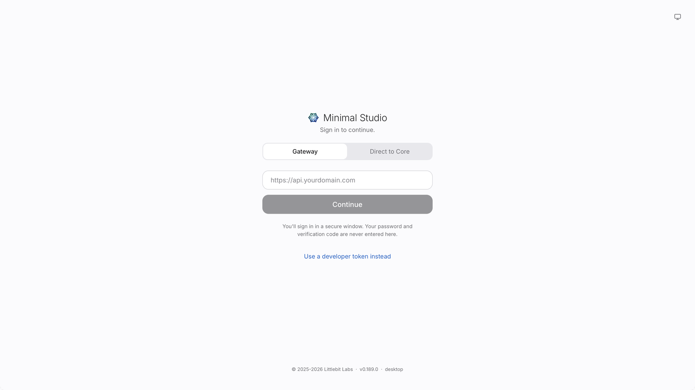
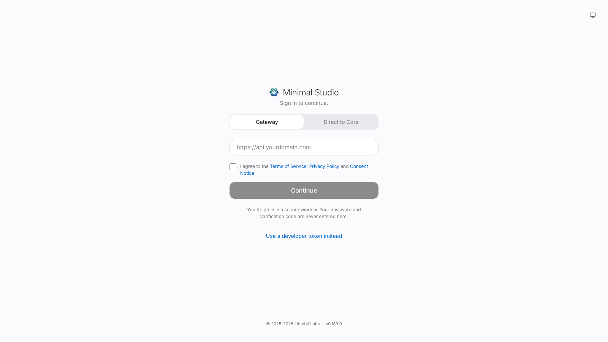
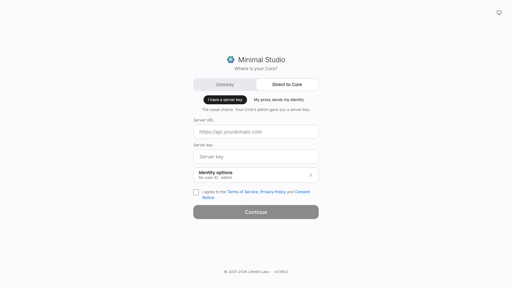
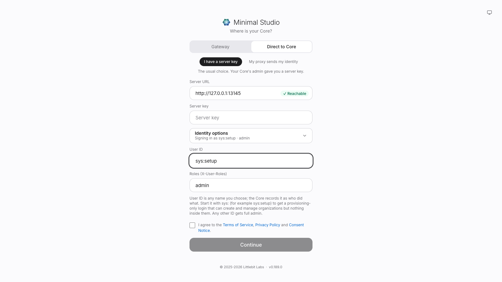
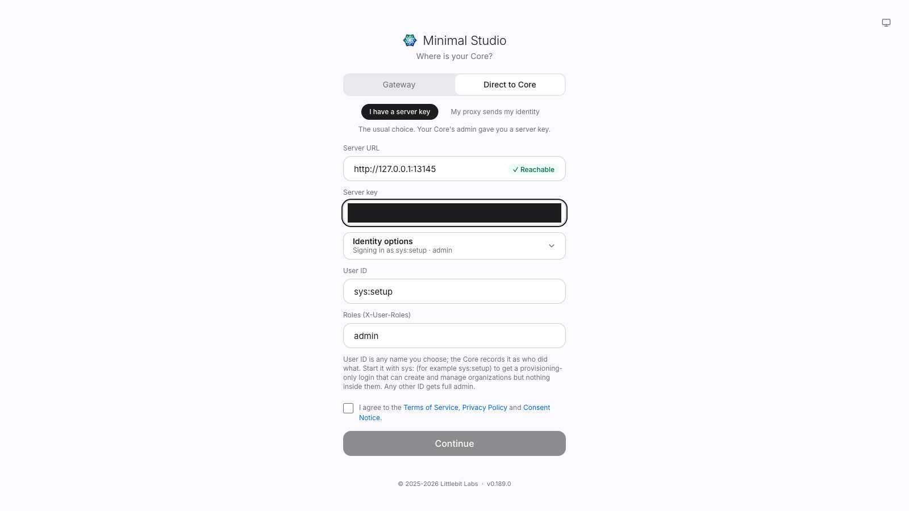
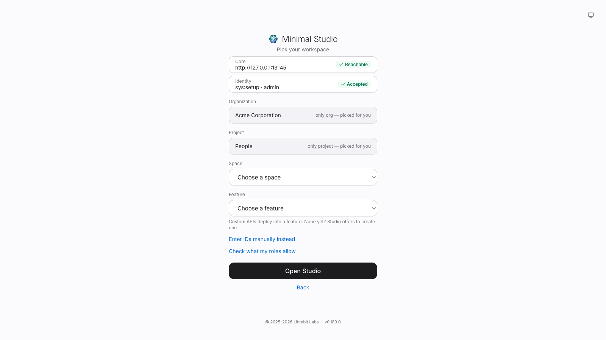
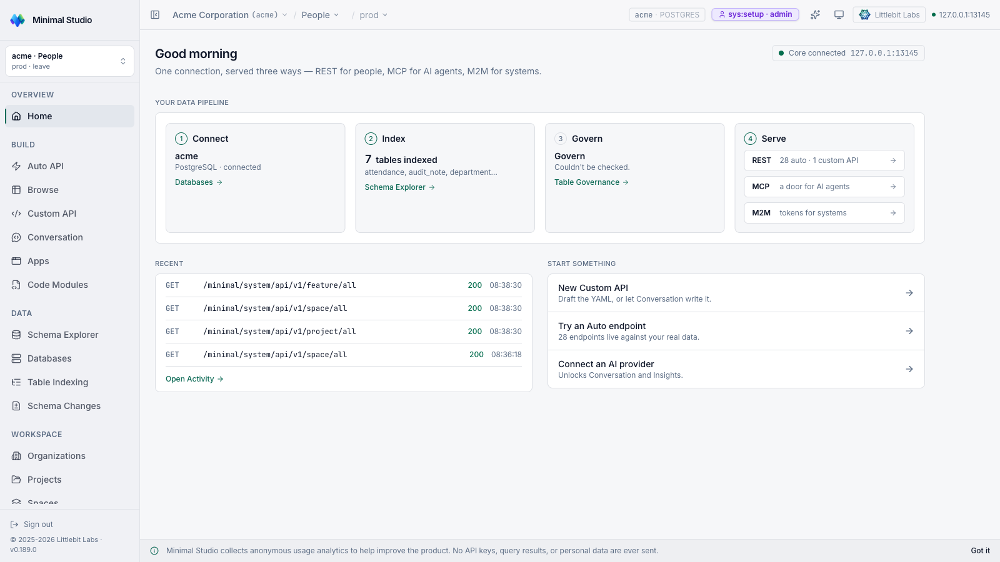

# 2. Install and launch

Studio runs as an application on a Mac and as a page in a browser. This chapter starts it either way. On a Mac it stops at the sign-in page, which Chapter 3 fills in; in a browser it takes the sign-in through to Home, because the browser's sign-in differs from the Mac's in two places.

> **Setup.** A Mac for the desktop application, or any current browser for the web page. For either, you need the address of a Core and its server key; Chapter 3 uses them.

## On a Mac

1. Download the build for your Mac from the page where your administrator publishes Studio. A build is a zip, named `minimal-studio-<version>-mac-arm64.zip` for Apple silicon and `minimal-studio-<version>-mac-amd64.zip` for Intel.

2. Open the zip. It holds one application, `minimal-studio.app`. Move it to **Applications**.

3. Open it. The window is called **Minimal Studio**. The first page is the sign-in page of Chapter 3, with its two tabs, **Gateway** and **Direct to Core**, and a line at the foot naming the version and the mode: "v0.189.0 · desktop".

   

4. Quit with **Minimal Studio**, **Quit Minimal Studio**. Open it again: it asks for nothing more once you have signed in, as Chapter 21 shows.

The book's shots are taken at one window size, 1600 by 900 points, in the light theme. Your window may be another size; the pages reflow.

## In a browser

1. Open the address of the web build that your administrator publishes. The sign-in page is the page of the Mac app without a title bar, and its foot reads only the version, "v0.189.0": a browser shows no mode after it.

   

2. Select **Direct to Core**. The form is the one of Chapter 3, with one addition above **Continue**: "I agree to the Terms of Service, Privacy Policy and Consent Notice." The same line sits under the **Gateway** form. **Continue** stays grey until the box is ticked, whatever else you have typed. The box is yours to tick; the book does not do it for you.

   

3. Fill the form as in Chapter 3, with one difference: the book's browser run signs in as the provisioner of Chapter 5, `sys:setup`, because it grants the schema roles of Chapter 15. The address is tagged **Reachable**; the user ID and its role sit under **Identity options**.

   

4. Paste the key. It shows as dots; here a solid bar covers them. **Continue** is still grey while the box is clear.

   

5. Tick the box. The message under the key reads "Key accepted. This id can provision. Stored securely.", and **Continue** turns dark. Select it: **Pick your workspace** opens. For `sys:setup` the Core lists what exists, so the organization and the project are picked for you when each is the only one, and the space and the feature are chosen from their lists; for `john.doe` the page asks for the organization's ID, as in Chapter 3.

   

6. **Home** is the page of the Mac app, with a bar at the foot: "Minimal Studio collects anonymous usage analytics to help improve the product. No API keys, query results, or personal data are ever sent.", with **Got it**. Its tiles read differently only because this sign-in is the provisioner's: **Govern** reads "Couldn't be checked." and a card offers "Connect an AI provider". The pages that follow are the same as on the Mac.

   

In a browser Studio's own note says the key is kept for the tab; Chapter 21 shows what the book's run found.

## What to check

| Check | Where |
|---|---|
| The version | The foot of the sign-in page, and the foot of the sidebar once you are in |
| The mode | The foot of the sign-in page on a Mac ends with "desktop"; the sidebar's foot and a browser's foot name the version only |
| Where the key goes | **Settings → Connection**, under **SERVER KEY** (Chapter 20) |

## Exercises

1. Open Studio and read the line at the foot of the sign-in page. Write down the version and, on a Mac, the mode.
2. Switch between the two tabs, **Gateway** and **Direct to Core**, and read the heading of each. Do not sign in.
3. Quit Studio and open it again. Check whether the page you meet is the sign-in page or your workspace, and say why.
