# 3. Connect to your Core

Studio shows nothing of its own. Every page reads from a Minimal Core, so the first thing Studio asks is where that Core is and how you prove you may use it. This chapter takes the usual way in, **Direct to Core** with a server key, against a Core that runs on your own machine. It ends on the first page of a Core that holds nothing yet.

> **Setup.** You need a running Core and its server key. The book's Core runs on the same Mac as Studio, at `http://127.0.0.1:13145`. A Core installed with its defaults listens on port 3045 instead: use your own address wherever the book writes this one. The person who runs the Core gives you the key; the book writes it `<your-server-key>`.

## Sign in

All the steps of this chapter happen in the Studio window.

1. Open Studio. The sign-in page reads "Sign in to continue." and offers two tabs, **Gateway** and **Direct to Core**. **Gateway** is selected first; Chapter 4 uses it. The line at the foot of the page names the version, v0.189.0, and the mode, desktop.

   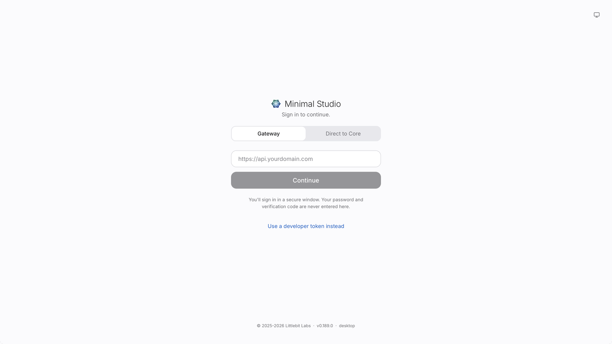

2. Select **Direct to Core**. The heading becomes "Where is your Core?". Two choices sit under the tabs: **I have a server key**, selected, which the page calls "The usual choice", and **My proxy sends my identity**, which Chapter 4 covers. Below them are **Server URL**, **Server key** and a closed panel, **Identity options**, whose summary reads "No user ID · admin".

   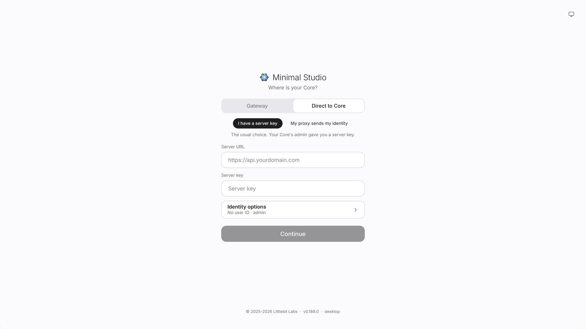

3. Select **Identity options**. It opens on two fields: **User ID**, empty, and **Roles (X-User-Roles)**, which holds `admin`. The note under them says that the Core records the user ID as who did what. An ID that starts with `sys:` gets a provisioning-only login, which can create and manage organizations but nothing inside them; any other ID gets full admin.

   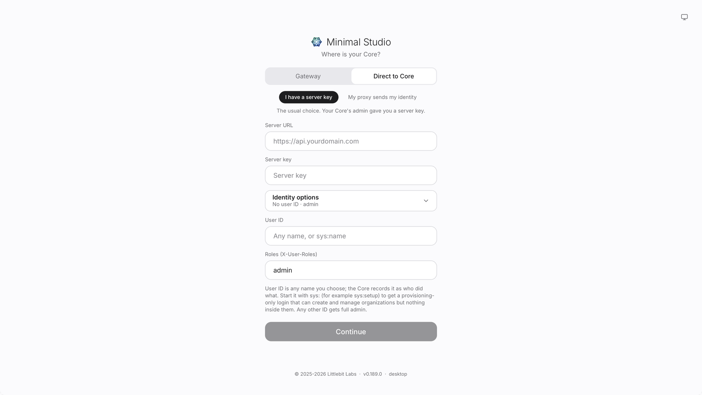

4. Type an address into **Server URL**. Studio tries it as you type. Give it a port where nothing listens, `http://127.0.0.1:13199`, and the field turns red, with the tag **Unreachable** and the message "Cannot reach the Core. Check the URL." Then type `john.doe` into **User ID**. The summary of **Identity options** now reads "Signing in as john.doe · admin".

   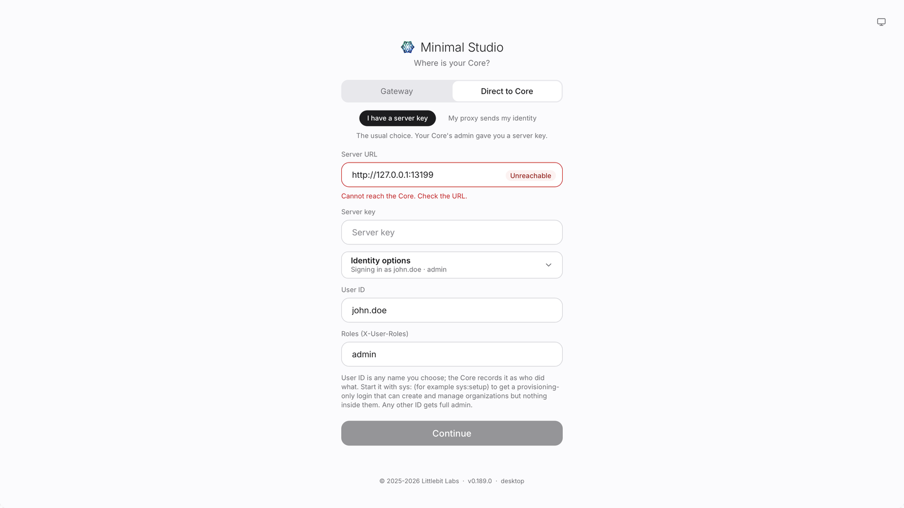

5. Correct the address to `http://127.0.0.1:13145`. The tag becomes **Reachable**. Type a wrong key into **Server key**, such as `wrong-key`. **Continue**, grey until now, turns dark.

   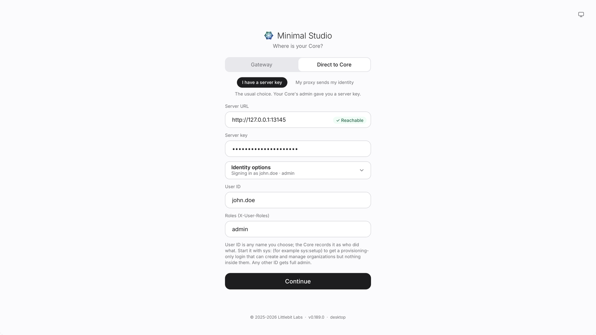

6. Select **Continue**. The key field turns red, with the message "The Core refused this key. Check it and try again." Nothing else changes: you are not signed in.

   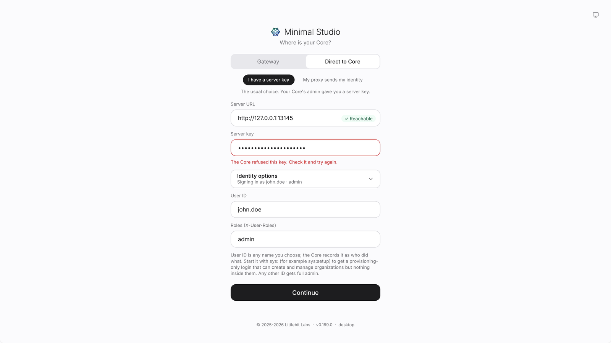

7. Replace the wrong key with `<your-server-key>`. Studio checks it with the Core when you leave the field, and the message under it reads "Key accepted. Provisioning needs an id that starts with sys:. Stored securely." The first sentence answers for the key. The second says that creating organizations needs a user ID that starts with `sys:`, which `john.doe` does not. Chapter 21 shows where the key is stored.

   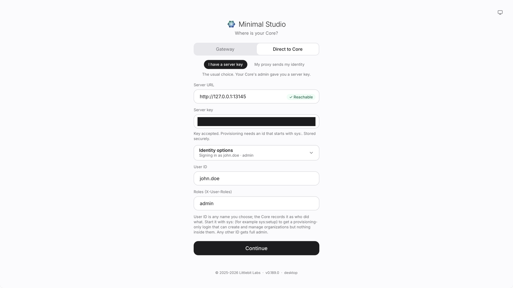

8. Select **Continue**. The page becomes **Pick your workspace**. Two rows confirm what Studio checked: **Core**, with the address and **Reachable**, and **Identity**, with "john.doe · admin" and **Accepted**. Below them, **Organization ID** asks for an ID; the note says "Your sign-in does not name an organization, so paste its ID once. Project, space and feature are picked from lists." The links **Enter IDs manually instead** and **Check what my roles allow**, which stays pale until an organization is found, sit above **Open Studio** and **Back**.

   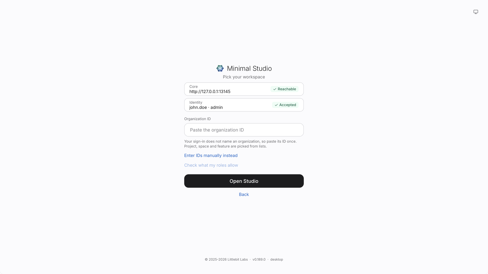

## An empty Core

A Core you have just installed has no organization, so there is no ID to paste. Studio lets you in all the same.

1. Leave **Organization ID** empty and select **Open Studio**. Studio opens on **Spaces**, which reads "No organization selected" and offers **Pick a workspace**. The picker at the top of the sidebar reads **No workspace**, "Pick a workspace". The top bar shows who you are, **john.doe · admin**, and the Core's address.

   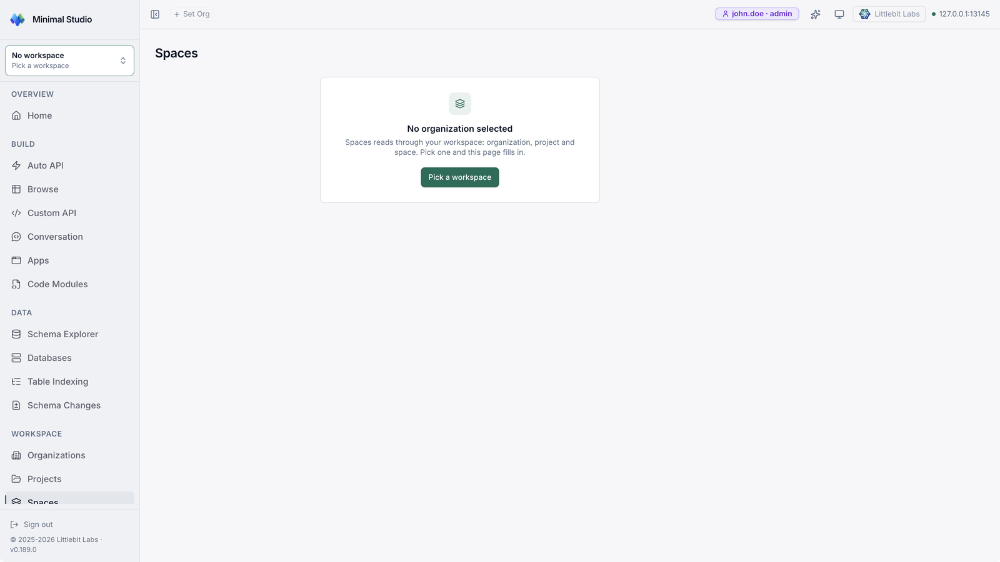

2. Select **Home**. On an empty Core the home page is a checklist. **SET UP YOUR WORKSPACE · 0 OF 5** lists **Create an organization**, with the button **New Org**, then **Project**, **Space**, **Feature** and **Database connection**. Below it, **HOW IT WORKS — FOUR STEPS, THIS PAGE** shows **Connect**, **Index**, **Govern** and **Serve**, and **WHAT YOU CAN BUILD ONCE CONNECTED** lists the pages the later chapters teach, and **Apps**, which this edition leaves out.

   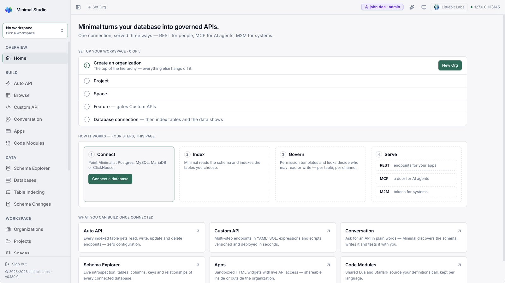

Chapter 4 explains why `john.doe` cannot create the organization, and Chapter 5 creates it with the `sys:` login of step 3.

## What Studio checked

Studio made two checks before it let you in, and stopped at the first that failed.

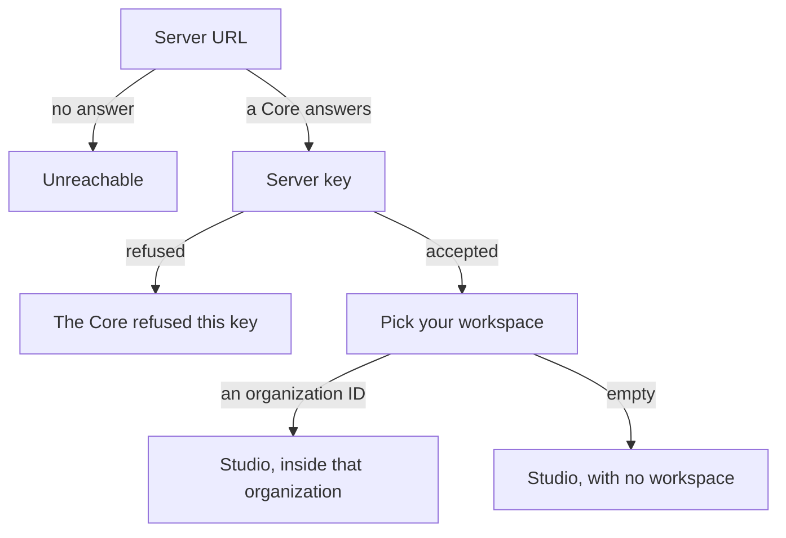

*The checks of Direct to Core, in the order Studio makes them.*

The address check asks only whether a Core answers there. The key check asks the Core whether the key is its own, so a wrong key stops you before the workspace. The user ID is not checked against any list: it is a name that the Core records beside what you do, and its `sys:` prefix decides what kind of login it is. The organization is the one thing a sign-in with a server key does not carry, which is why Studio asks for its ID. Volume 1, chapter 4 of the Book of Minimal describes the credentials a Core accepts.

## Exercises

1. On **Direct to Core**, type an address whose port has no Core behind it. Check that **Server URL** carries the tag **Unreachable** and that the message under it reads "Cannot reach the Core. Check the URL."
2. Open **Identity options** before you type a user ID and read its summary. Type `john.doe` and read it again. Check that it changes from "No user ID · admin" to "Signing in as john.doe · admin".
3. Sign in with your key and leave **Organization ID** empty. Check which page Studio opens on, and what the picker at the top of the sidebar reads.
