# 4. Identities

Every request Studio sends tells the Core who is asking, and the Core decides from that what the request may do. Chapter 3 signed in one way: a server key, with the user ID `john.doe`. That identity is a full administrator, and still it cannot do everything. This chapter shows what it cannot do, then the other identities Studio can sign in with, and what each one checks.

> **Setup.** Studio is signed in to the book's Core as `john.doe`, as Chapter 3 left it. The steps that sign out and look at the other ways in change nothing on the Core. The gateway steps use a second Core, the book's Pitstop gateway; afterwards the book signs back in to its own Core.

## What a full administrator cannot do

All the steps of this chapter happen in the Studio window.

1. On **Home**, select **New Org** in the row **Create an organization**. Studio opens **Organizations**, which reads "0 organizations". The button **+ New Org** at the top right is greyed out, and the note under the title says "Create, status, DDL roles and delete are server-key actions. Needs a user id that starts with sys: (a provisioner)." A box under the note reads "an org id is needed to get details": there is no organization yet to show. A second, smaller line under it, "The table is not catalogued, the engine is not supported, or a value could not be encrypted. Index the table first.", belongs to a table error and means nothing on this page.

   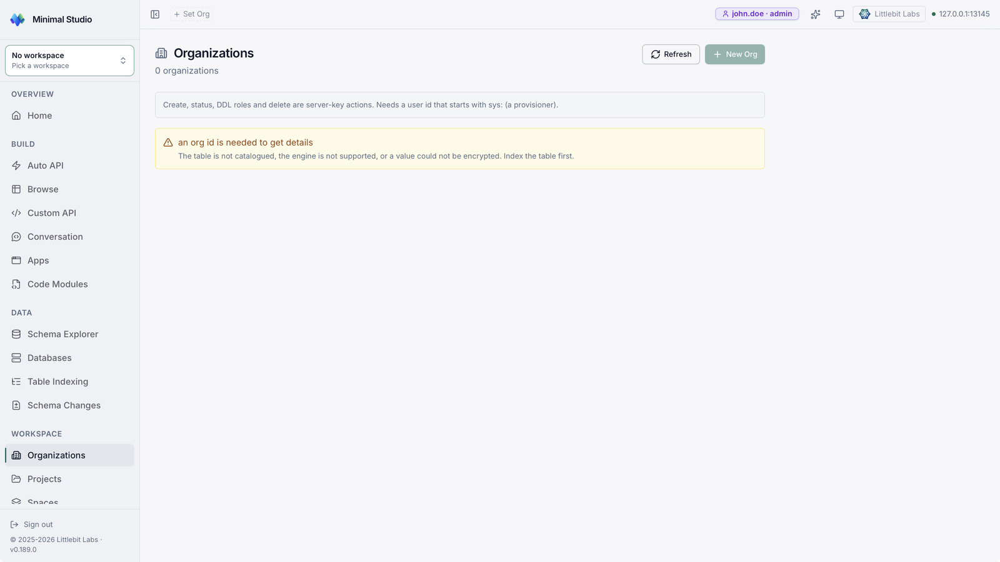

A server key and any user ID make a full administrator of everything inside an organization. Creating the organization itself is a separate power, provisioning, and it belongs to a user ID that starts with `sys:`, such as `sys:setup`. A provisioning login can create and manage organizations but nothing inside them. Chapter 5 signs in as `sys:setup` to create Acme's organization, then comes back as `john.doe` to work inside it.

## The other ways in

Select **Sign out** at the foot of the sidebar. The sign-in page of Chapter 3 returns, on **Gateway**.

### A developer token

1. Under the **Gateway** form, select **Use a developer token instead**. A field, **Developer token**, appears with the button **Use token**, and the note "Tokens skip two-step verification. Your roles come from the token." A token carries its own organization, project, space and roles, so a token is all this way in asks for. Chapter 17 shows where tokens come from.

   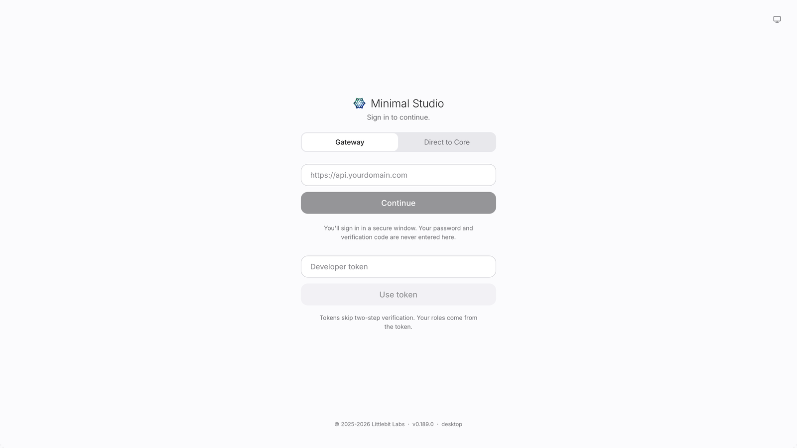

### A gateway

A gateway is a login service in front of the Core: you sign in on it with your own account, and it tells the Core who you are.

1. Type the gateway's address into the field under **Gateway**, such as `https://api.minimal.example`. Studio asks the gateway for the client ID that the desktop app signs in with. When the gateway publishes one, the page reads "Using the client this gateway publishes." with a link, **Advanced**, that shows the same **Client ID** field as the next step.

2. When the gateway publishes none, as here, a field **Client ID** appears with "This gateway publishes no desktop client ID. Paste the one registered for this app." Under it, "Sign-in opens your browser." and the three addresses to register for the app on the gateway's login service, as a Native application: `http://127.0.0.1:43517/auth/callback`, and the same on ports 43518 and 43519. **Continue** waits for the client ID.

   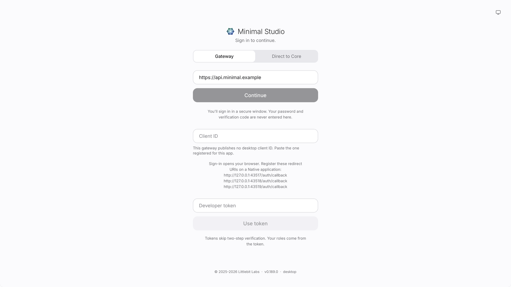

   With the book's own gateway the first case holds: the page reads "Using the client this gateway publishes." and **Continue** is live. Here a solid bar covers the address, because the book prints no real host.

   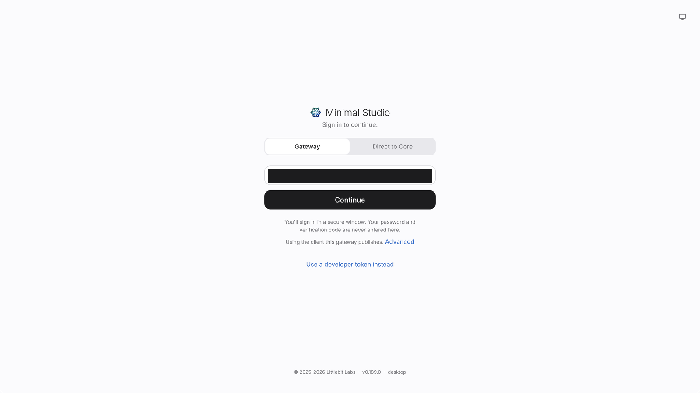

3. Select **Continue**. Studio shows "Waiting for your browser…" with a **Cancel** link, and your default browser opens on the gateway's login page.

   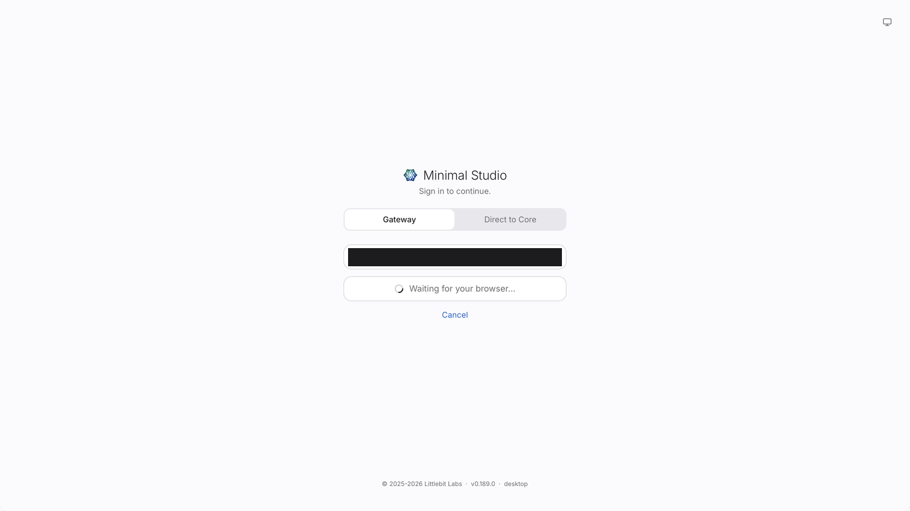

4. Sign in on that page. It is the identity provider's page, not Studio's: the line under **Continue** says that your password and verification code are never entered in Studio, and the book shows none of the login. On a new install the first login of the initial administrator first asks for a new password before it goes on: at least eight characters, with a number, a lowercase letter, an uppercase letter and a symbol, typed twice.

5. When the login completes, the browser hands control back and Studio opens on **Home** as the gateway's user. The greeting names the user, "Good morning, Pitstop Admin", and the identity chip names the roles, "admin, schema". The workspace is the gateway's own: organization Acme Inc, project People, space `dev`. It is a different Core from the book's local one, so its **Home** reads "11 tables indexed" and "44 auto · 0 custom APIs".

   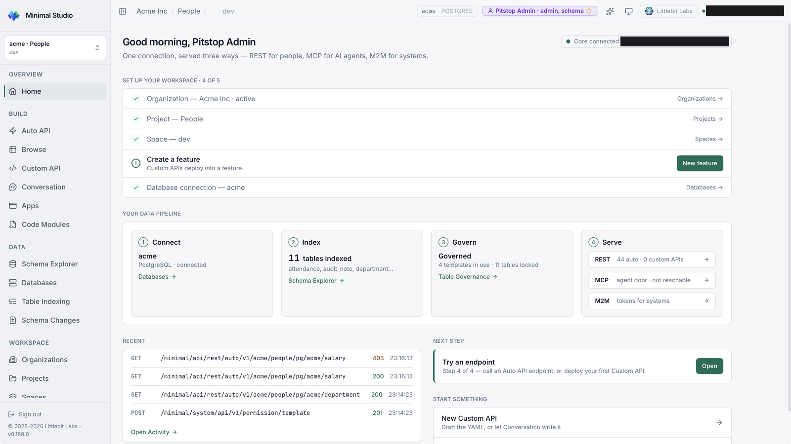

6. **Settings → Connection** says how you came in. **SIGNED IN AS** lists the name, the user ID (covered here), the roles `admin, schema`, **Sign-in**, "Single sign-on", and **Second factor**: "Signed in without a second factor (amr: pwd). Turn on TOTP in your identity provider." (The next section turns it on.) Then **Token expires** gives the date and time the token ends. Under **THE GATEWAY** the page reads **Connected**, shows the gateway's address, and says "You sign in through a gateway, so there is no server key. Your sign-in and MCP token are kept in the OS keychain."

   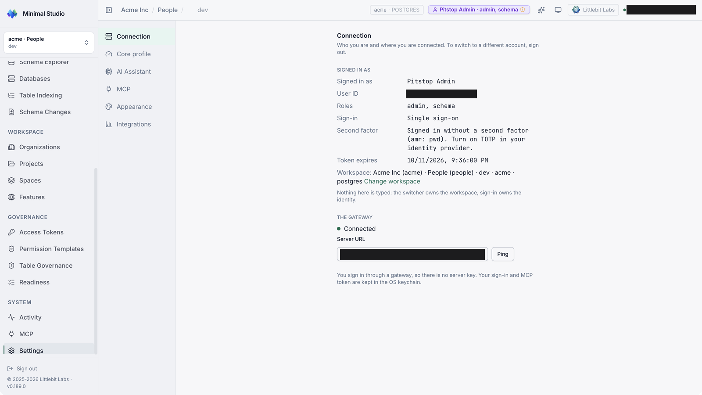

### When the admin screens are locked

A gateway sign-in with a password alone reaches Home and the pages that read, but not the admin screens. The admin screens are Organizations, Projects, Spaces, Features, Access Tokens, Permission Templates, Table Governance, Readiness, Databases, Table Indexing, Schema Changes and Provisioning. Select **Projects**, the one the book tried, and the page reads "Admin screens need a second factor": "You signed in as an admin with a password only (amr: pwd). Admin screens are locked until your sign-in records an authenticator code (TOTP) for the sign-in." Two steps follow: "Make sure TOTP is added to your account and two-step verification is required for the organization." and "Sign out here, then sign in again and enter your code when asked.", with a button, **Sign out and sign in again**.

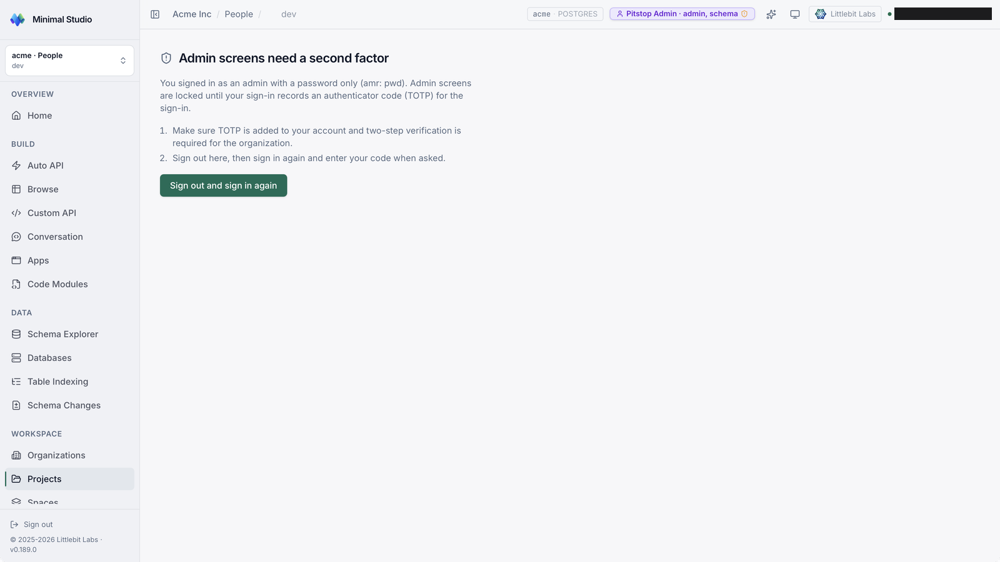

The book's own gateway was installed without a second factor, so its first session met this page. If your installation skipped it, add one now.

1. Add an authenticator to your account in the identity provider, not in Studio. Open the provider's console in a browser; on the book's gateway it is on the `auth` address that pairs with the gateway's `api` address, at `/ui/console`: for a gateway at `https://api.minimal.example`, that is `https://auth.minimal.example/ui/console`. Sign in as the same administrator.

2. Open your own account and find its multi-factor authentication. Add an **Authenticator app (OTP)**. The provider shows a QR code and a secret key: scan the code with an authenticator app, or type the key into one, and then type the six digits the app shows to confirm. The QR code and the key are secrets, and the book shows neither.

3. Back in Studio, select **Sign out and sign in again**. In the browser, give your password and then the code.

4. Studio returns on **Home** as before, and the admin screens open. **Settings → Connection** now reads, under **Second factor**, "Signed in with a second factor (amr: pwd, otp, mfa)."

   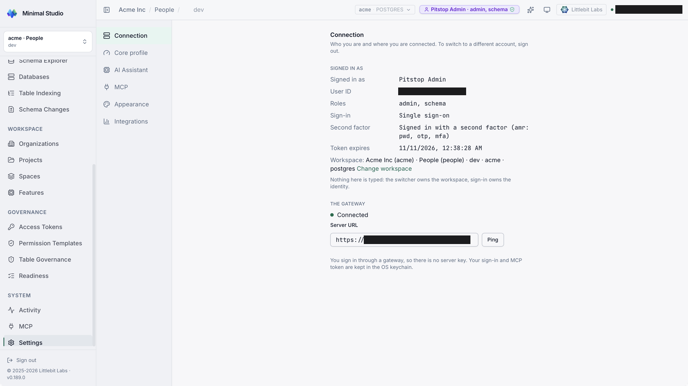

The provider's own pages are not shown: they are the provider's, they carry the gateway's host, and their menus differ between versions. If the code is not asked for at sign-in, look in the provider's login settings: one-time passwords must be allowed as a second factor. The provider also has a setting that makes every login ask for one; Zitadel calls it force MFA. Add your own authenticator first, so that you cannot lock yourself out.

A developer token is a different way in: the note under its field says "Tokens skip two-step verification" (earlier in this chapter). The book did not sign in with one here.

### A proxy that knows who you are

Some Cores sit behind a proxy that has already signed you in and passes your identity on. For those, Studio needs no key.

1. Select **Direct to Core**, then **My proxy sends my identity**. The **Server URL** is shared with the **Gateway** tab and still holds the gateway's address from the step before: type the Core's address, `http://127.0.0.1:13145`, over it. The note reads "For a Core behind a proxy or login layer that already knows who you are. No key needed." The form keeps **Server URL** and **Identity options**, and drops **Server key**. The summary of **Identity options** reads "No user ID · users": this way in starts from the role `users`, not `admin`.

   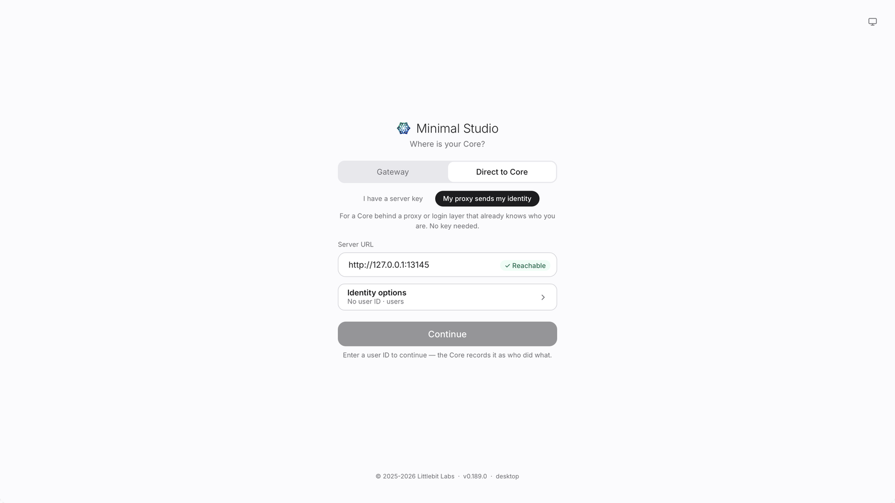

2. Select **Identity options**. Its two fields name the headers they fill, **User ID (X-User-Id)** and **Roles (X-User-Roles)**, and the note says "No server key. Every route checks your roles against the organization's and the project's role lists." Type `jane.doe` as the user ID; **Continue** turns dark.

3. Select **Continue**. **Pick your workspace** opens, and its **Identity** row reads "jane.doe · users" with **Not checked** where Chapter 3 showed **Accepted**. Without a key there is nothing Studio can check: the identity is whatever the proxy sends.

   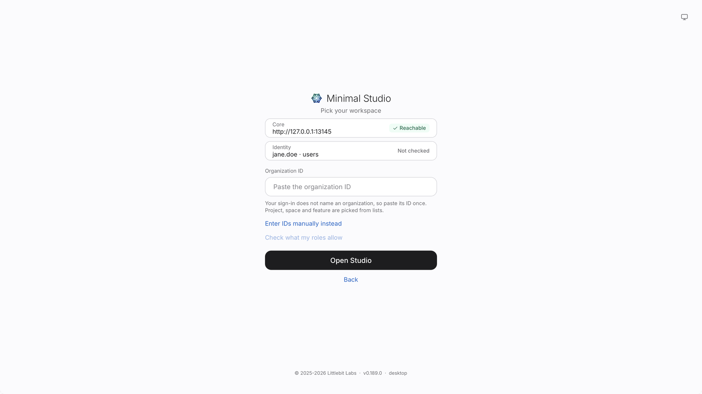

Select **Back** to return to the form; what you typed is kept. Type a gateway's address in **Server URL** instead of a Core's, and the field turns red with "A gateway answered. Sign in through a gateway instead": Studio recognizes the gateway and points you to the right tab. The two tabs share this field, so an address typed on one appears on the other.

## Four kinds of identity

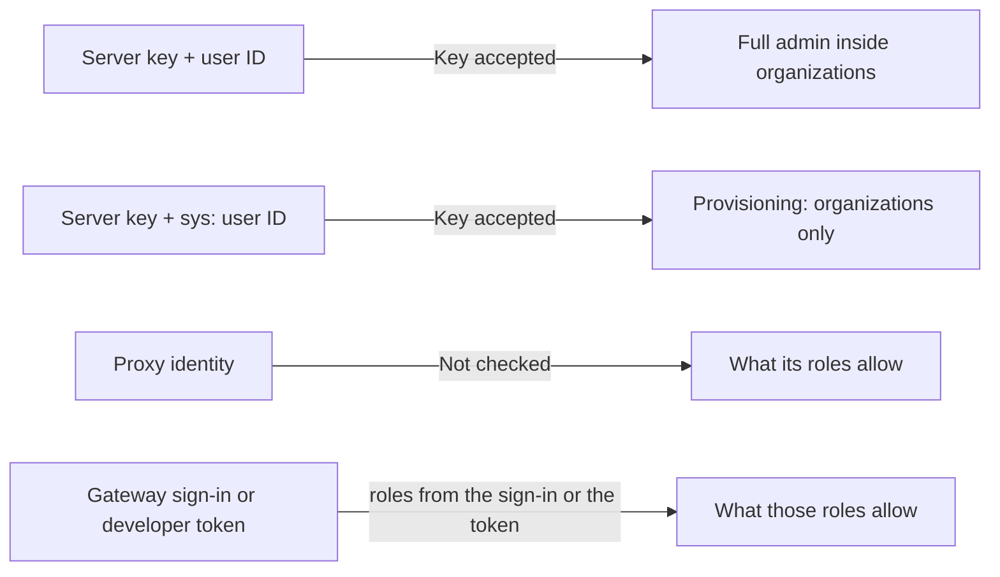

*The identities Studio signs in with, and what each one is allowed.*

A server key answers for the whole Core, so Studio can check it, and the user ID beside it only names who did what, or, with `sys:`, asks for provisioning instead. A proxy identity carries roles that nobody checks at sign-in; every route then checks them against the organization's and the project's role lists. A gateway sign-in and a developer token bring their roles with them. Volume 1, chapter 4 of the Book of Minimal sets out the credentials and the role lists in full.

## Exercises

1. Signed in as `john.doe`, open **Organizations**. Check that **+ New Org** is unavailable and read the note that says who may create an organization.
2. On the sign-in page, open **Use a developer token instead** and check the note under **Use token**. Then select **Direct to Core**, **My proxy sends my identity**, and check that **Server key** is gone and that the summary of **Identity options** names the role `users`.
3. Sign in through a gateway you can reach. Open **Settings → Connection** and read the line under **Second factor**, the expiry of the token, and the note about the server key. If an admin screen is locked, follow "When the admin screens are locked" and read the line again.
