# 5. The workspace

Every page of Studio works inside a workspace: an organization, a project in it, a space in the project, and, for Custom APIs, a feature. A Core you have just installed has none of them, which is why Chapter 3 ended on empty pages. This chapter builds Acme's workspace in the order the Core requires: the organization with the provisioning login of Chapter 4, then the project, its three spaces and one feature as John Doe.

> **Setup.** You need the book's Core and its key, as in Chapter 3, and the Acme database of Appendix A, which the project registers. The book's database runs on the same Mac as the Core, on port 5434, with the login `acme_app`.

## The organization

All the steps of this chapter happen in the Studio window.

1. Select **Sign out**, then sign in as in Chapter 3 with one change: in **Identity options**, type `sys:setup` as the **User ID**. When the key is pasted, the message under it reads "Key accepted. This id can provision. Stored securely."

   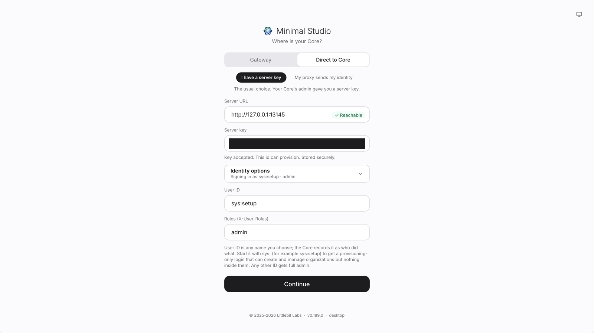

2. Select **Continue**. **Pick your workspace** shows a card, **FRESH SERVER · PROVISIONER**, headed "No organization yet". It says that this Core has no organization your token can read, and that you hold the provisioning key, so you create the first one. It offers **Create the organization** and **Enter IDs manually**.

   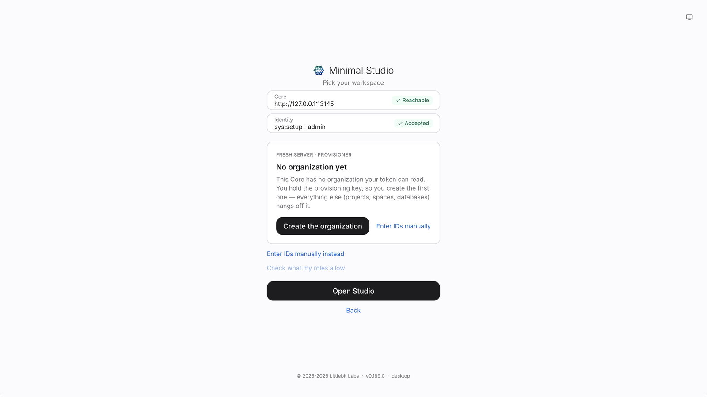

3. Select **Create the organization**. Studio opens **Organizations**, now with **+ New Org** available. The note under the title reads "Editing: A sys: user is refused on this route: sign in as an ordinary user to edit." The provisioner creates an organization; an ordinary user changes it.

   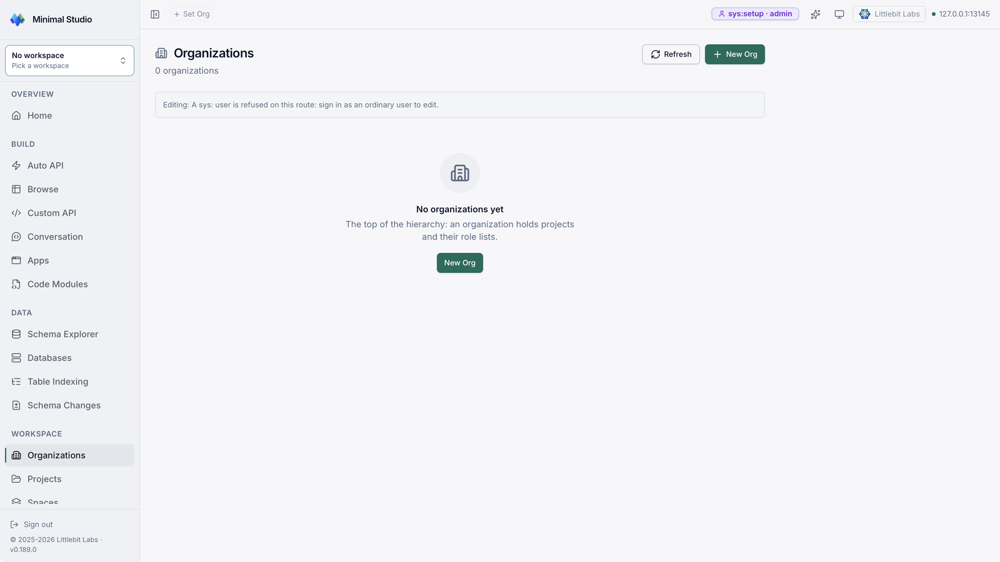

4. Select **New Org**. The dialog **New organization** asks for eight fields, all required, and four role lists. Its first line says "A new org starts active. Role columns you leave empty start as your own roles." **Abbreviation** carries the warning "Cannot be changed later." The red list at the foot names what is still missing, and **Create** stays grey until it is empty.

   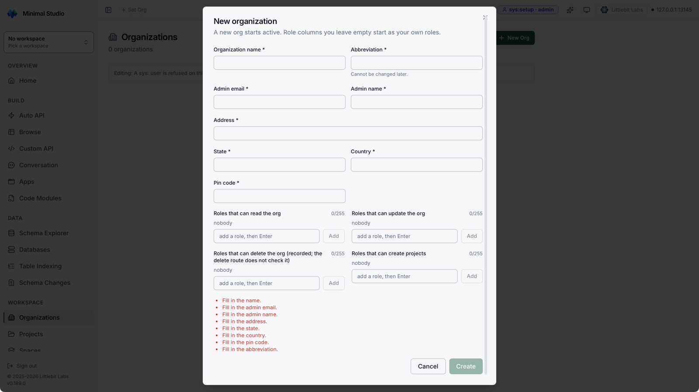

5. Fill it in with Acme's details, and leave the role lists empty:

   | Field | Value |
   |---|---|
   | **Organization name** | `Acme Corporation` |
   | **Abbreviation** | `acme` |
   | **Admin email** | `john.doe@acme.example` |
   | **Admin name** | `John Doe` |
   | **Address** | `1 Foundry Road, Suite 400` |
   | **State** | `CA` |
   | **Country** | `USA` |
   | **Pin code** | `94103` |

   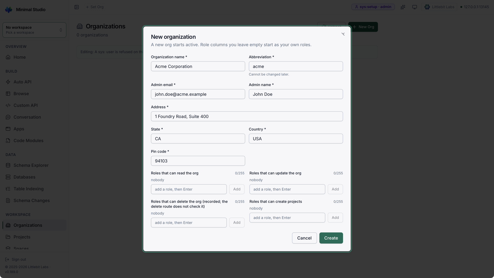

6. Select **Create**. A message reads "Organization created", and the list holds one card: **Acme Corporation**, `acme`, **active**, the administrator's name and email, the organization's address, the organization's ID with a copy button, and the times it was created and last updated, with `sys:setup` as the one who updated it. Under it are the role lists: `admin` may read the organization, update it, delete it and create projects, because `admin` was the role you signed in with. **Create a database (set by a provisioner)** and **Drop a database (set by a provisioner)** read "nobody".

   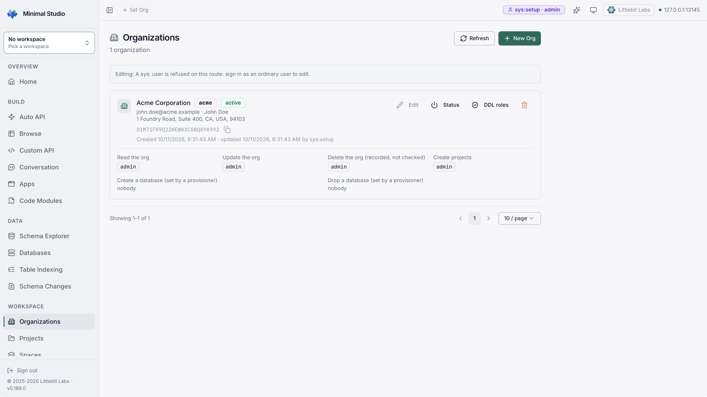

The two database lists are the provisioner's to set. **DDL roles** on the card opens **Database roles of Acme Corporation**, where both start as nobody; the dialog adds that dropping a database also needs two confirmation tokens minted apart. Acme leaves both empty.

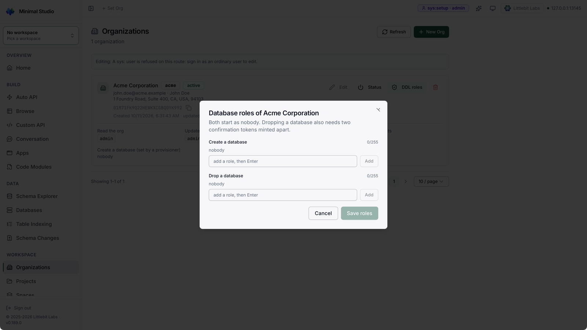

Copy the organization's ID with the button beside it: the next sign-in asks for it.

## The project

1. Sign out and sign in as `john.doe`, as in Chapter 3. On **Pick your workspace**, paste the ID into **Organization ID**. The card that answers, **ORG FOUND · NO READABLE PROJECT**, reads "No project your roles can read": the organization **Acme Corporation** exists, but your roles, `admin`, are in no project's read roles yet. It offers **Create a project**, a link to copy your roles for whoever runs the organization, and **Enter IDs manually**.

   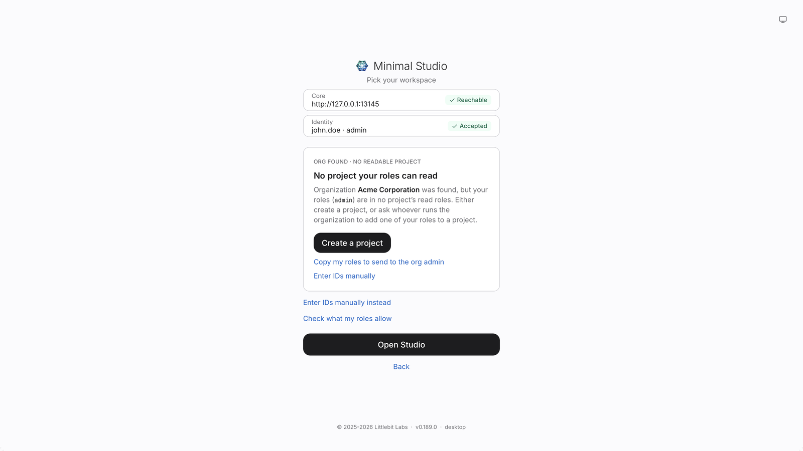

2. Select **Create a project**. Studio opens **Projects** in **Acme Corporation**, which the breadcrumb at the top now names. The list is empty: "A project holds its databases, spaces and role lists."

   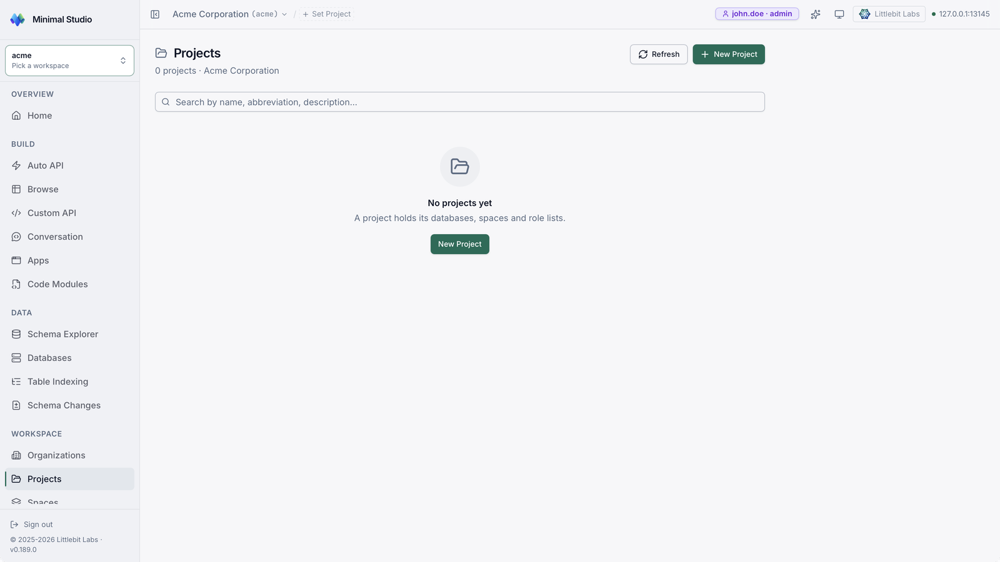

3. Select **New Project**. The dialog asks for **Project name**, **Abbreviation**, which cannot be changed later, and **Description**, then three role lists, each with a note on what it allows. **Read the project** is "Never empty. Also lets a role list the project's history." **Change the project** "Also reads real passwords, lists every space and feature, and changes the connections. Empty freezes the project." **Delete the project**: "Empty means nobody can delete the project." Left empty, each starts as your own roles. Below them, **DATABASE CONNECTIONS (1)** holds the first connection, **Database 1**.

   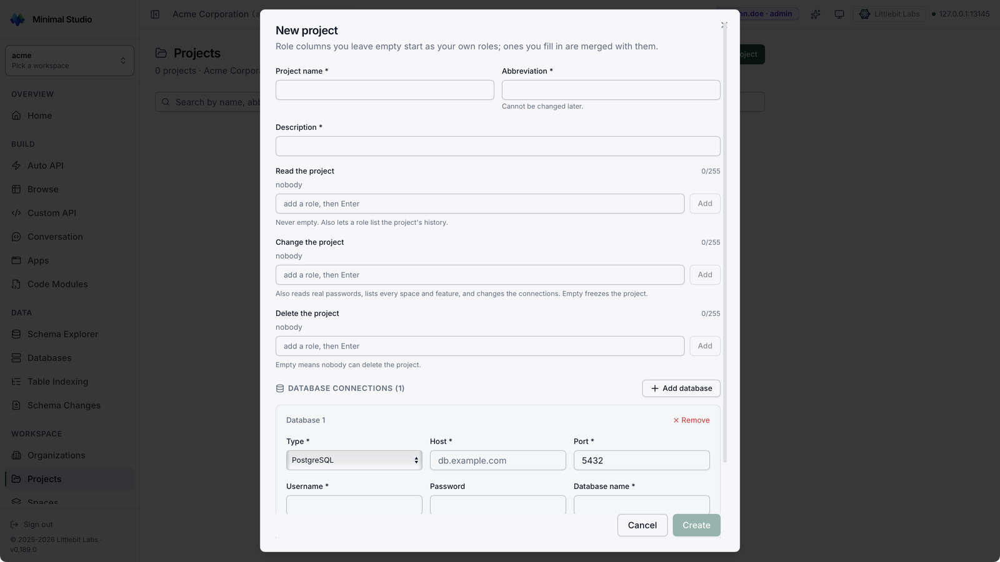

4. Type `People`, `people` and the description `Acme's HR database: people, leave and pay`, and leave the role lists empty. In **Database 1**, keep **Type** at **PostgreSQL** and type the connection: host `host.docker.internal`, port `5434`, username `acme_app`, database name `acme`. The book's Core runs in a container on the same Mac as the database, so it reaches the Mac's port 5434 by that name; a Core on a server uses the database's own address.

   Studio tries the connection as you type. Before the password is in, the Core answers with the database's own refusal: "The Core could not open it (HTTP 424)", followed by the database's message, which includes "password authentication failed for user "acme_app"".

   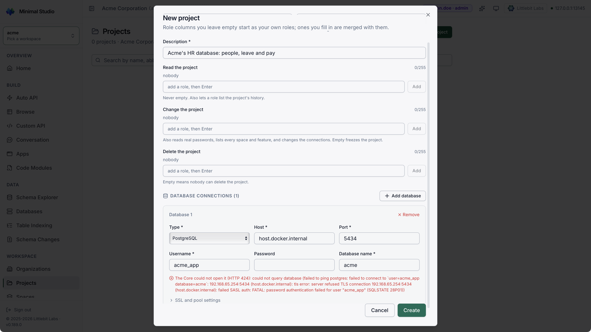

5. Type the password of `acme_app`. The line under the connection changes to "The Core can open this connection." **SSL and pool settings** opens on the defaults: **SSL mode** driver default, a connect timeout of 30 seconds, an idle timeout of 600, a query timeout of 60, at most 20 open and 5 idle connections.

   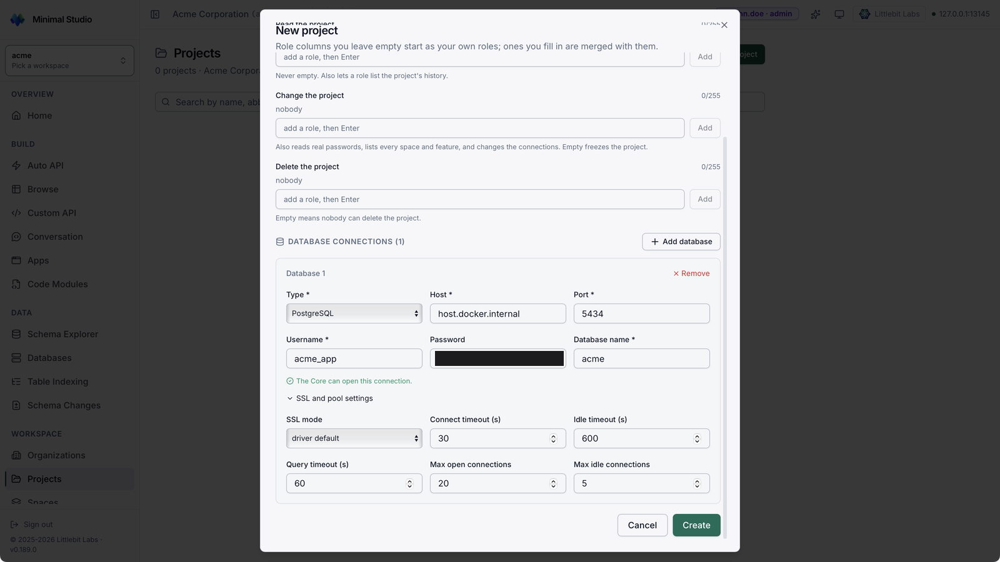

6. Select **Create**. "Project created" appears, and the list holds **People**, `people`, with its connection, **PostgreSQL · acme**, and the actions **Edit**, **Add database**, **Edit connections** and **History**, then a greyed **Schema roles** and a delete icon (Chapter 15).

   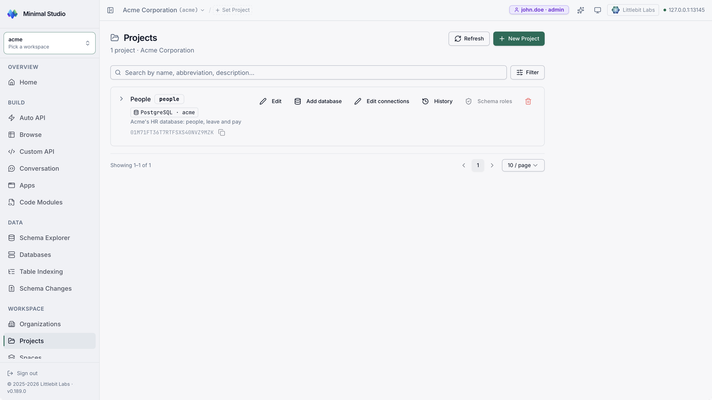

## The spaces

A space is where a project's Custom API definitions and modules are written and run. The project brings none of its own.

1. Select **Spaces** in the sidebar. The page reads "No project selected" and offers **Pick a workspace**. Select it. The workspace picker opens with four sections: **ORGANIZATION**, Acme Corporation, "set at sign-in"; **PROJECT**, with People ticked; **SPACE** and **FEATURE**, each "None to pick from." Select **Apply**.

   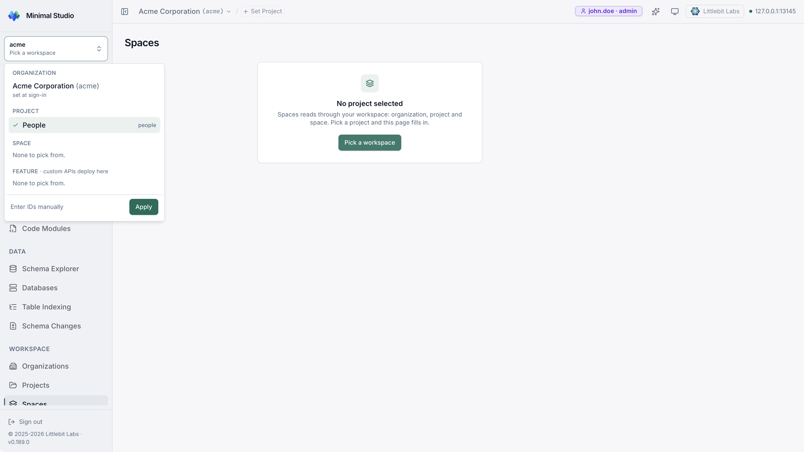

2. **Spaces** now reads "0 spaces · People". A note warns that a space cannot be deleted on its own: it goes only when its project or organization is deleted, and its owner is whoever created it.

   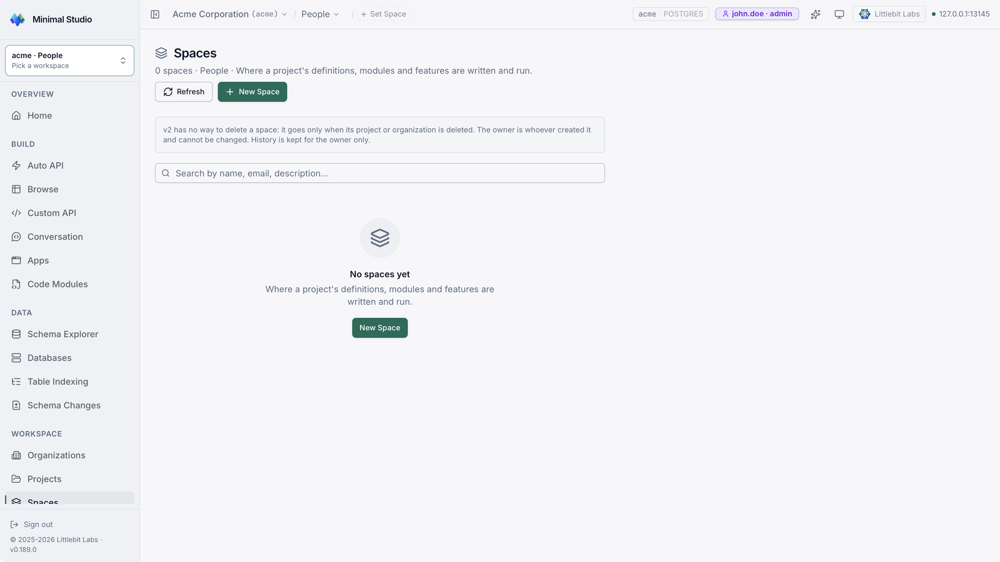

3. Select **New Space**. The dialog says "You become the owner of the new space; the owner cannot be changed later." and asks for **Name**, unique in the project, **Contact email** and **Description**.

   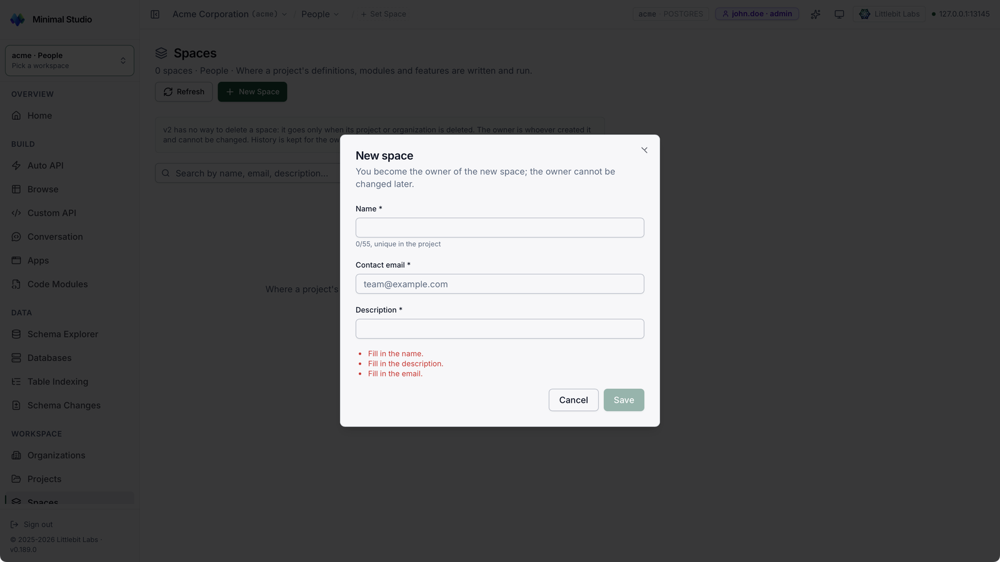

4. Type `dev`, `john.doe@acme.example` and `Where a definition is written and first run`, and select **Save**. "Space created" appears.

   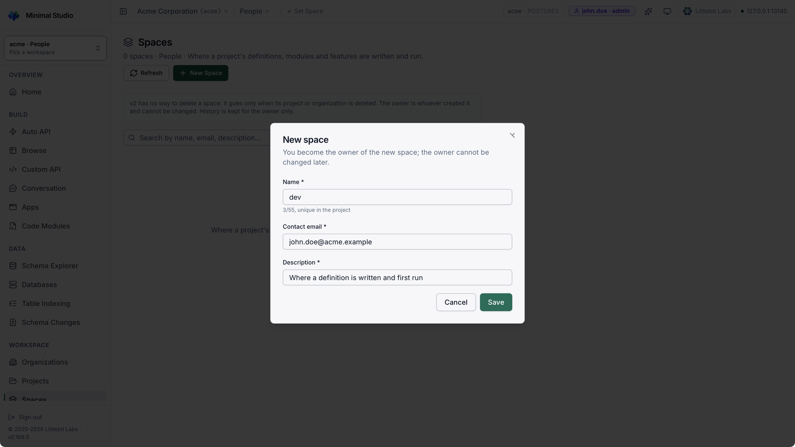

5. Do the same twice more: `staging`, "Where a definition is proven before it reaches prod", and `prod`, "Where Acme's callers reach a definition". The list reads "3 spaces", each with its owner, `john.doe`, and an ID.

   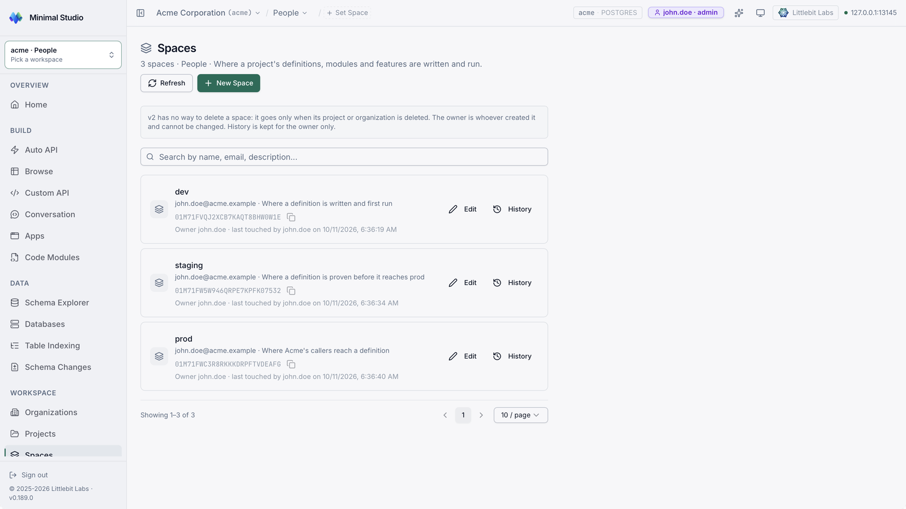

## Pick a space and a feature

1. Select **Home**. The checklist reads **SET UP YOUR WORKSPACE · 3 OF 5**. The organization, the project and the database connection are ticked, and the row **Pick a space** says "3 already exist — none is picked." The **Index** step below reads "8 tables indexed": the Core read Acme's tables when the project registered its database, and Chapter 6 opens them.

   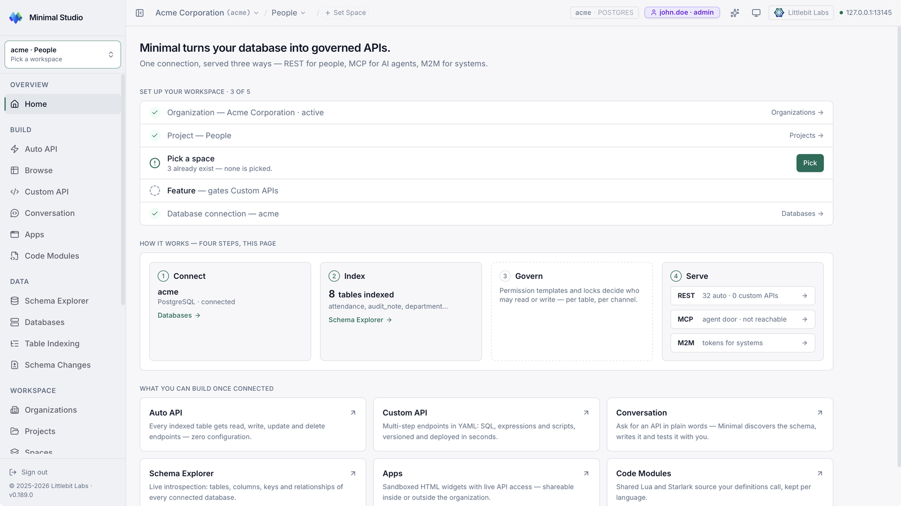

2. Select **Pick** in that row. The workspace picker opens with the three spaces. Select `dev`, then **Apply**.

   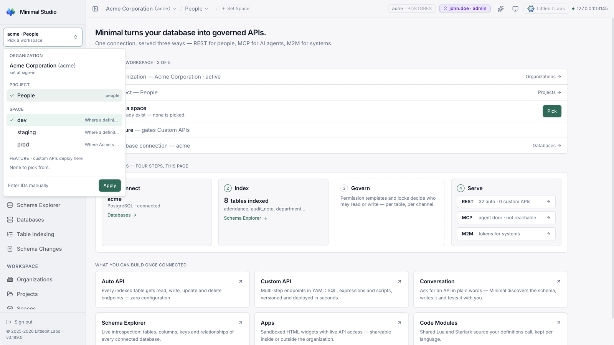

3. **Home** now greets you, shows "Core connected" with the address, and reads **4 OF 5**. The row still open is **Create a feature**: "Custom APIs deploy into a feature."

   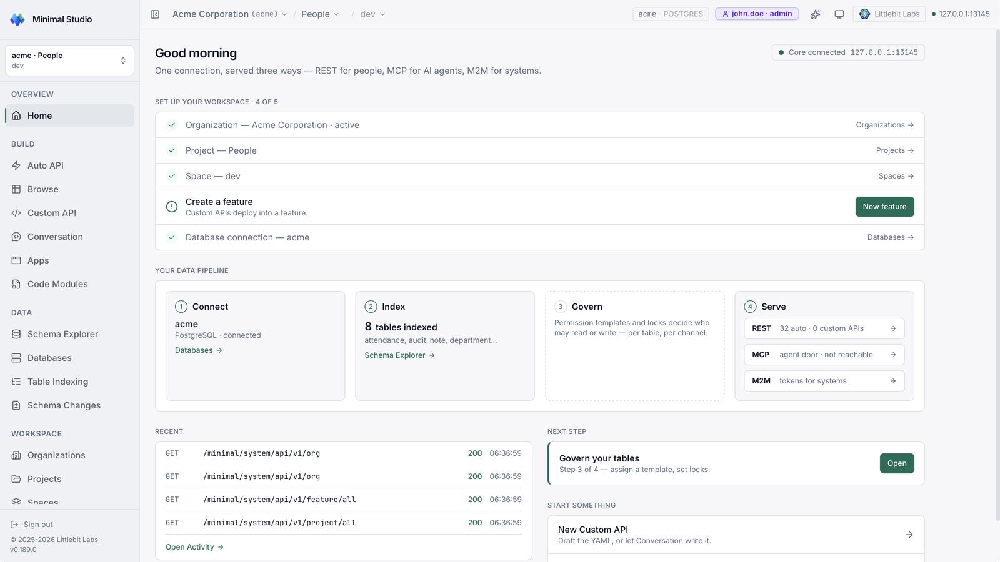

4. Select **New feature**. Studio opens **Features**, "Functional units that scope API capabilities.", with none yet; like a space, a feature cannot be deleted on its own.

   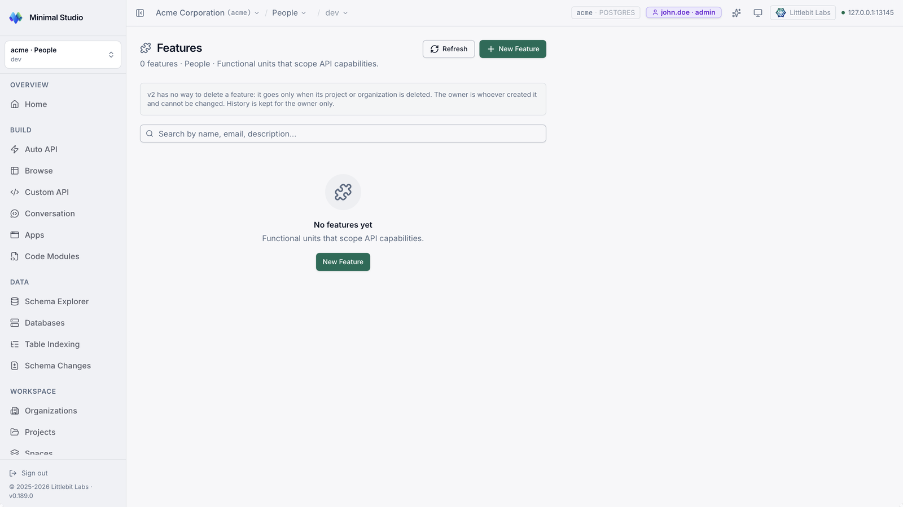

5. Select **New Feature**, fill in `leave`, `john.doe@acme.example` and `Leave requests and approvals`, and select **Save**. "Feature created" appears.

   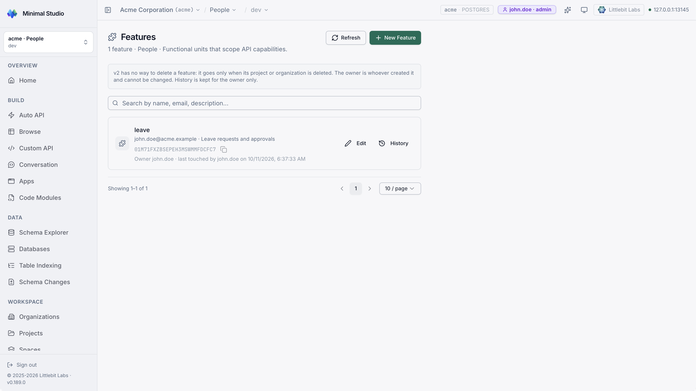

6. On **Home**, the row now reads "Pick a feature — One already exists — it just isn't picked." Select **Pick**: the picker has ticked `leave` already. Select **Apply**. The checklist is gone, and the picker at the top of the sidebar reads **acme · People**, **dev · leave**.

   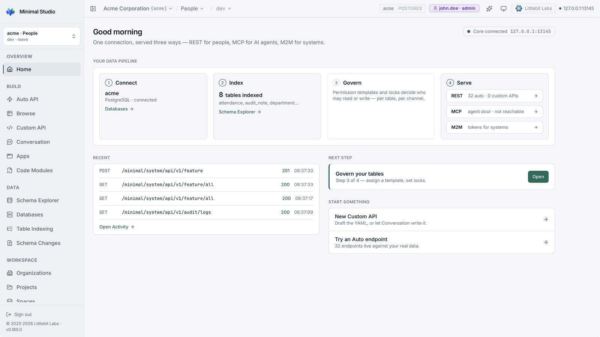

## The ladder

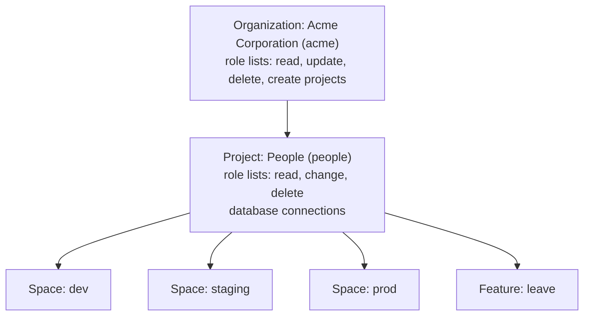

*Acme's workspace, from the organization down to the spaces and the feature.*

Each level is addressed by an ID that the Core generates, a string of 26 characters such as the one you copied. The organization and the project also carry an abbreviation, `acme` and `people`, which the Core uses in the paths of their APIs, and which is why it cannot change. Role lists sit on the organization and on the project; a space and a feature have an owner instead, the person who created them. Volume 1, chapter 3 of the Book of Minimal sets out the same ladder from the wire.

## Exercises

1. Open the workspace picker at the top of the sidebar. Check that its sections read **ORGANIZATION**, **PROJECT**, **SPACE** and **FEATURE**, and which space and feature are ticked.
2. Open **Spaces** and check that it counts three spaces, each owned by `john.doe`. Read the note on what deletes a space.
3. Open **Projects** and check that the **People** card shows its connection as **PostgreSQL · acme**. On **Home**, check what the **Index** step counts.
