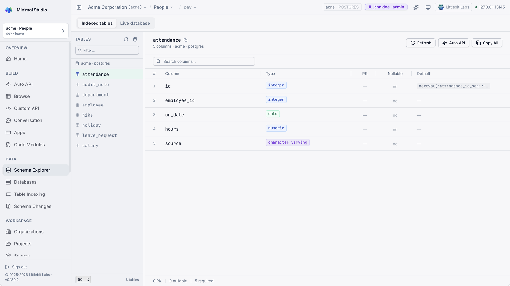
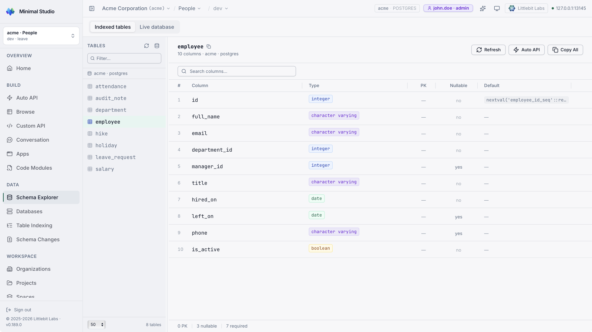
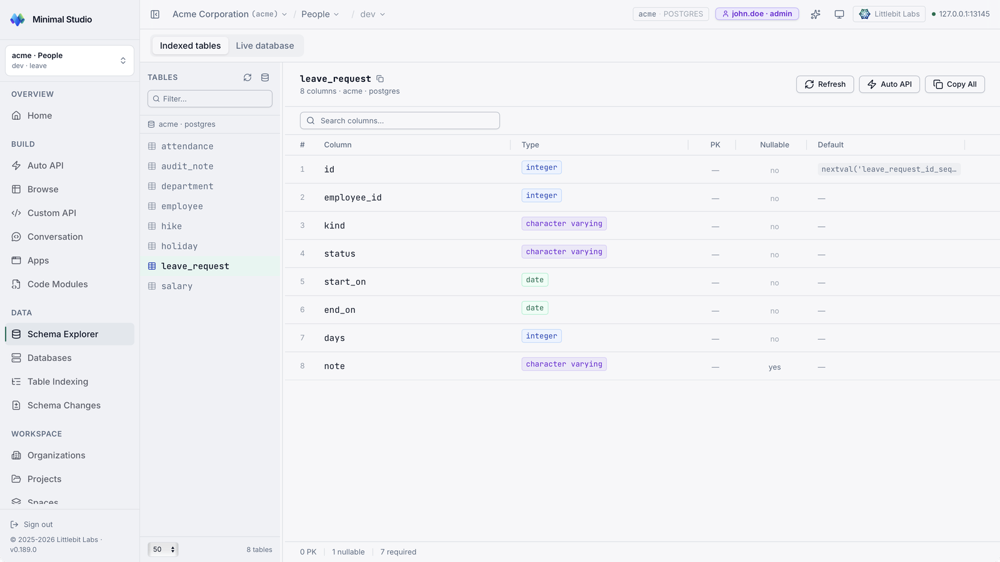
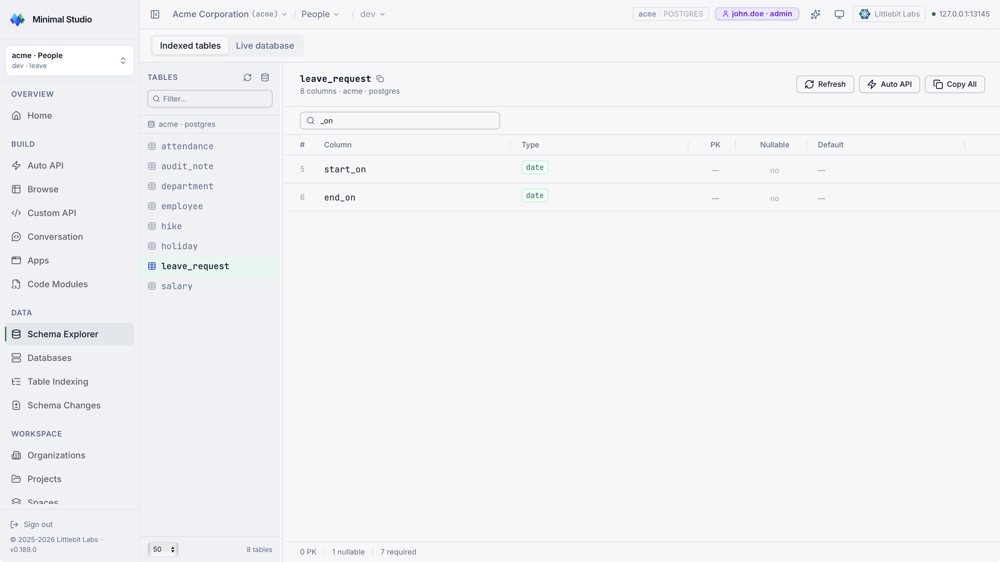
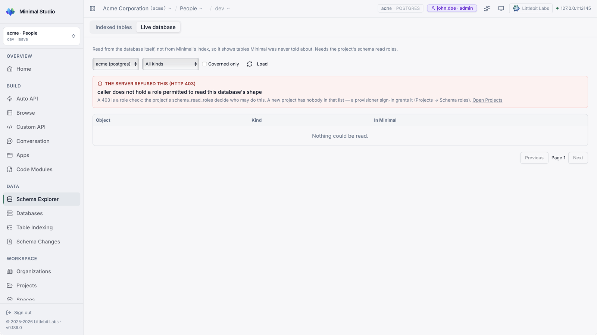
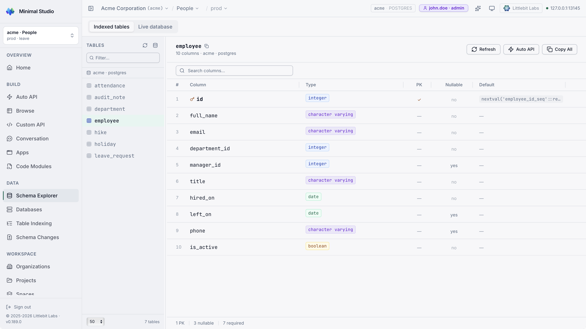
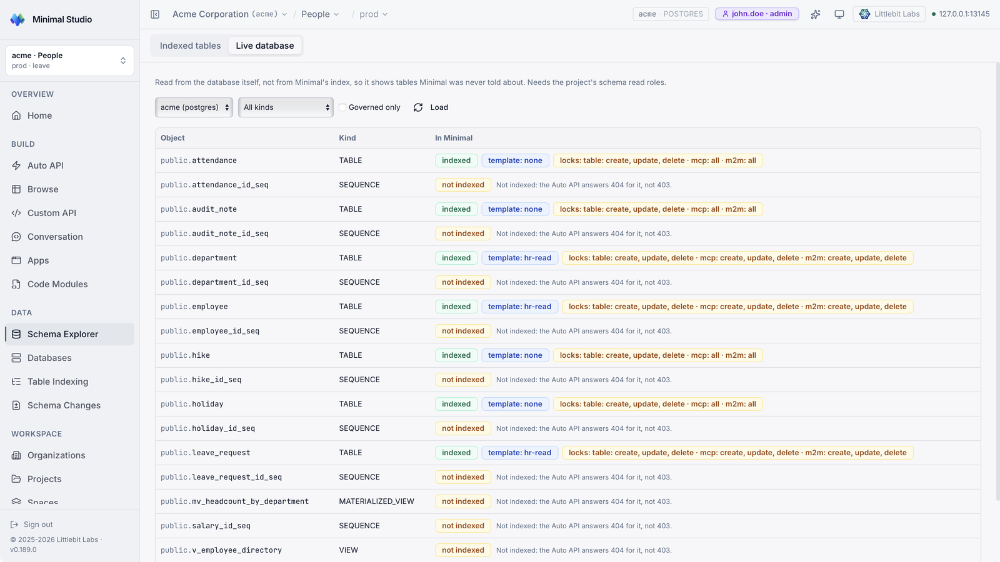
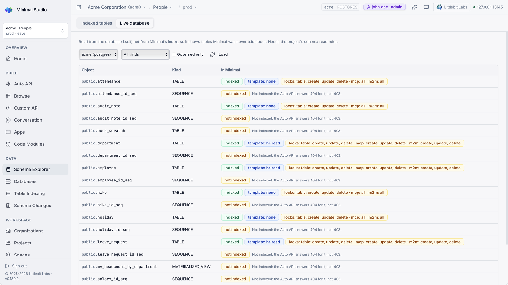
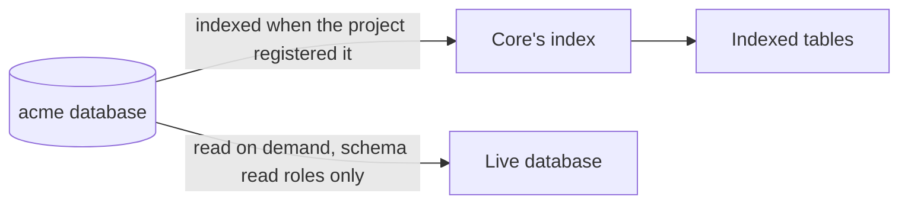

# 6. The Schema Explorer

Before you build on a database you read its shape: its tables, their columns, and what each column holds. The **Schema Explorer** page shows that shape for the project's databases. It has two views of it, one from what the Core has indexed and one from the database itself, and on a new project only the first is open to you. This chapter reads Acme's tables through it.

> **Setup.** You need the workspace of Chapter 5: Studio signed in as `john.doe` in **acme · People**, space **dev**.

## The indexed tables

All the steps of this chapter happen in the Studio window.

1. Select **Schema Explorer** in the sidebar, under **DATA**. The page opens on the tab **Indexed tables**. On the left, **TABLES** lists the database `acme`, marked **postgres**, and its eight tables, `attendance` to `salary`; the foot of the list counts "8 tables". The first table is open on the right: `attendance`, "5 columns · acme · postgres", with one row per column and the headings **Column**, **Type**, **PK**, **Nullable** and **Default**.

   

2. Select `employee`. Its ten columns appear in the order the table defines them. Three read **yes** under **Nullable**: `manager_id`, `left_on` and `phone`, the columns a row may leave empty. The foot of the page counts them in three figures, "0 PK", "3 nullable" and "7 required". The **Default** of `id` reads `nextval('employee_id_seq'::regclass)`, cut short in the cell: the database numbers new rows itself.

   

3. Select `leave_request`, a table the Custom API of Chapter 9 reads. It has eight columns; only `note` may be empty.

   

4. Type `_on` into **Search columns**. The list narrows to `start_on` and `end_on`, and each keeps its number from the full list, 5 and 6.

   

Only the eight tables are listed: the views of Appendix A are not among the indexed tables. In this version the **PK** column shows a dash for every column, `id` included, and the foot of the page counts "0 PK", although `id` is the primary key of every Acme table. That changes once the project's schema read roles are granted, as the end of this chapter shows.

## The live database

1. Select the tab **Live database**. The line under the tabs says that it reads "from the database itself, not from Minimal's index, so it shows tables Minimal was never told about", and that it needs the project's schema read roles.

2. On a new project the read is refused. A red box reads **THE SERVER REFUSED THIS (HTTP 403)** and "caller does not hold a role permitted to read this database's shape". It adds that a 403 is a role check: the project's schema read roles decide who may read the shape, a new project has nobody in that list, and a provisioner sign-in grants it, under **Projects** and **Schema roles**. The table below reads "Nothing could be read."

   

Chapter 15 grants those roles, signed in as the provisioner, and the sections below come back to this tab afterwards.

## After the grant

Once Chapter 15 has granted the schema read role to `admin`, both tabs change. The shots of this section were taken in the `prod` space, the one the later chapters use; the tables are the same in every space of the project, and `salary` is missing from the seven because Chapter 18 hid it.

1. On **Indexed tables**, open `employee`. The **PK** column now ticks `id`, and the foot of the page counts "1 PK", "3 nullable" and "7 required". The key information appears once the role is held.

   

2. Select **Live database**. The page loads at once, with the database `acme (postgres)`, a chooser of **All kinds**, a box **Governed only** and **Load**. Each object of the database is a row: its **Kind**, and under **In Minimal** a badge, **indexed** or **not indexed**. An indexed table also shows its template and its locks: `template: hr-read` for the three tables of Chapter 18, `template: none` for the rest. The sequences that number the rows, `attendance_id_seq` and the others, read "Not indexed: the Auto API answers 404 for it, not 403."; so do the materialized view `mv_headcount_by_department` and the views further down the list, `v_employee_directory` and `v_leave_balance` (Chapter 19 lists them again). `salary` is missing from the list: Chapter 18 hid it.

   

3. Chapter 19 creates a scratch table in the database through **Schema Changes**. Reload this tab and `public.book_scratch` is there, **not indexed**: the database has a table that Minimal was never told about.

   

## What the two tabs read

*Indexed tables reads the Core's index of the database; Live database reads the database itself.*

The index is what the rest of Studio works from: the Auto API serves the indexed tables, and the governance pages decide who may use them. A table the Core has not indexed exists in the database but not in Minimal. **Live database** is the way to see such a table, which is why it is guarded more closely: reading a database's whole shape is a power of its own, granted per project.

## Exercises

1. On **Indexed tables**, open `department` and count its columns. Check which of them **Nullable** marks **yes**.
2. Type `id` into **Search columns** on `salary` and check which columns stay, and the numbers they keep.
3. Before the grant, open **Live database** and read the refusal: check which page and button it names as the place where the role is granted. After it, count the objects of kind **VIEW** and **MATERIALIZED_VIEW**, and check the count against Appendix A.
