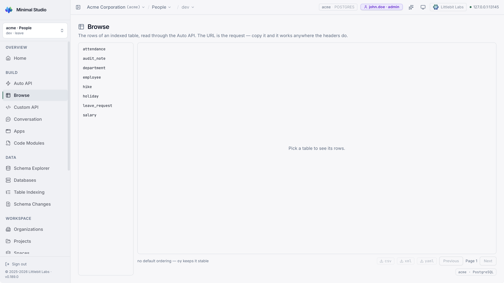
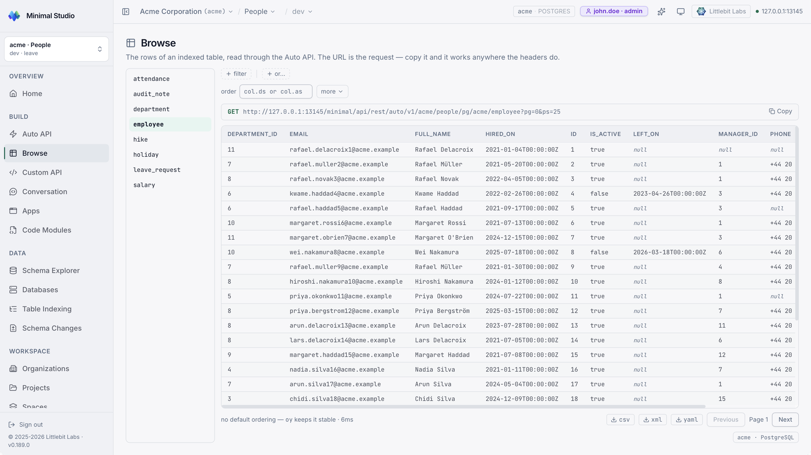
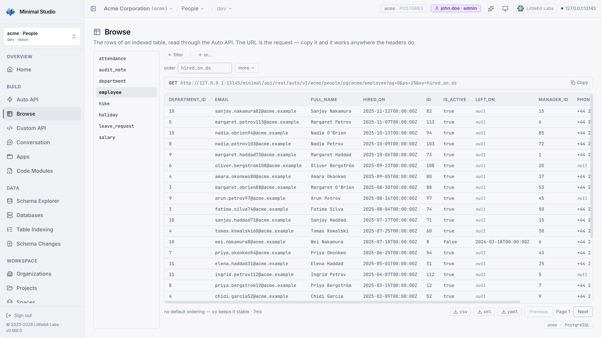
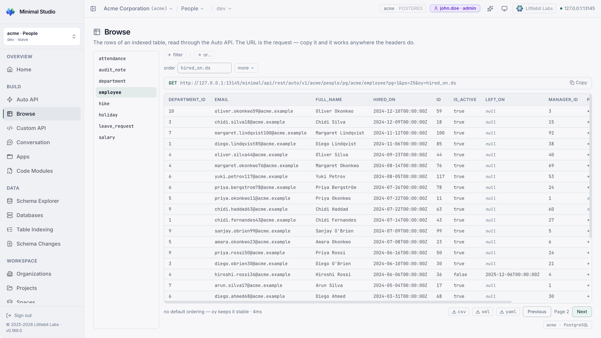
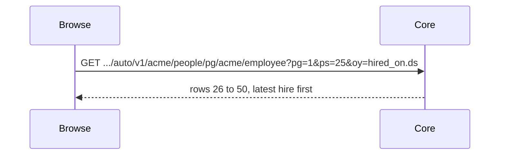

# 7. Browse

The Schema Explorer shows a table's shape; **Browse** shows its rows. Each page of rows is one request to the Core's Auto API, and Browse prints that request above the rows, so what you see on screen is also a call you could make yourself. This chapter reads Acme's employees through it, in order and a page at a time.

> **Setup.** The workspace of Chapter 5: Studio signed in as `john.doe` in **acme · People**, space **dev**.

## A table's rows

All the steps of this chapter happen in the Studio window.

1. Select **Browse** in the sidebar, under **BUILD**. The line under the title reads "The rows of an indexed table, read through the Auto API. The URL is the request — copy it and it works anywhere the headers do." The eight indexed tables are listed on the left, and the rest of the page reads "Pick a table to see its rows."

   

2. Select `employee`. A line starting with **GET** shows the request, with a **Copy** button beside it:

   ```text
   GET http://127.0.0.1:13145/minimal/api/rest/auto/v1/acme/people/pg/acme/employee?pg=0&ps=25
   ```

   The rows arrive below it, one column per field, the fields in alphabetical order. The first row is employee 1, Rafael Delacroix, whose **MANAGER_ID** reads `null`. The foot of the page reads "no default ordering — oy keeps it stable" with the time the request took, and offers **csv**, **xml** and **yaml**, **Previous**, **Page 1** and **Next**.

   

The path of the request names the whole workspace: the organization `acme`, the project `people`, the database's engine `pg` and its name `acme`, then the table. Two query parameters choose the page: `pg` counts pages from 0, and `ps` is the page size, 25 rows.

## Order and pages

Without an order, the database returns rows in whatever order it likes, and two requests for the same page may not agree. The note at the foot says so, and names the parameter that fixes it, `oy`.

1. Type `hired_on.ds` into the box **order** and press Return. The request gains `&oy=hired_on.ds`: `ds` sorts down, `as` sorts up. The first row is now the latest hire, employee 82, Sanjay Nakamura, hired on 2025-11-12.

   

2. Select **Next**. The request reads `pg=1`, the foot reads **Page 2**, and the page starts at the 26th latest hire, employee 59, Oliver Okonkwo, hired on 2024-12-10.

   

Above the order box sit **+ filter** and **+ or…**, and beside it the menu **more**; this edition does not use them. Selecting a row opens nothing: Browse only reads.

## The request behind the page



*One page of Browse is one Auto API request.*

Browse sends the request with your identity, so it sees what your roles may read and nothing more. The same request works from a terminal or a program when it carries the same identity headers; Chapter 8 sends Auto API requests from Studio's own page for them, and Volume 1, chapter 5 of the Book of Minimal sets out every parameter the Auto API takes.

## Exercises

1. Open `department` and check how many rows the first page shows, and which department has no head: its **HEAD_EMAIL** reads `null`.
2. Order `leave_request` by `days.ds`. Check the request line for the order, and read the largest number of days on the first row.
3. Order `employee` by `hired_on.as` and check that the first row is the earliest hire. Then select **Next** and check that the request reads `pg=1`.
