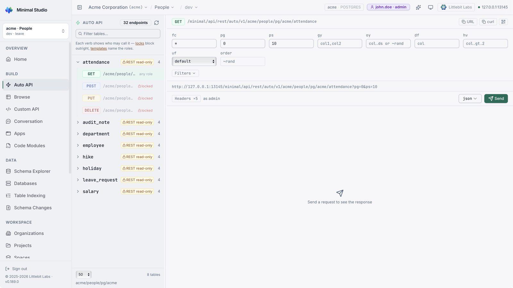
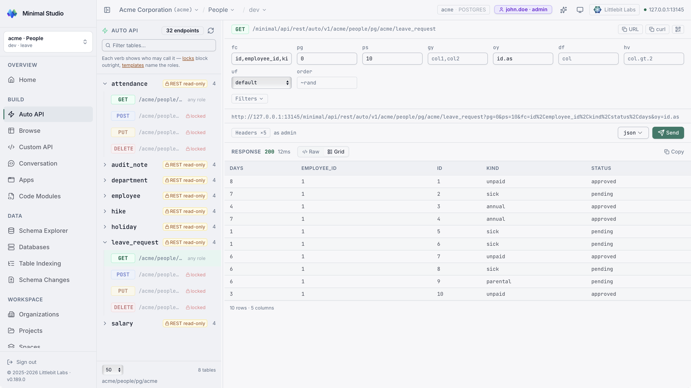
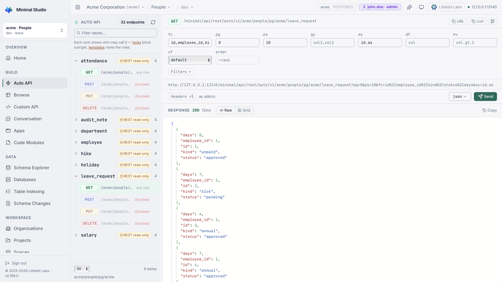
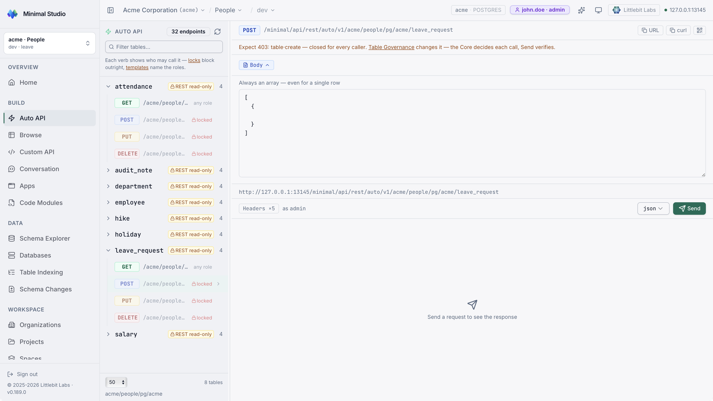
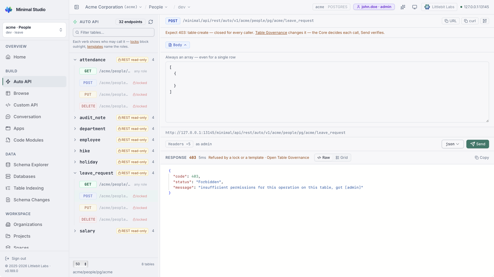

# 8. The Auto API page

Every table the Core indexes is served at once as REST endpoints, one per verb: **GET** reads, **POST** inserts, **PUT** updates and **DELETE** removes. That is the Auto API, and Browse already used its **GET**. The **Auto API** page lists every endpoint of the workspace, says for each verb who may call it, and sends a request of your own. This chapter reads `leave_request` through it, then tries to write and is refused.

> **Setup.** The workspace of Chapter 5: Studio signed in as `john.doe` in **acme · People**, space **dev**.

## The endpoints and who may call them

All the steps of this chapter happen in the Studio window.

1. Select **Auto API** in the sidebar, under **BUILD**. The list on the left is headed **AUTO API**, "32 endpoints": four verbs for each of the eight tables. Its legend reads "Each verb shows who may call it — locks block outright, templates name the roles." Every table carries the tag **REST read-only**. Open one, such as `attendance`: **GET** reads "any role", and **POST**, **PUT** and **DELETE** read **locked**.

   

A table the Core indexes for the first time starts this way: anyone with a role may read it over REST, and nobody may write it. Table Governance changes that, table by table, in Chapter 18.

## Read through the Auto API

1. Open `leave_request` in the list and select its **GET**. The panel on the right builds the request: the path at the top, a field for each parameter, the whole URL below them, and **Headers ×5** "as admin" beside **Send**.

2. Type `id,employee_id,kind,status,days` into **fc**, the columns to return, and `id.as` into **oy**, the order, as in Browse; the second box, labelled **order**, stays as it is. The URL grows as you type.

3. Select **Send**. The response arrives under **RESPONSE 200** with the time it took. The tab **Grid** shows ten rows and five columns, "10 rows · 5 columns": the first ten leave requests, all of employee 1, in order of their ID. **ps**, the page size, is 10 on this page.

   

4. Select **Raw**. The same answer, indented: a JSON array, one object per row, its keys in alphabetical order.

   

## The same request on the wire

What **Send** does, you can do from a terminal. The Core takes the identity in six headers: the key, the user ID, the roles, and the three IDs of the workspace; the badge on the page counts five of them. Here is the same read for two rows:

```http
GET /minimal/api/rest/auto/v1/acme/people/pg/acme/leave_request?pg=0&ps=2&fc=id,employee_id,kind,status,days&oy=id.as HTTP/1.1
Host: 127.0.0.1:13145
X-Server-Key: <your-server-key>
X-User-Id: john.doe
X-User-Roles: admin
X-Org-Id: <org-id>
X-Project-Id: <project-id>
X-Space-Id: <space-id>
```

```http
HTTP/1.1 200 OK
content-type: application/json
x-request-id: 01M71GAG24HN9DGJ4KFYCP5QPQ
content-length: 138
```

```json
[
  {"days": 8, "employee_id": 1, "id": 1, "kind": "unpaid", "status": "approved"},
  {"days": 7, "employee_id": 1, "id": 2, "kind": "sick", "status": "pending"}
]
```

Leave out **X-Project-Id** and **X-Space-Id**, and the Core answers `400` with "missing required header" and the two names in its data. Volume 1, chapter 5 of the Book of Minimal sets out every parameter of the Auto API, **gy**, **df**, **hv** and **uf** among them. Chapters 28 and 29 try its operators, keywords and formats on Acme's employees; **uf** is for ClickHouse and appears in Chapter 23.

## A write that is refused

1. Select **POST** under `leave_request`. Before anything is sent, a line in orange predicts the answer: "Expect 403: table·create — closed for every caller. Table Governance changes it — the Core decides each call, Send verifies." The body editor reads "Always an array — even for a single row" and holds an empty row.

   

2. Select **Send**. The Core answers as predicted: **RESPONSE 403**, with "Refused by a lock or a template" and a link, **Open Table Governance**. The body reads:

   ```json
   {
     "code": 403,
     "status": "Forbidden",
     "message": "insufficient permissions for this operation on this table, got [admin]"
   }
   ```

   

The prediction comes from what Studio has read about the table's locks and templates; the answer comes from the Core, which checks every call. `admin` is a full administrator of the workspace, and the lock refuses it all the same: a lock closes a verb for every caller, whatever the roles.

## Exercises

1. Open `department` on **Auto API** and check what its **GET**, **POST**, **PUT** and **DELETE** read. Send its **GET** with **ps** set to `12` and count the rows in **Grid**; check the count against Appendix A.
2. On the **GET** of `leave_request`, set **ps** to `5` and send. Check that **Grid** reads "5 rows" and that the URL carries `ps=5`.
3. Select **DELETE** under `salary`. Read the line that predicts the answer and say which lock it names. Do not send it.
