# 9. The Custom API editor

The Auto API serves tables as they are. A Custom API serves what you write: one YAML document, called a definition, that names a path and a method and lists the steps that run when it is called. This chapter builds Acme's: **pending-leave**, a GET that counts the leave requests still awaiting approval, by department. It writes the definition in Studio's editor, checks it, deploys it, calls it, changes it, and reads its history.

> **Setup.** The workspace of Chapter 5, with the feature `leave` picked: Studio signed in as `john.doe` in **acme · People**, **dev · leave**. You also need the password of the `acme_app` login of Appendix A.

## A new definition

All the steps of this chapter happen in the Studio window.

1. Select **Custom API** in the sidebar, under **BUILD**. The list on the left, **CUSTOM API**, reads "No definitions yet" and counts "0 deployed" at its foot. The right of the page opens a **New Definition**, already written from the workspace: its **identifiers** are the IDs of the organization, the project, the feature and the space, and `user_id: "john.doe"`; its **database** is the project's connection to `acme`, with the password shown as a mask. Four tabs, **Editor**, **Form**, **History** and **Try**, sit above the document, and the size in bytes, out of 16384, sits beside **Validate** and **Deploy**.

   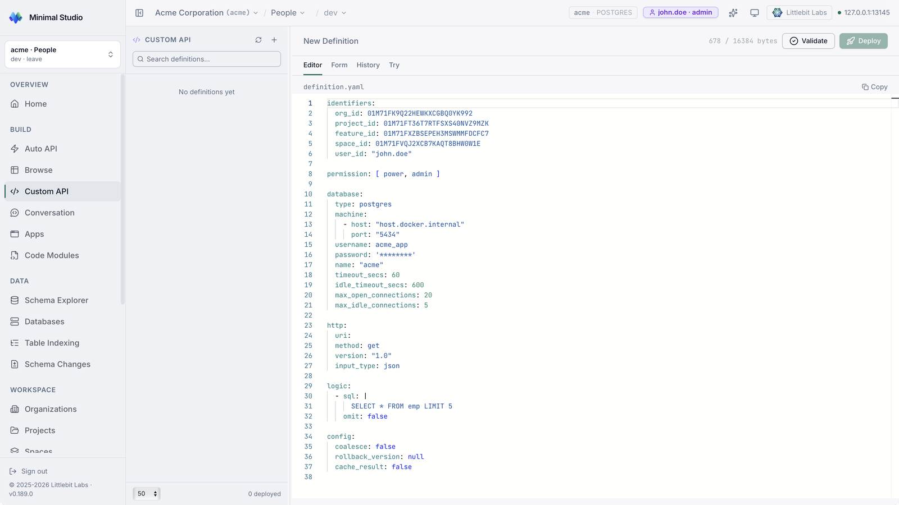

2. Select **Form**. The same document appears as sections. **IDENTIFIERS** reads "Inherited from top-bar context" and **DATABASE** "Inherited from project DB config" with "1 configured DB" beside it. **HTTP & ACCESS** holds the method, the path, the version `1.0`, the input and output types `json`, and **access**, the roles that may call it. **LOGIC** holds the steps; each step is one of four kinds, **SQL**, **Starlark**, **Lua** or **Expr**, and **+ Add Step** adds another. **OTHER CALLERS** opens the definition to agents and machines.

   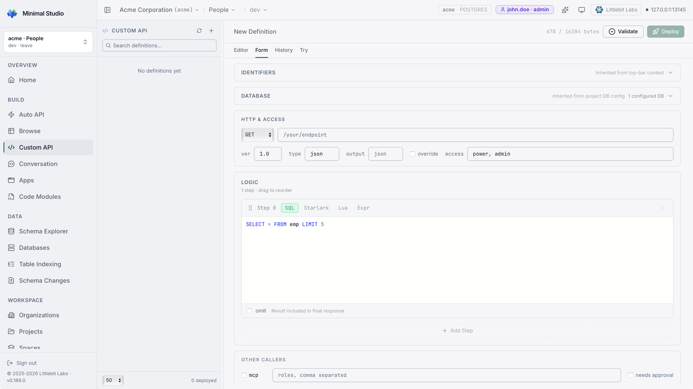

3. Type `leave/pending` as the path, and replace the roles in **access** with `admin`. Select **Validate**. A row of checks appears, **identifiers**, **permission**, **http**, **logic**, **config**, **database** and **size**, each ticked, with "All sections valid — click Deploy". Validate checks the document's shape. It does not run the SQL: the step still holds the template's sample query, which reads a table `emp` that Acme does not have, and every section passes.

   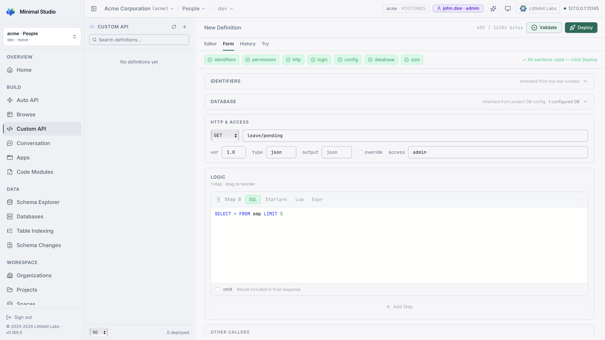

4. Select **Deploy**. Studio refuses before sending anything: "The password is hidden and no other definition in this space uses the same database. Type the password into the database block, then save." A definition carries its own connection, and the first one in a space must carry the password too. Open **DATABASE** in the form and type the password of `acme_app` into **Password**.

   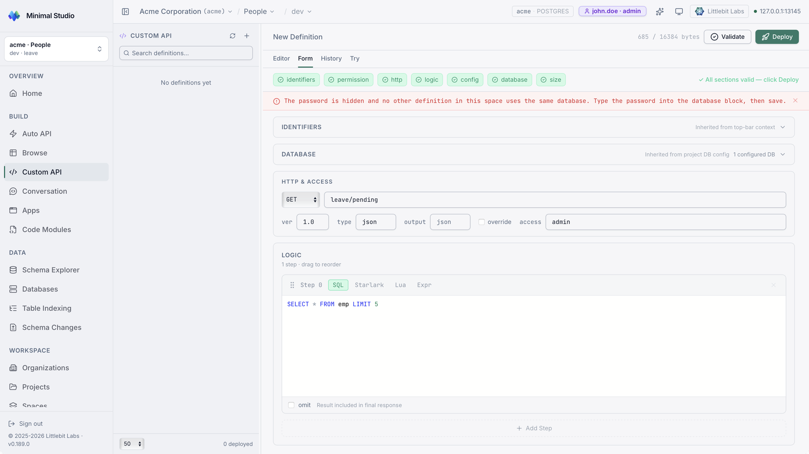

5. In the step under **LOGIC**, kind **SQL**, replace the sample query with the one that counts pending requests:

   ```sql
   SELECT d.name AS department, COUNT(*) AS pending
   FROM leave_request l
   JOIN employee e ON e.id = l.employee_id
   JOIN department d ON d.id = e.department_id
   WHERE l.status = 'pending'
   GROUP BY d.name
   ORDER BY pending DESC, d.name
   ```

   Select **Validate**, then **Deploy**. The list now holds one definition, **GET** `/acme/people/lea…`, `v1.0`, and counts "1 deployed". Select it: the editor's header names it, **GET** `/acme/people/leave/pending` **v1.0**, and offers **Export**, **Attributes**, **Delete** and, in place of **Deploy**, **Update**.

   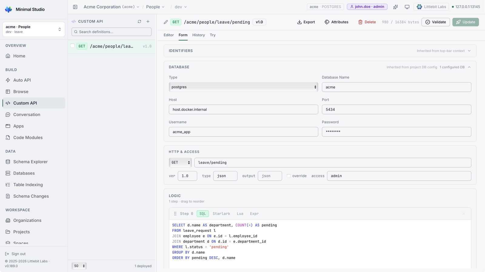

6. Select **Editor**. The document reads as the Core stores it: its sections in alphabetical order, from **config** to **permission**, indented by four spaces, and the password as `'********'`. The path you typed is served under the organization's and the project's abbreviations, `acme/people/leave/pending`. Appendix A prints the document as it stands at the end of this chapter, after the update to 1.1 and the attributes, so its version, path and metadata differ from this first deploy.

   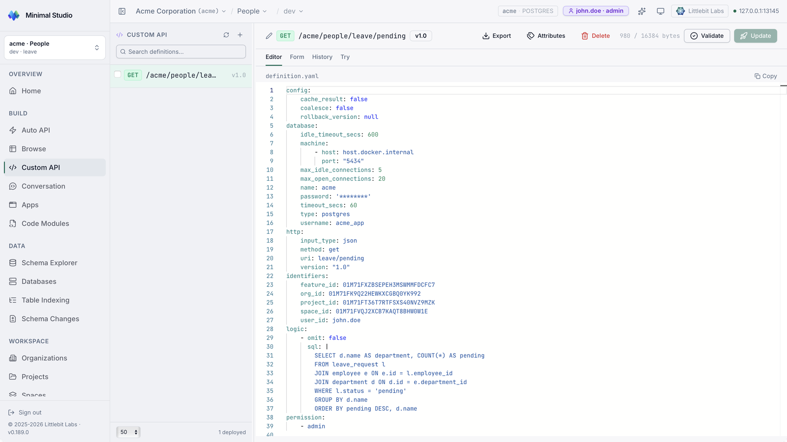

## Try it

1. Select **Try**. The panel shows the call it will make, **GET** `/minimal/api/rest/v1/acme/people/leave/pending`, and the URL with the version the definition carries, `?version=1.0`. Select **Try it**.

2. The response arrives as **RESPONSE 200** with its time. **Raw** shows a JSON array, one object per department, `{"department": "Legal", "pending": 42}` first.

   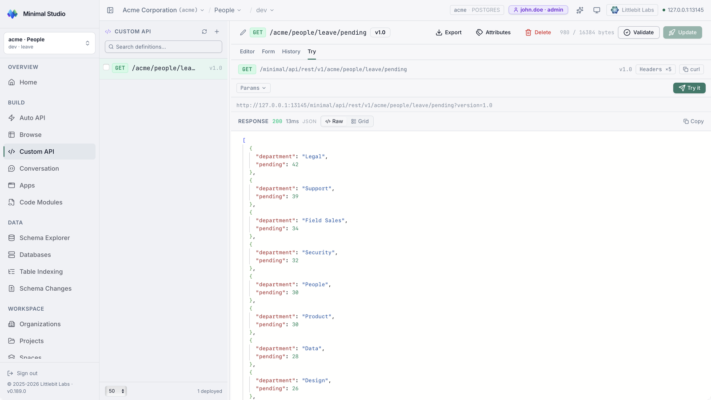

3. Select **Grid**: "11 rows · 2 columns", from Legal, 42, to Engineering, 6. The counts are those of Appendix A, which were read from the database directly; the endpoint agrees with them.

   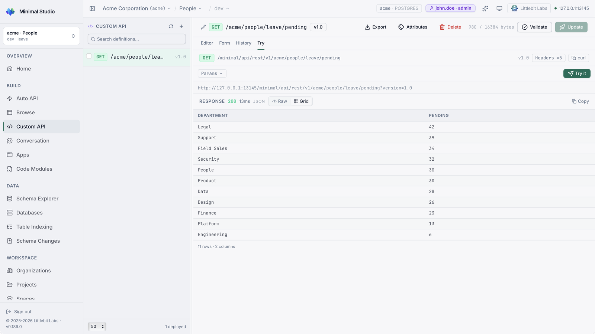

## Versions

1. Select **History**. "Version history" shows the definition's ID with a copy button and "1 version": **v1.0**, marked **Latest** and **Active**, with its author, `john.doe`, and the time it was deployed.

   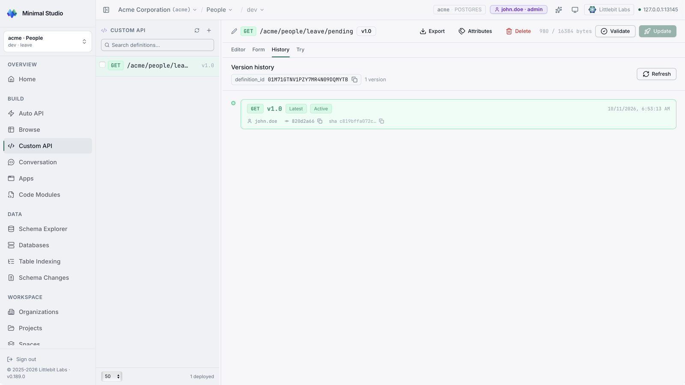

2. Select **Form**, change **ver** to `1.1`, select **Validate**, then **Update**. A message reads "Definition updated successfully", and the list shows `v1.1`. The header keeps reading `v1.0` until you open the definition again. No password was typed this time: the space already holds a definition with this connection, and its stored password is kept.

   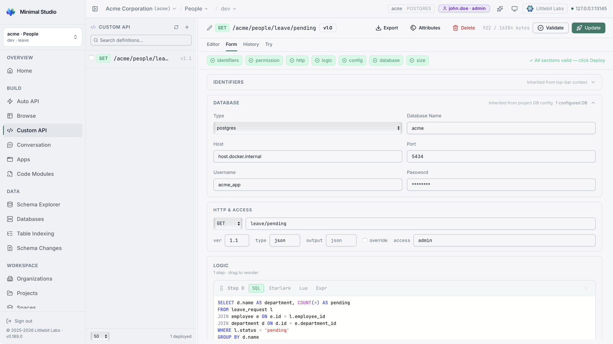

3. Select **History**. It reads "2 versions": **v1.1**, **Latest** and **Active**, and **v1.0**, still **Active**.

   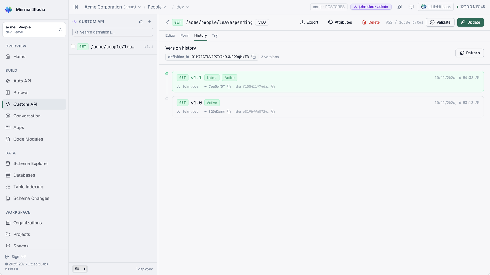

Both versions answer. The version is a label every call carries, and a call with a label the definition has never had is refused:

```http
GET /minimal/api/rest/v1/acme/people/leave/pending?version=2.0 HTTP/1.1
Host: 127.0.0.1:13145
X-Server-Key: <your-server-key>
X-User-Id: john.doe
X-User-Roles: admin
X-Org-Id: <org-id>
X-Project-Id: <project-id>
X-Space-Id: <space-id>
```

```http
HTTP/1.1 417 Expectation Failed
content-type: application/json; charset=utf-8
x-request-id: 01M71H14H35W4CDV7HV8GG72R8
content-length: 109
```

```json
{"code": 417, "status": "Expectation Failed", "message": "error getting details", "details": "definition not found"}
```

The same call with `version=1.0` or `version=1.1` answers 200 with the eleven rows.

## Attributes

A definition also carries what describes it rather than what it does. **Attributes** edits those parts without touching the YAML.

1. Select **Attributes**. The dialog says that only the fields you change are sent, and that the definition's YAML and version stay as they are. It holds **Documentation**, **Tags**, **API groups** and **MCP groups**, then **MCP** and **Machine-to-machine**, each with **Enabled** and its roles, both "unchanged". Type `Leave requests awaiting approval, counted by department.` as the documentation and `leave, hr` as the tags.

   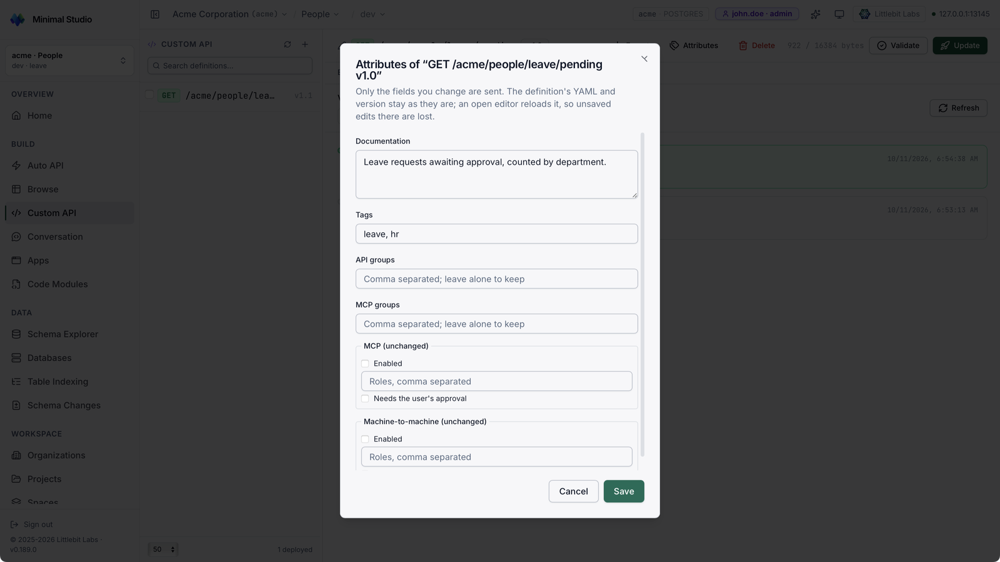

2. Select **Save**. "Attributes saved" appears. On **History**, select **Refresh**: the save is recorded as a third entry, a new **v1.1**, now **Latest**.

   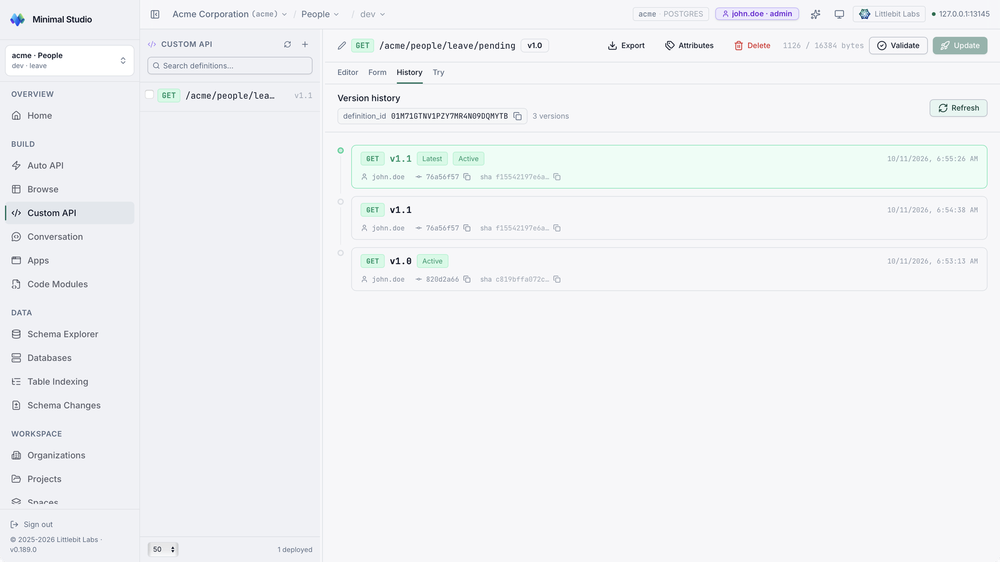

## What a definition holds

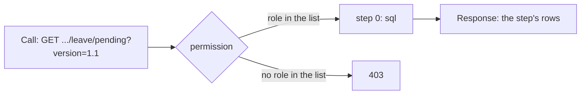

*A call to pending-leave: the permission check, then the one step.*

A definition holds six required sections: **identifiers**, which must match the caller's workspace; **permission**, the roles that may call it; **http**, its method, path and version; **logic**, the steps; **config**; and **database**, its own connection. Each step's result is kept by its position, `step_0`, `step_1` and on, for the steps after it, and every step not marked **omit** appears in the response. Chapter 25 builds definitions of several steps, Chapter 26 writes the script steps, and Chapter 27 loads modules from them. Volume 2, chapter 1 of the Book of Minimal sets out every section, every step kind and the whole life of a definition on the wire.

## Exercises

1. Open **Editor** and find the SQL step. Check that the password reads `'********'`, and read the path under **http**, **uri**.
2. On **Try**, select **Try it** and switch to **Grid**. Check the count of rows and the department with the fewest pending requests.
3. On **History**, select **Refresh** and count the entries. Check which of them read **Active**.
