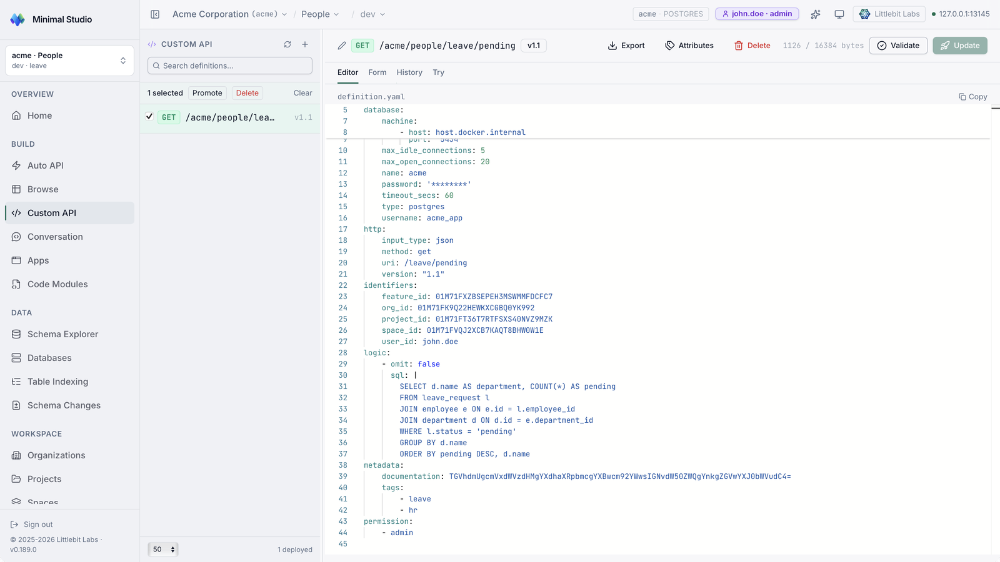
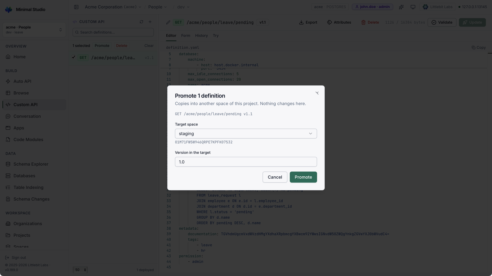
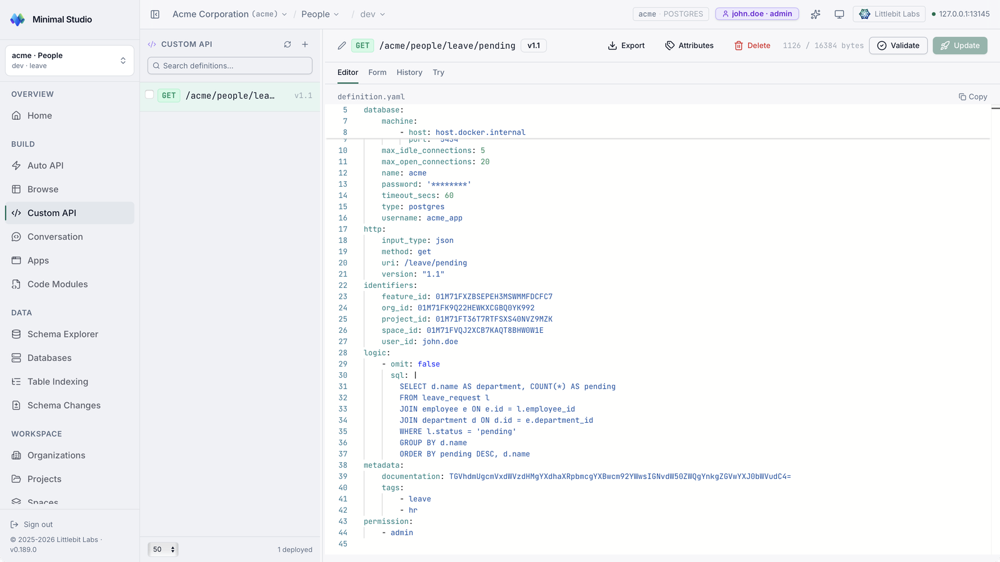
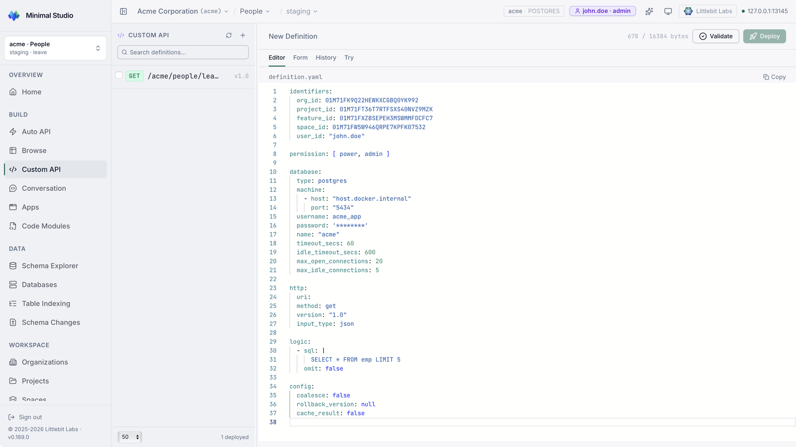
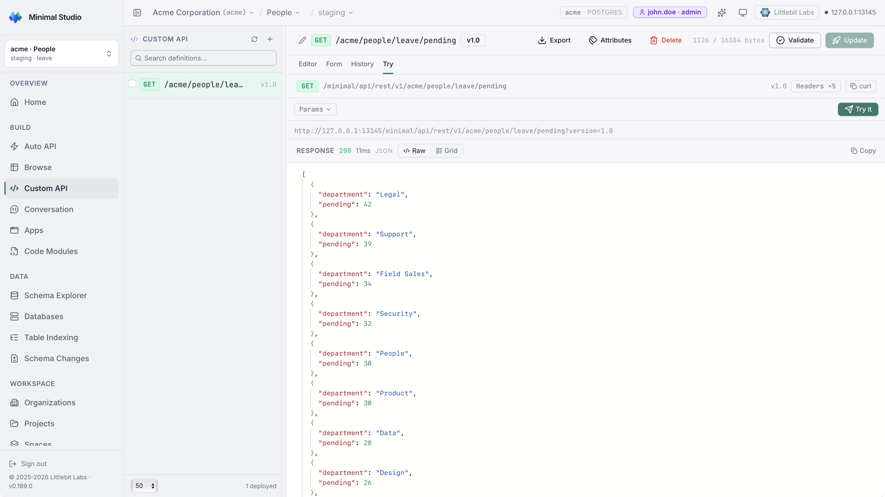
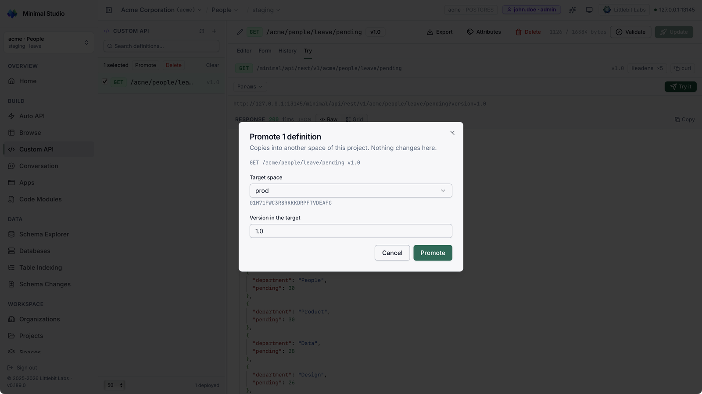
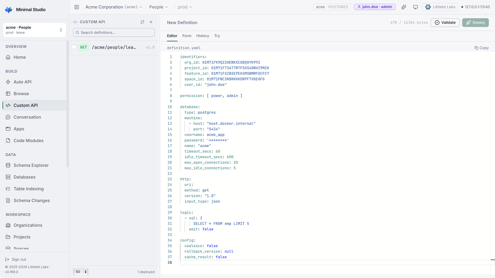
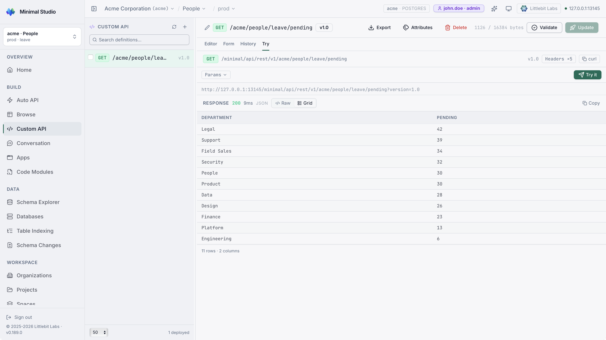
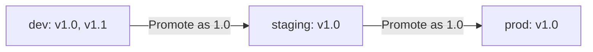

# 10. Promotion

A definition lives in one space. Acme writes and tries its APIs in `dev`, proves them in `staging`, and serves its callers from `prod`, so a definition that works in `dev` has to be carried forward, space by space. Studio calls that **Promote**: it copies a definition into another space of the same project and leaves the original as it is. This chapter carries **pending-leave** from `dev` to `staging`, then to `prod`, and checks it from each.

> **Setup.** Chapter 9's **pending-leave** in **acme · People**, **dev · leave**.

## From dev to staging

All the steps of this chapter happen in the Studio window.

1. On **Custom API**, tick the box beside **GET** `/acme/people/lea…`. A bar replaces the list's header: "1 selected", **Promote**, **Delete** and **Clear**.

   

2. Select **Promote**. The dialog **Promote 1 definition** says "Copies into another space of this project. Nothing changes here." It names the definition, **GET** `/acme/people/leave/pending` **v1.1**, and asks for **Target space**, here `staging` with its ID under it, and **Version in the target**, here `1.0`. The version is the one the copy will carry; the original keeps its own.

   

3. Select **Promote**. A message reads "Copied 1 to the other space". Nothing in `dev` has changed.

   

## Check it from staging

1. Change the workspace to `staging`: in **Settings**, select **Change workspace**, or open the workspace picker at the top of the sidebar. Select `staging`, and tick the feature `leave` again, which a change of space clears; select **Apply**.

2. Open **Custom API**. The list in `staging` holds the copy, **GET** `/acme/people/lea…`, `v1.0`, and counts "1 deployed".

   

3. Open it, select **Try**, then **Try it**. The call carries `?version=1.0` and answers 200 with the same counts as in `dev`: the copy brought its connection, password included, so nothing had to be typed again.

   

## From staging to prod

1. In `staging`, tick the definition and select **Promote**. The target now offers `dev` first. Open **Target space** and choose `prod`; the ID under it changes to the ID of `prod`. Keep **Version in the target** at `1.0`.

   

2. Select **Promote**: "Copied 1 to the other space".

3. Change the workspace to `prod`, tick `leave`, and open **Custom API**: the definition is listed at `v1.0`.

   

4. Open it, select **Try**, then **Try it**, and **Grid**: "11 rows · 2 columns", Legal 42 to Engineering 6.

   

## One path, three spaces

The three copies share one path, `acme/people/leave/pending`. Which of them answers a call is decided by the space the call names in **X-Space-Id**, and each space knows only the versions it holds:

| Space | `version=1.0` | `version=1.1` |
|---|---|---|
| `dev` | 200 | 200 |
| `staging` | 200 | 417 |
| `prod` | 200 | 417 |

`dev` holds both versions of Chapter 9; `staging` and `prod` hold the one the promotion gave them. A caller in `prod` asking for `1.1` is refused with "definition not found", as in Chapter 9.

*pending-leave's way from dev to prod; each promotion copies, and the source keeps what it had.*

A promotion is a copy, not a move: change the definition in `dev` and `prod` keeps serving what it was given until you promote again. Volume 2, chapter 1 of the Book of Minimal describes the copy on the wire, and its chapter 2 adds that the modules a definition loads do not travel with it, since a module belongs to one space (Chapter 27).

## Exercises

1. In `staging`, open **pending-leave** and select **History**. Count its versions and compare with `dev`.
2. In `prod`, open **Try** and check the version in the URL. Then change the workspace back to `dev` and check the version the definition carries there.
3. Open the **Promote** dialog from `dev` without promoting. Check which target space it offers first and the version it proposes, then select **Cancel**.
