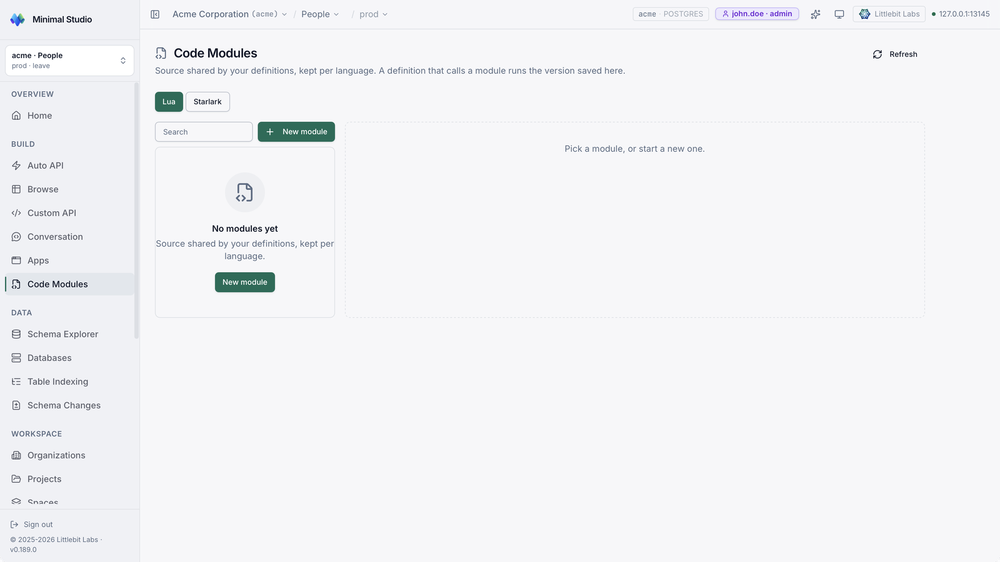
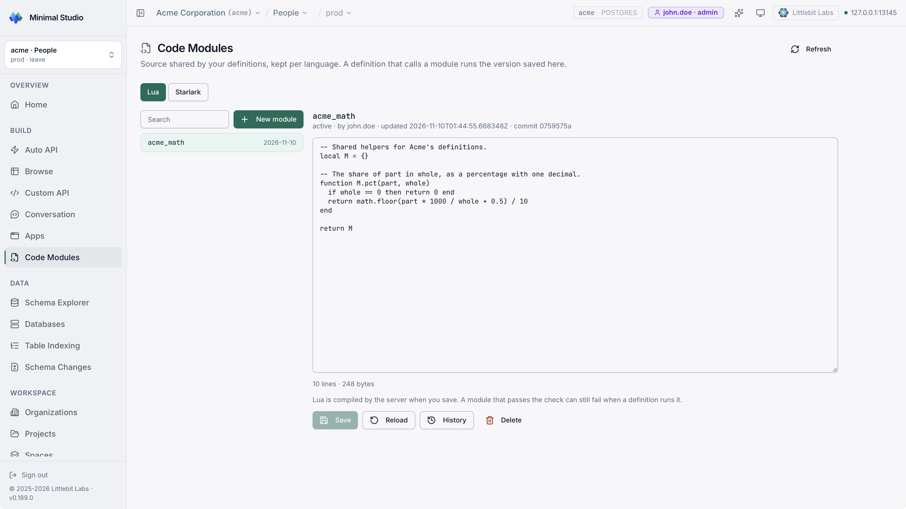
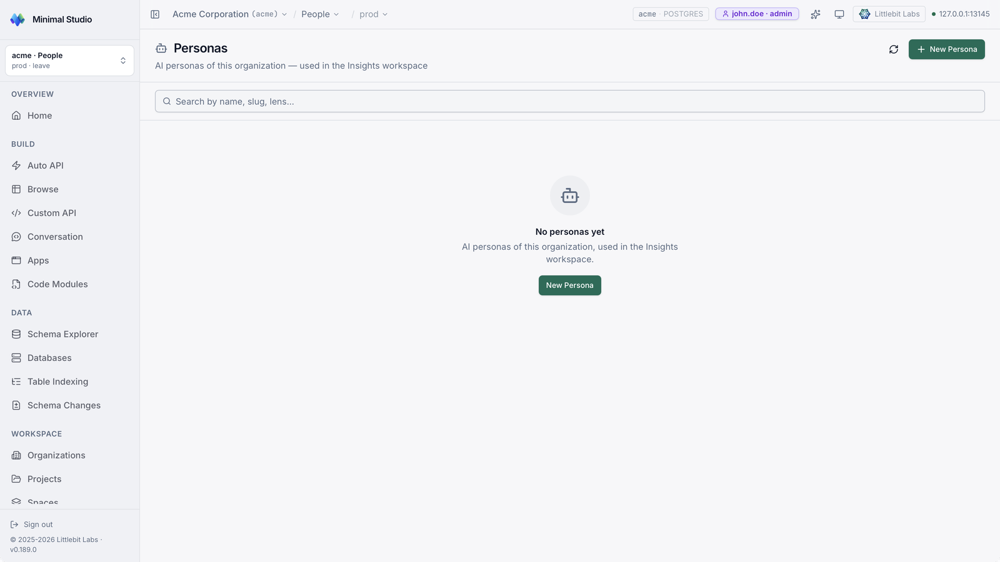
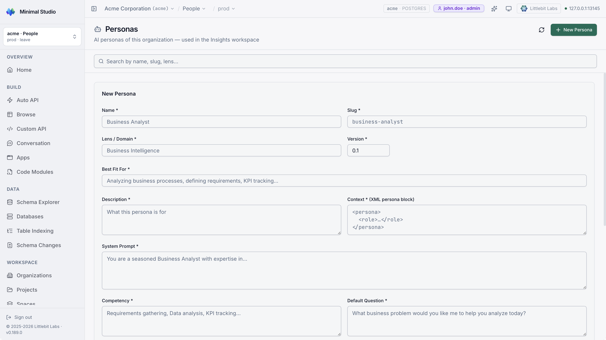
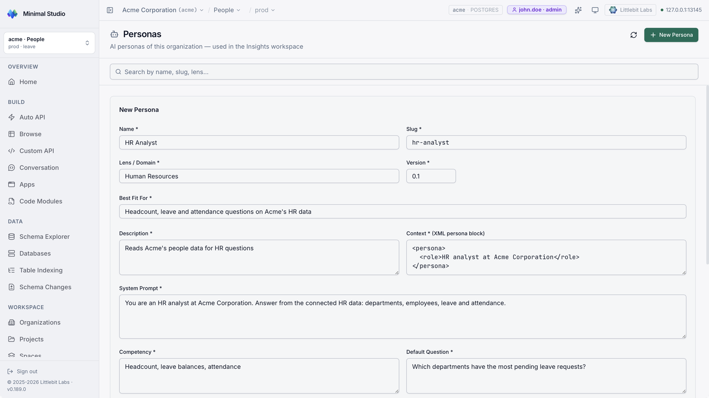
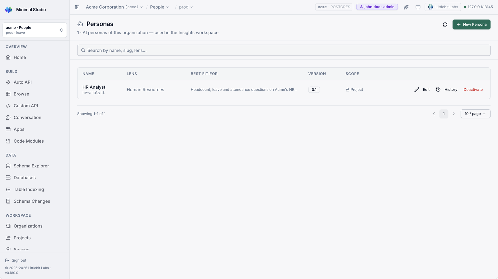

# 11. Code Modules and Personas

Two pages hold what other pages reuse. **Code Modules** keeps source that definitions share, so a helper written once is not pasted into every definition that wants it. **Personas** keeps the voices of the model-calling pages: who a conversation is for, what it may see, and how it should answer. This chapter writes one of each for Acme.

> **Setup.** The workspace of Chapter 5: Studio signed in as `john.doe` in **acme · People**, any space.

## A shared module

All the steps of this chapter happen in the Studio window.

1. Select **Code Modules** in the sidebar, under **BUILD**. The line under the title reads "Source shared by your definitions, kept per language. A definition that calls a module runs the version saved here." Two tabs choose the language, **Lua** and **Starlark**, and the list reads "No modules yet".

   

2. Select **New module**, type `acme_math` as the **Module name**, and this source:

   ```lua
   -- Shared helpers for Acme's definitions.
   local M = {}

   -- The share of part in whole, as a percentage with one decimal.
   function M.pct(part, whole)
     if whole == 0 then return 0 end
     return math.floor(part * 1000 / whole + 0.5) / 10
   end

   return M
   ```

   The counter under the editor follows you: "10 lines · 248 bytes · unsaved changes". The line under it says "Lua is compiled by the server when you save. A module that passes the check can still fail when a definition runs it."

3. Select **Create**. "Created "acme_math"" appears; the list holds the module with today's date, and its header names who saved it and the commit of this version. The buttons become **Save**, **Reload**, **History** and **Delete**.

   

A definition that calls `acme_math` runs the version saved here. A module belongs to one space, the one in the top bar, and changing it changes what every definition of that space runs next. Chapter 27 loads modules from definitions; volume 2, chapter 2 of the Book of Minimal sets out modules on the wire and their care.

## A persona

1. Press `⌘6` for **Insights**, then select **+ New persona**, which opens **Personas**. The page reads "AI personas of this organization — used in the Insights workspace", with none yet.

   

2. Select **New Persona**. The form opens with a placeholder in every field, from **Name** and **Slug** to **Default Question**, except **Version**, which holds `0.1`.

   

3. Fill in Acme's analyst. The **Slug** writes itself from the name; the rest is yours:

   | Field | Value |
   |---|---|
   | **Name** | `HR Analyst` |
   | **Lens / Domain** | `Human Resources` |
   | **Best Fit For** | `Headcount, leave and attendance questions on Acme's HR data` |
   | **Description** | `Reads Acme's people data for HR questions` |
   | **Context** | `<persona>` with one `<role>` line |
   | **System Prompt** | `You are an HR analyst at Acme Corporation. Answer from the connected HR data: departments, employees, leave and attendance.` |
   | **Competency** | `Headcount, leave balances, attendance` |
   | **Default Question** | `Which departments have the most pending leave requests?` |

   

4. Below them, **Tools** takes one slug per line, matched "against the connected MCP tools at runtime", and **Output Spec** is required: type `A short answer first, then a table of departments and counts.` The foot of the form names what is still missing until nothing is; **Global persona** would offer it to every project of the organization, and Acme leaves it off.

5. Select **Save Persona**. "Persona created" appears, and the list holds **HR Analyst**, `hr-analyst`, lens **Human Resources**, version **0.1**, scope **Project**, with **Edit**, **History** and **Deactivate**.

   

A persona is not deleted but deactivated, and its versions keep their history, like a definition's. Chapter 13 reads Acme's data through this persona's eyes once the MCP door of Chapter 17 is open.

## Exercises

1. Open `acme_math` and select **History**. Check how many versions it has and who saved them.
2. Change one comment line of the module and select **Save**. Check the counter's "unsaved changes" before, and the new commit after.
3. On **Personas**, open **Edit** on **HR Analyst** and read which fields the form carried over. Select **Cancel**.
