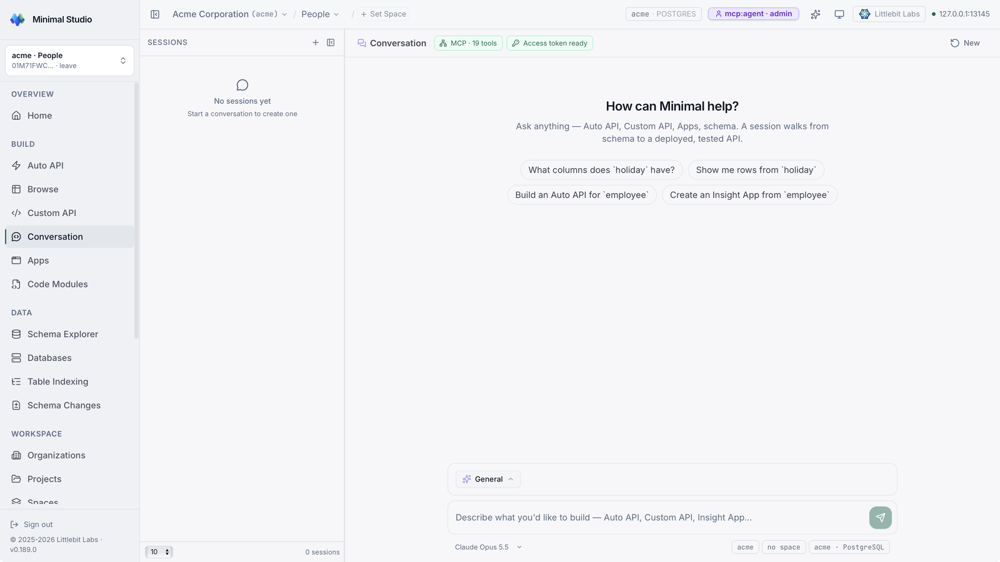
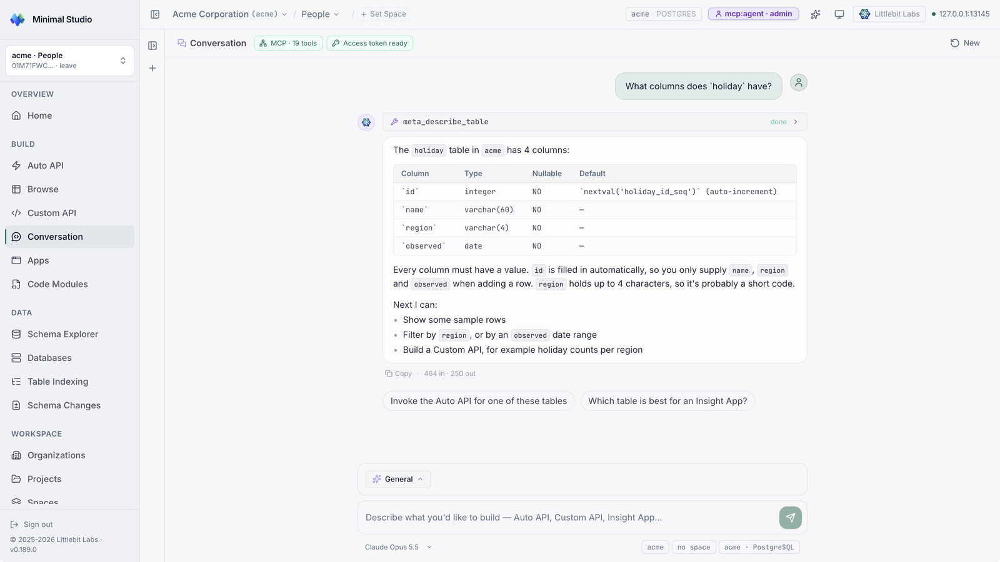

# 12. Conversation

**Conversation** is a page where you ask for an API in plain words. A model reads Acme's schema through the Core's MCP door, writes a definition, tests it, and walks you from the tables to a deployed API. This chapter asks it one question and reads the reply.

> **Setup.** The workspace of Chapter 5, the MCP door open to the space (Chapter 17), and the model of **Settings → AI Assistant** (Chapter 20): Anthropic, **Claude Opus 5.5**. Without the door the page is dim, as Chapter 17 shows. The shots of Chapters 12 to 14 were taken signed in as `mcp:agent`, the owner of the token Studio holds for the door (Chapter 17), except the one of Settings; `john.doe` works the same once that user holds such a token (Chapter 30 hands one to him).

## The page

1. Select **Conversation** in the sidebar, under **BUILD**. A **SESSIONS** list sits on the left and reads "No sessions yet — Start a conversation to create one". The heading reads **Conversation**, with two badges: **MCP · 19 tools** and **Access token ready**. The **MCP** page counts 115 tools for the same door; this page does not say why it counts 19.

2. The middle of the page reads "How can Minimal help?" and "Ask anything — Auto API, Custom API, Apps, schema. A session walks from schema to a deployed, tested API." Four starting points are named after a table of the workspace: "What columns does `holiday` have?", "Show me rows from `holiday`", "Build an Auto API for `employee`" and "Create an Insight App from `employee`".

3. At the foot, the **General** chooser sets who the conversation is for. The composer reads "Describe what you'd like to build — Auto API, Custom API, Insight App…". The model line reads **Claude Opus 5.5**, and three tags name the workspace: `acme`, `no space` and `acme · PostgreSQL`.

   

## Ask a question

1. Select the starting point "What columns does `holiday` have?". It fills the composer and does not send. Select the send button at the composer's right.

2. A session appears in the list, named by your first words and marked **Running**. The page shows your message, then "Thinking…" and "Processing results…" while the model calls the Core's tools.

3. The reply opens with the tool it used, `meta_describe_table`, marked **done**, and then answers in words and a table. A reply such as:

   > The `holiday` table in `acme` has 4 columns: `id`, an integer filled in automatically; `name`, `varchar(60)`; `region`, `varchar(4)`; and `observed`, a date. None of them may be empty.

   

   The wording changes from run to run. What the book asserts is the tool, and the four columns and their types, which are the ones of Appendix A.

4. Under the reply, a line counts the tokens of the exchange, here "464 in · 250 out", and offers two follow-ups, "Invoke the Auto API for one of these tables" and "Which table is best for an Insight App?". Select one to continue the session.

## What a session does

A session walks "from schema to a deployed, tested API". It reads the indexed tables, drafts a Custom API definition like Chapter 9's, validates it, tries it, and offers to deploy it. Every tool it calls reaches the Core through the door, with the token's roles and the locks of Chapter 18: a table whose MCP read is closed answers the model with a 403, as Chapter 13 shows.

The model line is a choice of cost. The exchange above used about 700 tokens. The book's own ceiling for the whole edition was US$10; `notes/model-calls.md` logs each call.

## Exercises

1. Open **Conversation** and read the two badges. Check how many tools the page says it has.
2. Ask "What columns does `employee` have?". Check that the reply names ten columns, those of Appendix A, and read which tool it used.
3. Open **Settings → AI Assistant** and read which model **Conversation** shows at its foot.
