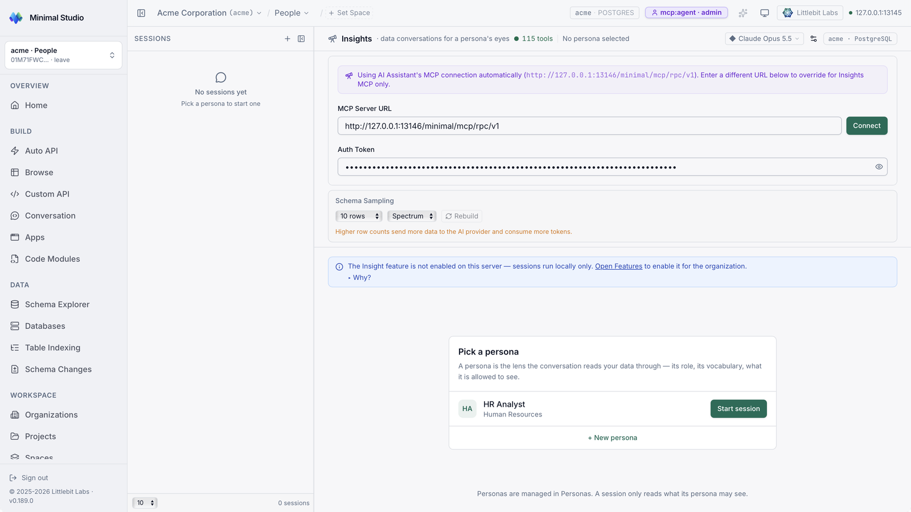
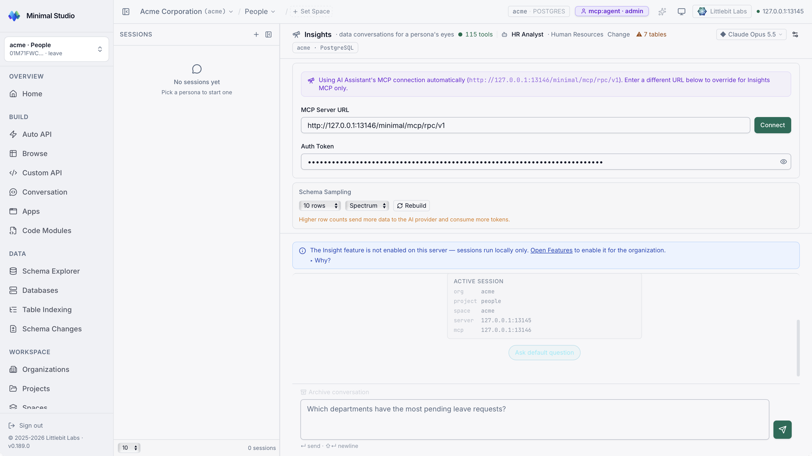
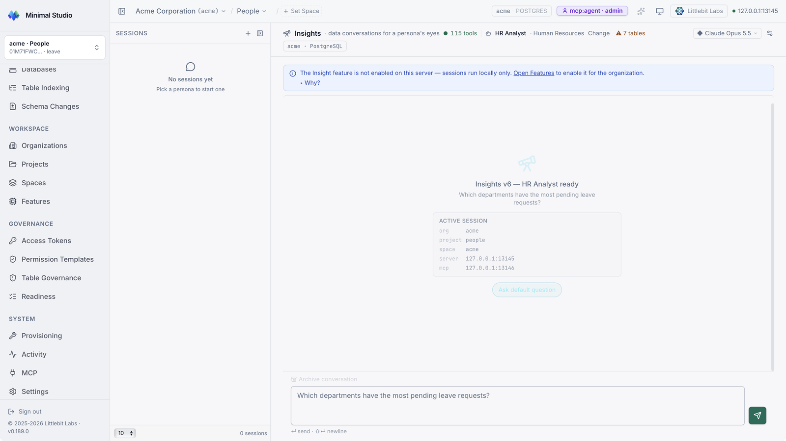
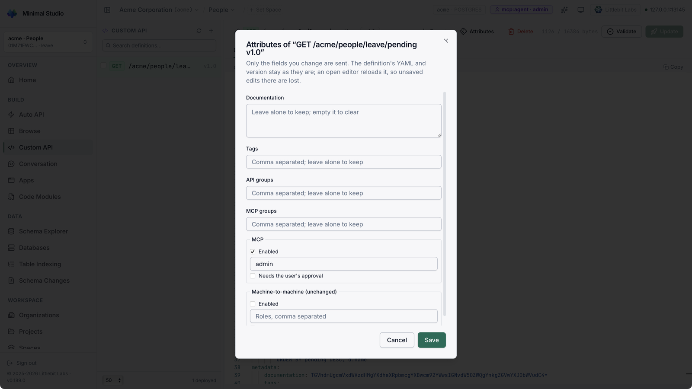
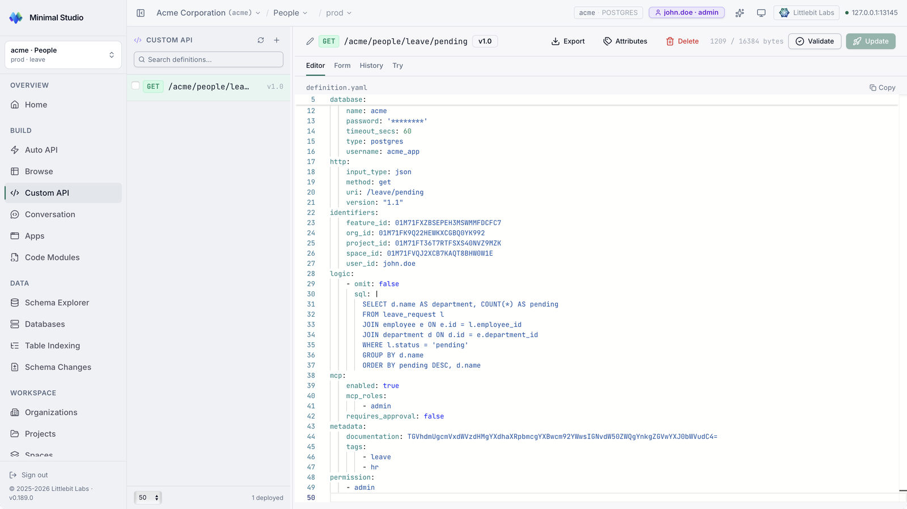
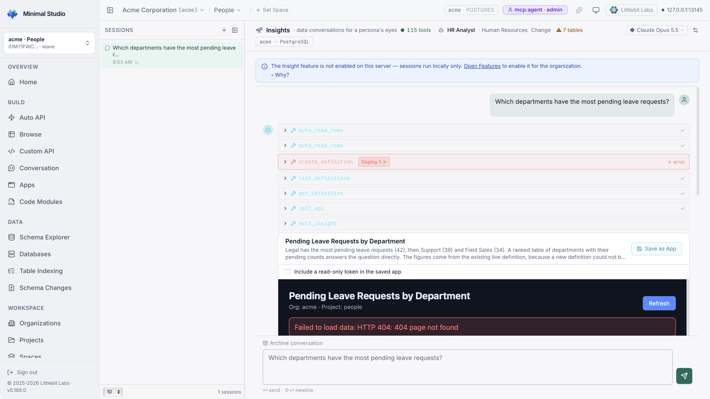
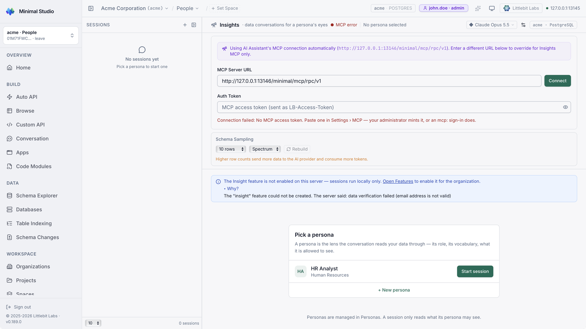
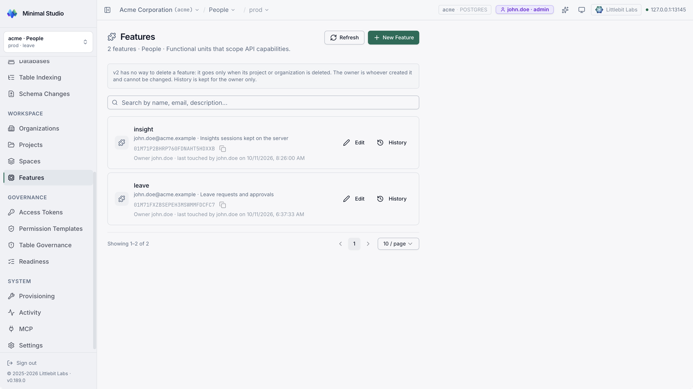
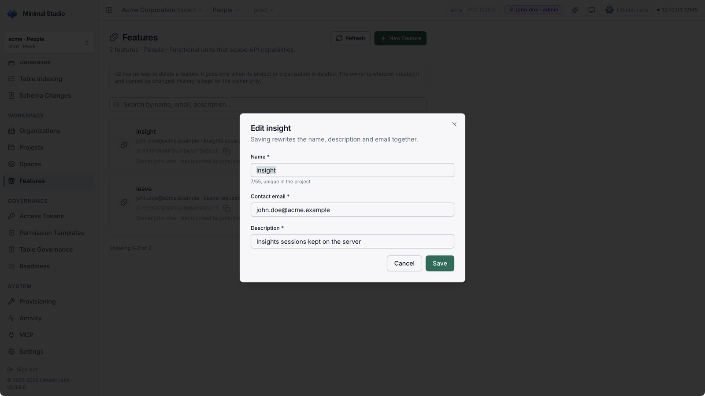
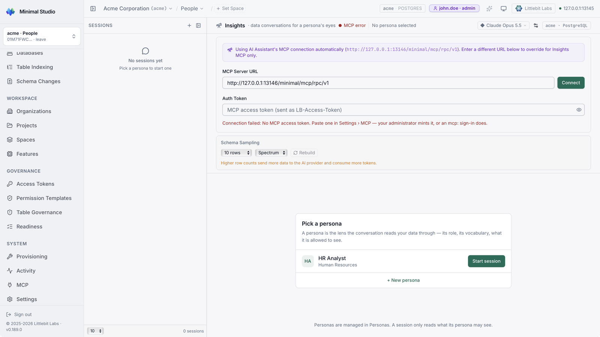

# 13. Insights

**Insights** asks questions of your data through a persona: a lens with a role, a vocabulary and a list of what it may see. Where Conversation builds APIs, Insights answers questions, as a short reply and a dashboard. This chapter asks Acme's question, finds it refused, and makes it answerable.

> **Setup.** The workspace of Chapter 5, with the **HR Analyst** persona of Chapter 11, `pending-leave` promoted to `prod` (Chapter 10), and the MCP door open (Chapter 17). Step 2 below uses the tables that Chapter 18 opens to agents.

## The page

1. Press `⌘6`. The page is headed **Insights**, "data conversations for a persona's eyes", with the door's state, **115 tools**, in green, and **No persona selected**; to the right, the model, **Claude Opus 5.5**, and the database, `acme · PostgreSQL`.

2. A panel at the top names the address and the token, and **Connect** tries the door. Under it, **Schema Sampling** sets how much of the data goes to the model: **10 rows**, a style named **Spectrum**, and **Rebuild**. The warning is in orange: "Higher row counts send more data to the AI provider and consume more tokens."

3. A blue line says "The Insight feature is not enabled on this server — sessions run locally only." **Open Features** leads to the page where it is enabled, and **Why?** says why it is not; the end of this chapter turns it on.

4. At the foot, **Pick a persona** lists **HR Analyst**, **Human Resources**, with **Start session**.

   

## Start a session

1. Select **Start session**. The header gains the persona, **HR Analyst · Human Resources**, a **Change** link, and an amber count of tables, "7 tables". A message in the corner, which fades after a few seconds, reads "Could not read sample rows of employee: insufficient permissions for this operation on this table, got [admin]… (and 6 more, see the console)". The amber "7 tables" stays on the header whatever the message says.

   

   Insights samples a few rows of each table to teach the model the data. The tables are still at the indexing default, with the agent channel closed (Chapter 18), so every sample is refused with a 403, and the session says so rather than failing.

2. Chapter 18 opens MCP reads on `employee`, `department` and `leave_request`. Start the session again: the corner message now reads "attendance… (and 3 more)", four tables in place of seven, and the page reads **Insights v6 — HR Analyst ready**, with the question of Chapter 11, "Which departments have the most pending leave requests?", waiting under **Ask default question**.

   

## Ask the question, and read the refusal

1. Select **Ask default question**. The page steps through "Analyzing your question…", "Building your insight…", "Reading your data…", "Checking existing definitions…", "Reading a definition…" and "Composing your dashboard…". Each tool the model calls is listed, with a check mark when it worked and **× error** when it did not: here `auto_read_rows`, `create_definition`, `list_definitions`, `get_definition`, `call_api` and `emit_insight`.

2. The first time the card reads **Pending leave requests by department (blocked: no access)**. It says no counts could be retrieved: the model's attempt to create a new definition was refused with a 403, and the existing endpoint `acme/people/leave/pending` "is closed to MCP for the admin role (403)".

   The second refusal is the lesson. A Custom API is open to an agent only when its definition's `mcp` block is enabled and names the agent's roles. `pending-leave` was written for people and callers (Chapters 9 and 10), and was never opened to agents.

## Open the definition to agents

1. Select **Custom API**, open **pending-leave** in `prod`, and select **Attributes**. Besides the documentation and the tags, the dialog carries **MCP groups** and a box headed **MCP**, "Enabled", with its roles field and "Needs the user's approval"; a second box below it, **Machine-to-machine (unchanged)**, has its own **Enabled** box and roles field, and stays as it is.

2. In the **MCP** box, tick **Enabled**, type `admin` in its roles field, leave the approval box clear, and select **Save**. "Attributes saved" appears, and the **Editor** gains an `mcp:` block.

   

   

3. Back on **Insights**, start a new session and select **Ask default question**. This time the reply names the answer. A reply such as:

   > Legal has the most pending leave requests (42), then Support (39) and Field Sales (34). A ranked table of departments with their pending counts answers the question directly. The figures come from the existing live definition, because a new definition could not be …

   

The counts are the ones of Appendix A and Chapter 10, and the book asserts them; the wording is the model's. The card's dashboard below the text did not load its own data in this edition ("Failed to load data: HTTP 404"), and the **Debug** console below the part of the card that the shot shows names the call it made; the figures in the text are the answer.

## Turn the Insight feature on

1. Select **Why?** under the blue line. It reads: The "insight" feature could not be created. The server said: data verification failed (email address is not valid). The message says that an attempt to create a feature named `insight` failed, and that the Core found an email address not valid.

   

2. Select **Open Features**, then **New Feature**. Type `insight` as the **Name**, in lower case, as the message spells it; `john.doe@acme.example` as the contact email, and a description such as `Insights sessions kept on the server`. Select **Save**: "Feature created", and the list holds two features, `insight` and `leave`.

   

   A feature called `Insight`, with a capital, did not count: the blue line stayed until the name was `insight`. A feature's name can be changed with **Edit**, which rewrites the name, the description and the email together.

   

3. Return to **Insights**. The blue line is gone; the rest of the page is as in the first shot of the section. These three shots are `john.doe`'s, who holds no MCP token since the sign-out of Chapter 17, so the header still reads "MCP error"; the blue line does not depend on the door.

   

Nothing else on the page changes for a reader: it is the line that told you sessions were local that goes. The page looks for the feature each time you open it.

## Exercises

1. On **Insights**, start a session and read the message in the corner. Say which Chapter 18 setting would stop it naming one of the tables.
2. Open **Attributes** on **pending-leave** and clear **Enabled**. Ask the question again and check that the card is **blocked: no access**; then enable it again.
3. Select **Open Features** and check which page opens.
