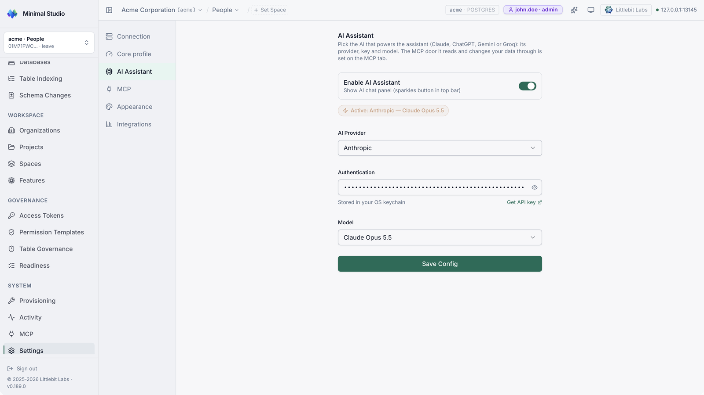
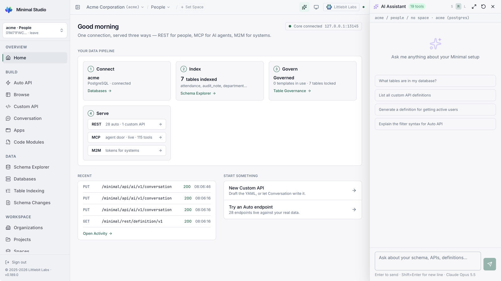
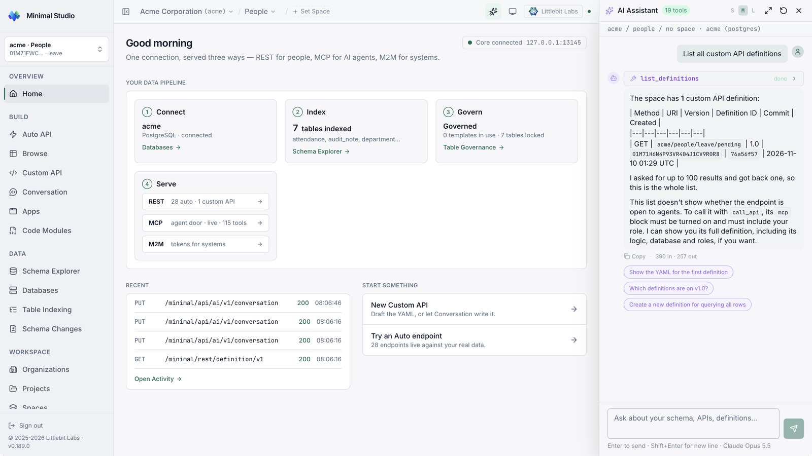

# 14. The AI Assistant

The AI Assistant is a panel that sits beside any page. It answers questions about your schema, APIs and definitions, and it reaches them the same way Conversation does: through the MCP door. This chapter sets it up, opens it, and asks it one question.

> **Setup.** The workspace of Chapter 5, and the MCP door open to the space (Chapter 17).

## Where it is set

1. Open **Settings → AI Assistant**. At the top, **Enable AI Assistant** shows or hides the chat panel, "sparkles button in top bar", and a badge names what is active, "Active: Anthropic — Claude Opus 5.5". Below it, three things: the **AI Provider**, the key under **Authentication**, and the **Model**; **Save Config** stores them. The key line reads "Stored in your OS keychain", never in a file of the project. The book's choice is **Anthropic**, with **Claude Opus 5.5**.

   

2. The note on the tab says the assistant's data goes through the MCP door of the next tab. Its reach is therefore the token of **Settings → MCP**, and what Chapter 18's locks and templates allow that token.

## Open it

1. On **Home**, select the button in the top bar that carries the sparkles, to the left of the monitor icon (`⌘.`). The panel opens on the right, headed **AI Assistant** with a badge, "19 tools", and the scope under it: `acme / people / no space · acme (postgres)`. Its four suggestions are "What tables are in my database?", "List all custom API definitions", "Generate a definition for getting active users" and "Explain the filter syntax for Auto API".

   

   On **Insights** the same button did not open the panel in this edition.

2. Select "List all custom API definitions". The panel shows your question, "Thinking…", and then the tool it called, `list_definitions`, marked done, and the answer. A reply such as:

   > The space has 1 custom API definition: GET `acme/people/leave/pending`, version 1.0. … The list doesn't show whether the endpoint is open to agents. To call it with `call_api`, its `mcp` block must be turned on and include your role.

   

   The reply says what Chapter 13 found by trial, that a definition is open to agents only through its `mcp` block. A line under it counts the tokens, here "390 in · 257 out", and the panel offers follow-ups such as "Show the YAML for the first definition".

3. The foot of the panel reads "Enter to send · Shift+Enter for new line · Claude Opus 5.5". The last icon at its top right closes it.

## What it costs

Every reply is a call to the provider, billed to the key you stored. The two exchanges of this chapter and the last were each a few hundred tokens; `notes/model-calls.md` logs them against the book's ceiling of US$10. Two settings control the cost: the model, here, and the row count of **Schema Sampling** on **Insights**.

## Exercises

1. Open **Settings → AI Assistant** and read the line under the key. Say where the key is kept.
2. On **Home**, open the panel and select "What tables are in my database?". Compare the tables it names with the list on **Browse**.
3. Press `?` and find the shortcut for the assistant. Check it against the button in the top bar.
