# 15. Organizations, projects and spaces

Chapter 5 built Acme's workspace. This chapter reads it back as an administrator would: who may do what to each level, what the screens show you and what they keep from you, and which actions belong to the operator rather than to you.

> **Setup.** The workspace of Chapter 5: Studio signed in as `john.doe` in **acme · People**.

## The operator's page

All the steps of this chapter happen in the Studio window, except those of **As the provisioner**, which the book ran in a browser (Chapter 2).

1. In the sidebar, under **SYSTEM**, select **Provisioning**. The line under the title reads "Organizations of this deployment and the routes only an operator may call. Every call carries the server key and the `sys:` user id below." The **Provisioner user id** is `sys:studio`.

2. The table lists each organization with its **Status**, its **Administrator** and its **Database roles**. Acme Corporation is **active**, administered by John Doe, and both **create** and **drop** read **nobody**. At the end of the row sit three icons: a power icon, a key icon and a bin.

   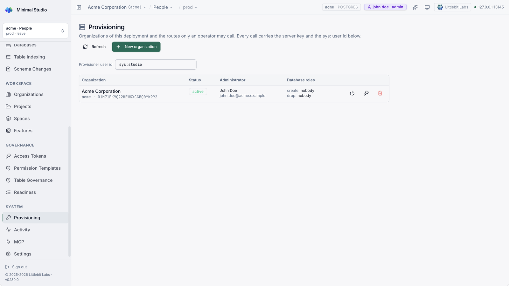

3. The line under the title says what the page is: "the routes only an operator may call. Every call carries the server key and the sys: user id below." The field **Provisioner user id** holds `sys:studio` for `john.doe`: the page sends that identity, with the server key, which Chapter 4 called a provisioner. **As the provisioner** signs in as one.

## Organizations

1. Select **Organizations**, under **WORKSPACE**. "1 organization" lists Acme Corporation, `acme`, **active**, with the administrator's name and email, its address, its ID, and the times it was created and last updated, with `sys:setup` as the one who updated it. **New Org** is greyed, and the note above says why: "Create, status, DDL roles and delete are server-key actions. Needs a user id that starts with sys: (a provisioner)."

2. Read the four role lists at the foot of the row. **Read the org**, **Update the org**, **Delete the org (recorded, not checked)** and **Create projects** are all `admin`; the label of delete adds "(recorded, not checked)". **Create a database** and **Drop a database** read **nobody**: they are set by a provisioner, and until one names a role, nobody holds them.

   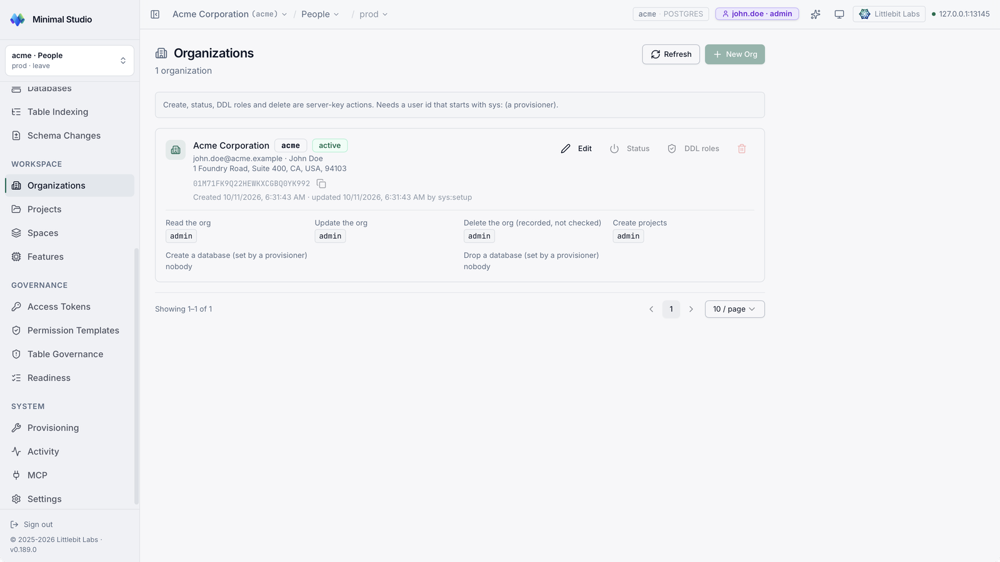

## Projects

1. Select **Projects**. The People project lists its abbreviation, its engine and database, `PostgreSQL · acme`, its description and its ID. The row offers **Edit**, **Add database**, **Edit connections**, **History**, **Schema roles** and delete. **Schema roles** is greyed for `john.doe`: it is the control Chapters 6, 16 and 19 keep running into.

2. Select the arrow at the row's start. The row opens on three role lists, **Read the project**, **Change the project** and **Delete the project**, all `admin`, and two more, **Read the schema** and **Change the schema**, which read **nobody** and are "set by a provisioner". Under them, **Embeddings** reads "off · dimension not set (fixed at 1536)", and **Connections (1)** lists the connection to `acme`: the host and port, the user, the pool of 20 open and 5 idle connections, and the timeouts. The password reads as a mask; **Reveal passwords** is the way to see it.

   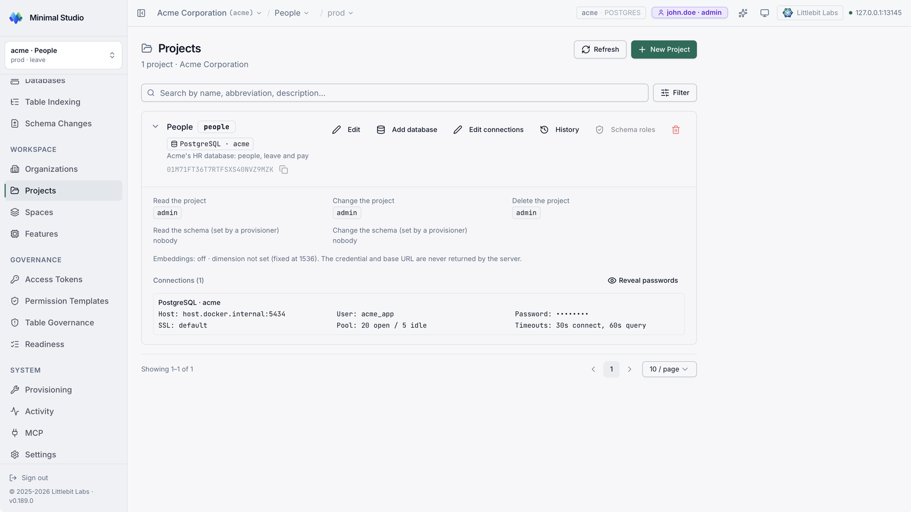

The two schema lists are the reason Live database, Scan and Schema Changes answer 403 on a new project: nobody holds them yet. They are not a fault; the project is new, and the one who may fill them is a provisioner. The next section fills them.

## As the provisioner

A provisioner is a sign-in whose user ID starts with `sys:`. Sign out and sign in again as `sys:setup`, as Chapter 5 did, or open a second Studio in a browser, which is what the book did (Chapter 2). Several pages carry a note of their own for it.

1. On **Organizations**, the note reads "Editing: A sys: user is refused on this route: sign in as an ordinary user to edit." **New Org**, **Status**, **DDL roles** and delete are live, and **Edit** is grey.

   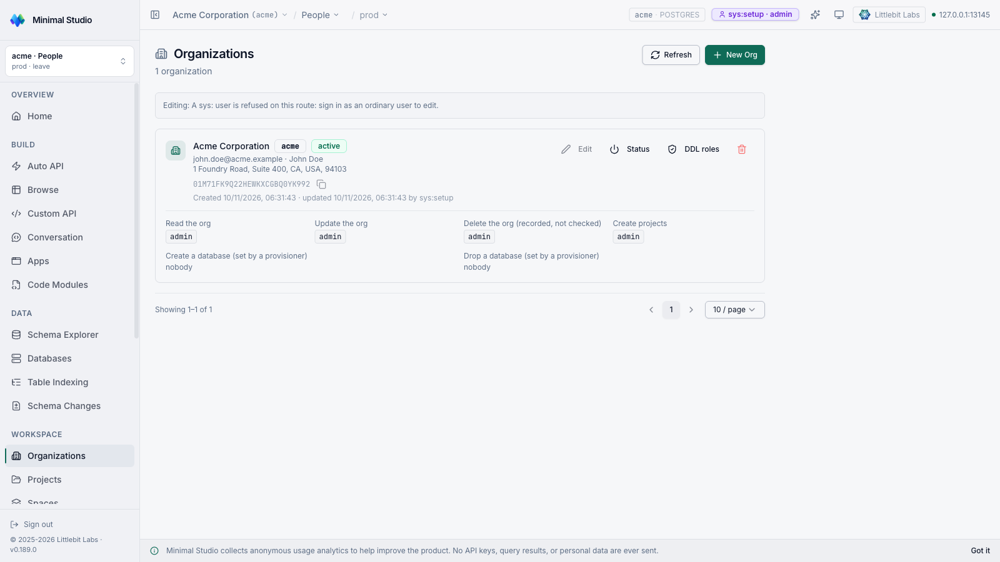

2. Select **DDL roles**. "Database roles of Acme Corporation": "Both start as nobody. Dropping a database also needs two confirmation tokens minted apart." The two lists, **Create a database** and **Drop a database**, take roles one at a time, "add a role, then Enter". Here both are empty.

   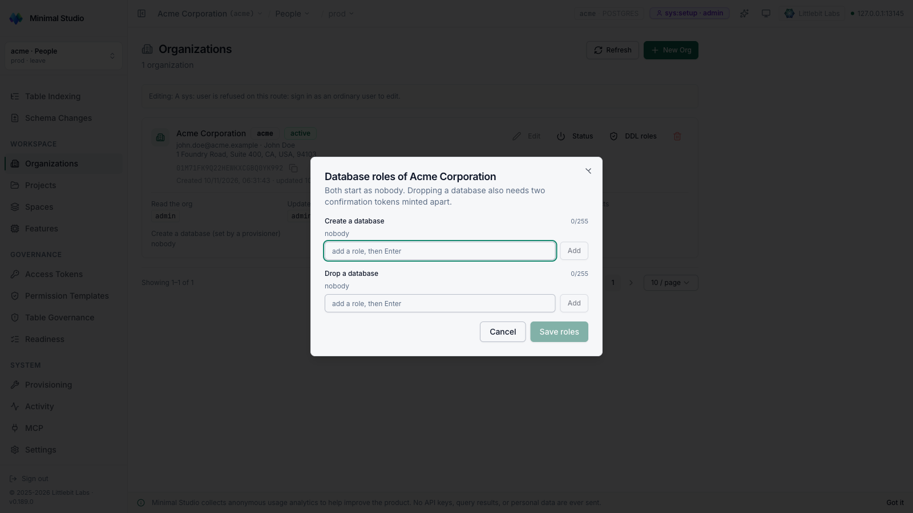

   Chapter 16 creates a database, which needs the first list. Type `admin` into **Create a database**, press `Enter`, and select **Save roles**: the chip "admin ×" appears, **Drop a database** stays "nobody", and "Database roles saved" follows. The organization's card then reads "Create a database (set by a provisioner): admin".

   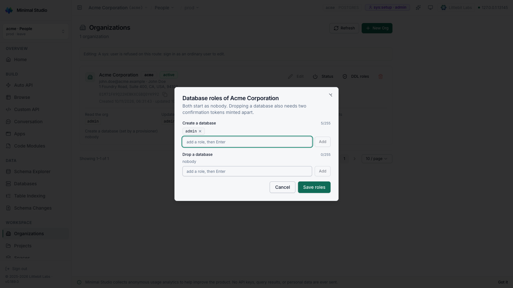

   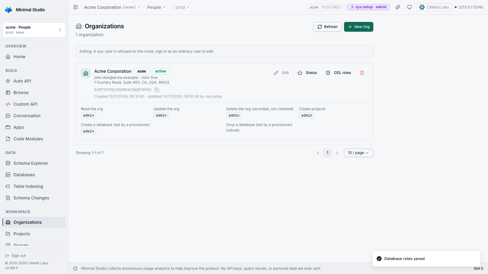

   Chapter 16's **Drop it** drops a database, which needs the second list too. Type `admin` into **Drop a database** as well, press `Enter`, and select **Save roles**: both lists hold the chip "admin ×", and the card names `admin` under both **Create a database** and **Drop a database**. The first shot below fills both lists before saving, so the card behind the dialog still reads "nobody".

   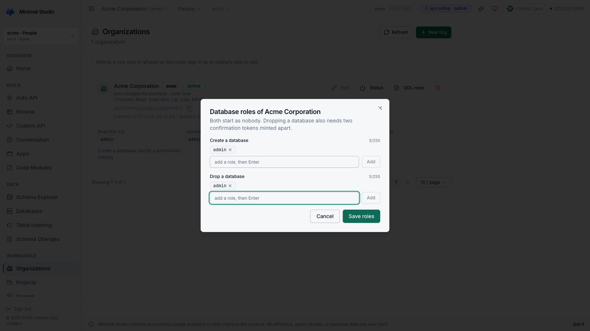

   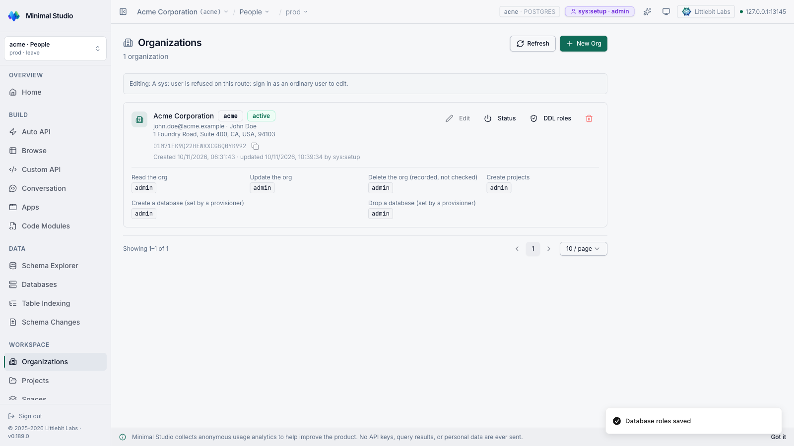

   The book put both lists back to "nobody" when Chapter 16 was done, so the other shots of this chapter read "nobody".

3. On **Provisioning**, the field **Provisioner user id** now holds `sys:setup`, the identity that signed in (for `john.doe` it read `sys:studio`), and the table lists Acme with **active**, the administrator, and, under **Database roles**, "create: nobody" and "drop: nobody" (the shot was taken before the grants above).

   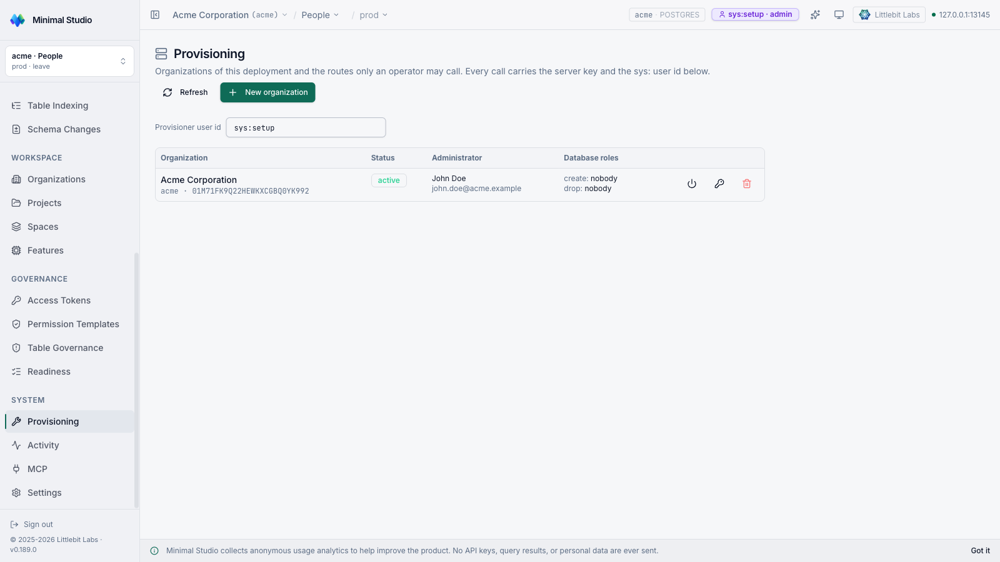

4. On **Projects**, the same note reads "Editing and deleting: A sys: user is refused on this route: sign in as an ordinary user to edit." **Edit**, **Add database** and **Edit connections** are grey; **History** and **Schema roles** are live. **Schema roles** is the reason a provisioner opens this page.

   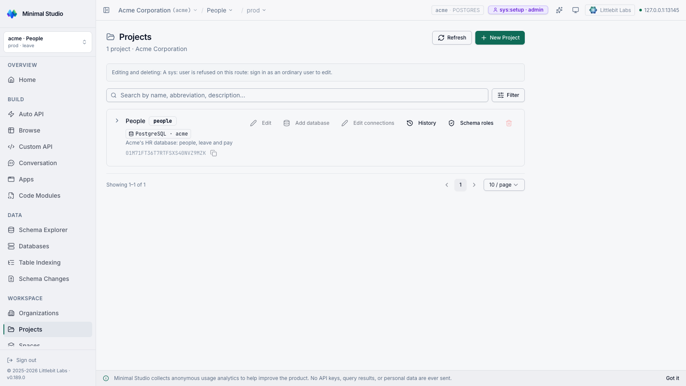

5. Select **Schema roles**. "Schema roles of People": "Until a role is granted here, the schema and database routes refuse everyone." There are two lists, **Change the schema** and **Read the schema**, both reading "nobody".

   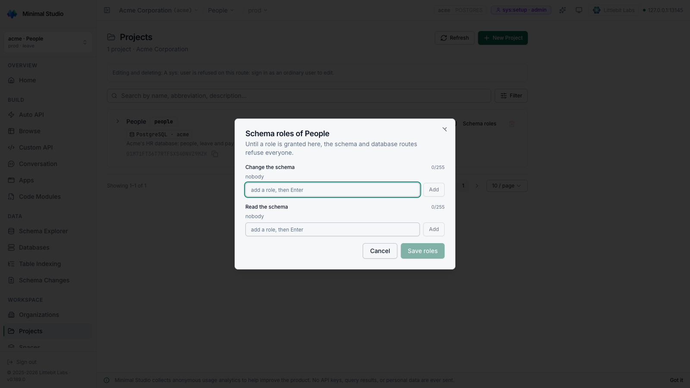

6. Type `admin` into each list and press `Enter`: the role appears as a chip, "admin ×", and the counter reads "5/255". Select **Save roles**: "Schema roles saved".

   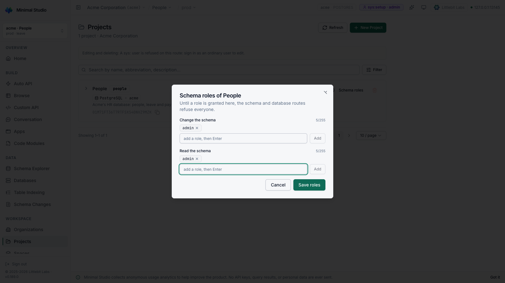

   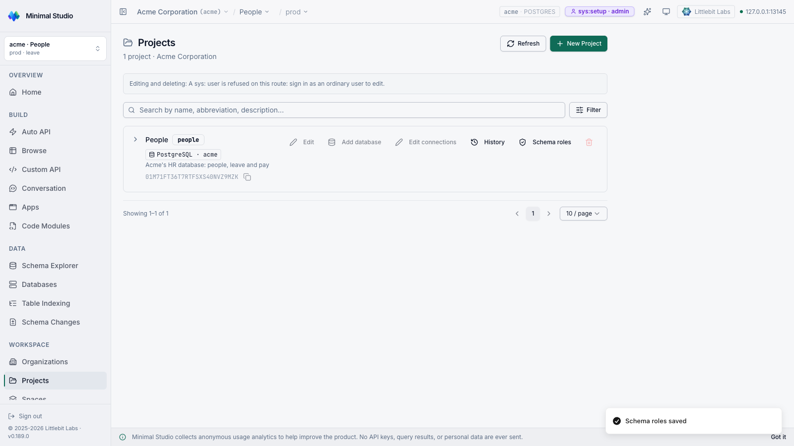

The grant is for the role `admin` on the project: every user with that role, `john.doe` among them, may now read the shape of Acme's database and change it. Chapters 6, 16 and 19 return to their pages as `john.doe` and find them open.

## Spaces and features

1. Select **Spaces**. The three spaces of Chapter 5 are listed with their descriptions, IDs and owner. A note heads the list: "v2 has no way to delete a space: it goes only when its project or organization is deleted. The owner is whoever created it and cannot be changed. History is kept for the owner only."

   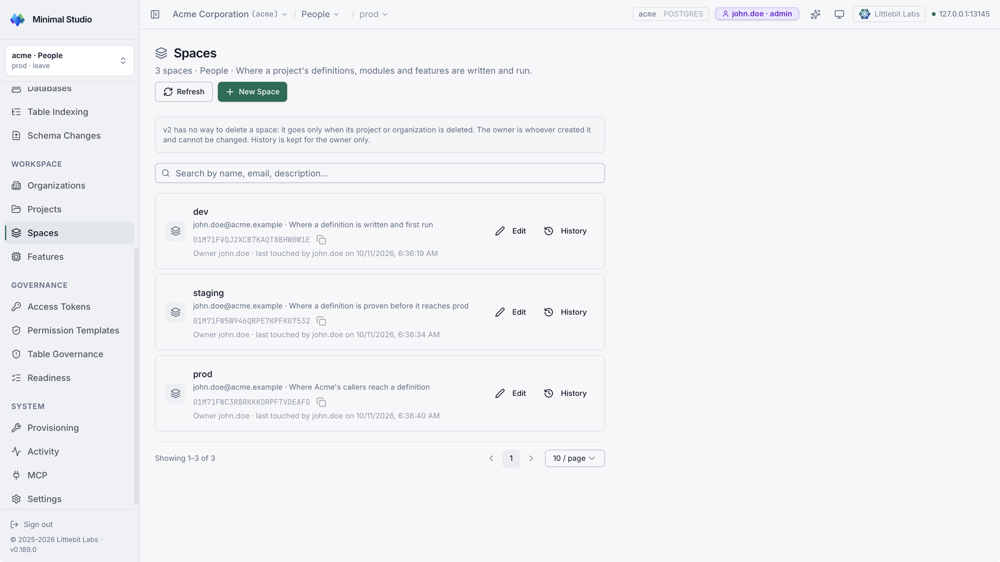

2. The same rule holds for features, on **Features** (Chapter 19): once created they stay with the project.

The rule changes how Acme plans its spaces. A space cannot be removed or handed to another owner, so `dev`, `staging` and `prod` are chosen with care; **Edit** can still change a space's name, contact email and description.

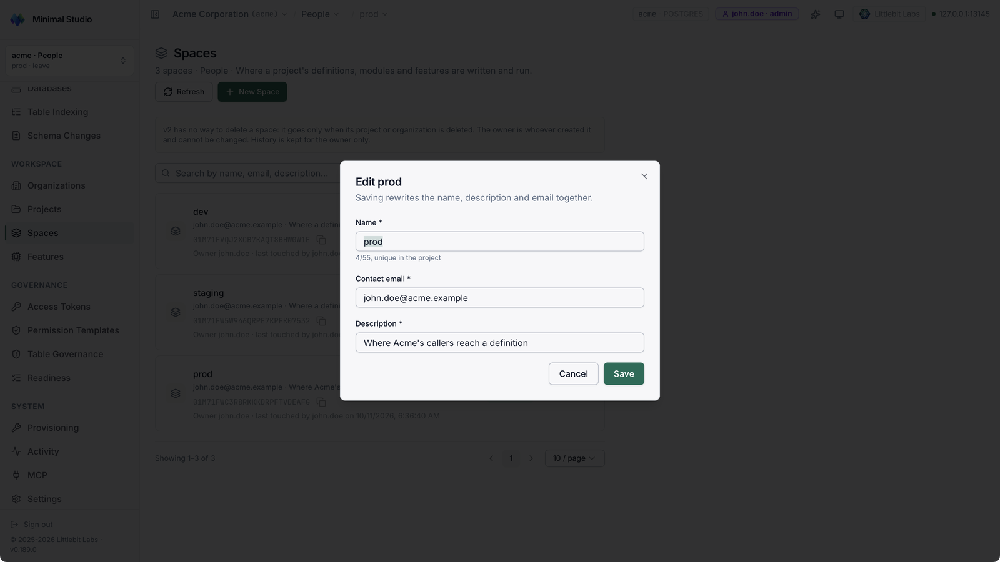

## Exercises

1. On **Organizations**, read the four role lists and the two database lists. Check which of them read **nobody**, and which control of the provisioner's page the note says is refused.
2. On **Projects**, open **People** and select **Reveal passwords**. Note what the page does, and select the control again to hide it.
3. On **Spaces**, open **History** on `prod` and read who touched it, and when.
