# 16. Databases and readiness

A database is registered on a project: the host, the login and the pool that the Core uses to reach it. The **Databases** page lists and tests them, adds one, asks the server to create one, or drops one. **Readiness** reads what is registered and says what is not yet safe. This chapter reads both pages, makes a scratch database and drops it, and says which parts wait for the role that Chapters 15 and 19 explained.

> **Setup.** The workspace of Chapter 5: Studio signed in as `john.doe` in **acme · People**.

## The Databases page

1. Select **Databases**, under **DATA**. The line under the title reads "Reading needs the project's schema read roles. Creating a database needs the organization's database create roles, dropping one its database drop roles." Above the list, four controls: **Test connection**, **Refresh**, **Add database** and **Create database**.

2. In the list, a red panel is headed "THE SERVER REFUSED THIS (HTTP 403)" over "caller does not hold a role permitted to read this database's shape", and explains: "A 403 is a role check: the project's schema_read_roles decide who may do this. A new project has nobody in that list — a provisioner sign-in grants it (Projects → Schema roles)." with a link, **Open Projects**. The list reads "No registered databases", though `acme` is registered: the page cannot read it back.

   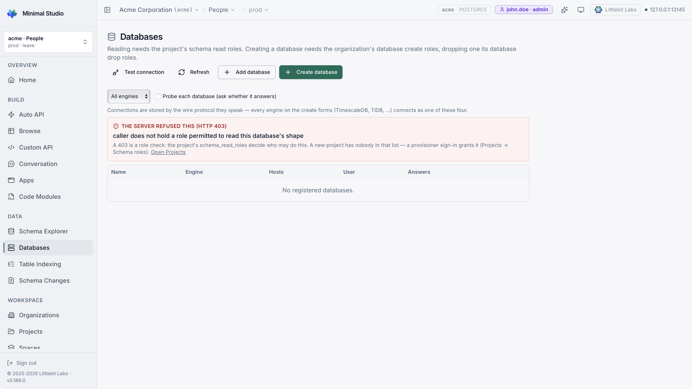

The 403 is the Core's design, not a Studio fault: the roles that decide it are the project's schema read roles, which Chapter 15 showed empty. Chapter 15 also grants them.

## After the grant

1. The page lists a single row: **acme**, **PostgreSQL**, the host and port the Core reaches the database at, the login, `acme_app`, and **Answers**, "not probed". Under the name, "Pool and other settings" opens the pool. The red bin at the end of the row opens the wizard that deletes the database from the server, data and all, which needs the organization's drop role (Chapter 15) and two confirmation tokens; **Drop it**, further down, runs it on a scratch database. Do not select it on a database you mean to keep.

   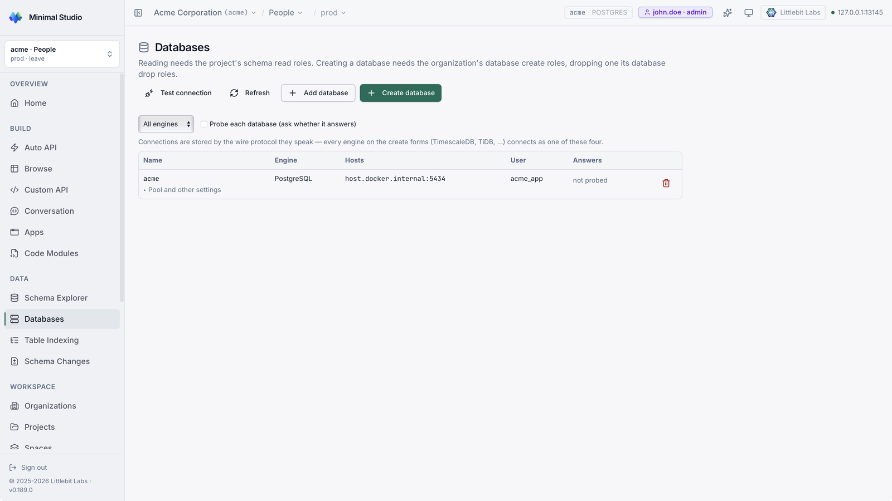

2. Tick **Probe each database (ask whether it answers)**. The Core asks each registered database whether it answers, and the column reads **yes**.

   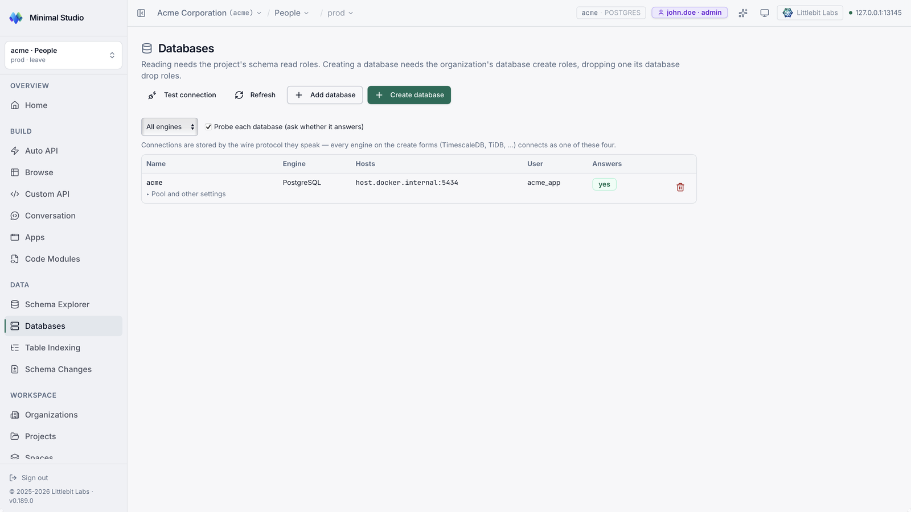

## Add a database

The shots of the two dialogs of this and the next section were taken before the grant, which is why the page behind them still shows the refusal.

1. Select **Add database**. The dialog reads "It joins People's connections — the existing ones stay exactly as they are. The connection is tried first; the try stores nothing." It asks for the **Type**, the **Host**, the **Port** (5432), the **Username**, the **Password** and the **Database name**, with **SSL and pool settings** folded below.

   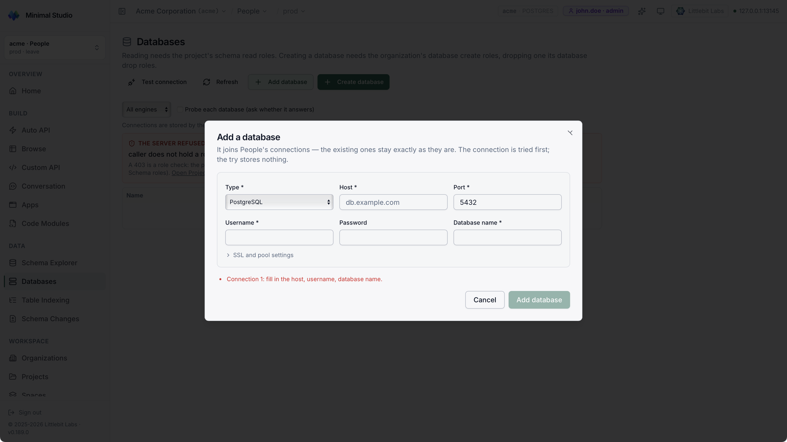

2. The foot of the dialog names what is missing — "Connection 1: fill in the host, username, database name." — and **Add database** stays dim until it is filled. For Acme this is the step Chapter 5 did once; Acme's connection is listed under the project on **Projects**.

The password field is the one place the book does not type for you: type it yourself, and do not paste it into a chat or a note.

## Create a database

1. Select **Create database**. The dialog reads "Creates it on the server, then registers it on the project. Needs the organization's database create roles." The **Engine** is one of a grid of fourteen, from **PostgreSQL**, **MySQL**, **MariaDB** and **ClickHouse** to **TiDB** and **StarRocks**; a line under the grid says more are on the way and that flat files (CSV, Parquet, JSON) import as tables. Chapter 23 registers all fourteen of these engines on one project.

2. Two connections are asked for. **Create connection (privileged, used once)** is the login that makes the database and is not kept. **Register connection (kept on the project)** is the login the project will use from then on; select the button **Same host and port as the create connection**, which copies the create host and port into the register fields, when they share a server. Under them, the pool and the timeouts: connect 30 s, idle 60 s, query 60 s, 20 open and 5 idle connections, and an **SSL mode**.

   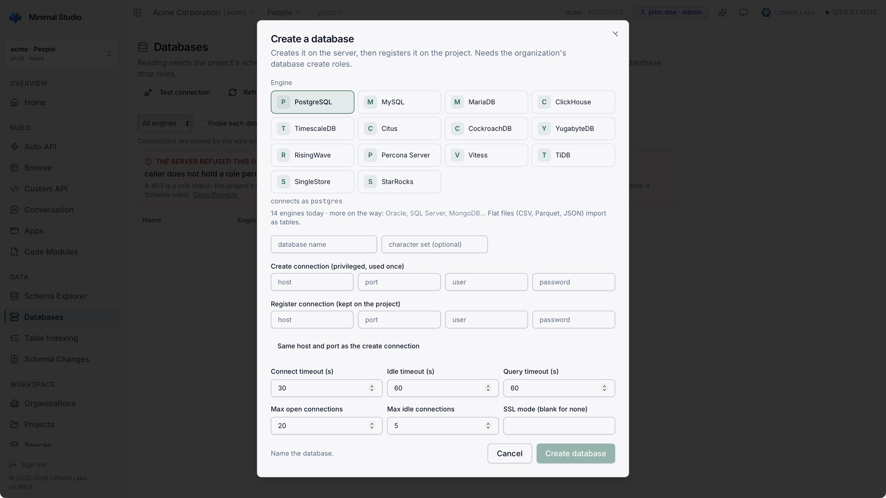

3. The dialog needs the organization's create roles, which read **nobody** until a provisioner names one; Chapter 15 shows where. The book gave `admin` the create role, and the drop role for **Drop it**, and put both back afterwards.

### Create one

The book makes a small second database on its own Postgres server. It needs a login that may create databases, and the book made a throwaway one for this on its local server: `book_creator`, with the right to log in and to create databases, and no other. Its password is yours to paste, in both password fields, as with every secret in this book.

1. In the dialog, leave the engine on **PostgreSQL** and type `book_sandbox` as the database name; the character set stays empty. Under **Create connection**, type the host, `host.docker.internal`, the port, `5434`, and the user, `book_creator`.

2. Under **Register connection**, select **Same host and port as the create connection**, which copies the two, and type the same user. The book uses one login for both to keep the example small; a real project registers an ordinary login that cannot create databases, and the privileged one is used once. Paste the password into both password fields. The timeouts and the pool keep their defaults.

   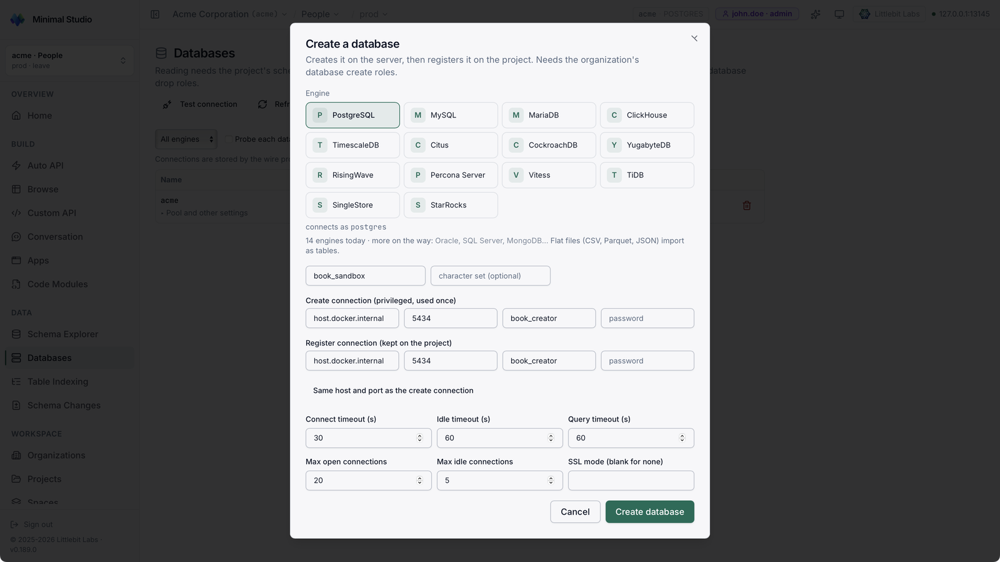

3. Select **Create database**. A message reads "Database book_sandbox created and registered" for a few seconds, and the dialog closes. The list now holds two rows, `acme` and `book_sandbox`, the second reached through `book_creator`.

   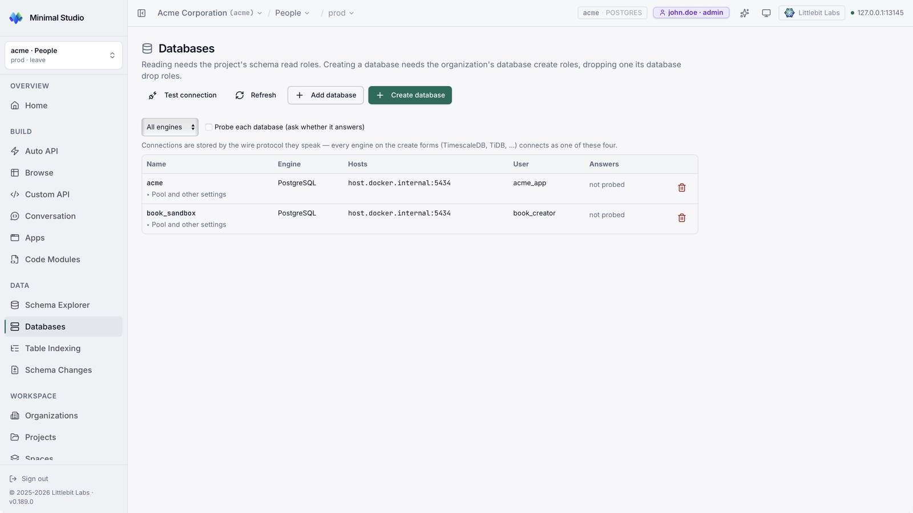

4. Tick **Probe each database (ask whether it answers)**: both rows read **yes**. The Postgres server lists the new database too, owned by the login that made it.

   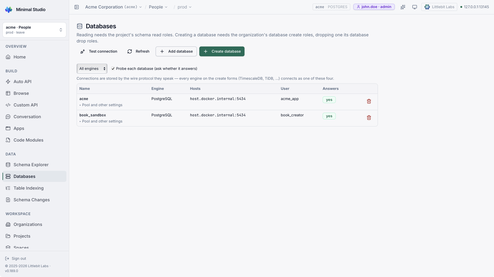

A refusal the book met once, when it made the database a second time with the same login name and a new password: **Create database** answered twice with a red panel, "THE SERVER REFUSED THIS (HTTP 502)", "the server refused to create the database: failed to connect to `user=book_creator database=postgres` … failed SASL auth: FATAL: password authentication failed for user "book_creator" (SQLSTATE 28P01)", and under it "The server could not read or run something on the database; the engine's own message follows. Check that the database is up." The password was right: the same password, tried from another container against the Postgres server, logged in. After the Core was restarted, the same dialog, unchanged, created the database. The book did not find the cause, and saw it once. If a create is refused like this with a password you know is right, ask whoever runs the Core to restart it, and try again.

### Drop it

The red bin at the end of a row opens the wizard that deletes the database from the server, data and all. It needs the organization's drop role, which the book gave to `admin` for this section (Chapter 15), and two confirmation tokens, minted at least 23 minutes apart. Nothing is sent by itself: each request waits for its own button.

1. Select the red bin on the **book_sandbox** row, and not on `acme`'s. "Drop postgres / book_sandbox" opens: "This cannot be undone. The server wants two confirmation tokens minted at least 23 minutes apart (its default; if it is set differently, it refuses and says so). Needs the organization's database drop roles." Three steps are listed: **Mint the first token**, **Wait out the gap, then mint the second token** and **Name the database and drop it**. Only the first has a button; the others read "Mint the first token first." and "Available once both tokens are held."

   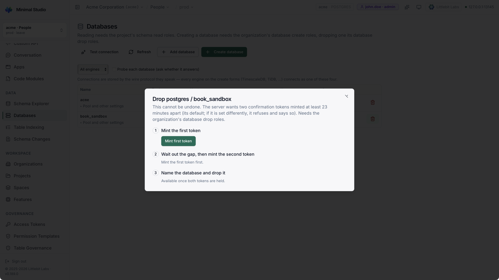

2. Select **Mint first token**. The step is ticked and reads "Held (…xxxx), minted at 11:03:00 AM. It is kept in this window only." The wizard shows only the last four characters of the token, which the shot covers. Step 2 now shows a countdown, from 23:00 (22:32 in the shot), beside a dim **Mint second token**. Under the steps, **Last answer to a token request** keeps the server's own answer folded under **Raw answer**; the book left it folded, since it may hold the token.

   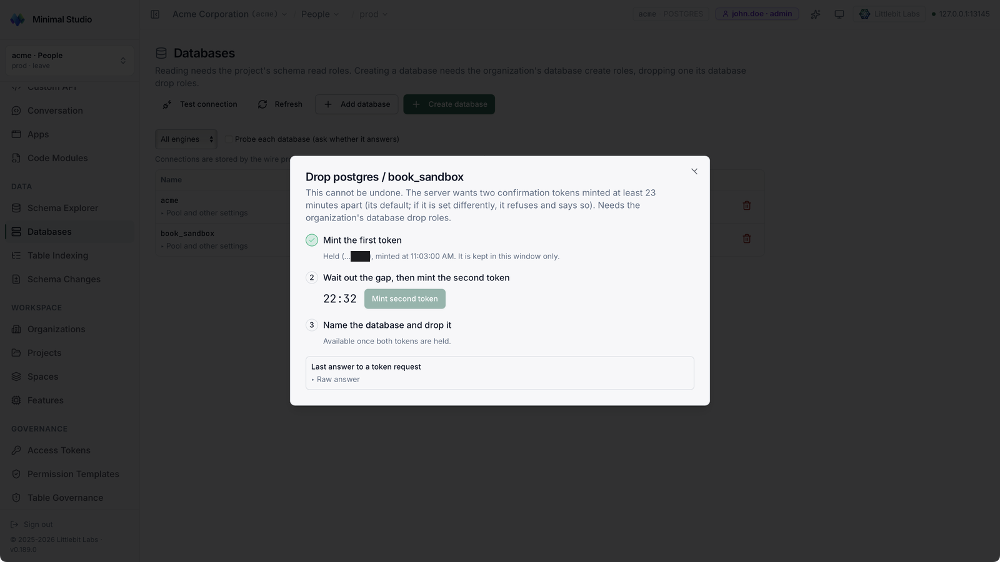

3. Wait. Stay on **Databases**: the wizard says the token is kept in this window only. The book did not test what leaving the page does, and left it alone for the 23 minutes.

4. When the countdown reads 0:00 the button turns green. Select **Mint second token**. The step is ticked, "Held (…xxxx), minted at 11:26:22 AM": 23 minutes and 22 seconds after the first, and the server accepted it. Step 3 opens: "Type book_sandbox to confirm which database goes.", a box for the name; **Connection that may drop it**, with host, port, user and password, all empty; a comment, optional; and the red button **Drop database book_sandbox**, dim until the form is filled in.

   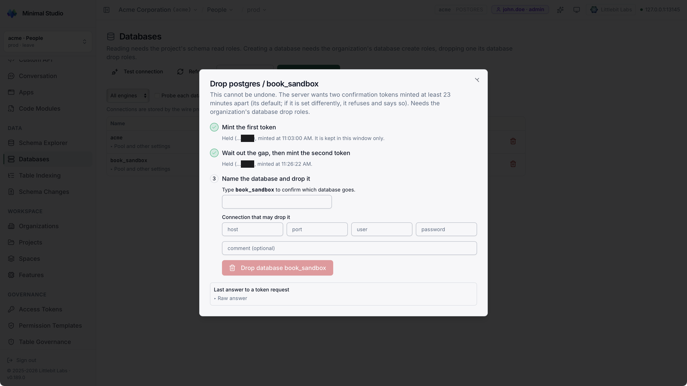

5. Type `book_sandbox` in the first box. Fill in the connection of a login that may drop the database: Postgres lets the owner of a database, or a member of its owner's role, drop it. The book made such a login on its server, `book_dropper`, a member of `book_creator`, and used it rather than `book_creator` itself because the Core had once refused a changed password for that name (above). Type the host, `host.docker.internal`, the port, `5434`, that user, and its password, which is yours to paste. The comment stays empty. The button turns red.

   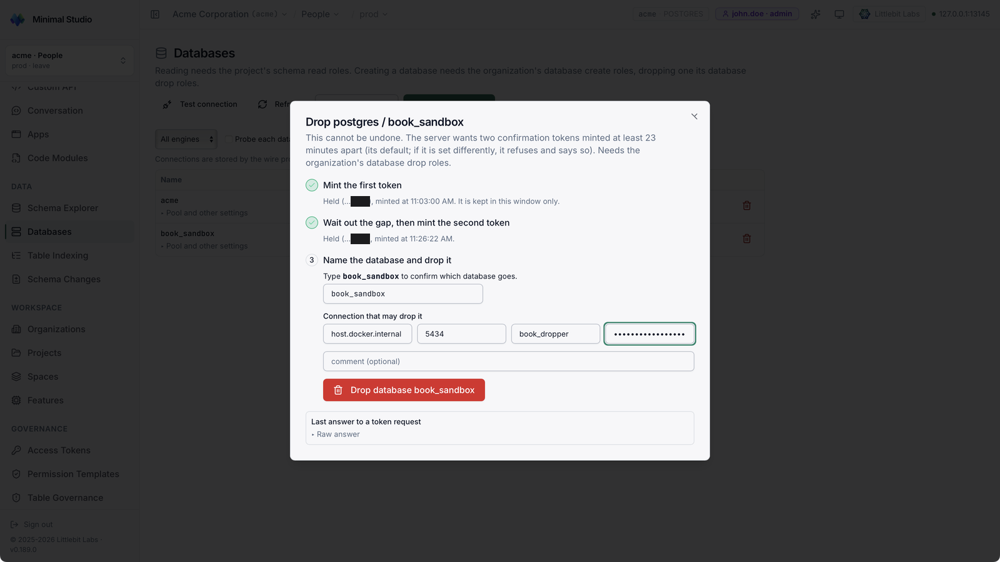

6. Select **Drop database book_sandbox**. The wizard closes and a message reads "Database book_sandbox dropped" for a few seconds; the shot was taken after it faded. The list holds one row again, `acme`. The book read the rest elsewhere: **Projects** lists one connection, so dropping took the database off the project as well, and a query on the Postgres server lists only `acme` and `postgres`, apart from its templates, with `acme` still holding its 120 employees.

   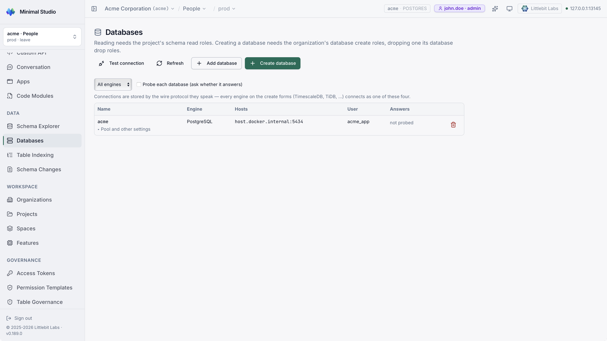

### Take it off the project without dropping it

The wizard is not the only way off the project. **Edit connections** removes a connection and leaves the database on the server. To try it, make a second scratch database as above, and use this instead of the drop.

1. On **Projects**, select **Edit connections** on the People project. The dialog reads "Saving replaces the whole set of connections with the list below. Each one is tried first; the try stores nothing." A warning adds "Any connection you remove here is dropped from the project. The server never shows stored passwords, so a password cannot be sent back as read: type it again, or load the current ones (needs the project's write role)." Under **DATABASE CONNECTIONS (2)** the two databases are listed, each with its type, host, port, user, a password field that reads "hidden: type it again", and the database name.

   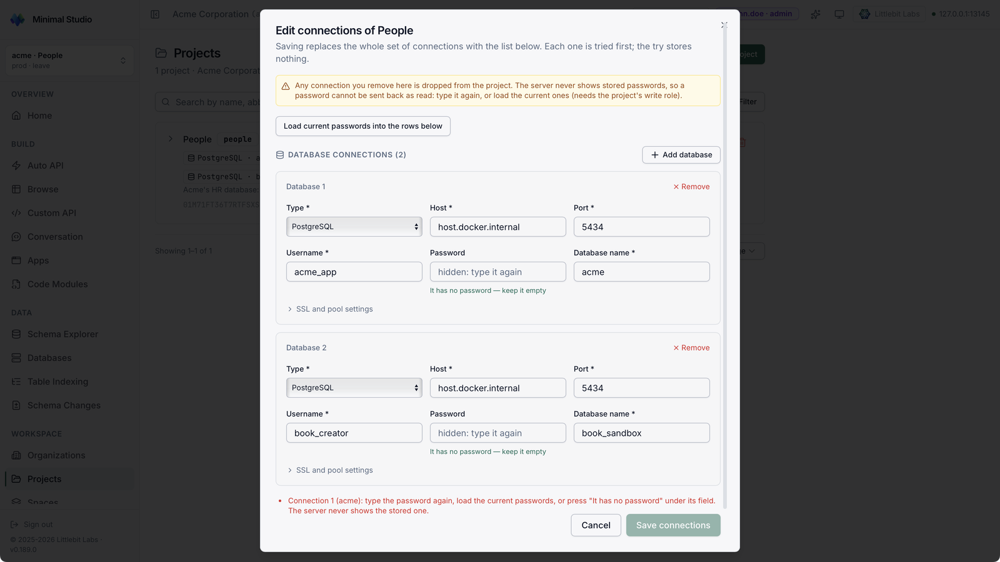

2. Select **Remove** on Database 2, `book_sandbox`. For `acme`, select **Load current passwords into the rows below**: the field fills, and the row reads "The Core can open this connection." Select **Save connections**: "Connections saved". The project lists one database again, and **Probe** still answers **yes** for `acme`.

Removing a connection unregisters the database; it does not delete it. The database stays on the server, and with no row on **Databases** it has no red bin, until **Add database** registers it again. Dropped on the server itself instead, it can be refused while the Core still holds a connection to it; the book met this once, with an earlier scratch database of the same name, and ended the Core's last session first.

## Readiness

1. Select **Readiness**, under **GOVERNANCE**. The line under the title reads "Findings are advice, not gates — nothing here blocks anything." A green line, "Clean: every token expires, no Custom API is open to agents.", comes first, then a list of findings, each with the page that fixes it.

2. For Acme, at this point of the book, the findings read: tables reachable on an open channel with no template, "every role passes", 7; tables without a row scope, 7; and tokens unused for thirty days or more, 1. The shot was taken after Chapter 18 hid `salary`, so the counts are of seven tables; before that they count eight. The first two lead to **Table Governance**, the third to **Access Tokens**. Chapter 18 assigns a template to three of the seven, and the page changes with it.

   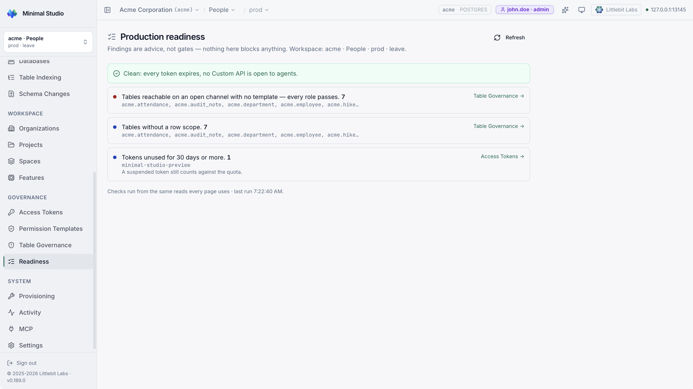

3. After Chapter 18 the same page reads 4 for the first finding, naming `attendance`, `audit_note`, `hike` and `holiday`, the tables with no template; 7 for the row scopes; and 2 for the unused tokens, both named `minimal-studio-preview`, which the book did not mint. The green line is unchanged.

   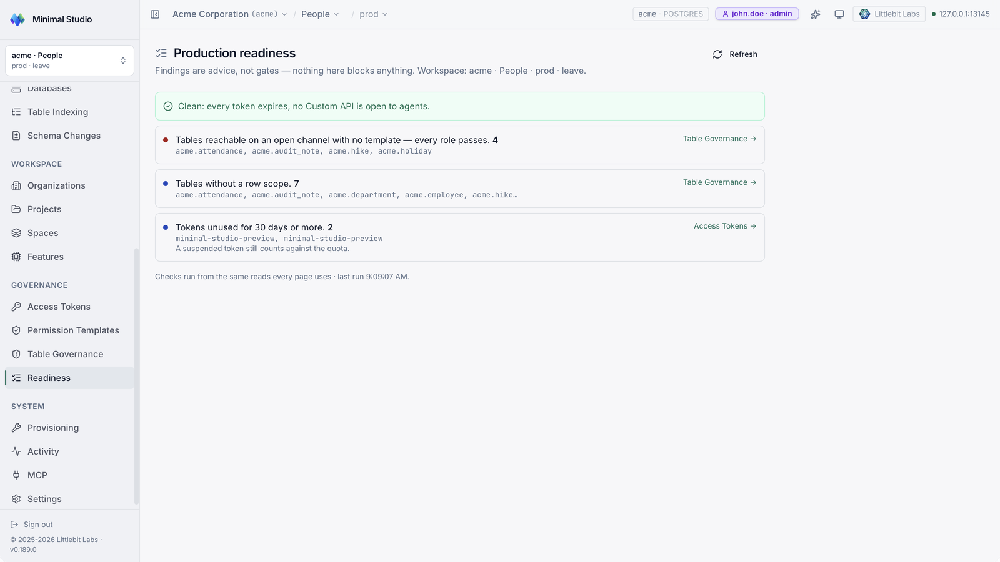

## Exercises

1. On **Databases**, read the red panel and say which role list it names. After Chapter 15's grant, tick **Probe each database** and read the answer.
2. Open **Add database** and leave it empty. Read what it says is missing, and select **Cancel**.
3. On **Readiness**, follow the link of the first finding. Check which page it opens and what it lists.
