# 17. Access tokens and the MCP page

Studio signs you in; a token signs in everything else. A script, an automation or an AI agent calls the Core with an access token, which carries its own roles, its own powers and its own expiry, and can be revoked without touching anything else. This chapter mints Acme's first token, hands it to Studio's own MCP page, and reads the refusal that teaches where MCP tokens must come from.

> **Setup.** The workspace of Chapter 5: Studio signed in as `john.doe` in **acme · People**; the sections from `mcp:agent` on use **prod**, entered by its IDs at sign-in: the top bar then reads "Set Space" and the sidebar chip shows the space's ID in place of its name.

## Mint a token

All the steps of this chapter happen in the Studio window.

1. Select **Access Tokens** in the sidebar, under **GOVERNANCE**. The line under the title reads "A token carries roles and a key type (which of create, read, update, delete it may do). Use one for an MCP client or a script; they replace power tokens." The list, filtered to **Mine, in this space**, reads "No tokens."

   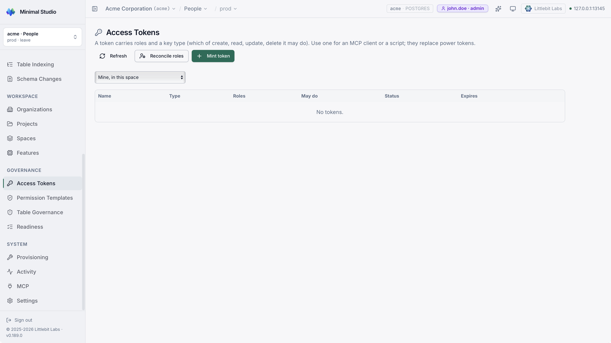

2. Select **Mint token**. The dialog **Mint an access token** warns "Roles and expiry cannot be changed afterwards. Prefer the fewest roles and a read-only key type." Its **Type** opens on **MCP agent**, and under **May do: create, read** two lines explain the choice: "MCP transport is POST — this type needs Create to work at all." and "The listener also needs the token's owner to be an mcp: user id — the owner is whoever mints it, so mint it signed in as one." **Roles** reads "(yours: admin)", and **Expires in (days)** is 30.

   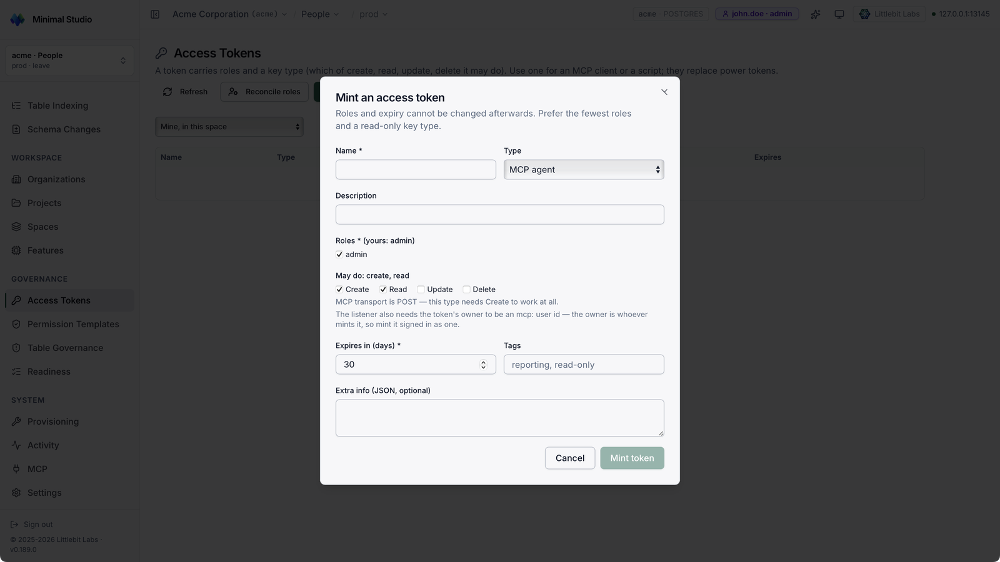

3. Type `book-mcp` as the **Name** and `The book's MCP token` as the **Description**, and select **Mint token**. A dialog shows the token once, in plain text: "Anyone with this string can act as the token until it is deleted. Copy it now into your password manager — Studio keeps it only if you choose Use for MCP."

   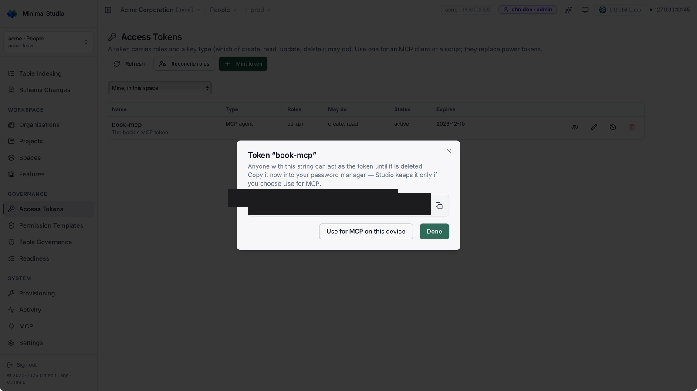

4. Select **Use for MCP on this device**. The dialog's second line becomes "Saved to your OS keychain.", and a link appears, **Open MCP → Test**. Select **Done**.

   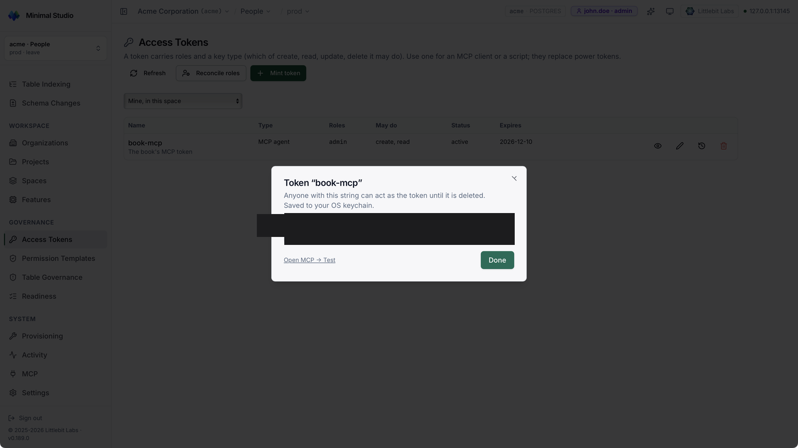

5. The list now holds **book-mcp**: type **MCP agent**, roles `admin`, **May do** "create, read", status **active**, and its expiry date. The first icon at the row's end reveals the token again; the red one deletes it.

   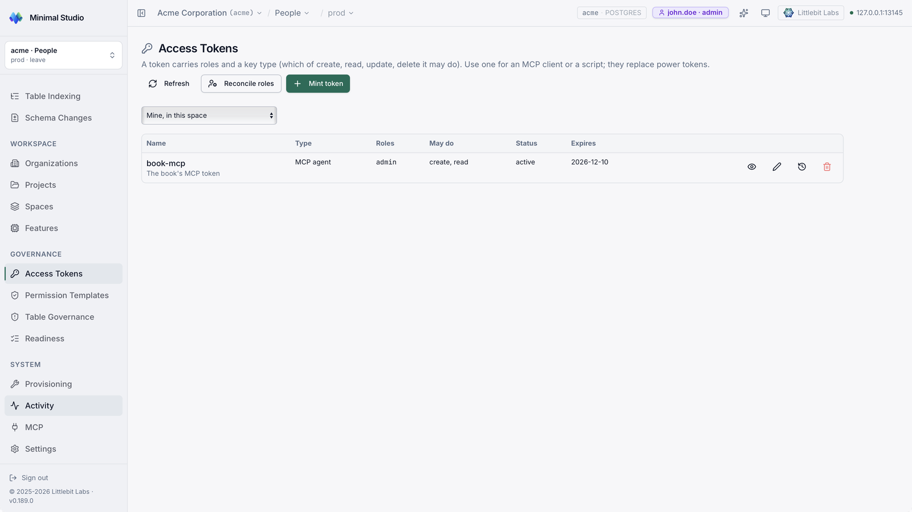

## The MCP page

The Core serves the same tables to AI agents as tools, over MCP, through a door of its own. Studio's **MCP** page lists the tools that door offers and tries them, with the URL and the token that **Settings → MCP** holds.

1. Select **MCP** in the sidebar, under **SYSTEM**. With no token saved, as in the book's first look, the page shows a red "Connection failed" heading over "No MCP access token. Paste one in Settings › MCP — your administrator mints it, or an mcp: sign-in does." If you saved the token of the section above, step 3 shows what **Connect** answers instead.

   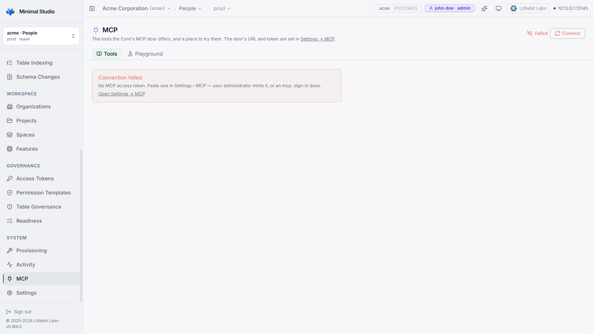

2. Open **Settings**, tab **MCP**: "The door the AI assistant uses to read and change your data. One place for its URL, its access token and Test." **MCP server URL** names the door, and the note under it says the URL ends in `/minimal/mcp/rpc/v1`. A default Core serves the door on port 3046; the book's Core serves it on 13146, so type `http://127.0.0.1:13146/minimal/mcp/rpc/v1`. **MCP access token** already holds the token that **Use for MCP** saved, masked; the text under it repeats the rule the Mint dialog stated, names the way a gateway's administrator makes one (on Pitstop, `docker compose run --rm mcp-token --name <you>`, which Chapter 30 describes), and says the desktop app keeps the token in the system keychain until you sign out. Select **Save**.

   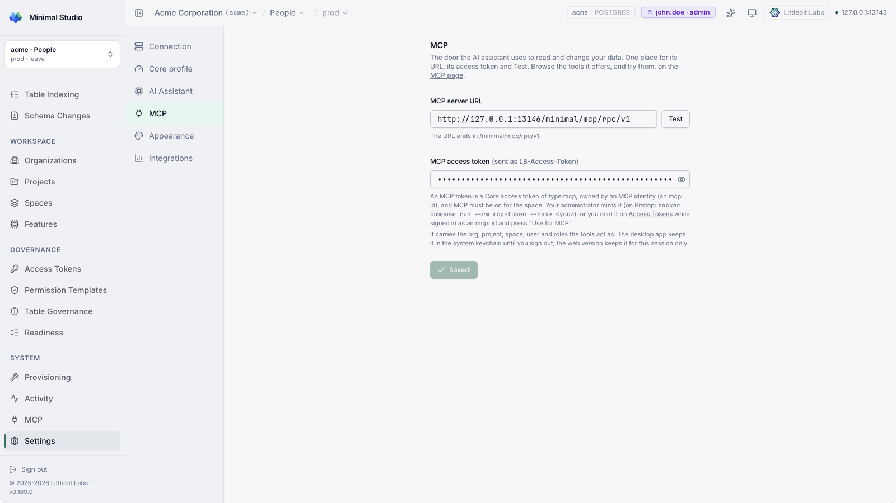

3. Back on **MCP**, select **Connect**. The door refuses: "HTTP 403: this access token's owner is not an MCP identity: mint the token for an MCP user/persona/profile whose id carries the deployment's MCP prefix", and the page adds the fix: "Sign in with an mcp: user id (for example mcp:agent) and mint the token there — the token's owner is whoever mints it."

   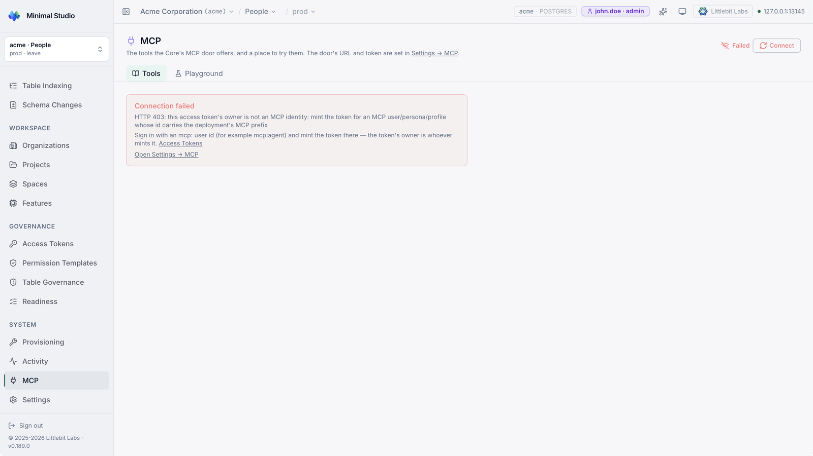

The Mint dialog said so before the mint: the door takes only a token whose owner is an `mcp:` user ID, and a token's owner is whoever minted it. `book-mcp` belongs to `john.doe`, so the door refuses it, active or not. The token that works is minted the same way, signed in with the user ID `mcp:agent`. A URL that names a door the token's Core does not serve fails differently, with a 401 "access token does not resolve to an active, unexpired grant": when that message surprises you, check the URL first.

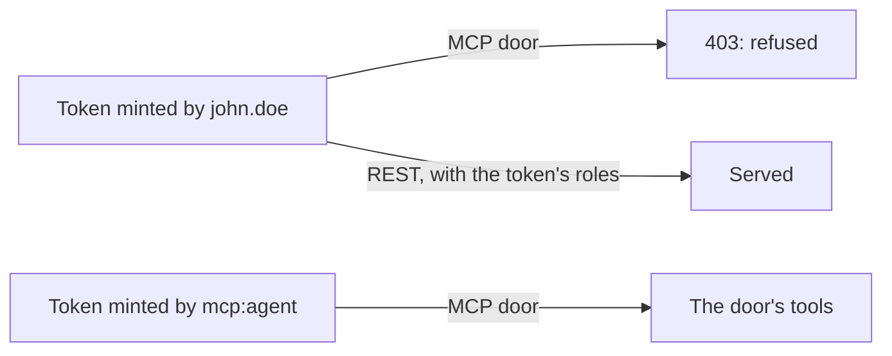

*The MCP door takes only tokens owned by an mcp: identity; the same token is fine elsewhere.*

## A token owned by mcp:agent

1. Sign out and return to the sign-in page of Chapter 3: choose **Direct to Core**, type the Core's address, and open **Identity options**. Type `mcp:agent` as the **User ID** and keep the role `admin`. Paste the server key, select **Continue**, and open the workspace as before.

2. On **Access Tokens**, mint a token as above: the **MCP agent** type, `book-mcp-agent` as its name. The list reads **book-mcp-agent**, **MCP agent**, `admin`, "create, read", **active**. Select **Use for MCP on this device**: "Saved to your OS keychain."

3. Open **MCP** and select **Connect**. The 403 is a different one now: "HTTP 403: MCP is not enabled for this space; it is switched on per space by the platform". The door has accepted the token's owner and refused the space.

   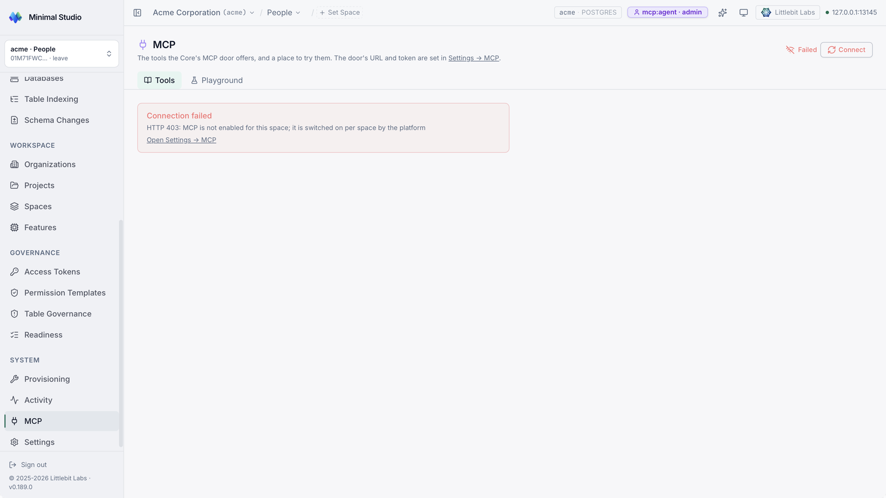

4. Nothing in Studio switches it on. **Edit** on a space offers only the name, the contact email and the description (Chapter 15 shows the dialog), and **New space** the same three. The switch belongs to whoever runs the Core: a space made by a provisioner may be created with it on, and one made through Studio is not. Until it is on, the pages that use the door, **MCP**, **Conversation**, **Insights** and the assistant, answer with a refusal of their own: **Conversation** keeps its composer dim and **Insights** shows the failed connection above its persona list. The shots below were taken with `john.doe`'s token, so they show the owner refusal of the first section.

   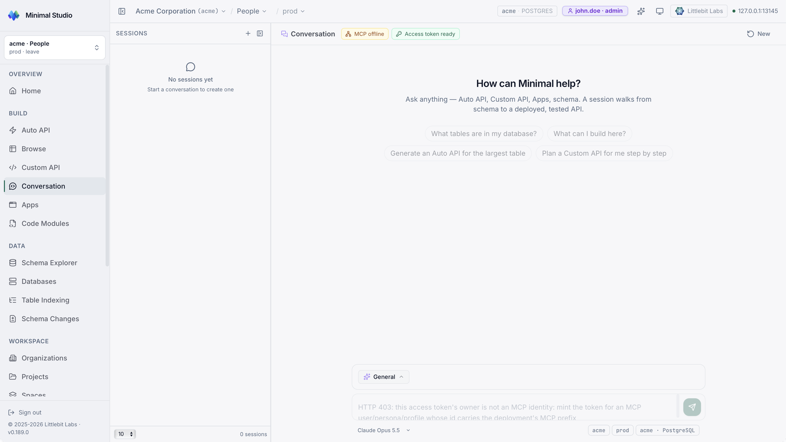

   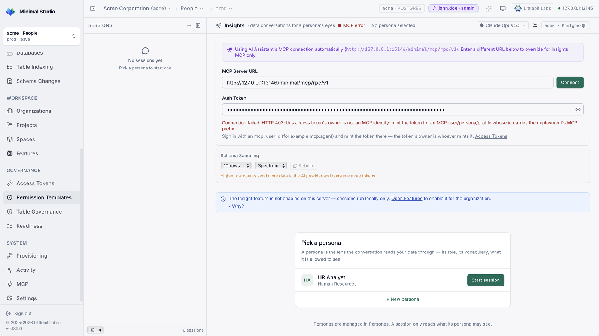

The mcp: sign-in clears the first refusal, and the per-space switch is the second.

## The door open

On the book's Core the operator switched the door on for `prod`, outside Studio. Select **Connect** again.

1. A message briefly reads "Connected — 115 tools available", and the page shows "115 tools" beside **Reconnect**, and a **Tools (115)** tab. The tools are listed alphabetically, each with its parameter count, a one-line description and **Try**. A search box narrows the list, and the tab **Playground** runs one.

   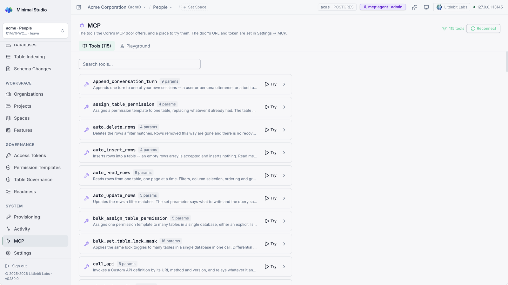

2. Search for `list_all_spaces` and select **Try**. The Playground names the tool, shows its description and an **Arguments (JSON)** box holding `{}`. Select **Run Tool**. The result is the three spaces as the Core holds them, each with its IDs, its owner and its `mcp_enabled` flag: `1` for `prod`, `0` for `dev` and `staging`.

   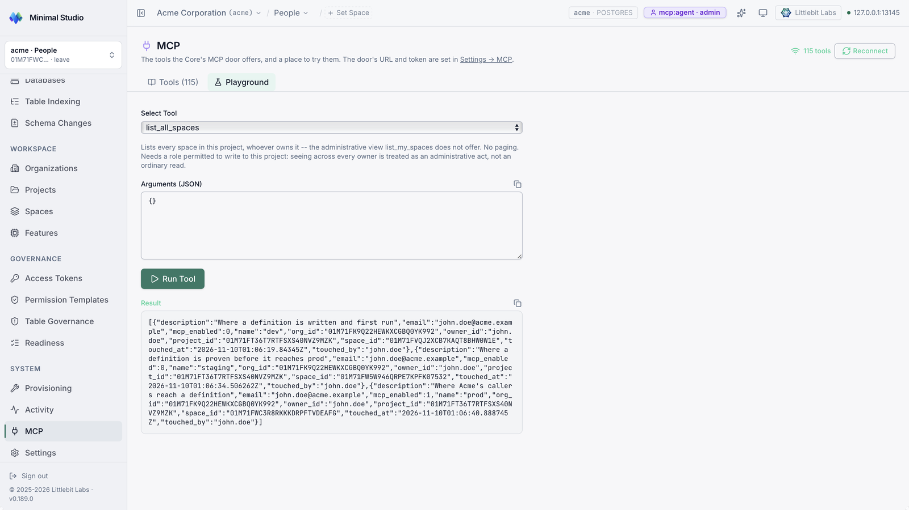

The door is open for `prod` alone, and for the token's owner: the tools run as the token's identity, with its roles and the locks of Chapter 18. Chapters 12 to 14 use it, and Chapter 30 hands it to a terminal, to another AI client and to another person.

Volume 1, chapter 7 of the Book of Minimal sets out the MCP door and its sessions; volume 2, chapter 7 the rule about owners.

## Exercises

1. Open the **Mint token** dialog and read the two sentences under **May do** while **Type** is **MCP agent**. Select **Cancel**.
2. On the token's row, select the eye icon. Check that the reveal dialog's last line reads "Studio already holds this token for MCP.", then select **Done**.
3. On **MCP**, select **Connect** and read the refusal. Check that its first line names the token's owner as the problem, and which page each of its two links opens.
