# 18. Permission templates and table governance

Indexing a table makes it known to Minimal; it does not decide who may use it. Two pages decide. **Permission Templates** keep reusable sets of roles, one per caller channel and verb. **Table Governance** says which template each table follows, which locks it carries, and whether it is seen at all. This chapter writes two templates for Acme and hides the one table that should never be listed, `salary`.

> **Setup.** The workspace of Chapter 5: Studio signed in as `john.doe` in **acme · People**, with the eight tables indexed. The shots of the section "Open the tables to agents" were taken signed in as `mcp:agent`, and the later ones with the space entered by its IDs, so their top bar reads "Set Space"; the others are `john.doe`'s.

## A template

All the steps of this chapter happen in the Studio window.

1. In the sidebar, under **GOVERNANCE**, select **Permission Templates**. The line under the title reads "Named, reusable role matrices — three caller channels × four verbs — assigned to tables in Table Governance. An empty cell closes that channel + verb; a table with no template is open to any role (locks still apply)." The list reads "No templates yet".

   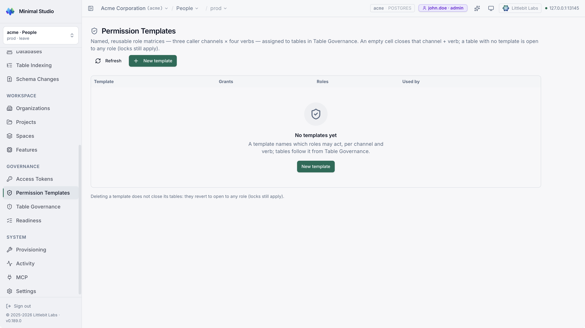

2. Select **New template**. The form asks for a **Name** (up to 100 characters) and a **Description**, and shows a matrix: the verbs **Create**, **Read**, **Update** and **Delete** down the side, and the channels **Auto API (REST)**, **MCP** and **Machine to machine** across the top. A cell holds the roles that may act; empty means closed. On the right, **EFFECTIVE GRANTS** restates the result as you edit: "Auto API closed · MCP closed · M2M closed".

3. Type `hr-read` as the **Name** and `Every role reads, nobody writes` as the **Description**. Under **Start from**, select **Reads for every role**. The **Read** row fills with the one role this organization knows, `admin`, on all three channels, and **EFFECTIVE GRANTS** now reads "Auto API read · MCP read · M2M read".

   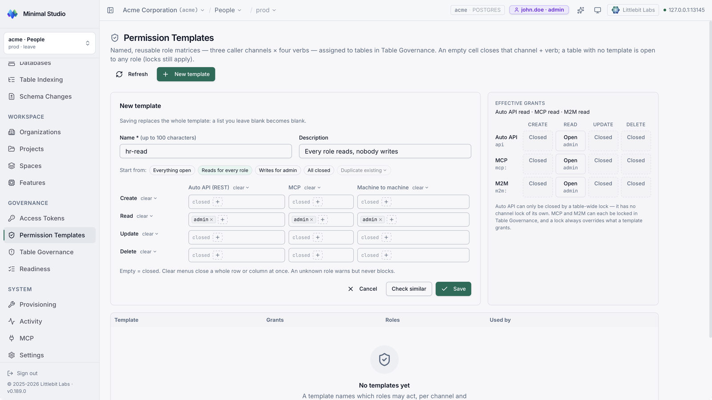

   The other presets are **Everything open**, **Writes for admin**, **All closed** and **Duplicate existing**. **Check similar** looks for a template that already does the same.

4. Select **Save**. "Template created" appears, and the list holds `hr-read` with its grants, its roles and "Used by 0 tables".

5. Do it again for a template that closes everything: select **New template**, type `salary-closed` and `Nobody reads or writes; for the salary table`, select **All closed**, and **Save**. Its grants read "Auto API closed · MCP closed · M2M closed" and its roles "none".

   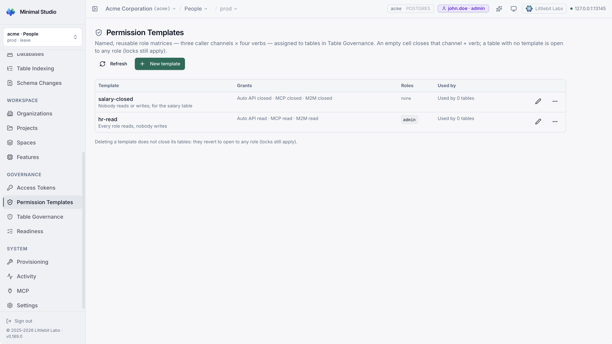

A template is a statement of intent; it protects nothing until a table follows it. Deleting one does not close its tables: "they revert to open to any role (locks still apply)".

## Table governance

1. Select **Table Governance**. The page lists the indexed tables of `acme`, eight of them, each with a **Template** chooser and its **Locks**. Every table reads "fresh from indexing — serving reads only", and under it "table: create, update, delete · mcp: all · m2m: all": a new table starts with writes locked, and with the agent and machine channels shut.

   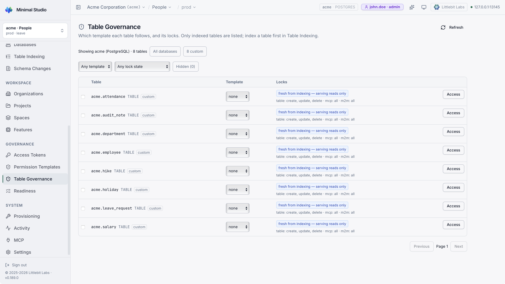

2. Select **Access** on the row of `acme.salary`. The dialog is headed **Access: acme.salary**, and says "Checked in order: visibility → locks → template → row scope." That order is the whole model:

   | Check | Question |
   |---|---|
   | Visibility | Is the table listed at all? |
   | Locks | Is this verb locked, table-wide or for one channel? |
   | Template | Does a role of the caller appear in the cell? |
   | Row scope | Which rows does the caller see? |

   The matrix of locks shows **Table-wide** first — create, update and delete **Locked**, read **Open** — then **+ MCP** and **+ M2M**, where read is **Locked** and the other verbs are **Blocked** by the table-wide lock above them. A banner says what it means: "Still at the indexing default — REST GET works, but agent (MCP) and machine (M2M) reads will answer 403 until you open them."

   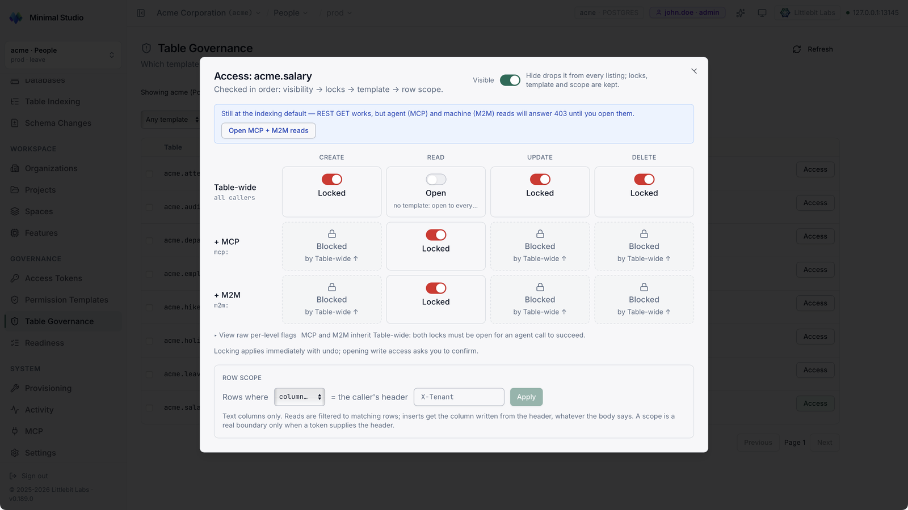

3. At the foot, **ROW SCOPE** reads "Rows where column = the caller's header", with the header name `X-Tenant` as its example: "Text columns only. Reads are filtered to matching rows; inserts get the column written from the header, whatever the body says. A scope is a real boundary only when a token supplies the header." This is how `employee.email` is bound to the person who signs in; the last section of this chapter sets one.

## Hide salary

1. In the same dialog, at the top right, switch **Visible** off. Its note reads "Hide drops it from every listing; locks, template and scope are kept." The dialog closes at once, and a message reads "Hid acme.salary" with **Undo**. The page now counts "7 tables", and **Hidden (1)** opens the list of the hidden.

   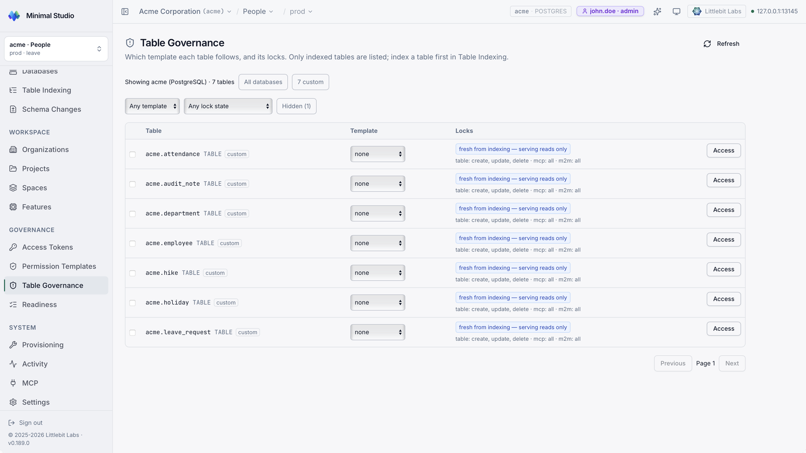

2. Select **Browse**. The list holds seven tables, and `salary` is not one of them. **Home** follows: its **Index** step reads "7 tables indexed" and the Auto API counts 28 endpoints in place of 32.

   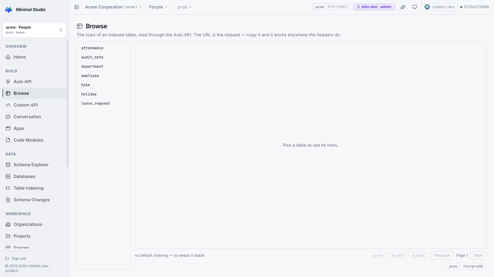

Hiding takes effect on the next read, with nothing to deploy. The table still exists, and its locks and template are kept: switch **Visible** on again and it returns as it was.

## Open the tables to agents

A table starts with its agent channel closed, as the banner of **Access** says. Chapters 12 to 14 need an agent to read some of Acme's tables, so open those.

1. Select **Access** on `acme.employee`. In the banner, select **Open MCP + M2M reads**. A message reads "Opened MCP and M2M reads on acme.employee", and in the dialog the **READ** cells of **+ MCP** and **+ M2M** change from **Locked** to **Open**, with the create, update and delete cells still **Blocked** by the table-wide lock.

   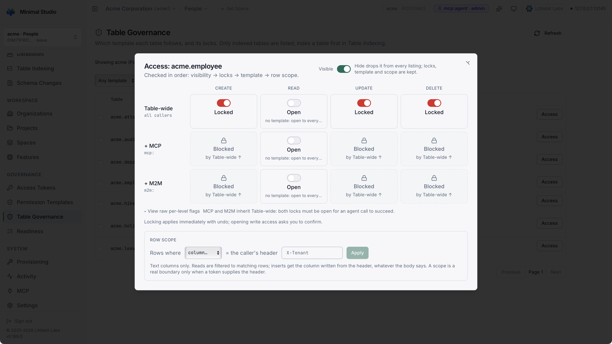

2. Close the dialog and do the same for `acme.department` and `acme.leave_request`. On the list, the opened tables carry the tag **read-only**, and their **Locks** line no longer says "fresh from indexing". The header counts "2 read-only" after the first two.

   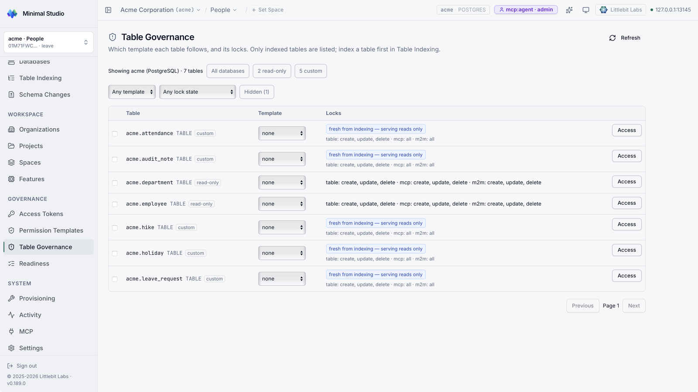

3. Select **Home**. The **Govern** step now reads "Governed" over "0 templates in use · 7 tables locked", and the **MCP** line under **Serve**, "agent door · live · 115 tools".

   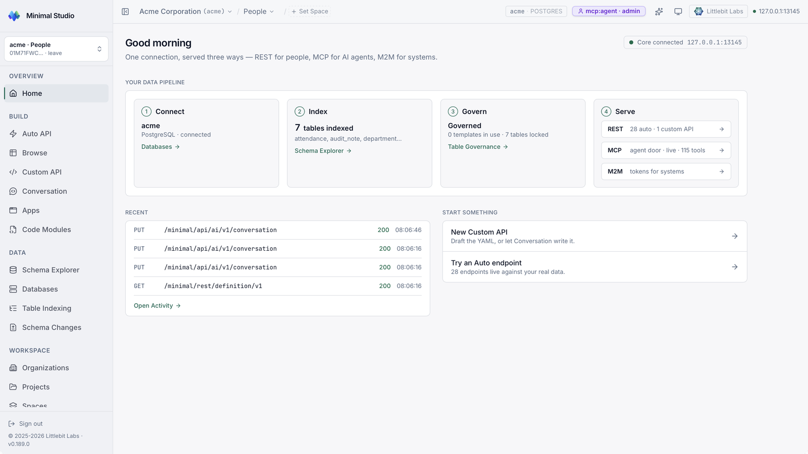

The button opens reads on the agent and machine channels together; it never opens a write. `salary` is left hidden, so an agent cannot list it, and `attendance`, `audit_note`, `hike` and `holiday` stay closed to agents.

## Assign a template

A template protects nothing until a table follows it. **Table Governance** assigns one to a row, or to several at once.

1. Tick the box at the start of the rows `acme.department`, `acme.employee` and `acme.leave_request`. A bar appears above the list: "3 selected", a **Template…** chooser, **Assign** and **Locks…**.

2. Open the chooser and select `hr-read`; **Assign** is live. Select **Assign**. "Template assigned to the selection" appears, and the **Template** column of the three rows reads `hr-read`.

   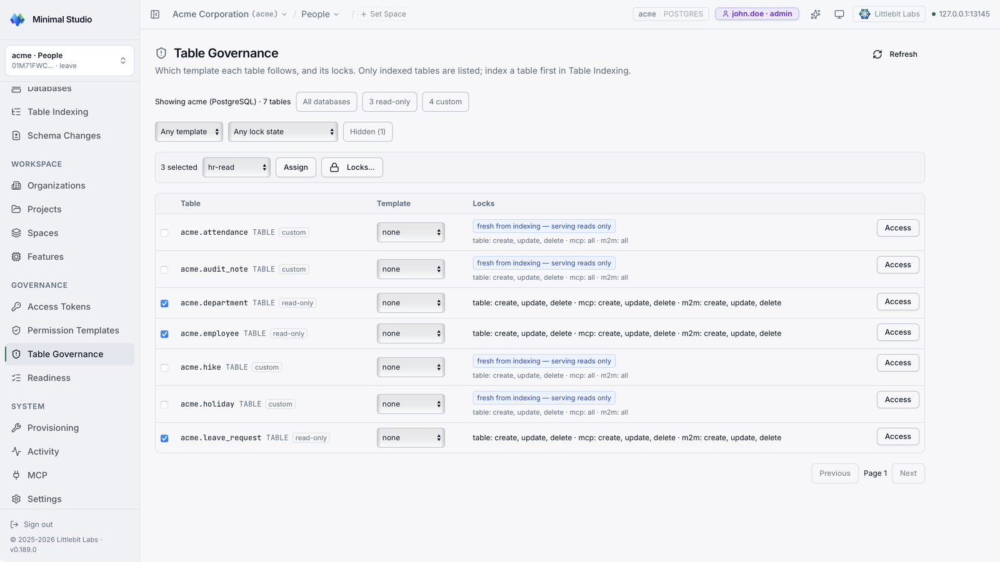

   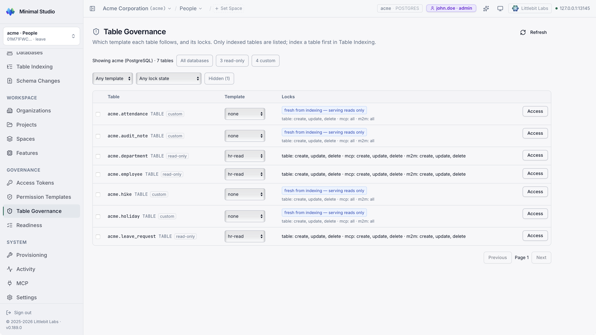

3. Open **Hidden (1)**. The panel reads "Hidden tables are dropped from every listing. Restoring one brings it back with its template, locks and row scope." and lists `acme.salary` with **Restore**.

   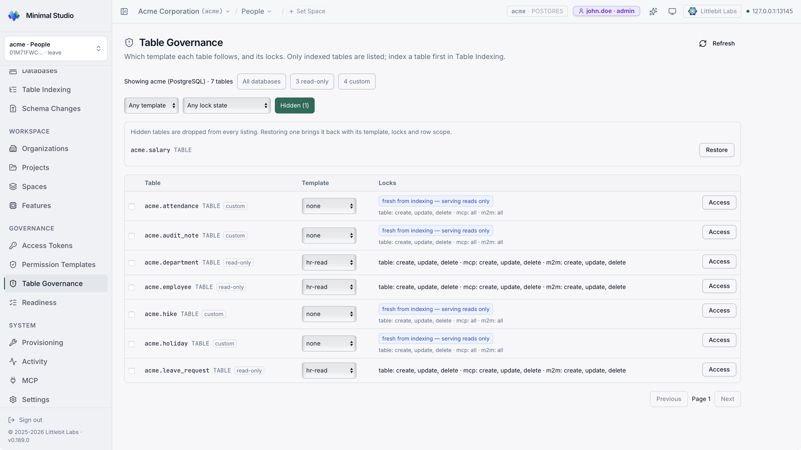

4. Select **Restore**: "Restored acme.salary", and the list holds eight tables again. Tick `acme.salary`, choose `salary-closed` in the bar and select **Assign**. The row's **Locks** line reads "table: create, update, delete · mcp: all · m2m: all", and the tag "fresh from indexing — serving reads only" is gone.

   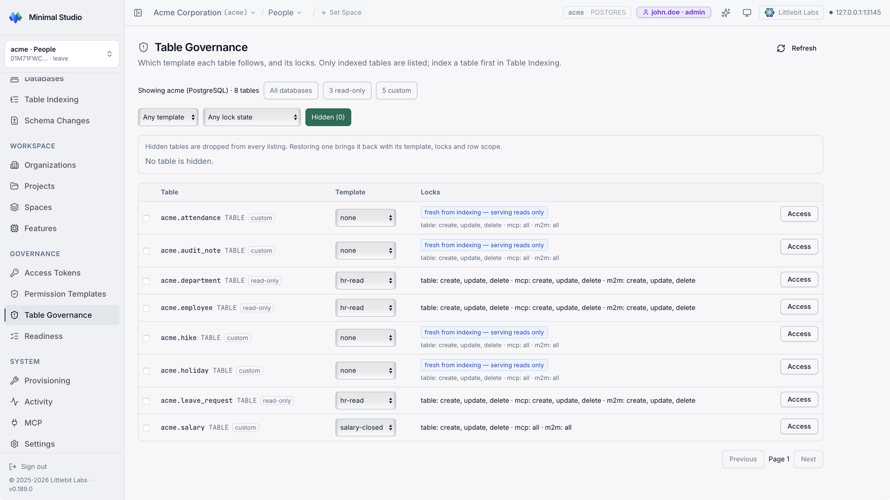

5. Select **Access** on `acme.salary`. Where the table-wide **READ** cell read "no template: open to every…" it now names the template `salary-closed`, and a line says "Template salary-closed then decides which roles pass the open cells." That is the order of checks at work: the lock is open, and the template closes it for every role.

   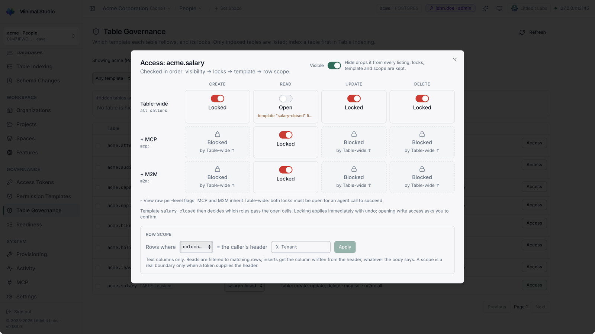

6. Switch **Visible** off to hide the table again: "Hid acme.salary".

In the bar's chooser a keyboard does the same job as the mouse: tab to it and type the first letters of the template's name.

## Bind employee.email to the caller

A template says which roles may read a table; a row scope says which rows each of them sees. Acme binds `employee.email` to the identity of the caller. The shots of this section come after the two before it: the reads of `employee` are open to agents, and `hr-read` is its template.

1. Select **Access** on `acme.employee`. At the foot of the dialog, **ROW SCOPE** reads "Rows where column = the caller's header", with a column chooser, a field for the header's name and **Apply**.

2. In the chooser, select `email`; the chooser lists the table's text columns only. Type `X-User-Id` into the field: it is the header that carries the user ID in the request of Chapter 8. **Apply** turns dark.

   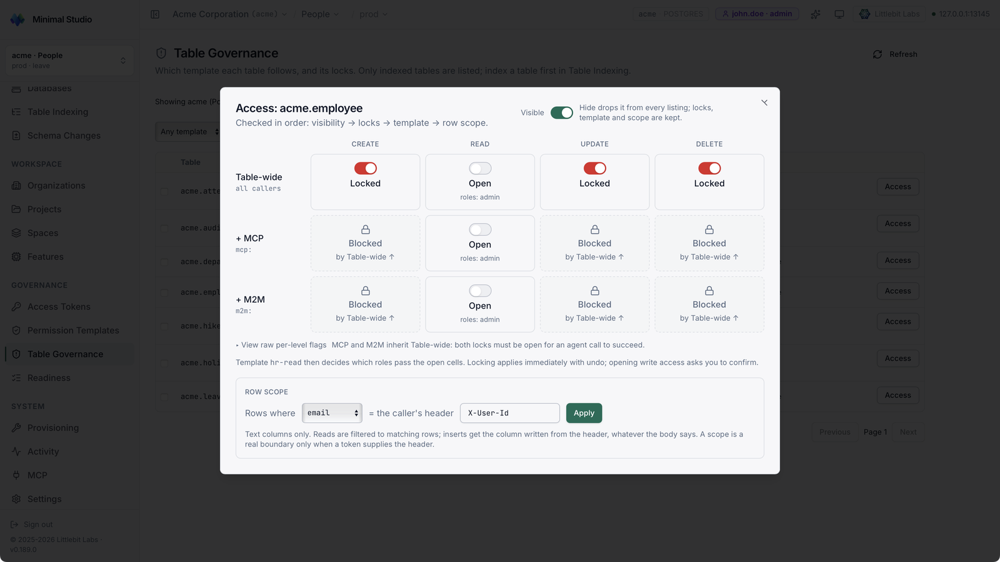

3. Select **Apply**. "Row scope set on acme.employee" appears, and a link, **Clear scope**, joins the title of the section.

   

4. Open **Browse** and select `employee`. The request is the one of Chapter 7, and the page reads "Nothing on this page.": no employee has the email `john.doe`, so the scope lets `john.doe` read no row.

   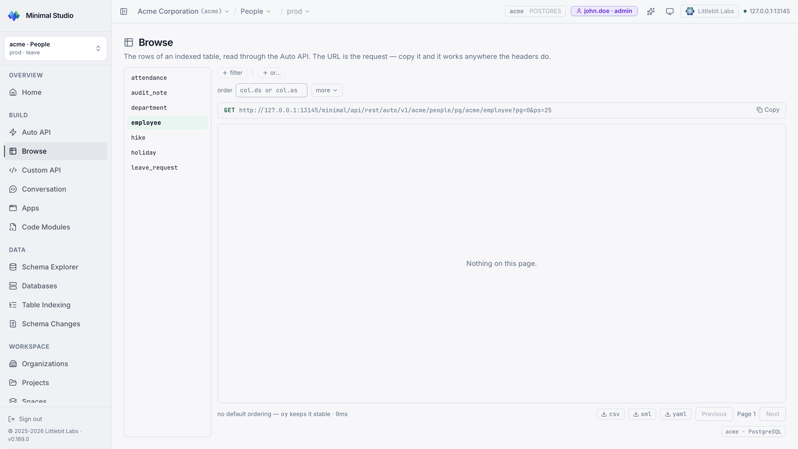

5. Back in **Access**, select **Clear scope**: "Row scope cleared on acme.employee". **Browse** lists the employees again.

A caller whose identity were an employee's email, `rafael.delacroix1@acme.example`, would read that one row. The dialog says where the boundary stops: "A scope is a real boundary only when a token supplies the header." The reason is the one the dialog implies: a call made with the server key can set its own headers, so only a token that supplies the header makes the scope a boundary. Chapter 24 mints one and reads through it.

## Exercises

1. Create a template named `hr-write` from the preset **Writes for admin**. Read its **EFFECTIVE GRANTS** before you save, and select **Cancel**.
2. In **Access: acme.salary**, read the four cells of the **+ MCP** row. Say why create, update and delete read **Blocked**, and read **Locked**.
3. Open **Hidden (1)** and select **Restore** beside `salary`. Check that **Browse** lists eight tables again, then hide the table once more.
