# 19. Features, table indexing and schema changes

Three pages shape what the Core knows about Acme's data. **Features** group the definitions of a project. **Table Indexing** makes the tables of a registered database known to Minimal. **Schema Changes** runs SQL on the live database, with a classifier that refuses what is dangerous. The last two need the project's schema roles, so this chapter shows them refused, as they are on a new project, and then open, after the grant of Chapter 15.

> **Setup.** The workspace of Chapter 5: Studio signed in as `john.doe` in **acme · People**.

## Features

1. Select **Features**, under **WORKSPACE**. The line under the title reads "1 feature · People · Functional units that scope API capabilities." A note heads the list: "v2 has no way to delete a feature: it goes only when its project or organization is deleted. The owner is whoever created it and cannot be changed. History is kept for the owner only."

2. The list holds `leave`, with its description "Leave requests and approvals", its ID and its owner, `john.doe`. The row offers **Edit** and **History**. The first shot shows the list as Chapter 5 left it.

   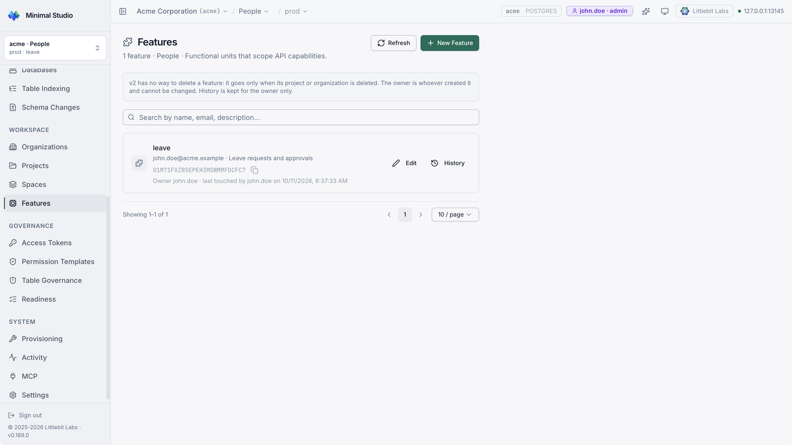

   Chapter 13 adds a second feature, `insight`, which switches the Insight feature on, and the list then reads "2 features".

   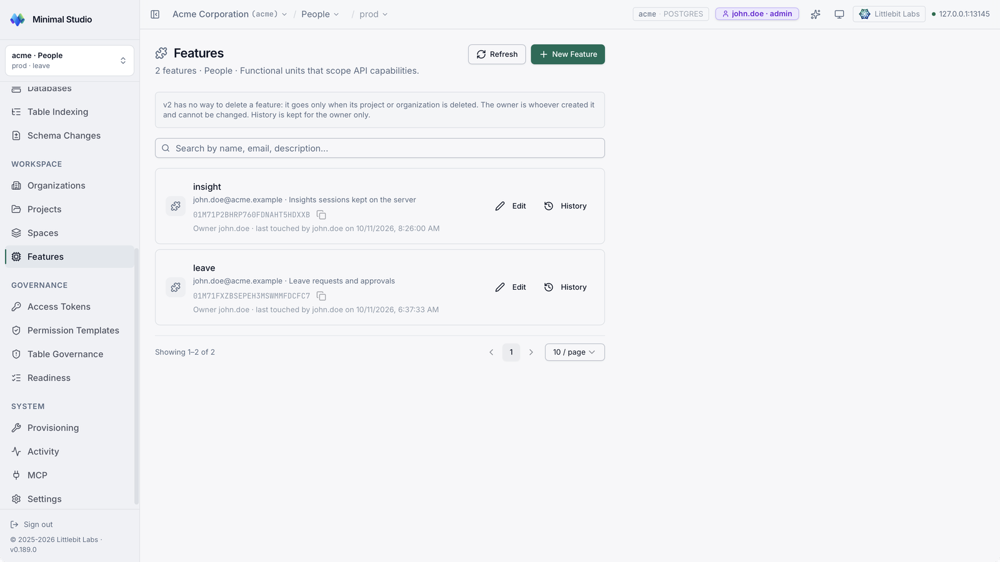

A feature is the unit a definition is filed under: Chapter 5 ticked `leave` on the workspace picker, and Chapter 9's pending-leave belongs to it.

## Table indexing

1. Select **Table Indexing**, under **DATA**. The line under the title reads "Make tables known to Minimal so the Auto API, permission templates and locks can govern them. A new table starts locked; open it in Table Governance once it is indexed." Two steps follow.

2. Before the schema roles are granted (Chapter 15), **1 Scan** names the database, `acme (postgres)`, with **Scan again**, and the Core answers: "THE LIVE CATALOG IS CLOSED TO YOU (HTTP 403)", the same project schema read roles of Chapters 15 and 16, and adds "Type the table names in step 2 instead."

   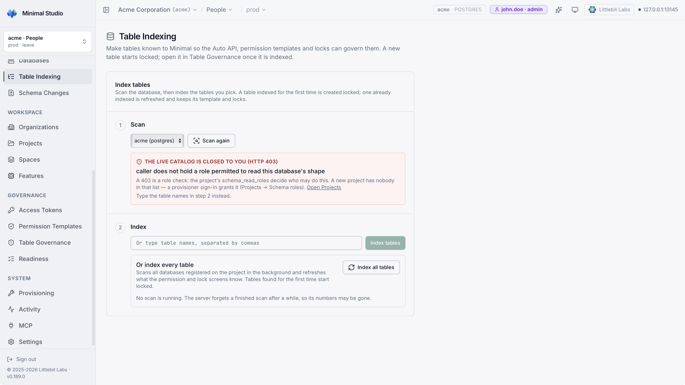

3. After the grant, the page shows its scan as soon as you open it, with **Scan again** beside it. It reads "10 tables: 3 not indexed yet, 7 indexed." **2 Index** lists each object with its kind: the tables, marked **indexed** with **Re-index** beside them, and below them `mv_headcount_by_department`, `v_employee_directory` and `v_leave_balance`, marked **new**. A line under the list says "8 internal objects hidden — sequences and other schemas' objects, which the Core cannot index." `salary` is not listed: Chapter 18 hid it.

   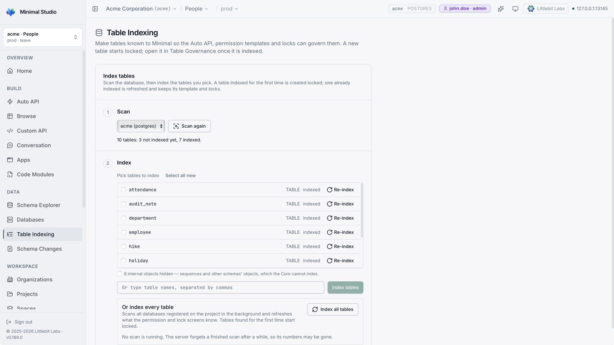

   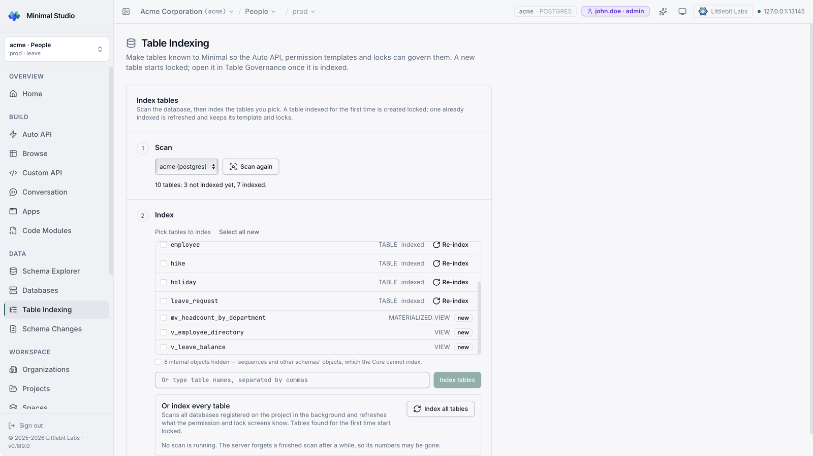

4. **Select all new** is the way to tick the three, **Index tables** indexes the ones ticked, and a box takes table names by hand, separated by commas. Under **Or index every table**, **Index all tables** "scans all databases registered on the project in the background and refreshes what the permission and lock screens know. Tables found for the first time start locked." The book indexes nothing here: a new table would change the counts the chapters before this one print.

Acme's eight tables were indexed when the project registered its database (Chapter 5), so the refusal of the scan blocked nothing the book needed.

## Schema changes

1. Select **Schema Changes**. The line under the title reads "Runs SQL on a live database. Running needs the project's schema write roles; a safety classifier refuses dangerous statements, such as DROP DATABASE, and says why."

2. The form takes a database, then one or more statements, each in its own box with the hint `CREATE TABLE …`; **Add statement** adds another, and the arrows reorder them. Beneath: **When a statement fails**, which reads "stop (skip the rest)"; a box to **Re-index the database afterwards, so new tables are governed**; an optional **Idempotency key**, so that a retry with the same key is not run twice; and a **Comment**. **Submit…** stays dim: "Add at least one statement."

3. Under the form, **Run history** lists what ran against the database, filtered by status, and at the foot **Stuck lock** offers a way out of a run that was killed halfway: "its lock can stay and block the next run. Give the id of the run that took it." Before the grant the history carries the same red 403 as the pages before it; after it, it reads "No runs."

   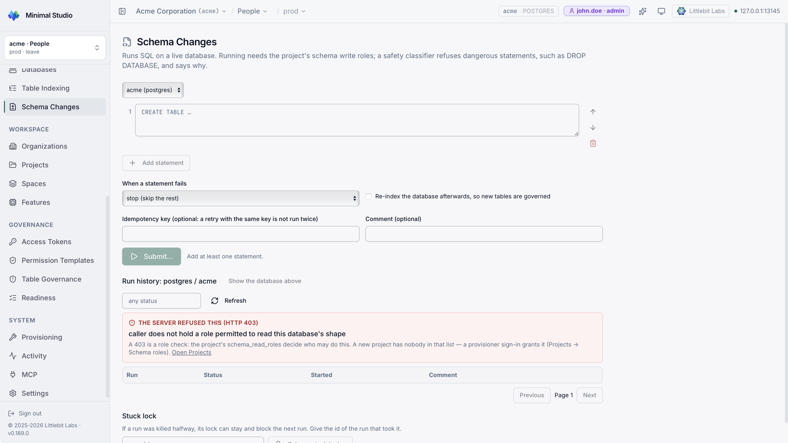

### Run a statement

1. Type `CREATE TABLE book_scratch (id integer)` into the first box and a comment into **Comment**. **Submit…** turns dark.

   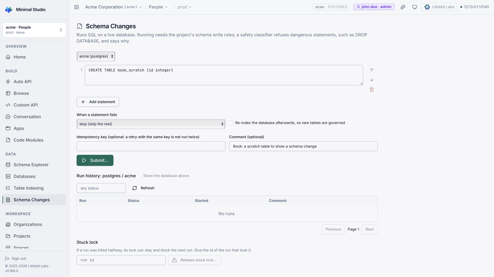

2. Select **Submit…**. A dialog asks "Run 1 statement on postgres / acme?" and says "This runs SQL on a live database. There is no preview, and Studio cannot undo it." It lists the statement and the policy, "On error: stop · no re-index". Select **Run on the live database**.

   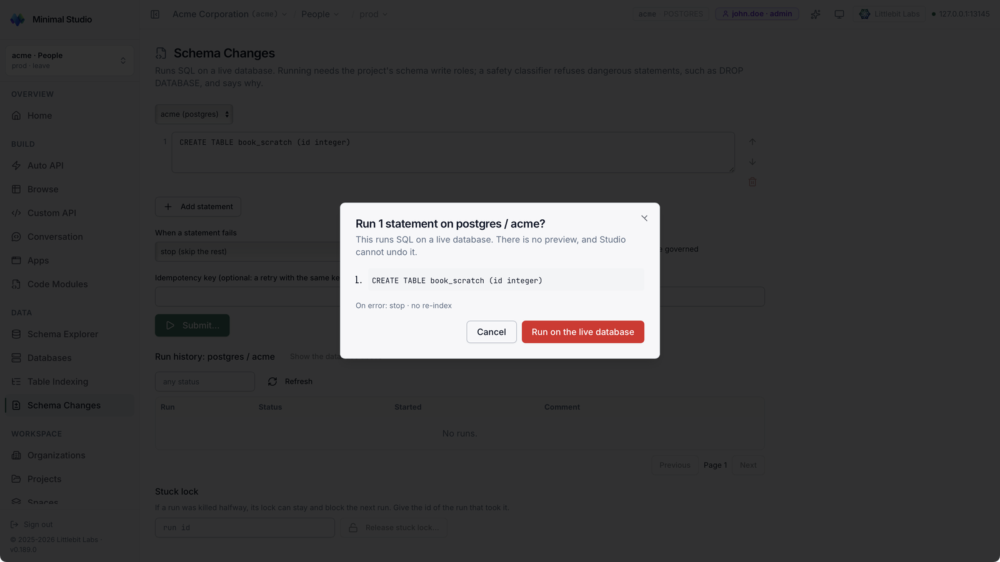

3. The page answers with an **Answer** panel: a green "succeeded" badge, the run's ID, and when it started and finished, and for each statement its verb, `CREATE TABLE`, its target, `book_scratch`, the role column that allowed it, `schema_write_roles`, and its duration in microseconds. The totals read "statement_count 1", "executed 1" and "reindex skipped".

   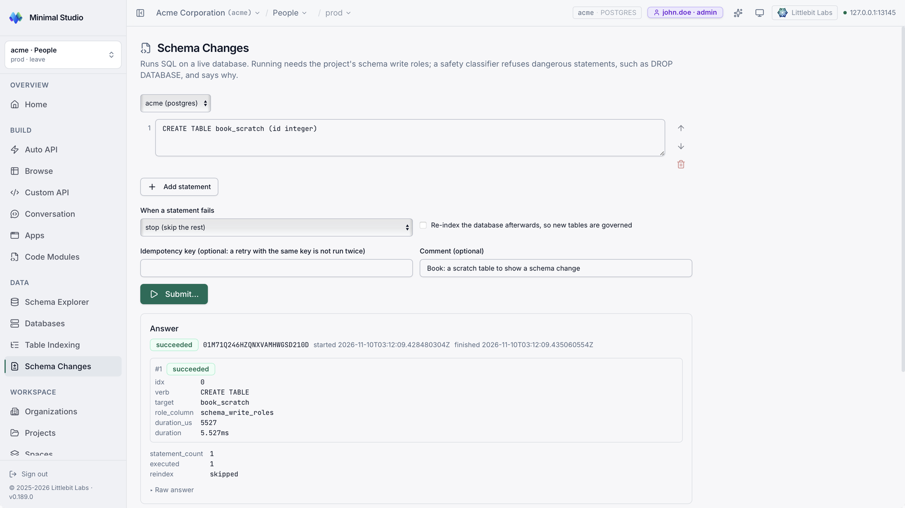

4. **Run history** lists the run, **succeeded**, with its comment and an eye icon at the end of the row.

   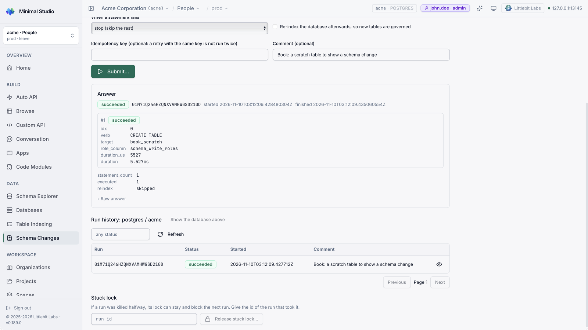

The table exists in the database now, and **Live database** on **Schema Explorer** lists it as **not indexed** (Chapter 6). The box **Re-index the database afterwards, so new tables are governed** was left clear, so the new table was not indexed; the box is the way to index a table made through this page.

Remove the table with a second run, `DROP TABLE book_scratch`, and its own confirmation. It succeeds the same way, and the Live database list is the one of Chapter 6 again, without `book_scratch`.

### What the classifier refuses

Type `DROP DATABASE` followed by the name of a database, here `book_missing`, which does not exist, and select **Submit…** and **Run on the live database**. The Core does not run it: a red panel reads "NOT RUN: THE SERVER REFUSED (HTTP 400)", "statements[0] `drop` and `database` cannot both appear in one statement -- dropping a database goes through the database drop route, which has its own role and needs two confirmation tokens. Reword a string literal that happens to hold both words." No run is recorded.

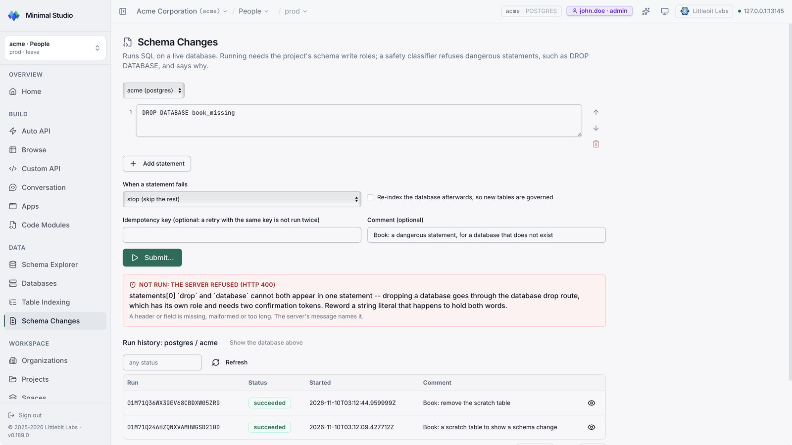

The refusal is about the two words, not the name, so a test against a name that does not exist shows it safely. Dropping a database goes through the drop wizard on **Databases**, which needs the organization's drop role and two confirmation tokens; Chapter 16 runs it on a scratch database.

## Exercises

1. On **Features**, open **History** on `leave` and read who created it.
2. On **Table Indexing**, count the objects marked **new** and name them. Check the count against Appendix A.
3. On **Schema Changes**, create `book_scratch` as above, find it on **Live database**, then drop it. Check that **Run history** lists both runs.
