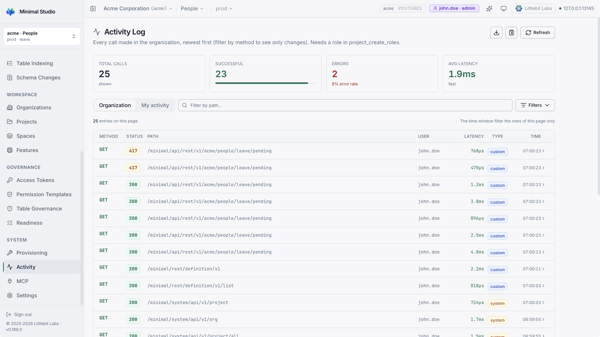
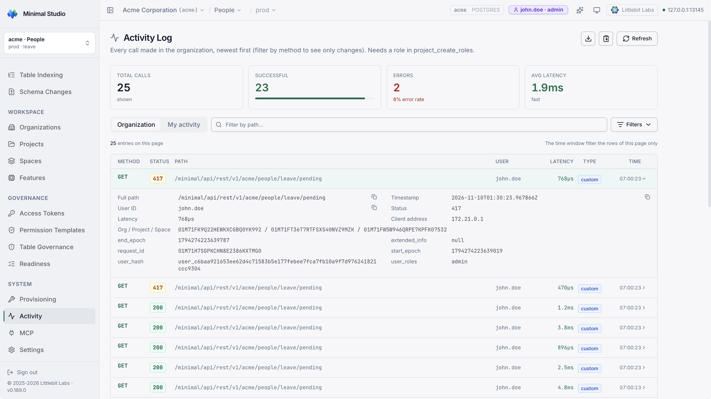
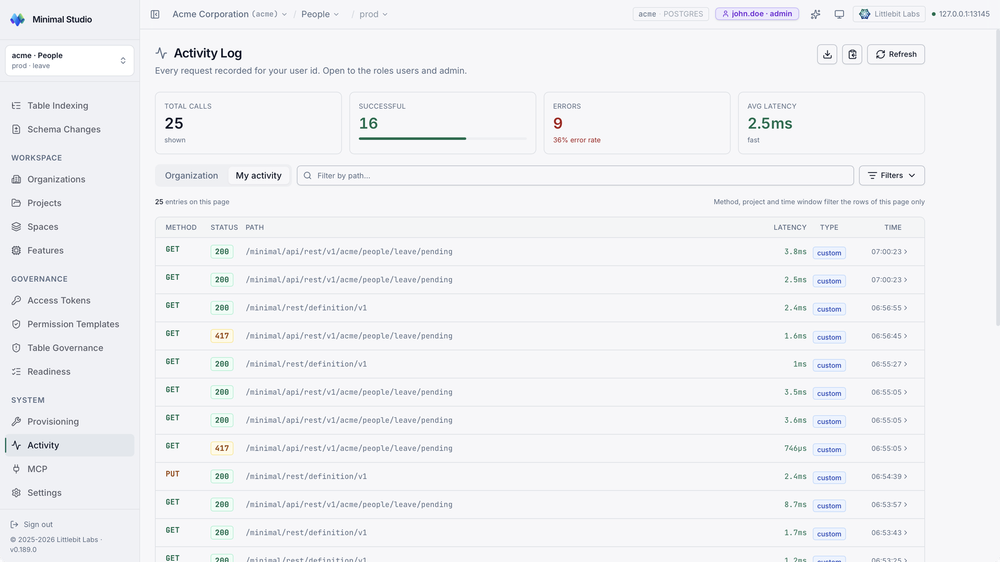
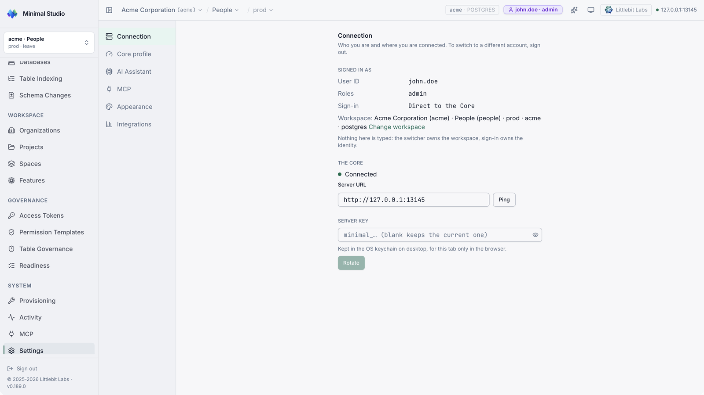
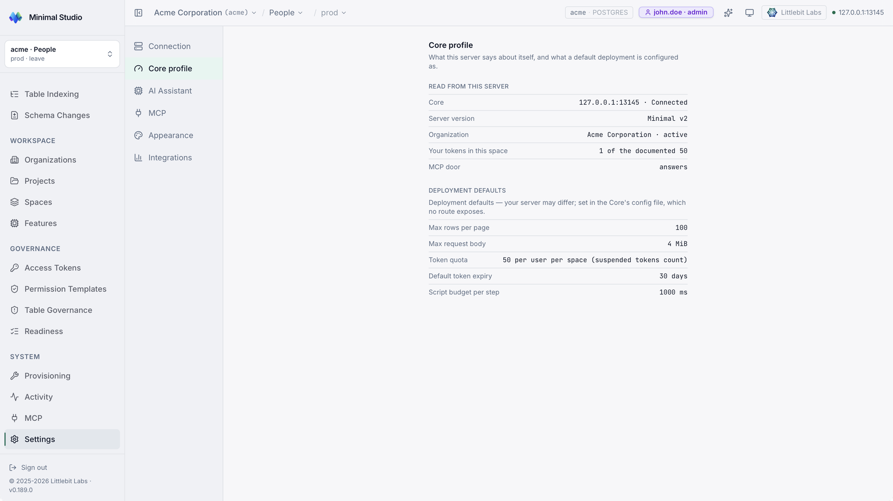
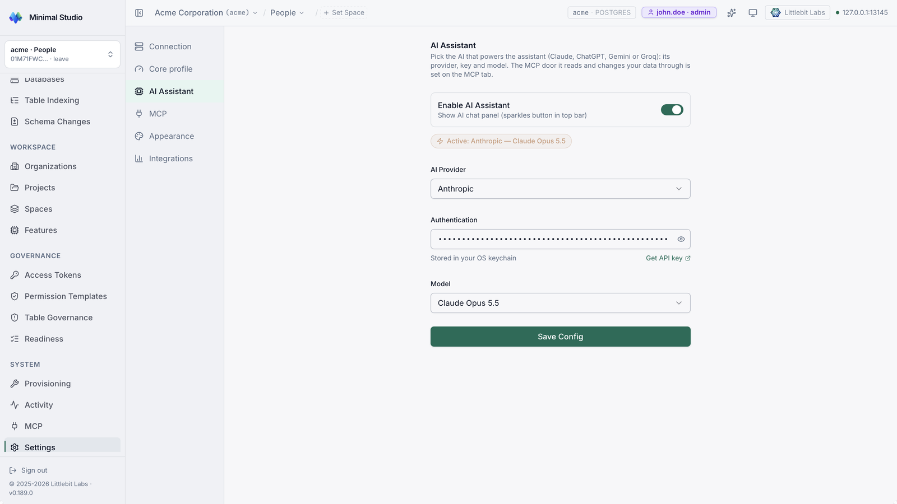
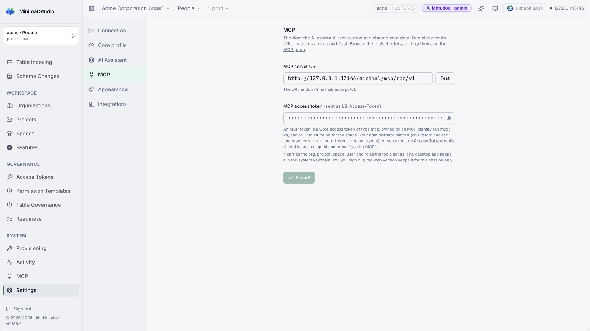
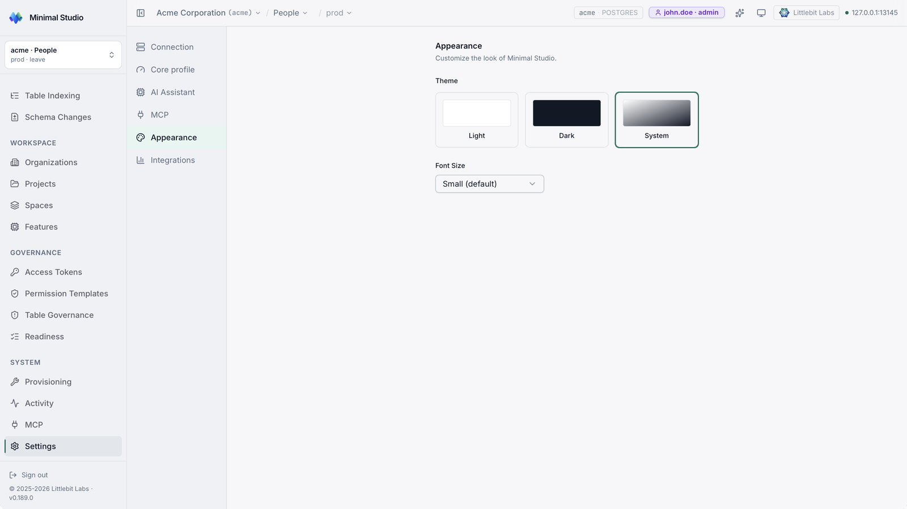
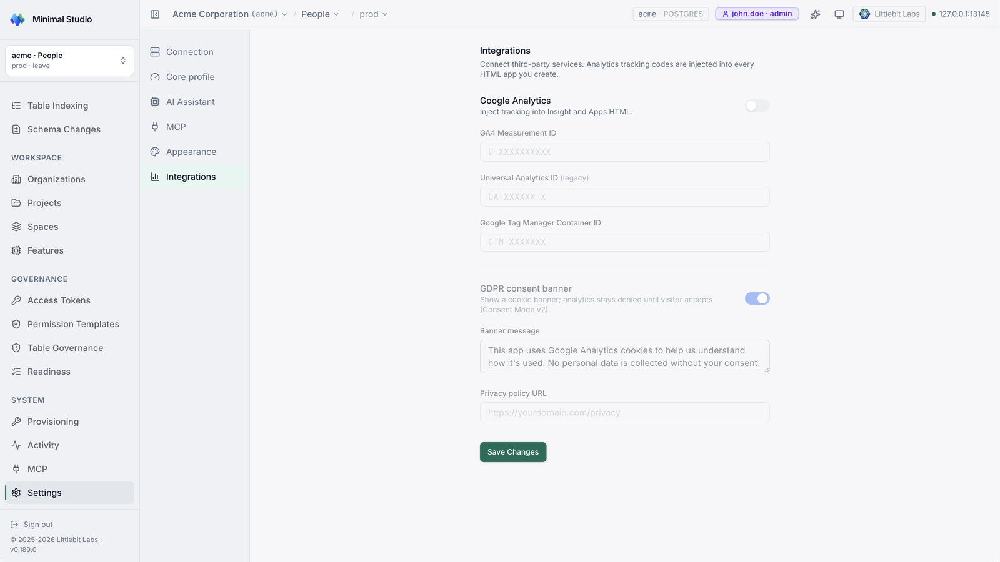
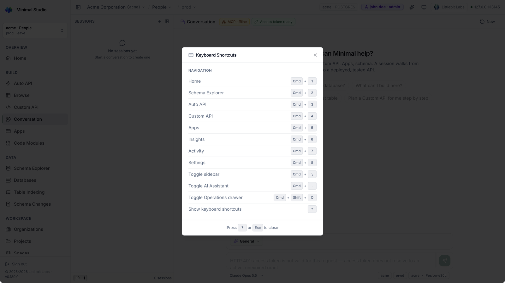

# 20. Activity and Settings

Two pages watch over everything the rest of the book did. **Activity** is the record: every call made in the organization, who made it, and how it was answered. **Settings** is where Studio itself is configured: the connection, the Core's own profile, the assistant's model, the MCP door, and the look of the app. This chapter reads both.

> **Setup.** The workspace of Chapter 5, after the chapters before this one have made some calls.

## The Activity Log

All the steps of this chapter happen in the Studio window.

1. Select **Activity** in the sidebar, under **SYSTEM**. The **Activity Log** reads "Every call made in the organization, newest first (filter by method to see only changes). Needs a role in project_create_roles." Four counters head the page — **TOTAL CALLS**, **SUCCESSFUL**, **ERRORS** with the error rate, and **AVG LATENCY** — over the rows of this page. Each row is one call: its method, status, path, user, latency, a type tag, **custom** or **system**, and the time. The two 417 rows at the top are Chapter 9's calls for a version that does not exist.

   

2. Select a row. It opens on the call's record: the full path, the user ID, the latency, the IDs of the organization, project and space, the request ID — the same `x-request-id` the response carried in Chapter 8 — the timestamps, the client address, and the caller's roles. What the log holds is who did what, when, and from where; never a request's body.

   

3. Select the tab **My activity**. The line changes to "Every request recorded for your user id. Open to the roles users and admin.", and the counters count only your own calls. **Organization** needs the greater role; **My activity** answers for yourself.

   

## Settings

Select **Settings** at the foot of the sidebar. Six tabs, one subject each.

1. **Connection** is who you are and where you are connected. **SIGNED IN AS** shows the user ID, the roles and the sign-in kind, and the workspace in one line with **Change workspace** — the same picker as everywhere else. **THE CORE** shows the status dot, the **Server URL** with **Ping**, and the **SERVER KEY**, which shows only a hint, `minimal_…`, with "(blank keeps the current one)" and **Rotate**. Through a gateway the page differs: **THE GATEWAY** replaces **THE CORE** and there is no key box (Chapter 4). The line under the key is Chapter 21's subject: "Kept in the OS keychain on desktop, for this tab only in the browser."

   

2. **Core profile** is what the server says about itself: the Core's address and version — here **Minimal v2** — the organization and its status, your tokens in this space against the documented 50, and whether the MCP door answers. Under it, **DEPLOYMENT DEFAULTS** lists what a default deployment is configured as, and says "your server may differ; set in the Core's config file, which no route exposes": 100 rows per page at most, a 4 MiB request body, a quota of 50 tokens per user per space (suspended tokens count), a default token expiry of 30 days, and a script budget of 1000 ms per step.

   

3. **AI Assistant** picks the model behind the assistant panel and the model-calling pages: an **Enable AI Assistant** switch for the chat panel, then the **AI Provider**, the key under **Authentication** — "Stored in your OS keychain" — and the **Model**, with a badge naming what is active and **Save Config** at the foot. The note says the data goes through the MCP door of the next tab. The book's choice is **Anthropic** and **Claude Opus 5.5**.

   

4. **MCP** holds the door's URL and token, as Chapter 17 used them: "One place for its URL, its access token and Test."

   

5. **Appearance** is the look: **Theme**, **Light**, **Dark** or **System**, and **Font Size**. The card chosen is **System**; the book's Mac is in light mode, so its shots are light.

   

6. **Integrations** injects analytics into the HTML apps you create on the **Apps** page: Google Analytics IDs, a GDPR consent banner with its message, and a privacy policy URL. Nothing here touches the Core.

   

## The keyboard

Press `?` anywhere outside a text field. The **Keyboard Shortcuts** overlay lists the navigation: `⌘1` to `⌘8` for Home, Schema Explorer, Auto API, Custom API, Apps, Insights, Activity and Settings, `⌘\` for the sidebar, `⌘.` for the AI Assistant, `⌘⇧O` for the Operations drawer, and `?` for the overlay itself. Press `Esc` to close it.

## Exercises

1. On **Activity**, open the newest row and compare its request ID with the `x-request-id` of a call you make on the **Auto API** page.
2. On **Settings · Core profile**, read how many tokens you hold in this space, and check the count against **Access Tokens**.
3. Press `⌘7`, then `⌘8`, then `?`. Check where each takes you, and close the overlay with `Esc`.
