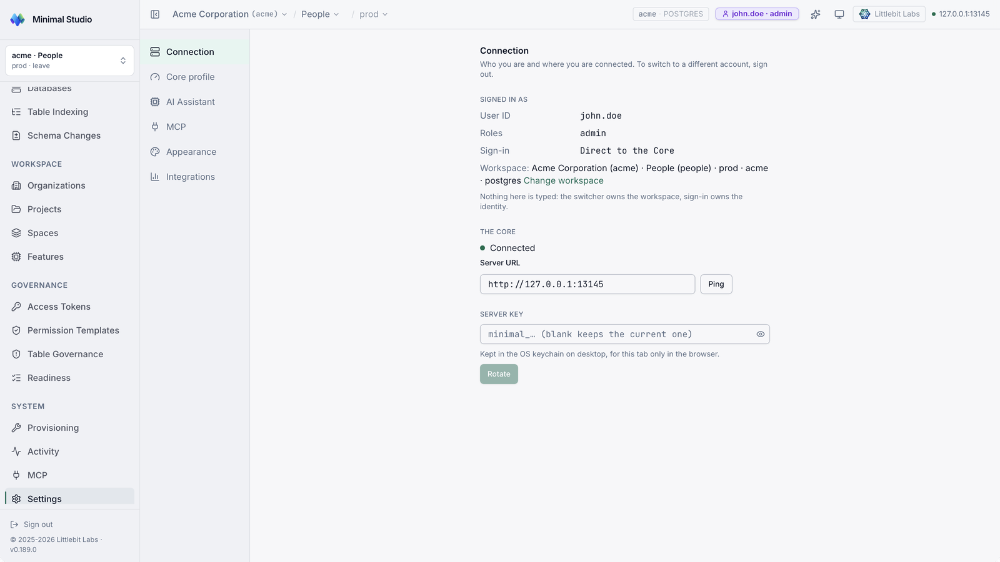
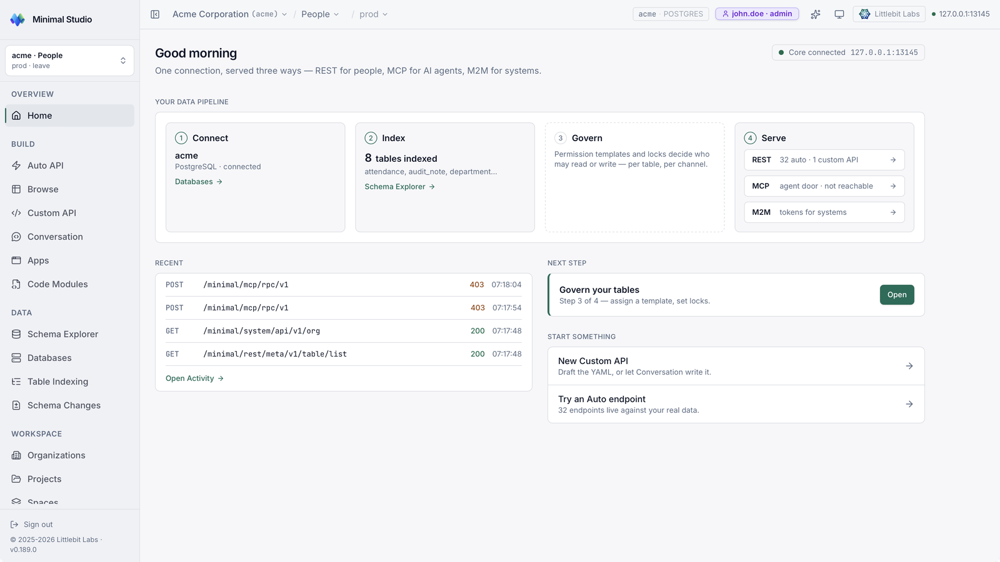
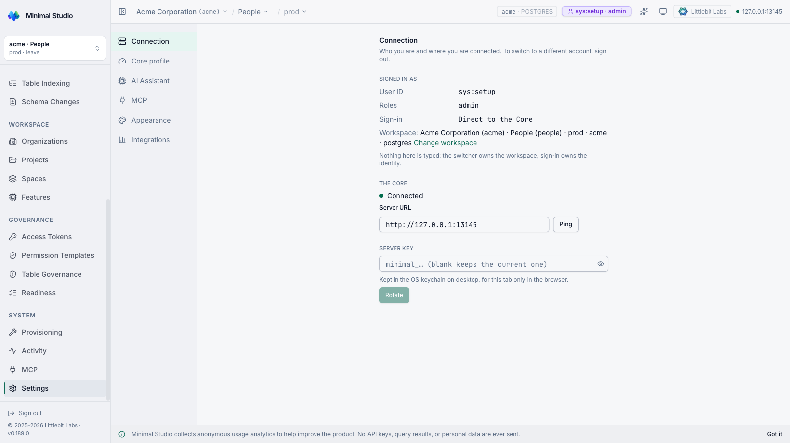
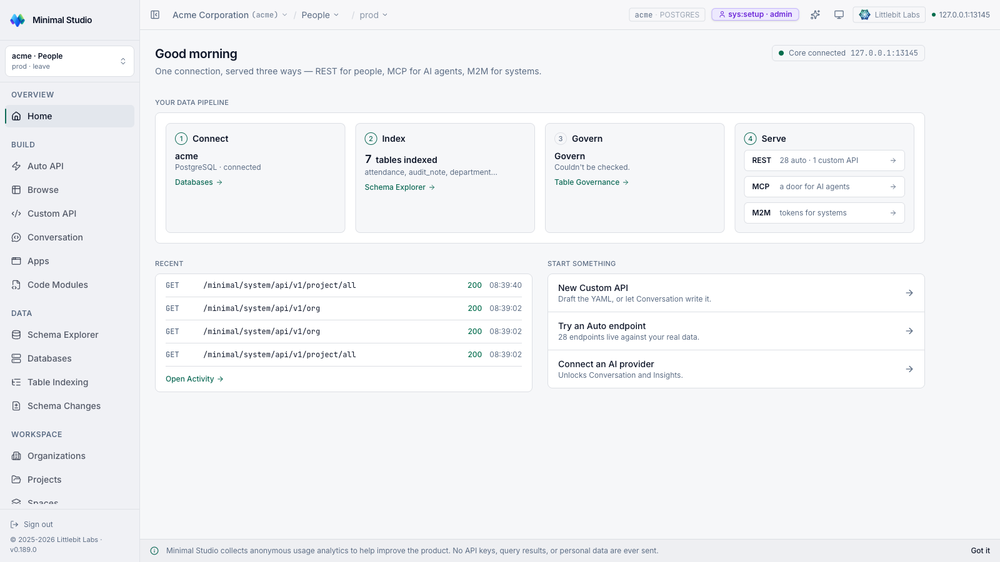

# 21. Where the key lives

Studio reaches the Core with a server key, and the key is the one secret every other chapter used without showing. This chapter says where Studio keeps it, what survives closing the app, and what you must never do with it.

> **Setup.** The workspace of Chapter 5, Studio signed in as `john.doe`. The Mac app, and, where noted, the same page in a browser tab. Home in this chapter's first shot reads eight tables and 32 endpoints, as before Chapters 17 and 18; after them it reads seven and 28. Two shots of the browser section are signed in as `sys:setup`, the provisioner of Chapter 15.

## Where it is kept

1. Open **Settings → Connection**. Under **THE CORE**, the **SERVER KEY** field shows no key, only a hint, `minimal_…`, with an eye icon for the key you type and the note "(blank keeps the current one)", and the line under it reads "Kept in the OS keychain on desktop, for this tab only in the browser."

   

   On the Mac app the key sits in the system keychain, as the note says. In a browser the note says the key is kept for the tab only; the last section of this chapter shows what the book's own browser run found.

Through a gateway there is no server key at all: **Settings → Connection** says "You sign in through a gateway, so there is no server key. Your sign-in and MCP token are kept in the OS keychain." (Chapter 4 shows the page.)

2. **Rotate** sets a new key; leaving the field blank keeps the one held. Studio never shows the key again after you paste it, and the book's notes never contain it.

## What survives a restart

1. Quit Studio from its menu: **Minimal Studio**, **Quit Minimal Studio**.

2. Open it again. It asks for nothing: it opens on **Home** in the same workspace, **acme · People**, **prod · leave**, signed in as `john.doe`, with "Core connected" at the top right.

   

   The key was held in the keychain, as the note under **SERVER KEY** says, and the rest in Studio's own settings. **RECENT** lists the latest calls.

3. **Sign out**, at the foot of the sidebar, returns Studio to the sign-in page, which asks for everything again, the key included. It also drops the token saved for the MCP page: after a sign-out, **Insights** read "No MCP access token" until a token was saved again. Take it only when you have the key to hand: the **SERVER KEY** field shows only a hint, so Studio cannot give the old key back.

## In a browser

1. **Settings → Connection** is the same page in a browser, down to the line under **SERVER KEY**: "Kept in the OS keychain on desktop, for this tab only in the browser." There is no keychain in a browser; the note means the key is kept for the tab.

   

2. The book's browser run used the development build of the web page. It keeps the key for the tab and, so that a reload does not sign you out, a copy in the browser's local storage. Open a second tab on the same address and it opens already signed in: **Home**, the same workspace, `sys:setup · admin`.

   

   A release build keeps the key for the tab alone, as the note says: the book built one and read it, and it never writes that copy and removes one if it finds it, so a second tab would ask for the key. The book did not sign in to a release build.

3. On a browser that is not yours, select **Sign out** before you close the tab.

## What not to do

- Do not paste the key into a chat, a ticket, a script or a screenshot. Where a screen does show a secret, as the mint dialog of Chapter 17 does, cover it with a solid bar before you share the shot.
- Do not keep a second copy "for safety" in a note on the same machine. Keep it in a password manager, and let the keychain hold the one Studio uses.
- Do not share a signed-in Studio. The key and the roles go with it; give a colleague a token of their own (Chapter 17) instead.

## Exercises

1. Open **Settings → Connection** and read the line under **SERVER KEY**. Say what differs between the app and a browser tab.
2. Quit Studio and open it again. Check the workspace in the sidebar and the identity at the top right before you touch anything.
3. In **Settings → Connection**, select **Ping**, and check the answer. Then say which of the two, key or URL, **Ping** tests.
