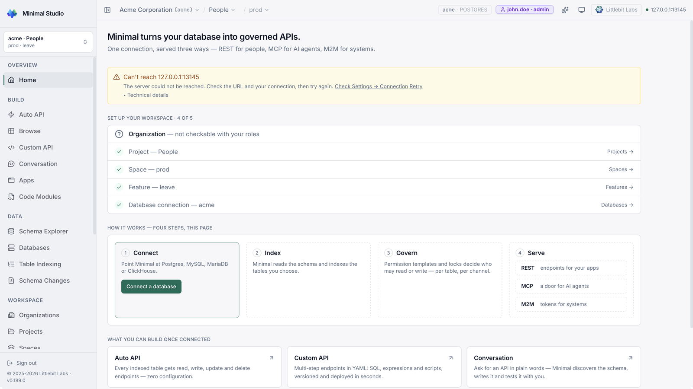
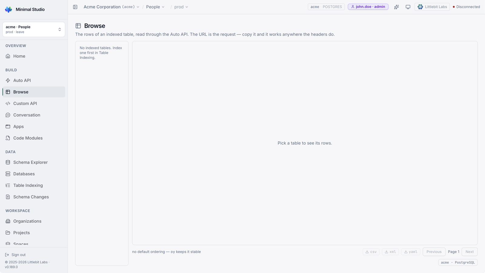
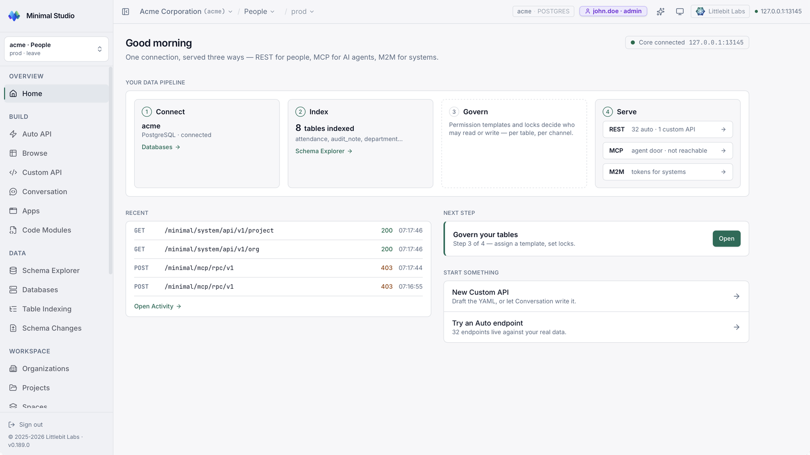

# 22. When Core is unreachable

Every page of Studio is a view of a Core that answers over the network. When the Core does not answer, Studio does not crash and does not invent data: it says what it could not reach and keeps what it knows. This chapter stops the book's Core on purpose, reads what Studio shows, and starts it again.

> **Setup.** The workspace of Chapter 5, Studio signed in as `john.doe` in **acme · People**, **prod · leave**. You need to be able to stop and start your Core; the book's runs in Docker. Home in this chapter's shots reads eight tables and 32 endpoints, as before Chapters 17 and 18; after them it reads seven and 28.

## Stop the Core

1. In a terminal, stop the Core's container, and leave the database running:

   ```bash
   docker compose -p minimal-book stop minimal
   ```

2. Switch to Studio and select **Home**.

## Read what Studio says

1. At the top of **Home**, a yellow banner reads "Can't reach 127.0.0.1:13145" and under it "The server could not be reached. Check the URL and your connection, then try again." It offers **Check Settings → Connection**, **Retry**, and **Technical details**, which opens the raw error.

   

2. Read the checklist under it, **SET UP YOUR WORKSPACE · 4 OF 5**. **Organization** reads "not checkable with your roles": with no answer, Studio cannot say, and says so. The four ticks beneath it are what Studio remembers of your workspace — the project, the space, the feature and the connection — not what the Core confirmed just now.

3. The page below the checklist is the first-visit page: **Connect a database** is offered as the first step, though `acme` is connected. It describes a Core that cannot be asked, not one that has no database. Do not follow it.

4. Open **Browse**. It reads "No indexed tables. Index one first in Table Indexing." Here too, the Core's silence reads as an empty list.

   

Two signs tell the silence from an empty Core. The banner of **Home** names the address it could not reach, and the **Core connected** pill of Home is gone; on other pages the status at the top right reads "Disconnected", in red. Trust the banner; an empty page elsewhere is only the same fact, less loudly.

## Start the Core again

1. Start it:

   ```bash
   docker compose -p minimal-book start minimal
   ```

2. In Studio, select **Retry** on the banner, or select **Home** again. Studio needs no restart and no sign-in: the banner goes, the status reads "Core connected 127.0.0.1:13145", and the pipeline of Chapter 5 is back with its eight indexed tables.

   

## What to check first

A wrong answer from the Core is a different case from none, and the quickest order of checks is short:

| You see | Look at |
|---|---|
| "Can't reach" and an address | The Core is stopped, or the **Server URL** in **Settings → Connection** is wrong; use **Ping** there |
| 401 or 403 on a call | The identity or the key, not the network: Chapters 4 and 21 |
| 417 "definition not found" | The version of the call, not the Core: Chapter 9 |

## Exercises

1. Stop the Core and select **Technical details** on the banner. Read what it says, then start the Core again.
2. With the Core stopped, open **Settings → Connection** and select **Ping**. Check that it fails, then start the Core and **Ping** again.
3. With the Core stopped, open **Activity**. Check whether the page shows the calls of the last chapters, and say why.
