# 23. Many databases, one project

A project holds as many databases as you register on it, and they need not be the same kind. Studio's **Create database** dialog offers fourteen engines (Chapter 16). This chapter registers all fourteen on one project, each with its own name and its own data, and reads every one back through the same Auto API.

> **Setup.** Studio signed in through the book's gateway with a second factor, as the section "When the admin screens are locked" of Chapter 4 leaves it: the gateway's workspace, **Acme Inc · People · dev**. **Databases** and **Table Indexing** are admin screens, and a password-only gateway sign-in meets the lock shown there. The fourteen databases run as containers on the gateway's own server, on the private network of its Core (Appendix D); nothing else is needed.

## Why the gateway, and why People

This chapter runs on the book's remote gateway (Chapter 4), not on its local Core. The databases are containers on the gateway's own server, on the private network of the Core that reaches them: nothing outside can connect to them, and the Core finds each by its container name.

The server began small, two CPUs and 4 GB of memory. Twelve engines ran on it with a 2 GB swap file; StarRocks ran only after four of the others were stopped; SingleStore, whose maker recommends 8 GB of memory and four CPUs, was left out. The server's owner then enlarged it, in the hosting provider's console and not in Studio, to 8 CPUs and 16 GB. The containers were started again (Appendix D says what two of them lose when they restart), and SingleStore was added. Appendix D has the limits.

On the gateway, **Projects** → **New Project** opens with a note: "This gateway serves one workspace, fixed by your sign-in. A new project is created, but calls through the gateway keep running in the one project it serves." A project of its own could be made and never browsed. So the databases join **People**, the project the gateway serves, which already holds its own sample database, `acme`. Nothing is removed from it.

## Fourteen engines, four ways of speaking

The note on **Databases** says it: "Connections are stored by the wire protocol they speak — every engine on the create forms (TimescaleDB, TiDB, ...) connects as one of these four." A wire protocol is the way a client talks to a database: these engines are built to be talked to the way PostgreSQL, MySQL, MariaDB or ClickHouse is. So whichever of the fourteen engines you pick in **Add database**, what is stored is the type it connects as, and the Auto API names a database by a two-letter code of that type.

| Engine | Connects as | Code in the Auto API path | Port the book used | Version that ran |
|---|---|---|---|---|
| PostgreSQL | PostgreSQL | `pg` | 5432 | 17.11 |
| TimescaleDB | PostgreSQL | `pg` | 5432 | 2.31.0 |
| Citus | PostgreSQL | `pg` | 5432 | 14.2.0 |
| CockroachDB | PostgreSQL | `pg` | 26257 | v26.3.5 |
| YugabyteDB | PostgreSQL | `pg` | 5433 | 2026.1.3.0 |
| RisingWave | PostgreSQL | `pg` | 4566 | 3.1.1 |
| MySQL | MySQL | `ms` | 3306 | 8.4.13 |
| Percona Server | MySQL | `ms` | 3306 | 8.4.11 |
| Vitess | MySQL | `ms` | 33577 | 25.0.0 |
| TiDB | MySQL | `ms` | 4000 | v7.5.1 |
| StarRocks | MySQL | `ms` | 9030 | 4.1.7 |
| SingleStore | MySQL | `ms` | 3306 | 10.9.0 |
| MariaDB | MariaDB | `ma` | 3306 | 11.8.9 |
| ClickHouse | ClickHouse | `ch` | 9000 | 26.10.3.7 |

## Fourteen databases

Each database has a name of its own and data of its own, so a row on the screen tells you which database it came from. The names are all different as well, and the Auto API path carries them (below), so a path says which database it reaches.

| Database | Engine | Table | Rows |
|---|---|---|---|
| `bookshop` | PostgreSQL | `book` | 5 |
| `weather` | TimescaleDB | `reading`, a hypertable | 6 |
| `invoices` | Citus | `invoice` | 5 |
| `hotel` | CockroachDB | `booking` | 5 |
| `payments` | YugabyteDB | `payment` | 5 |
| `clicks` | RisingWave | `click`, and the materialized view `clicks_per_page` | 5 |
| `webshop` | MySQL | `product` | 5 |
| `helpdesk` | Percona Server | `ticket` | 5 |
| `accounts` | Vitess | `customer` | 5 |
| `orders` | TiDB | `customer_order` | 5 |
| `sales` | StarRocks | `daily_sales` | 6 |
| `rides` | SingleStore | `trip` | 5 |
| `library` | MariaDB | `loan` | 5 |
| `weblogs` | ClickHouse | `hit` | 6 |

The people in the rows are John Doe and Jane Doe (`customer` also holds John Smith, Jane Smith and Alex Doe); the books, shops and pages are made up. Appendix D lists how each container was started and loaded.

## Add the first database

1. Select **Databases**, under **DATA**. It lists one row, `acme`, whose host reads `pg-app:5432`. Select **Add database**: "It joins People's connections — the existing ones stay exactly as they are. The connection is tried first; the try stores nothing."

2. Leave **Type** on **PostgreSQL**. Type the host, `poly-postgres`, the username, `postgres`, and the database name, `bookshop`. The port stays 5432, and the password stays empty. While you type, the line under the fields reads "Trying the connection…" and then "The Core can open this connection."

   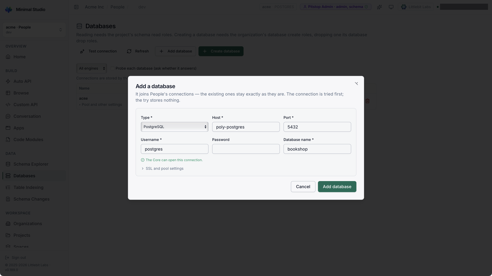

   The host is one the **Core** can reach, not Studio: here, the name of a container on the Core's own private network. Thirteen of the fourteen databases of this chapter accept an empty password because nothing outside that network can reach them. Do not do that to a database that anyone else can reach.

3. Select **Add database**. A message reads "Database added", and the list holds two rows.

## Add the others

Repeat the dialog for each engine. The **Type** list holds the fourteen engines. Pick the one you run, and Studio fills in the port that engine usually listens on and, under the list, says what it connects as: for TiDB, "connects as mysql", with the port 4000. The shot was taken after the first thirteen were registered, while four engines were stopped (see "When a database is down"), which is why the page behind it shows an orange error line: the dialog was opened again for TiDB and cancelled, since `orders` was already registered.

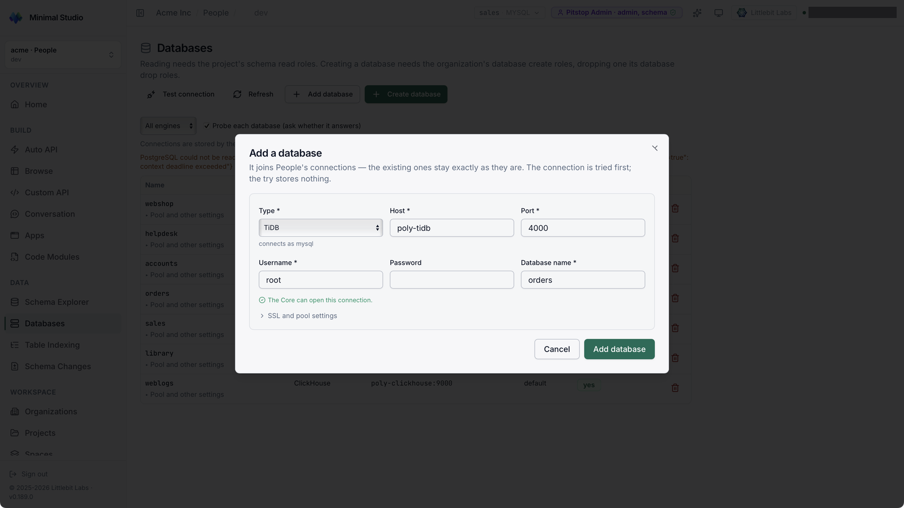

Studio knows the ports of CockroachDB (26257), YugabyteDB (5433), RisingWave (4566), TiDB (4000) and StarRocks (9030); for any other engine it fills in the port of the type it connects as, and anything you type over a port stays. For the first twelve databases, and for `sales`, the book picked the plain types, **PostgreSQL**, **MySQL**, **MariaDB** or **ClickHouse**, and typed the ports, which stores the same thing. These are the values it used:

| Database | **Type** picked | Host | Port | Username |
|---|---|---|---|---|
| `weather` | PostgreSQL | `poly-timescaledb` | 5432 | `postgres` |
| `invoices` | PostgreSQL | `poly-citus` | 5432 | `postgres` |
| `hotel` | PostgreSQL | `poly-cockroach` | 26257 | `root` |
| `payments` | PostgreSQL | `poly-yugabyte` | 5433 | `yugabyte` |
| `clicks` | PostgreSQL | `poly-risingwave` | 4566 | `root` |
| `webshop` | MySQL | `poly-mysql` | 3306 | `root` |
| `helpdesk` | MySQL | `poly-percona` | 3306 | `root` |
| `accounts` | MySQL | `poly-vitess` | 33577 | `root` |
| `orders` | MySQL | `poly-tidb` | 4000 | `root` |
| `library` | MariaDB | `poly-mariadb` | 3306 | `root` |
| `weblogs` | ClickHouse | `poly-clickhouse` | 9000 | `default` |
| `sales` | MySQL | `poly-starrocks` | 9030 | `root` |

Each one passed the same check, "The Core can open this connection." The book added `sales`, the StarRocks database, after the first twelve had been read.

`rides`, the SingleStore database, came last, after the server was enlarged. This time the book picked the engine by name: **SingleStore** in the **Type** list, which reads "connects as mysql". Host `poly-singlestore`, port 3306, username `root`, database name `rides`. It is the one database here with a password: the book started its container with a throwaway root password, which this field takes. It shows dots, and the check line reads "The Core can open this connection."

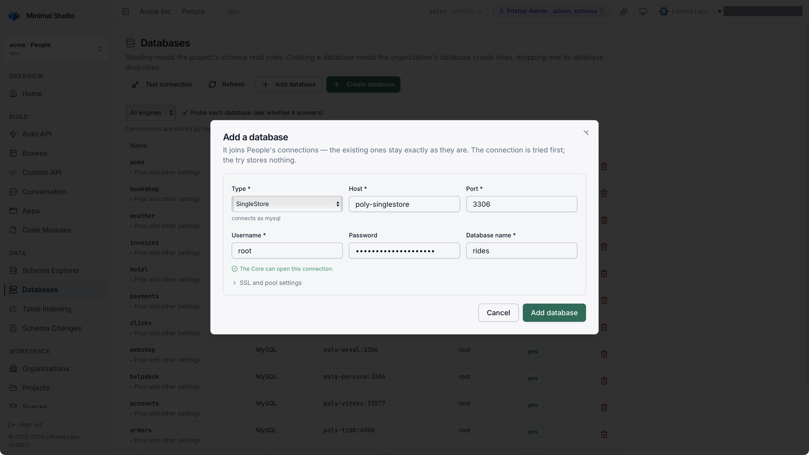

## One list

1. Open **Databases** and tick **Probe each database (ask whether it answers)**. Every one of the fifteen rows, `acme` and the fourteen added, reads **yes**. The **Engine** column says the **Type**: seven rows read PostgreSQL, six MySQL, one MariaDB and one ClickHouse, and the page keeps the rows of one type together. The **Hosts** column shows the container name, and the book named each container after its engine. The shot is of the page scrolled until the whole list and its header fit; the chip at the top reads `rides`, the database read last.

   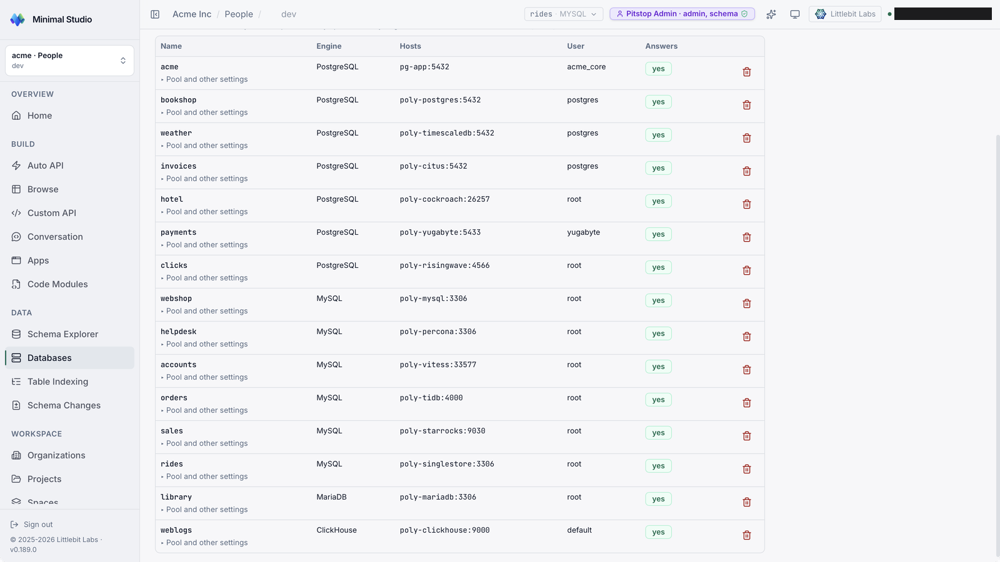

2. The chip at the top of every page, which read `acme · POSTGRES` before the first add, now opens a list headed "DATABASE", "15 databases in this project", each with its type, in the order they were added. It chooses the **active database**, the one that Schema Explorer, Browse and Auto API show; Table Indexing starts on it and has a list of its own. Choose `weather`, and the chip reads `weather · POSTGRES`. The shot was taken on Table Indexing with `sales` active: the chip reads `sales`, and the list carries the tick on it.

   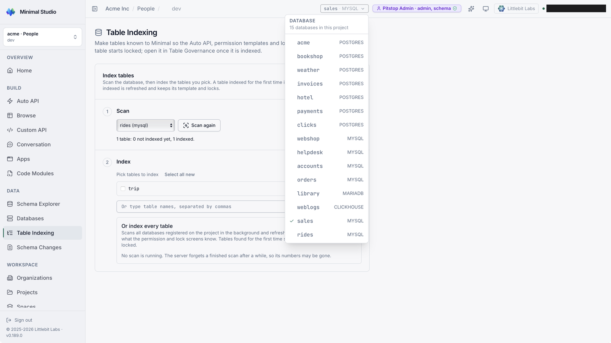

## Index their tables

A table is served only once it is indexed (Chapter 19). **Table Indexing** shows, for each database, which of its tables are indexed and which are new.

1. Open **Table Indexing**. In **Scan**, choose `rides (mysql)`, the database added last. The page reads "1 table: 0 not indexed yet, 1 indexed", and `trip` is listed as indexed, with a **Re-index** button. The table was already indexed; the book ran no step that would have done it.

   

2. `sales`, added with the plain **MySQL** type, came out differently. In **Scan**, choose `sales (mysql)`: "1 table: 1 not indexed yet, 0 indexed", and `daily_sales` is listed with **new**. Tick it and select **Index 1 table**. The book did not find why the two differ.

   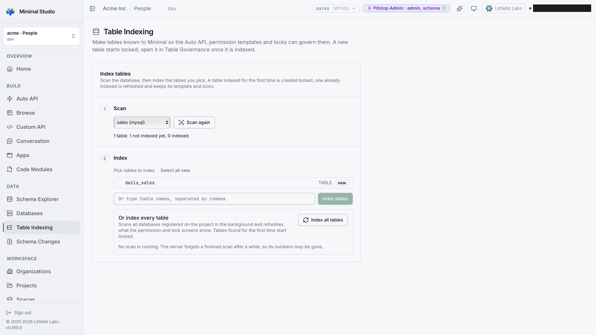

3. The same page on `clicks` (RisingWave) answers differently again. The scan reads the database's own catalog, and RisingWave does not have one of the functions the scan uses. A red panel reads "THE LIVE CATALOG IS CLOSED TO YOU (HTTP 502)": "could not read the database's catalog: ERROR: Failed to prepare the statement … function pg_total_relation_size(integer) does not exist (SQLSTATE XX000)", and under it "Type the table names in step 2 instead.", which is the page's own step 2, **Index**.

   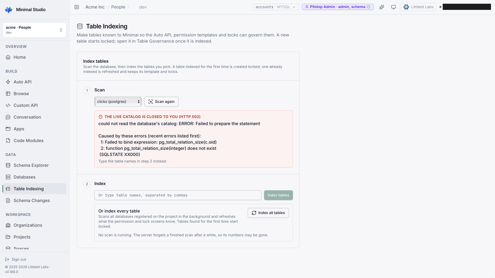

4. Do that. In the box "Or type table names, separated by commas" type `clicks_per_page`, the materialized view, and select **Index 1 table**. A result card names `clicks_per_page`, tagged **created**, kind MATERIALIZED_VIEW, and reads "New table: it starts locked.", followed by the locks it starts with.

   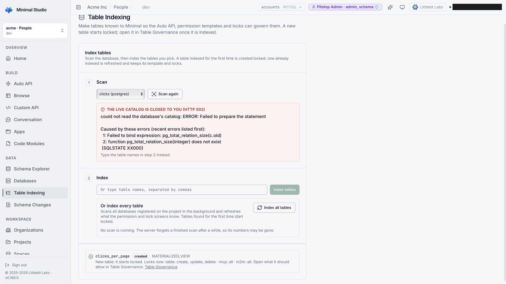

5. **Index all tables** "scans all databases registered on the project in the background and refreshes what the permission and lock screens know". The book pressed it after all fifteen databases were registered. A table appears under the button, with the headings **Database**, **Tables indexed**, **Started**, **Ended** and **Error**. It has one row per type, not per database: `clickhouse`, `postgres`, `mysql` and `mariadb`, each with 0 under **Tables indexed**, a start time and an end time of 0001-01-01T00:00:00Z. Under it the page reads "Every database was scanned. Open Table Governance to see each table and open the operations it should allow." The book does not explain these numbers.

   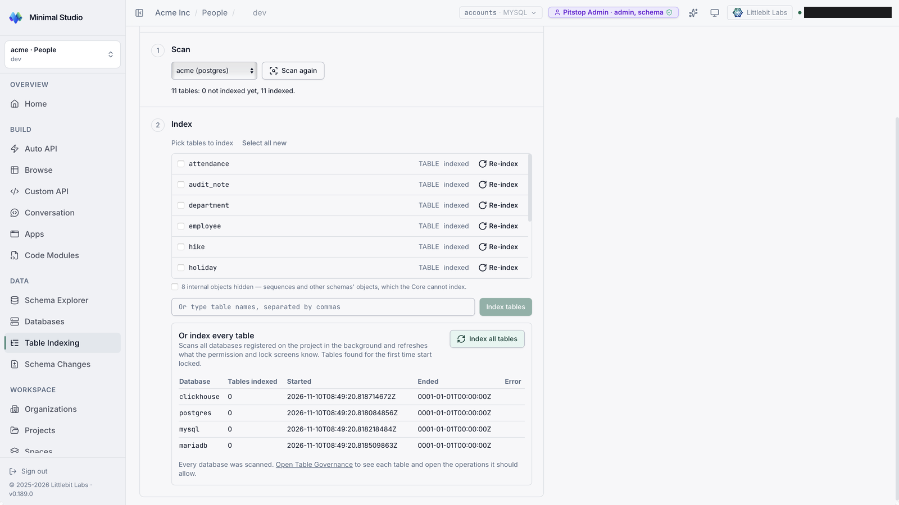

## Read each database

1. With `weather` active, open **Schema Explorer**. TimescaleDB keeps its own tables in the database, and the explorer lists them too: 30 in all. Type `reading` into the filter, and the footer reads "1 of 30 tables". The table has three columns: `ts`, a timestamp with time zone, `station`, text, and `temp_c`, a number.

   

2. Open **Browse** and scroll the list to `reading`. The rows are six temperature readings from two stations. The line above them is the request that Studio made, and it names the database: `…/auto/v1/acme/people/pg/weather/reading`. After the organization and the project come the **code** of the type, `pg`, the database, `weather`, and the table.

   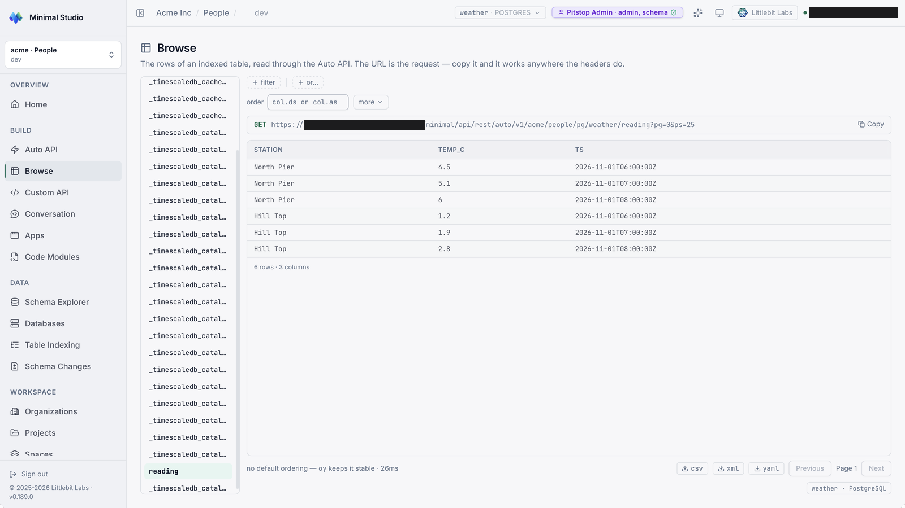

3. Choose `orders` in the chip. TiDB was registered as **MySQL**, so the code is `ms`: `…/ms/orders/customer_order`. Pick the table again in the list: right after a change of database, the rows on the right still belong to the table you had open before, shown under the new database's address, and picking a table replaces them. The chip is in the top bar of every page. On Browse, the column headings of the rows sit at the same height as one row of the chip's list, and the book could not click that row (`hotel` in the book's run); the same chip opened on Home had no such problem.

   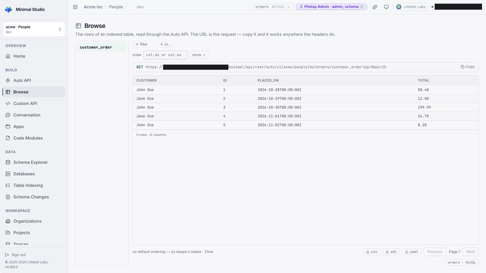

4. Choose `library`, the MariaDB database: the code is `ma`, and the table is `loan`.

   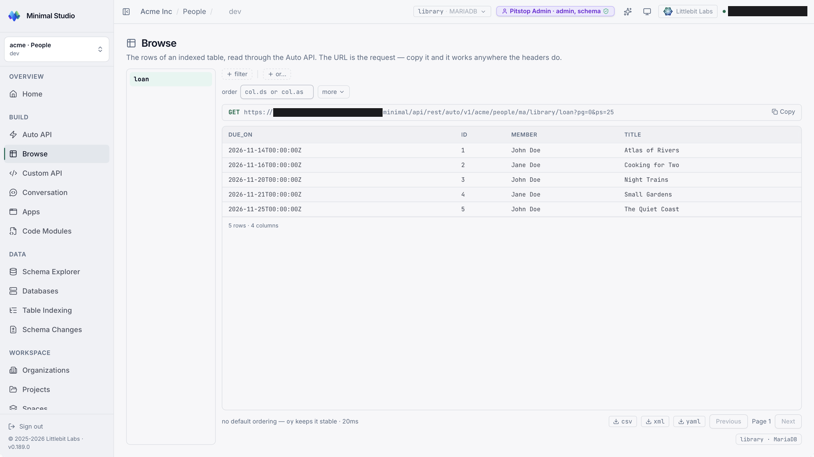

5. Choose `weblogs`, the ClickHouse database: the code is `ch`, and the table is `hit`.

   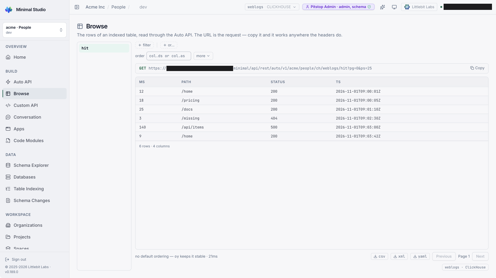

6. The others read the same way. `clicks`, on RisingWave, returns its five rows in the order the engine gives them, not by `id`. `hotel`, on CockroachDB, lists the engine's own `crdb_internal` tables as well; opening one of them is refused by the engine ("Access to crdb_internal and system is restricted. (SQLSTATE 42501)"), and `booking` reads.

   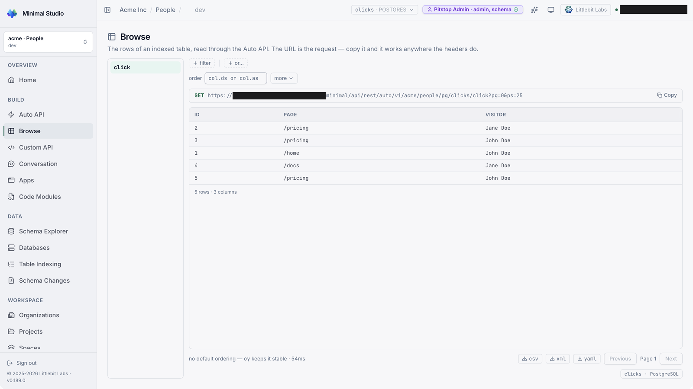

   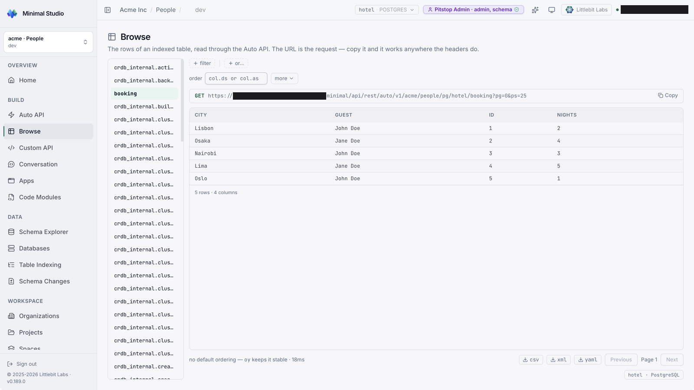

7. `sales`, the StarRocks database, reads once its table is indexed: six rows of sales by day and region.

   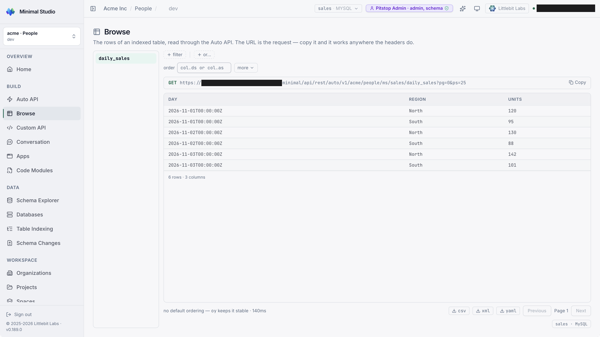

8. `rides`, the SingleStore database, reads without any indexing step of the book's: five trips, in the code `ms`, under `…/ms/rides/trip`. The engine gives the rows grouped by rider, not by `id`, and the page says "no default ordering".

   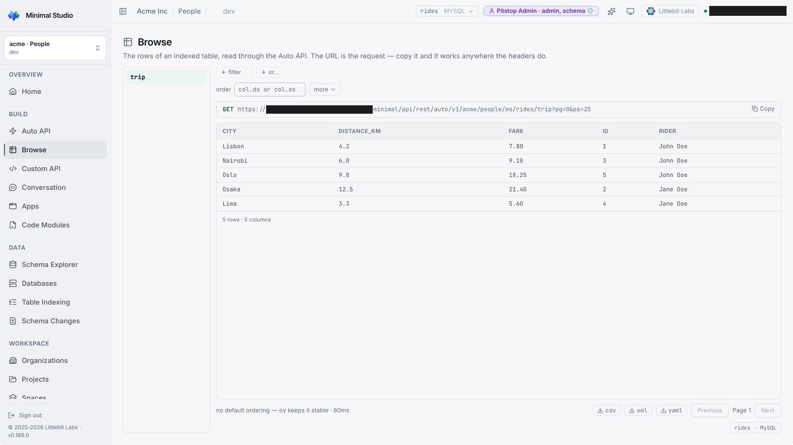

9. `bookshop`, `invoices`, `payments`, `webshop`, `helpdesk` and `accounts` were read the same way, and the book shows no shot of them.

## The same page for every engine

Open **Auto API** with `accounts` active. The list is the Vitess database's: one table, `customer`, and four endpoints. `GET` answers any role; `POST`, `PUT` and `DELETE` are **locked**, because a table indexed for the first time is created locked (Chapter 18). The request line reads `…/ms/accounts/customer`.

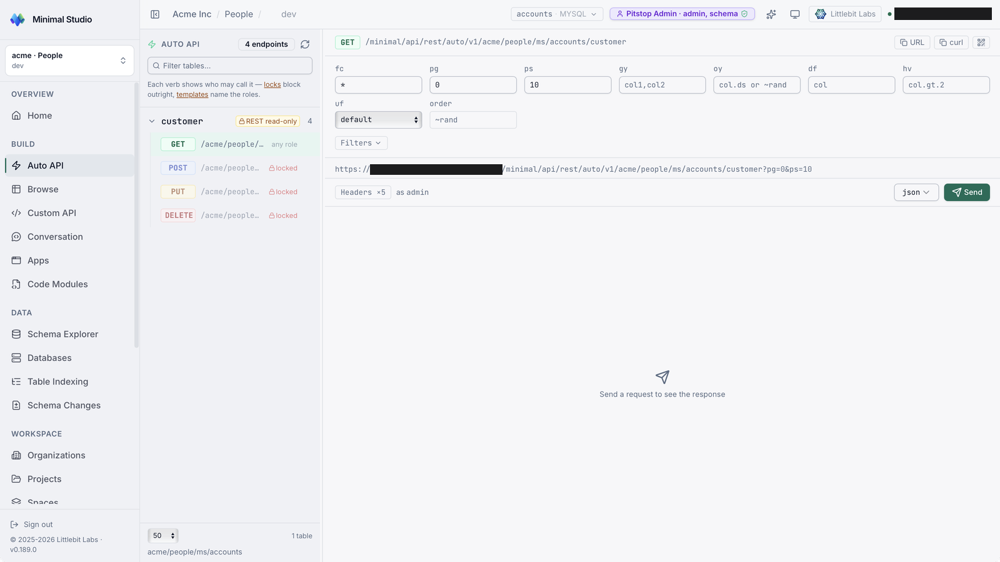

## When a database is down

While the server was small, the book had four containers stopped to make room for StarRocks: YugabyteDB, Vitess, CockroachDB and RisingWave. Their rows stayed on the project. A **Probe** in that state:

- the Vitess row, `accounts`, reads **no**;
- with three PostgreSQL-type engines stopped, the PostgreSQL probe ran out of time: an orange line reads "PostgreSQL could not be read: {"error":"Get … context deadline exceeded"}", and the page lists only the rows of the other three types, MySQL, MariaDB and ClickHouse, all **yes** but `accounts`.

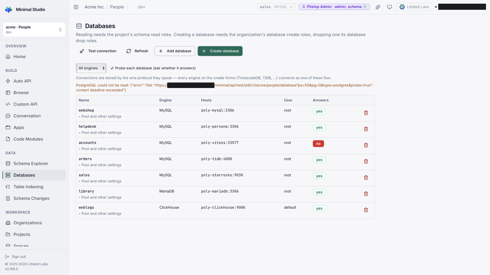

The probe still answered for the types it could read. It was slow: the page showed **unknown** on every row until the PostgreSQL probe gave up. After the server was enlarged the four were started again, and the probe of "One list" answered **yes** on every row.

## A smaller project on your own Mac

The fourteen databases above ran on the book's gateway. The same idea fits on the Mac that runs Studio: the book's local Core, the project's own database `acme`, and four containers beside it, five databases of four types. This section runs on the local Core, not on the gateway: Studio signed in to it as in Chapter 3, with **Direct to Core**, as `john.doe` in **acme · People**, space **dev** (Chapter 5). The shots are of Studio's web page, which is the same application as the desktop one (Appendix C).

The containers run on the Mac and publish their ports to it. The Core reaches them at `host.docker.internal`, Docker's name for the Mac.

| Database | Engine | Version | Host and port | **Type** picked |
|---|---|---|---|---|
| `metrics` | TimescaleDB | 2.31.0 | `host.docker.internal:5433` | PostgreSQL |
| `shop` | MySQL | 8.4.13 | `host.docker.internal:3306` | MySQL |
| `shop` | MariaDB | 11.8.9 | `host.docker.internal:3307` | MariaDB |
| `events` | ClickHouse | 26.10.3.7 | `host.docker.internal:9000` | ClickHouse |

Each has a read-only login, `studio_demo`, made with the engine's own client, and each was added as in "Add the first database": **Databases** → **Add database**, the type, the host, the port, the login and the database name. Two of the databases are called `shop`.

1. Open **Projects**. The card of **People** lists its connections as chips, each with a type and a name: `PostgreSQL · acme`, `PostgreSQL · metrics`, `MySQL · shop`, `MariaDB · shop` and `ClickHouse · events`.

   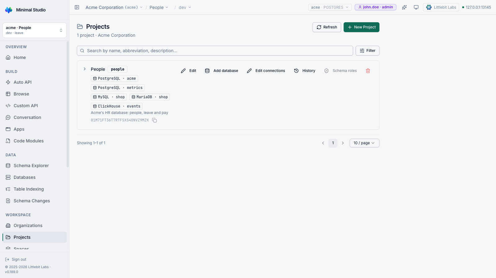

2. Select the arrow at the start of the card. Under its roles, "Connections (5)" lists each connection: its host, user, SSL mode, pool and timeouts. Passwords show as dots; **Reveal passwords** shows them, and the book did not select it.

   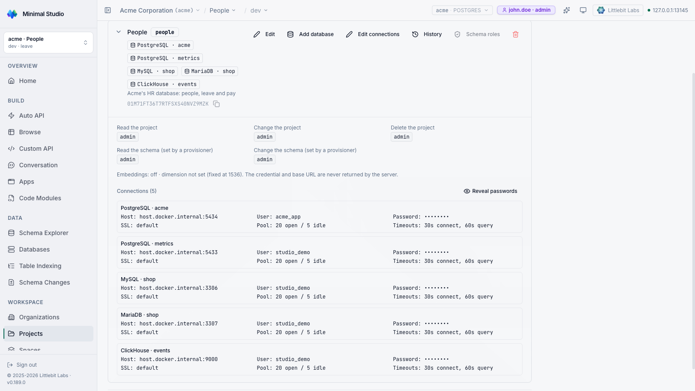

3. Open **Databases** and tick **Probe each database (ask whether it answers)**. All five rows read **yes**. Two rows are called `shop`: the **Engine** column tells the MySQL one from the MariaDB one.

   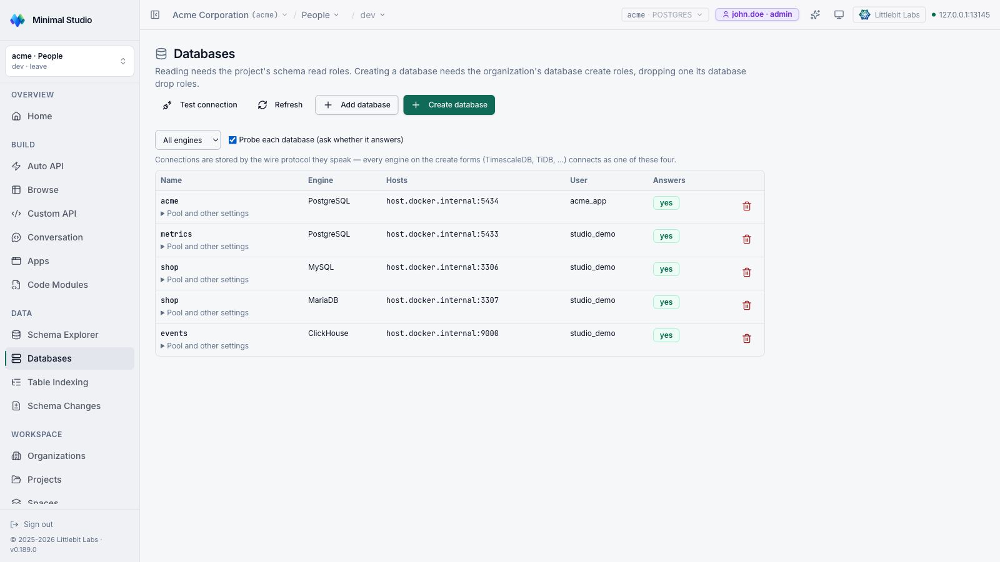

4. Open the chip at the top. It lists "5 databases in this project", each name with its type beside it: `shop` appears once with MYSQL and once with MARIADB.

   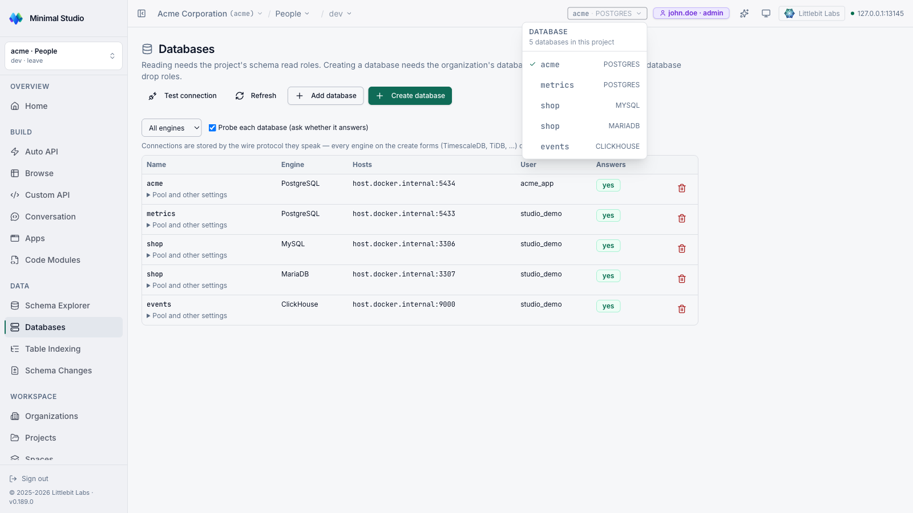

5. Choose the `shop` of type MYSQL, open **Auto API**, open `products` and select its **GET**. Set **ps** to `4` and select **Send**. The request line reads `…/ms/shop/products`, and four products come back. Choose the `shop` of type MARIADB and do the same: the line reads `…/ma/shop/products`. The name is the same; the code is not.

   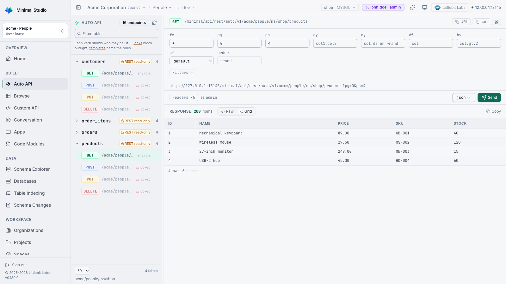

   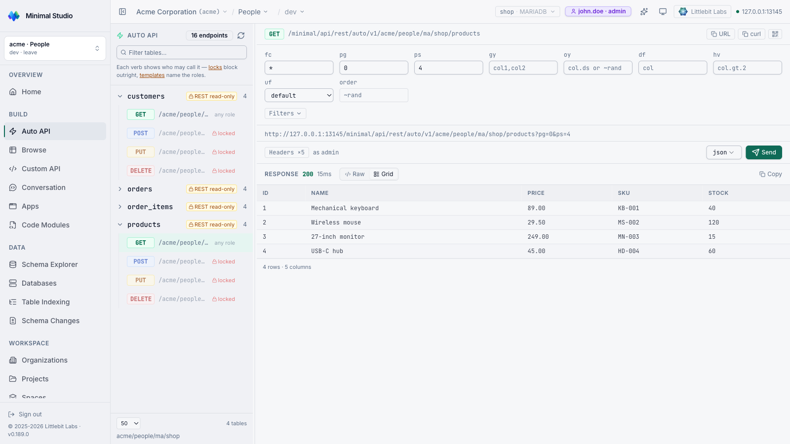

6. Choose `events`, the ClickHouse database. Select the **GET** of `page_views`, set **ps** to `4`, choose **false** in the **uf** list and select **Send**. The URL reads `…/ch/events/page_views?pg=0&ps=4&uf=false`. **uf** is for ClickHouse tables whose engine merges rows in the background: **false** reads every stored row, superseded ones included, instead of the merged rows. `page_views` and `users` are plain MergeTree tables, which merge nothing, so the Book of Minimal says it changes nothing here, and the answer is the table's own rows. On a database that is not ClickHouse the Core ignores **uf** too: on `acme`, `uf=false` answers 200 with the same rows. Studio offers the list on every database.

   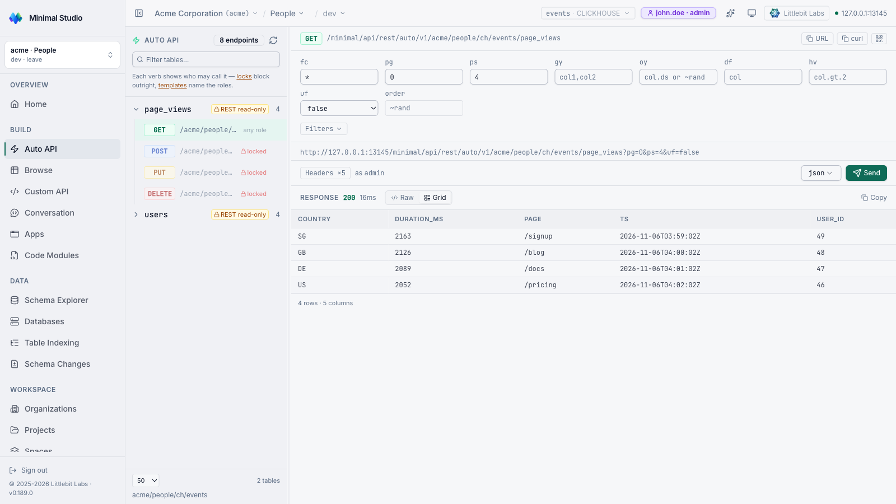

## Exercises

1. On **Databases**, tick **Probe**. For each of the MySQL rows, name the engine behind it from its **Hosts** column.
2. Choose `library` in the chip, open **Browse**, and read the request line. Which code does it carry, and which type was chosen when the database was added?
3. On **Table Indexing**, scan `weblogs`. Which line says how many tables it holds and how many are indexed?
