# 24. Row-level security in depth

Chapter 18 bound `employee.email` to the caller and read nothing. The dialog that did it makes three claims: reads are filtered to the rows that match, inserts get the column written from the header, and "a scope is a real boundary only when a token supplies the header". This chapter runs each claim on one table, `audit_note`, with three callers. Studio calls the feature a row scope; the Book of Minimal calls it row-level security.

> **Setup.** The workspace of Chapter 5, space **dev**: Studio signed in as `john.doe` in **acme · People**, with the tables of Chapter 18 as that chapter leaves them. `audit_note` has no template and the indexing default locks. The chapter signs out and in twice, as `hr.system@acme.example` and back as `john.doe`; each sign-in needs your Core's server key.

## Why `audit_note`

`audit_note` holds 400 notes (Appendix A). A query on the Postgres server shows that every one has the same `author`, `hr.system@acme.example`. The column is text, which a row scope needs, and the table is at the indexing default: REST reads are open, and writes are locked. Three callers read it:

- `john.doe`, who has written no note yet;
- `hr.system@acme.example`, who wrote all of them;
- a token that `john.doe` owns.

## Scope it

1. Select **Table Governance** and, on the row of `acme.audit_note`, **Access**. The dialog is the one of Chapter 18: "Checked in order: visibility → locks → template → row scope." Create, update and delete are **Locked**, read is **Open**, and a banner says "Still at the indexing default". At the foot, **ROW SCOPE** reads "Rows where column… = the caller's header".

   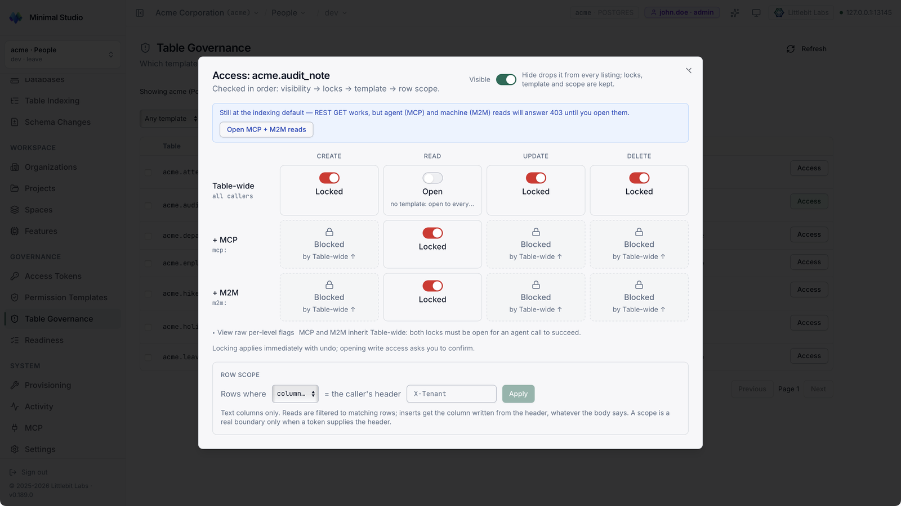

2. In the chooser select `author`, and type `X-User-Id` into the header field. **Apply** turns dark.

   

3. Select **Apply**. "Row scope set on acme.audit_note" appears for a few seconds, and **Clear scope** joins the title of the section.

   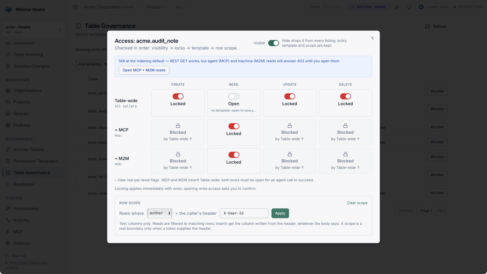

   Close the dialog. The list tags the table **scoped**.

   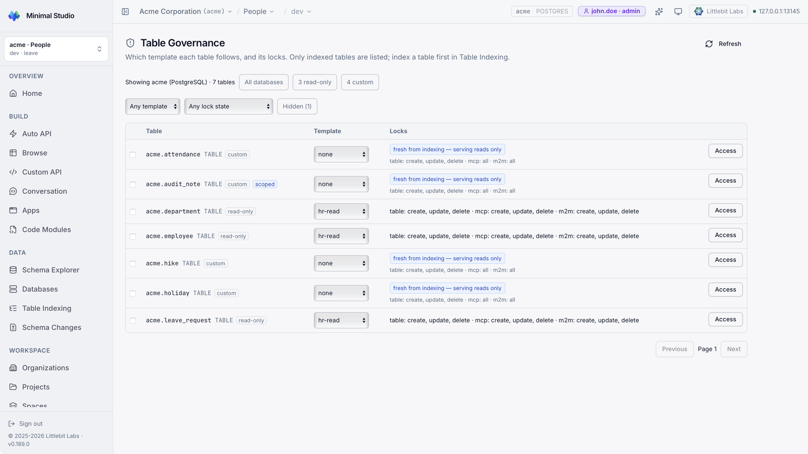

4. Open **Browse** and select `audit_note`. The page reads "Nothing on this page.": no note has the author `john.doe`, so the scope lets him read no row.

   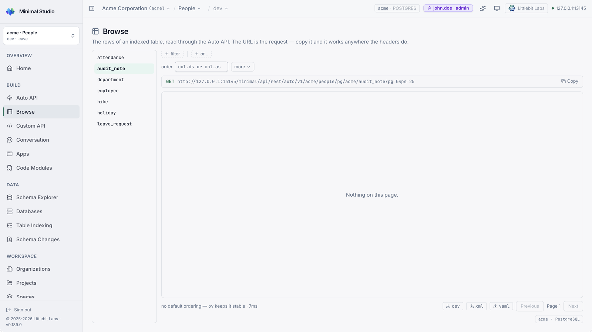

## Write as the caller

A write needs its lock open.

1. In **Access** on `audit_note`, select the **Create** switch in the **Table-wide** row. Studio asks "Open create on Table-wide for acme.audit_note?" and says "Once open: no template: open to every role." Select **Open create**.

   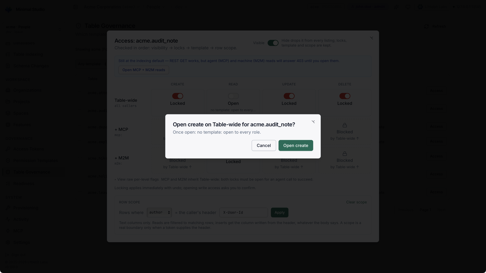

   A message reads "Opened create on Table-wide for acme.audit_note", with **Undo**, for a few seconds. Create is **Open**, and the scope is still set.

   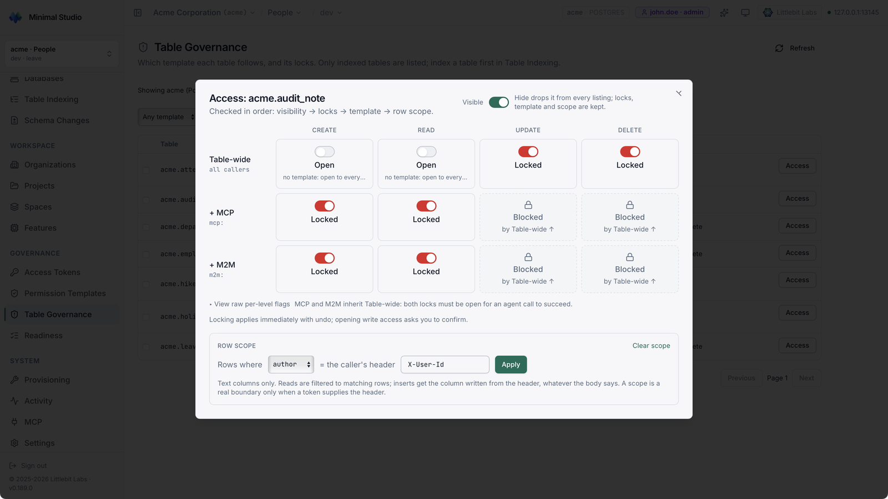

   The book opened **Update** and **Delete** the same way, so that the Auto API page lists all four verbs of `audit_note` as open to any role. An insert needs only create.

2. Open the **Auto API** page, expand `audit_note` and select its **POST**. The body editor, captioned "Always an array — even for a single row", holds an empty row. Replace its text with a row that names another author:

   ```json
   [
     {
       "id": null,
       "employee_id": 7,
       "author": "someone.else",
       "body": "Asked for a copy of the leave policy.",
       "written_at": "2026-11-10T10:00:00Z"
     }
   ]
   ```

   Two earlier attempts were refused, and the refusals are the Auto API's, not the scope's; the book did not picture them. Without `"id": null` the answer is 417: "The insert must name id. Put "id": null in the row to ask the server for a generated key, or give a value." With `written_at` lacking its zone it is 424: "Dates and times need ISO 8601 with a zone, for example 2026-10-31T00:00:00Z."

3. Select **Send**. The answer is **RESPONSE 201**, `ROWS_AFFECTED` 1.

   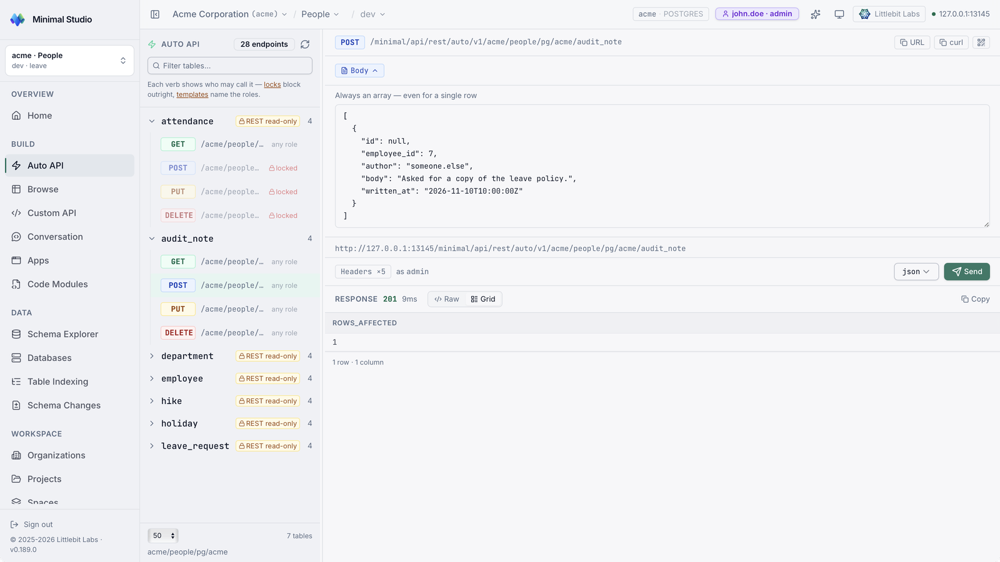

4. Open **Browse** and select `audit_note`. One row: the author is `john.doe`, and the id is 401. The body said `someone.else`; the Core wrote the header's value. A query on the Postgres server shows the same row. Under a scope an insert cannot be written into another caller's rows.

   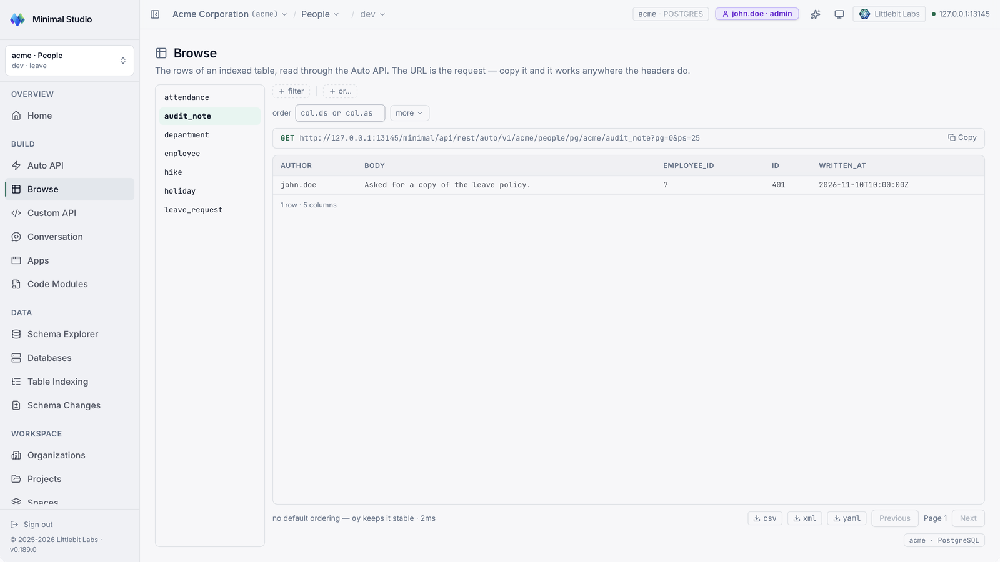

## A view is a table of its own

A scope binds one indexed object. A view built on a scoped table is another object, and starts with no scope.

1. A view must be indexed before it is listed (Chapter 19). In **Table Indexing**, type `v_employee_directory` into "Or type table names, separated by commas" and select **Index 1 table**. Studio answers with a card for the view, tagged **created**, kind VIEW: "New table: it starts locked."

2. As in Chapter 18, scope `acme.employee` on `email`, with `X-User-Id`. In **Browse**, `employee` answers "Nothing on this page."

   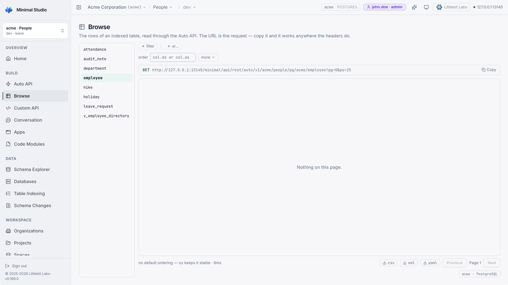

3. Select `v_employee_directory` in the same list. It lists the active employees, with their emails: the view is built on `employee`, but the scope of `employee` does not reach it.

   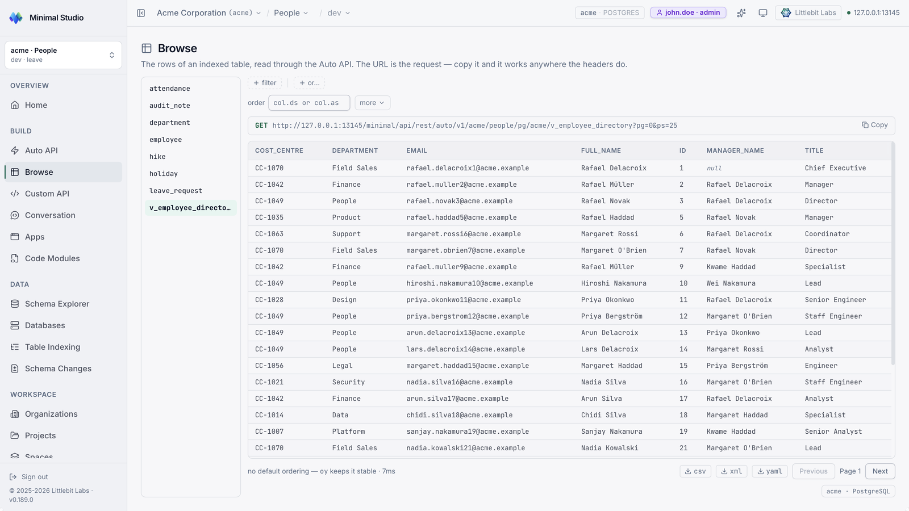

4. Scope the view the same way: **Access** on `acme.v_employee_directory`, `email`, `X-User-Id`, **Apply**. **Table Governance** now tags three tables **scoped**, `audit_note` among them.

   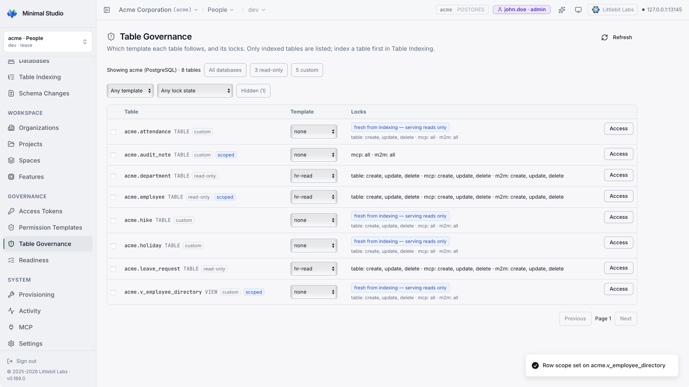

   **Browse** now answers "Nothing on this page." for the view as well.

   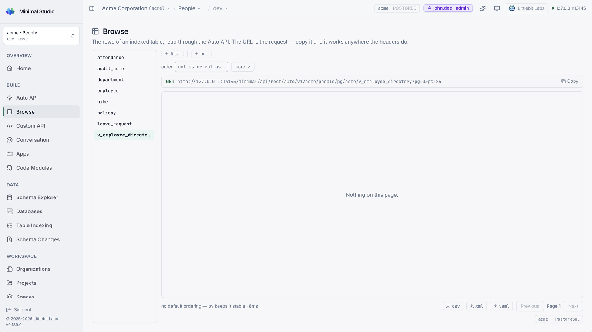

5. Clear what this section set. In **Access** select **Clear scope** on `employee` and on the view: "Row scope cleared on acme.employee", and the same for the view. In **Access** on the view, switch **Visible** off: "Hid acme.v_employee_directory". The view stays indexed, hidden, so **Table Governance** still lists seven tables.

   Two counts of earlier chapters change. **Hidden** now reads (2), where Chapter 18 shows (1), and the scan of `acme` in **Table Indexing** reads "2 not indexed yet, 8 indexed", where Chapter 19 shows 3 and 7.

## A boundary needs a token

Studio sends five identity headers, and the person who signs in picks the user ID (Chapter 3). A call made with the server key sets its own headers, so whoever holds the key can name any user ID and read that user's rows. The Core's rule (volume 2, chapter 4 of the Book of Minimal) is that a token replaces whatever identity headers a request sends with those of its own owner. A scope on a header that a token supplies keeps one caller out of another's rows.

1. Select **Access Tokens**, then **Mint token**. Type `book-rls` as the **Name** and choose the **Type** **Reviewer**: "May do: read only". Keep the role `admin`, and set **Expires in (days)** to 1. A token that only reads, and for one day, is what a test needs.

   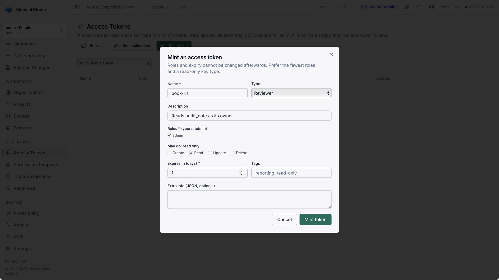

2. Select **Mint token**. The token appears once, in plain text, under the notice "Anyone with this string can act as the token until it is deleted. Copy it now into your password manager or the MCP settings; Studio does not keep it." The shot covers it. Copy it into your password manager, not only onto the clipboard: the next step puts the server key there. Select **Done**.

   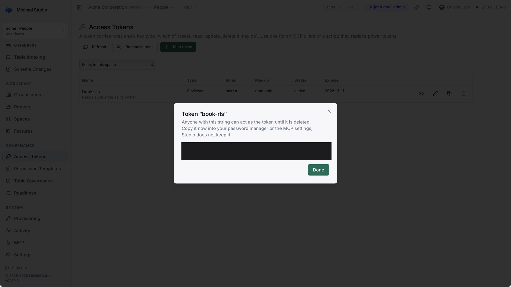

3. Sign out. On the sign-in page choose **Direct to Core**, type your Core's address, open **Identity options** and type `hr.system@acme.example` as the **User ID**: any ID that does not start with `sys:` gets full admin. Paste the server key, select **Continue**, and open Studio on **People**, space **dev**, as in Chapter 5. The top bar now names `hr.system@acme.example`. In **Browse**, `audit_note` lists the seeded notes: every row on the page has the author `hr.system@acme.example`, and the scope gives this caller no row that another author wrote.

   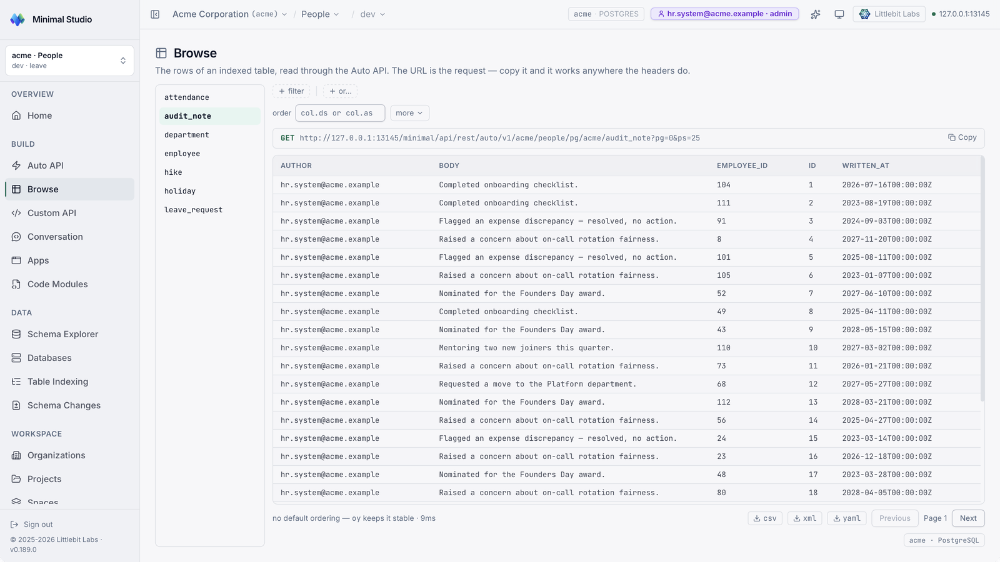

4. Open the **Auto API** page, expand `audit_note` and select its **GET**. The bar under the parameters reads **Headers ×5** "as admin". Select **Headers ×5**: it lists the five identity headers, and under them reads "Or act as an access token (sent as LB-Access-Token, in place of the five headers). Works on a direct connection; a gateway strips it." A field, "access token", takes the token.

   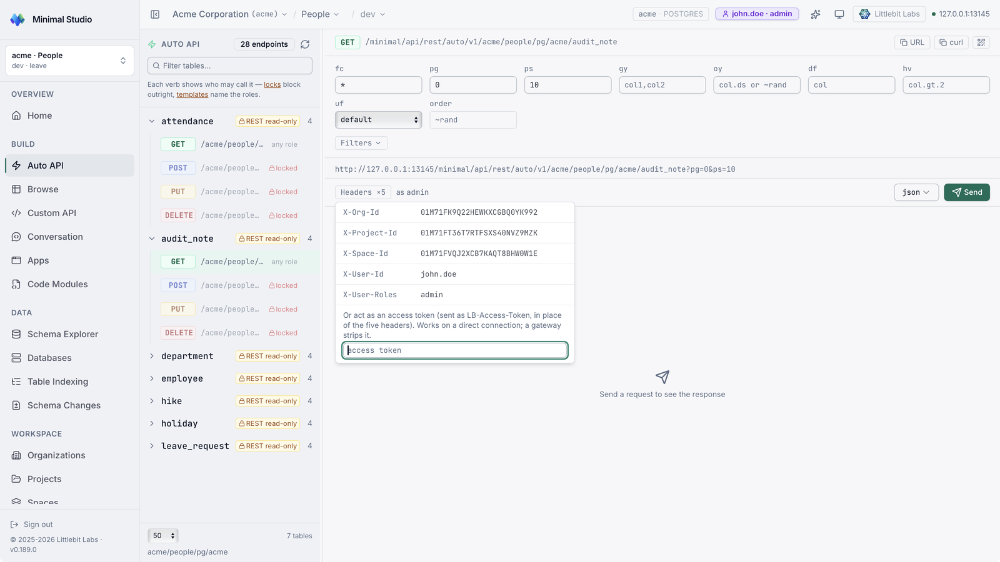

   Paste the token into that field and close the list by clicking outside it. The bar reads "as an access token". Select **Send**.

   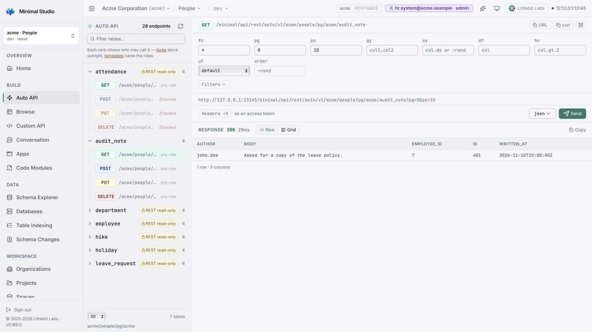

   The answer is **RESPONSE 200**, one row: the author is `john.doe`, the id 401. The top bar still says `hr.system@acme.example`; the token's owner decided.

The same table gave three readings:

| Caller | How the call is made | Rows of `audit_note` |
|---|---|---|
| `john.doe` | signed in, five headers | none; then his one note |
| `hr.system@acme.example` | signed in, five headers | the seeded notes, every one its own |
| John's token | sent from the session of `hr.system@acme.example` | John's one note |

## Put it back

1. Sign out, and sign in again as `john.doe`, as in Chapter 3, with the server key. Choose the workspace of Chapter 5.
2. In **Access** on `audit_note`, select **Clear scope**: "Row scope cleared on acme.audit_note".
3. Select the **Create**, **Update** and **Delete** switches of the **Table-wide** row. Locking applies at once, with **Undo**.
4. On the Postgres server, delete the note: `DELETE FROM audit_note WHERE id = 401;`. A count shows 400 notes again, as in Appendix A.
5. In **Access Tokens**, with the list on "Mine, in this space", select the red bin of `book-rls`: "Whatever uses this token stops working at once. This cannot be undone." Select **Delete**; the list reads "No tokens."

   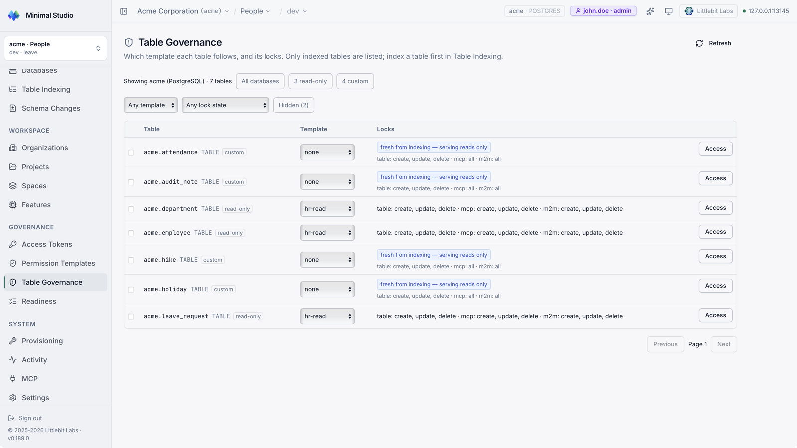

## Rules this chapter did not run

Volume 2, chapter 4 of the Book of Minimal gives two more rules for a scoped table: an update that assigns the scope column is refused, and a delete with no filter, which the Auto API refuses elsewhere, is allowed and removes only the caller's rows. It also lists what a scope may use: a text column, and a header that is not one of the platform's own, with `X-User-Id` the one identity header allowed. This edition did not run these rules, because they need the **Set** and **Filters** pop-ups of the Auto API page (Appendix C).

## Exercises

1. In **Access** on `acme.audit_note`, scope `author` to `X-User-Id`, and read the table in **Browse**. Check that the page says "Nothing on this page." unless your user ID wrote a note. Then clear the scope.
2. Open **create** on the table, insert a note through the **POST** of the Auto API page with `"author": "someone.else"`, and read it in **Browse**. Check that the author is your own user ID. Then put the table back as the chapter does, and delete your note.
3. Restore `v_employee_directory` from **Hidden (2)**, scope `employee` on `email`, and read the view in **Browse**. Check that it still lists employees. Scope the view, check that it empties, then clear both scopes and hide the view again.
