# 25. Custom APIs with several steps

Chapter 9 deployed a definition of one SQL step. The `logic` of a definition is a list, and a list can hold more. The steps run in order. Each keeps its result under its number, `step_0`, `step_1` and so on, and every later step can read it. This chapter builds three definitions on the Acme data: a card that answers with two reads, a headroom check that puts a script between two queries, and a write that a later step can undo. It ends with the refusals you will meet.

> **Setup.** The workspace of Chapter 5, space **dev**: Studio signed in as `john.doe` in **acme · People**, with `pending-leave` deployed as Chapter 9 leaves it. The chapter deploys three definitions in `dev`, and one throwaway in "What goes wrong", and deletes them at the end. It writes one note to `audit_note` and deletes it too. The note counts are read on the Postgres server, as in Chapter 24.

## A new definition

1. Select **Custom API**, then the **+** above the list (its tooltip reads "New definition"). Studio opens an empty definition on the **Form** tab: **IDENTIFIERS** and **DATABASE** say "Inherited from top-bar context" and "Inherited from project DB config", and **LOGIC** holds one sample step, `SELECT * FROM emp LIMIT 5`.
2. Open the **Editor** tab. The text is the whole definition, with `identifiers`, `permission` and `database` already filled in. Each definition below replaces only the `http` and `logic` blocks. The template leaves `uri` empty: until it holds a path, **Validate** turns the `http` chip red and says "URI is required. Enter a valid endpoint path (e.g. /my/endpoint)."

## Two reads, one answer

The card of an employee: who they are, and what their leave requests add up to. Two SQL steps, both with the placeholder `?:id`.

```yaml
http:
  uri: employee/card
  method: get
  version: "1.0"
  input_type: json

logic:
  - sql: |
      SELECT e.id, e.full_name, e.title, d.name AS department
      FROM employee e
      JOIN department d ON d.id = e.department_id
      WHERE e.id = ?:id
    omit: false
  - sql: |
      SELECT status, COUNT(*) AS requests, SUM(days) AS days
      FROM leave_request
      WHERE employee_id = ?:id
      GROUP BY status
      ORDER BY status
    omit: false
```

A SQL step is one statement. `?:id` is filled with the caller's `id`; the Core writes a number as it is, and a string as a quoted, escaped value. `omit: false` puts the step's rows in the answer.

1. Replace the `http` and `logic` blocks with the text above. Select **Validate**: the seven chips turn green and the line reads "All sections valid — click Deploy".

   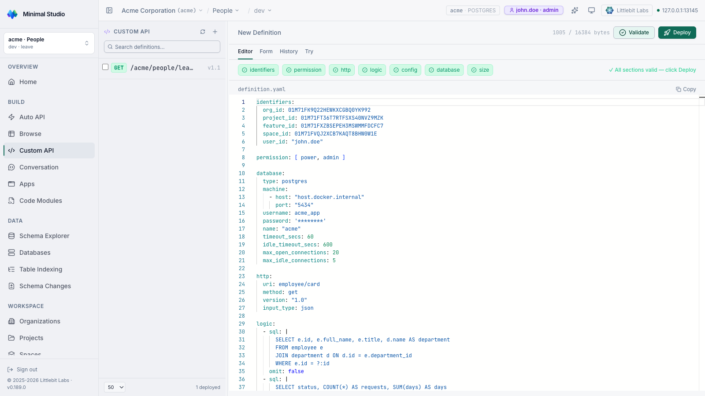

2. Select **Deploy**. A message reads "Definition deployed successfully", the button changes to "Updated!", and the foot of the list reads "2 deployed".

   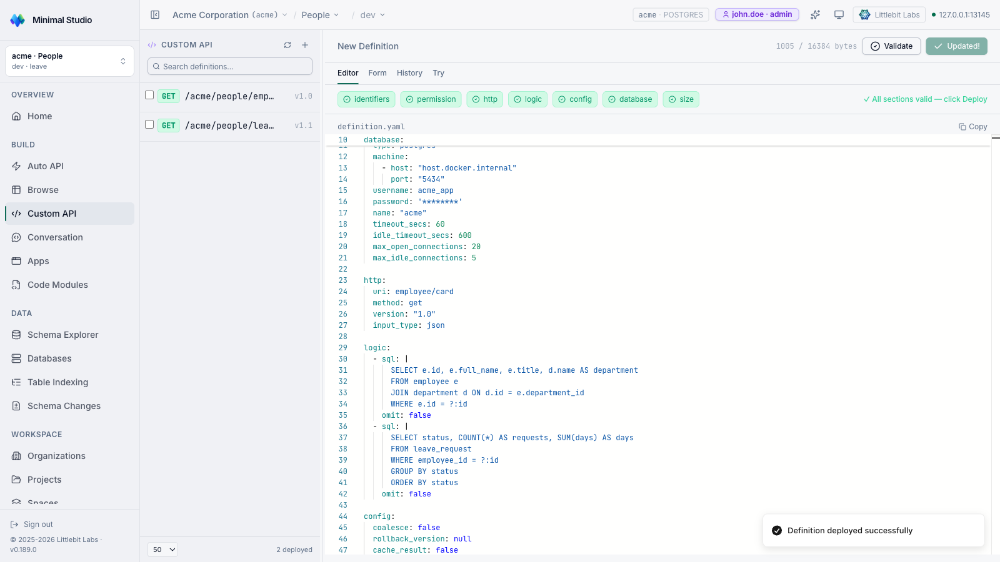

3. Select `/acme/people/employee/card` in the list and open **Editor**. This is the Core's copy, not your text: the keys are in alphabetical order, and each step has `omit` ahead of `sql`.

   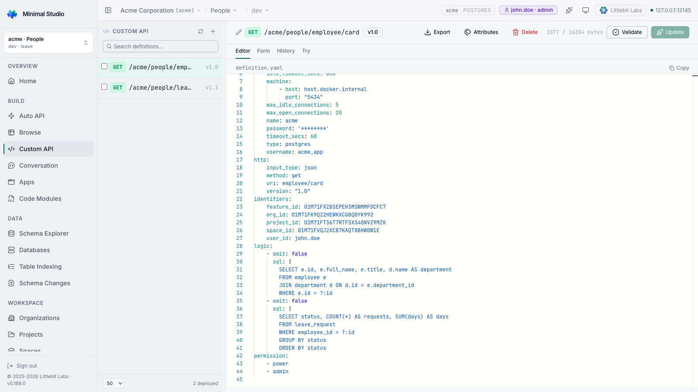

4. Open **Try**. The chip reads "1 param": Studio found `?:id` in the SQL and made it a row. Type `11` in the value field and select **Try it**. The answer is **RESPONSE 200**, one object with a key for each step: `step_0` holds one row, Priya Okonkwo, Senior Engineer, in Design; `step_1` holds three, for `approved` (9 requests, 53 days), `pending` (2, 18) and `rejected` (4, 17).

   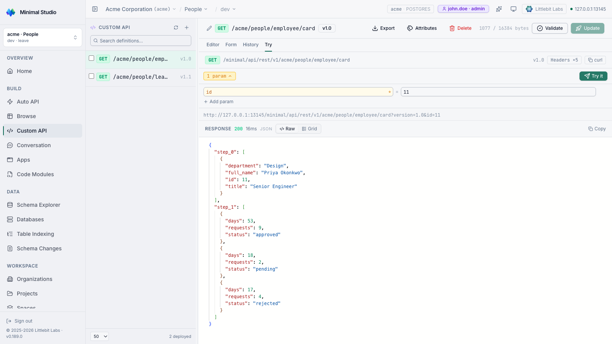

## Hide a step

A step can exist only to feed the next. `omit` keeps its result for the steps that follow and takes it out of the answer.

1. Open the **Form** tab. Each step is a card with its kind (**SQL**, **Starlark**, **Lua**, **Expr**) and an `omit` box with the note "Result included in final response". Tick it on Step 0: the note changes to "Result feeds into next step · hidden from final response".

   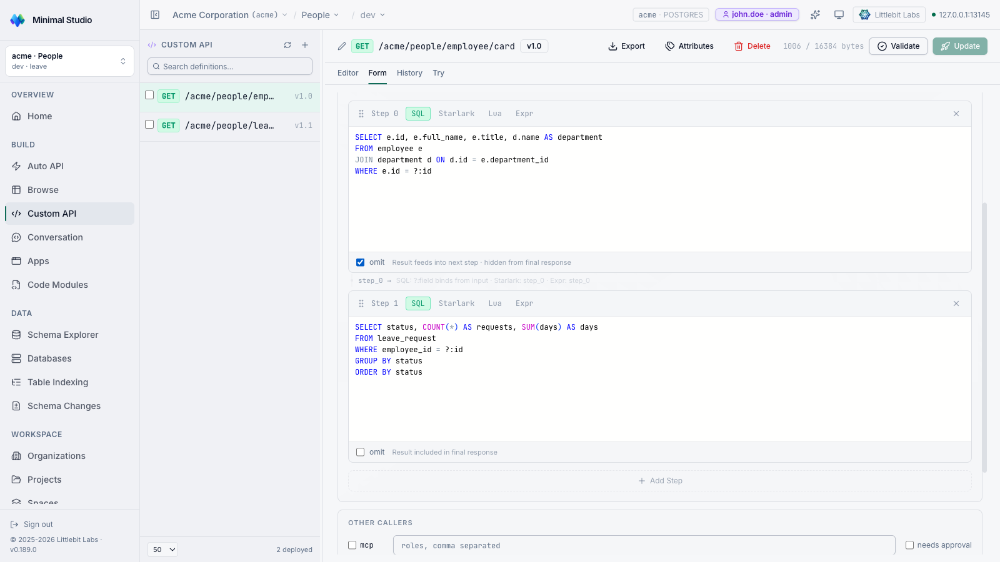

2. Select **Validate**, then **Update**: **Update** stays grey until the text has passed **Validate**. Open **Try** and run employee `11` again. Only the three rows of Step 1 are left, and they come as a plain list: with one result in the answer, there is nothing to number.

   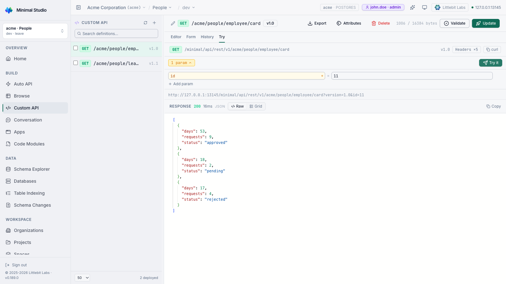

3. Open **Form**, untick `omit` on Step 0, select **Validate** and then **Update**. Run employee `11` again: `step_0` and `step_1` are back.

## A script between two queries

Acme gives each employee 25 days of leave a year. The 25 is made up for this book; it is not in the tables. The definition `leave/headroom` answers three questions about an employee: how many days they have taken in requests that start in 2026, how many of the 25 remain, and which pending requests are longer than what remains. SQL reads the days, a script subtracts, and SQL reads the requests.

```yaml
http:
  uri: leave/headroom
  method: get
  version: "1.0"
  input_type: json

logic:
  - sql: |
      SELECT COALESCE(SUM(days), 0) AS used
      FROM leave_request
      WHERE employee_id = ?:id
        AND status = 'approved'
        AND start_on >= '2026-01-01'
        AND start_on < '2027-01-01'
    omit: true
  - lua: headroom
    code: |
      function min_main()
        local allowance = 25
        local used = step_0[1].used
        return { allowance = allowance, used = used, remaining = allowance - used }
      end
    omit: false
  - sql: |
      SELECT id, kind, start_on, days
      FROM leave_request
      WHERE employee_id = ?:id
        AND status = 'pending'
        AND days > ?:remaining
      ORDER BY start_on
    omit: false
```

- Step 0 is `omit: true`: only the script needs it.
- Step 1 is a **Lua** step. A script step is a function named `min_main` that takes nothing and returns a table; Chapter 26 treats script steps in full. It reads `step_0`, a list of rows (Lua counts from 1), and returns `allowance`, `used` and `remaining`. `headroom` after `lua:` is the step's name.
- Step 2 uses `?:remaining`. No caller needs to send that name. A field that an earlier script step returned can fill a placeholder of a later SQL step, and this is how the script's answer reaches the second query.

1. Select **+**, open **Editor**, replace the `http` and `logic` blocks and select **Validate**.
2. Open **Form**. The three cards are in order: Step 0 **SQL** with `omit` ticked, Step 1 **Lua** with the name `headroom` in the `fn:` field, Step 2 **SQL**. Between the cards, a grey line says what the next step can read.

   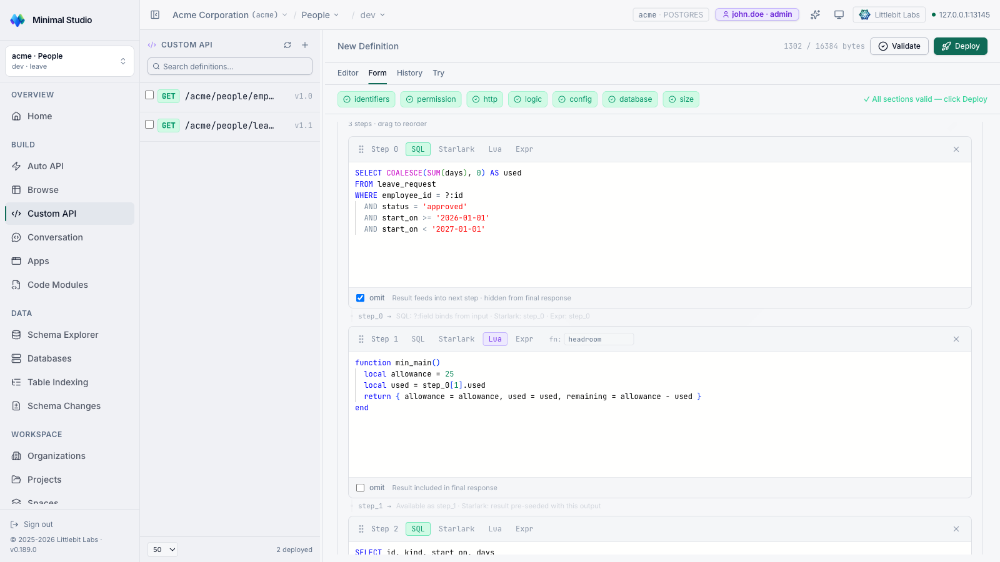

3. Select **Deploy**. The list reads "3 deployed".
4. Select `/acme/people/leave/headroom` and open **Try**. The chip reads "2 params": `id`, and `remaining`, which Studio found in the SQL and marks as required, though the script supplies it. Type `7` in `id`, leave `remaining` empty, and select **Try it**. The answer is **RESPONSE 200**: `step_1` holds the script's table (allowance 25, used 24, remaining 1), and `step_2` the pending requests that last more than one day, ids 99 and 101, of 8 and 7 days. Step 0 is not there. The employee has a third pending request, id 91, of one day; it is not listed, because 1 is not more than 1.

   

5. Run employee `1`. This employee has no approved leave that starts in 2026, so 25 remain, and none of the six pending requests is longer than 25 days: `step_2` is an empty list.

   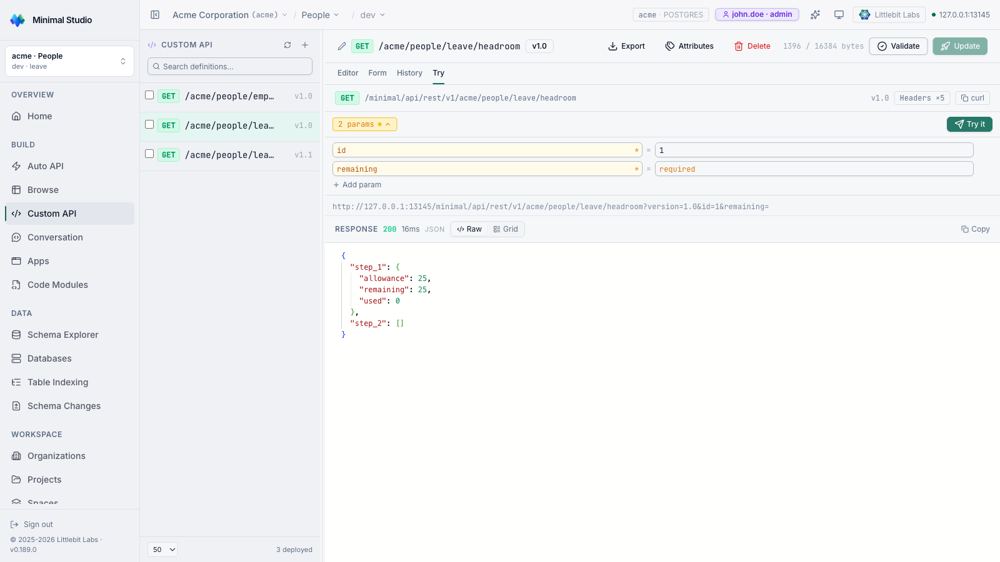

6. Run employee `7` again, with `0` in the `remaining` row. The answer does not change: `remaining` is still 1, and the same two requests are listed. The value that the script returned fills the placeholder; a caller cannot replace it by sending the same name.

   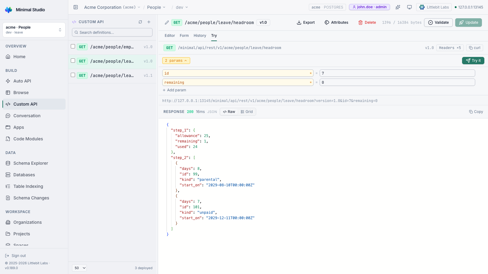

## A write that can be undone

A call that is not a GET runs its steps in one transaction on Postgres. If a step fails, what the steps before it wrote is rolled back. The definition `note/add` writes a note to `audit_note`, and a second step refuses a note that is too long.

```yaml
http:
  uri: note/add
  method: post
  version: "1.0"
  input_type: json

logic:
  - sql: |
      INSERT INTO audit_note (employee_id, author, body, written_at)
      VALUES (?:employee_id, 'chapter-25', ?:body, NOW())
      RETURNING id, body
    omit: false
  - lua: check_length
    code: |
      function min_main()
        local row = step_0[1]
        if #row.body > 40 then
          error("a note may hold at most 40 characters")
        end
        return { length = #row.body }
      end
    omit: false
```

`RETURNING id, body` makes the insert answer with the row it wrote, so the script has a row to read, `step_0[1]`. Without it the answer is `{"rows_affected": 1}` and there is nothing to read (the book ran this and did not picture it). The author is fixed text, so that the notes of this chapter can be found. `error` stops the script with a failure.

1. Select **+**, open **Editor**, replace the two blocks (`method` is now `post`), select **Validate** and **Deploy**. The list reads "4 deployed", and the new row says POST. Select it and open **Form**: Step 0 holds the insert, and Step 1 the Lua step, with `check_length` in its `fn:` field.

   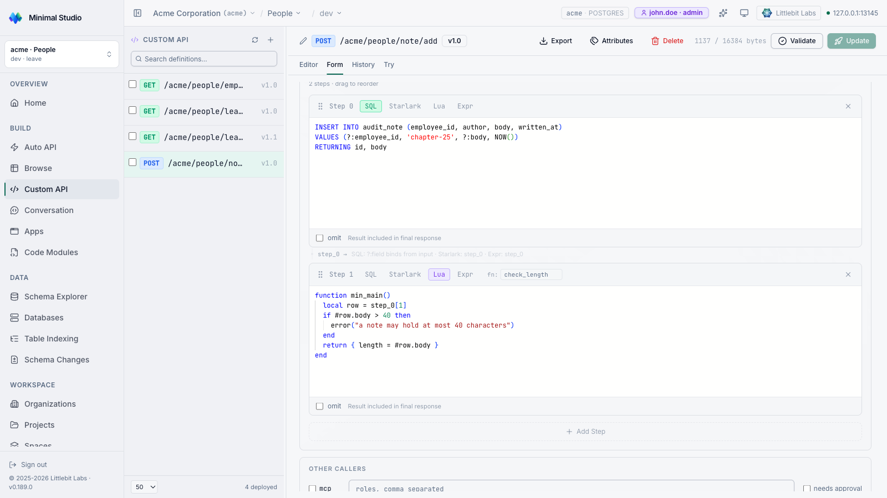

2. On the Postgres server, count the notes: `SELECT count(*) FROM audit_note;` answers 400.
3. Open **Try**. A **Body** button joins the params chip. Select it: a box opens for the JSON body. Leave the rows empty, and type this in the box:

   ```json
   {
     "employee_id": 7,
     "body": "Asked for a copy of the leave policy, and for the travel policy as well."
   }
   ```

   The text of `body` has 72 characters. Select **Try it**. The answer is **RESPONSE 424**, "Failed Dependency", with the message "could not execute URI" and, in `details`, the script's own words: `lua step "check_length": run failed (runtime): check_length.lua:4: a note may hold at most 40 characters`, and a traceback (the script's call stack).

   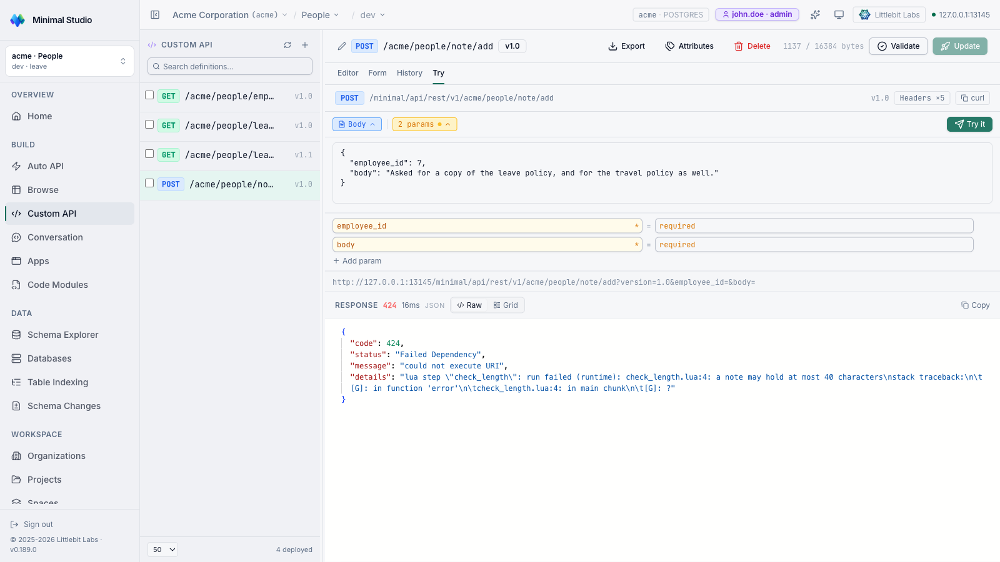

   Count again: 400. The insert ran, since the script read the long text from `step_0`, and then it was undone.

4. Replace the text of `body` with a short note, `"Asked for a copy of the leave policy."`, 37 characters, and select **Try it**. The answer is **RESPONSE 201**: `step_0` holds the new row, with its id, and `step_1` the length, 37. Count again: 401.

   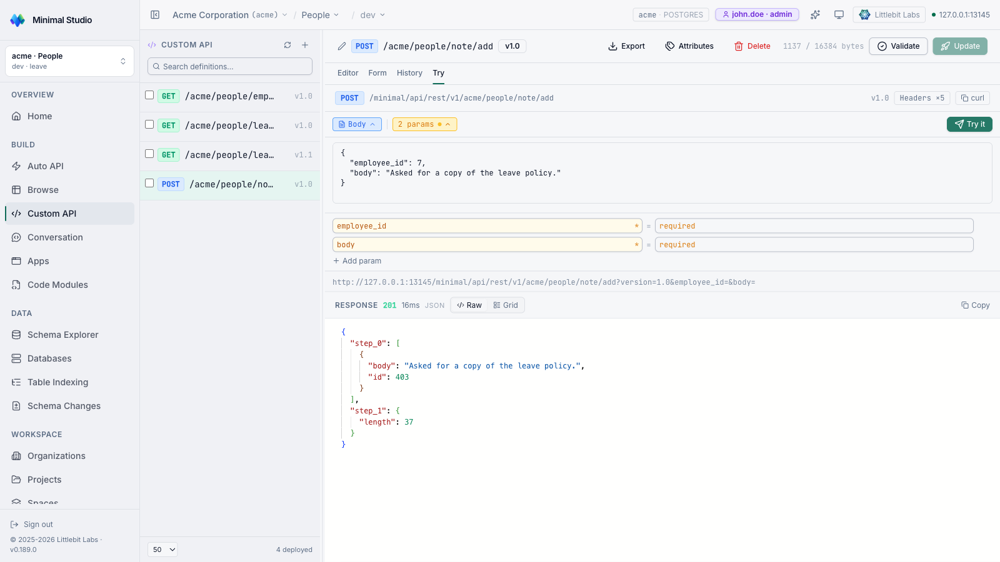

   The id is 403. Chapter 24 used 401, and the refused call used 402: Postgres does not give a number back when an insert is rolled back. Your numbers depend on what your table has seen.

5. On the Postgres server, delete the note: `DELETE FROM audit_note WHERE author = 'chapter-25';`. A count shows 400 again, as in Appendix A.

## What goes wrong

Studio's **Validate** checks the shape of a definition: the seven chips. It does not run the SQL, and it does not compile the scripts. Most of what follows passes **Validate** and fails later, at **Deploy** or at the call.

Each throwaway below is made like the definitions above: select **+**, open **Editor**, replace the `http` and `logic` blocks. A new definition has an empty `uri`, so give each a path; the book used `scratch/quoted`, `scratch/two`, `scratch/broken` and `scratch/let`. Without **+**, the button reads **Update** and the change goes into the definition that is open.

1. **A value left empty.** Run the card with `id` empty. The chip reads "1 param" with a yellow dot, and the tooltip of the dot reads "Required params missing". The call still goes: the answer is 424, and `details` carries the database's words, `invalid input syntax for type integer: ""`. A value that is not sent at all is refused by name (the book did not picture it): for `note/add`, a body without `employee_id` is answered by 424, with the details `definition defines fields: ['employee_id'], but missing from the Request`.

   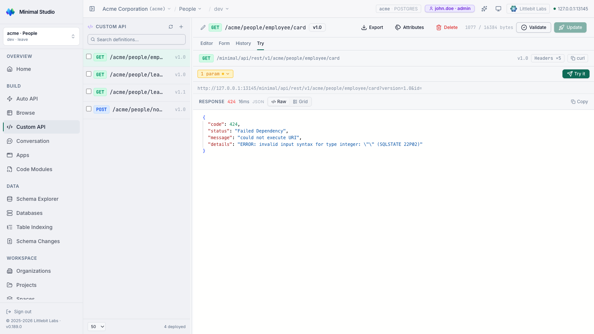

2. **A placeholder in quotes.** The Core quotes a string by itself, so a placeholder in quotes is wrong. Make `scratch/quoted` with one SQL step, `SELECT id, full_name FROM employee WHERE id = '?:id'`. It deploys. Try it with `id` 11: the call is answered by 424, `sql placeholder '?:id' is wrapped in quotes, but the value substituted in is already quoted automatically -- remove the quotes around this placeholder`. Write `?:id` bare, as the definitions above do.

   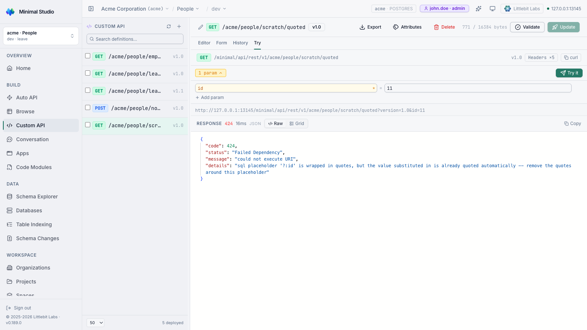

3. **Two statements in one SQL step.** In `scratch/two`, use one SQL step that holds two statements, `SELECT 1 AS one;` and `SELECT 2 AS two`. **Validate** says all is valid; **Deploy** answers with a red banner: "Deploy failed: HTTP 400", "ERROR COMPILING DEFINITION YAML", and `"sql" block must contain a single statement`. Nothing is stored. To run two statements, make them two steps.

   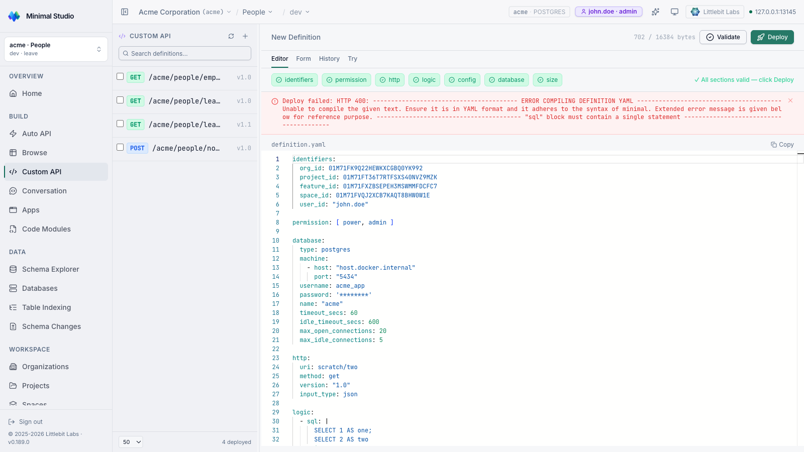

4. **A script that does not compile.** In `scratch/broken`, use the SQL step `SELECT 1 AS one` and a Lua step named `broken` whose source is `function min_main(`. **Validate** says all is valid; **Deploy** answers with the same banner, and `broken.lua at EOF: syntax error`. The name before `.lua` is the name after `lua:`. A script that compiles and then fails when called is the 424 of `note/add`.

   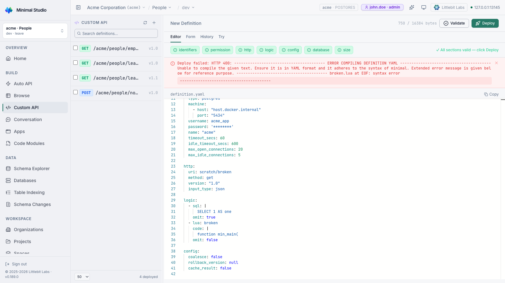

5. **A kind that is not implemented.** A definition may use three step kinds more than the four of the form: `let`, `case` and `fnc`. The Book of Minimal says that none of the three is implemented. Studio shows a yellow line as soon as one is in the text, before **Validate**: `Step 1: a "let" step compiles but is refused when the definition runs.` **Validate** passes it. The book made `scratch/let` with the SQL step `SELECT 1 AS one` and a second step, `let:` with `total: step_0[0].one + 1`; **Deploy** answered 400, `invalid "let" block noticed`. The book found no `let` block that the Core accepts, so it did not see the refusal at the call that Studio's line announces, and cannot say where the Core refuses these kinds: at **Deploy**, as the Book of Minimal has it, or at the call (Appendix C). Use `sql`, `lua` and `lark`; Chapter 26 tries `expr`.

   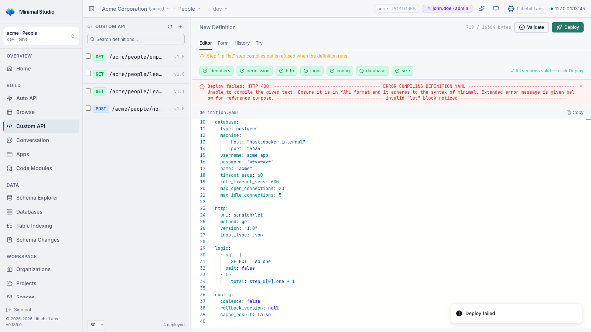

## Exercises

1. In `leave/headroom` change the allowance to 20, then select **Validate** and **Update**. Before you run employee `7`, say what `remaining` will be and which pending requests are listed. Check that `remaining` is -4 and that `step_2` lists three requests, ids 91, 99 and 101, since each is longer than -4. Put the 25 back.
2. Send `note/add` a body without `employee_id`. Check that the answer is 424, and that `audit_note` still holds 400 rows.
3. In `note/add` raise the limit to 80, in the test and in the message, then select **Validate** and **Update**. Send the 72-character note of this chapter. Check that the answer is 201 and that the count is 401. Delete the note, and put the 40 back.

## Put it back

1. On the Postgres server, delete any note the exercises left: `DELETE FROM audit_note WHERE author = 'chapter-25';`. A count shows 400 again.
2. Select each of `employee/card`, `leave/headroom` and `note/add` in turn, select **Delete** and then **Yes, Delete**: "Definition deleted". Do the same for `scratch/quoted`. The list reads "1 deployed", as Chapter 9 leaves it.
