# 26. Script steps: Lua, Starlark and Expr

SQL reads and writes rows. A script step works on what an earlier step returned: it can count the rows, reshape them or choose an answer from them. Studio offers three kinds of script step, Lua, Starlark and Expr, and they share one contract: the step reads what the earlier steps returned and answers with a map. This chapter writes one task in two languages, uses a script to send only part of an email address, tries Expr, and then breaks each kind on purpose.

> **Setup.** The workspace of Chapter 5, space **dev**: Studio signed in as `john.doe` in **acme · People**, with `pending-leave` deployed. Definitions are made as in Chapter 25: **+**, **Editor**, replace the `http` and `logic` blocks. The chapter deploys four definitions in `dev` and deletes them at the end. It writes nothing to the database. The book left the definitions of Chapter 25 in place while it ran this chapter, so the lists in its pictures are longer than yours.

## Four kinds of step

1. Open any definition on the **Form** tab and select **Add Step**. A menu headed "CHOOSE STEP TYPE" offers four kinds: **SQL**, "Raw SQL with ?:param binding"; **Starlark**, "Starlark script (Python-like)"; **Lua**, "Lua script; min_main returns a table"; **Expr**, "Lightweight expression".

   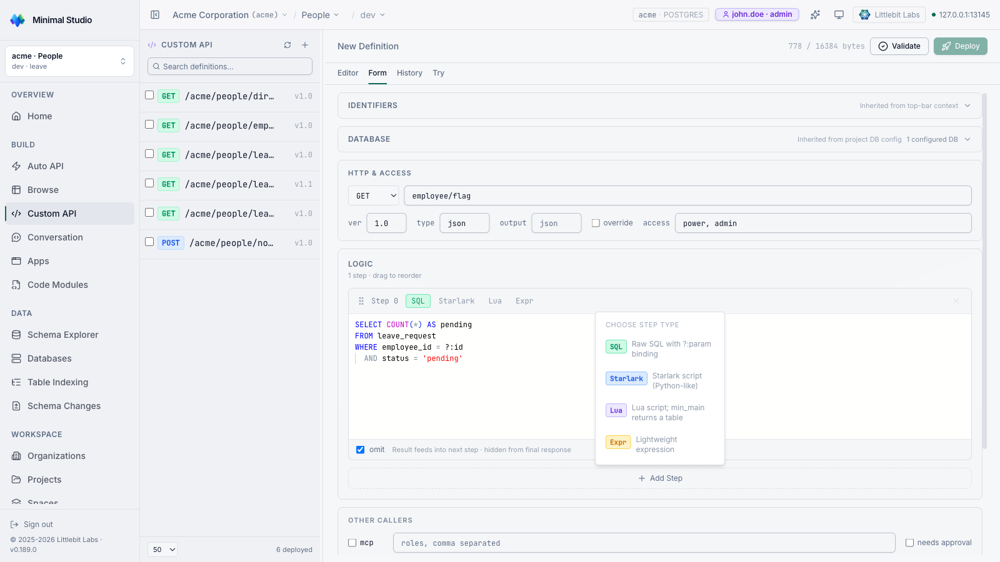

In the YAML, the key of a step names its kind: `sql`, `lua`, `lark` for Starlark, `expr`. For a script the key holds the step's name and `code` holds the source. The name shows in errors as a file name: `probe.lua`, `probe.star`.

The contract of a Lua or Starlark step:

- It defines a function `min_main`, with no parameters, and returns a map (a table in Lua, a dict in Starlark). An empty map, `{}`, is a valid answer.
- It reads `step_0`, `step_1` and so on: what the earlier steps returned. A SQL step gives a list of rows; a script step gives its map.
- It can read `input`, the values the caller sent in the query. They are text: `input.id` in Lua, `input["id"]` in Starlark, is `"7"`, not 7.
- The fields of the map it returns can fill the placeholders of a later SQL step (Chapter 25).

## One task, two languages

The leave summary of one employee: how many requests, how many approved, pending and rejected, and how many approved days. SQL reads the rows and the script counts them. A query could count too; the script does it here so that the two languages do the same work.

```yaml
http:
  uri: leave/summary
  method: get
  version: "1.0"
  input_type: json

logic:
  - sql: |
      SELECT status, days
      FROM leave_request
      WHERE employee_id = ?:id
    omit: true
  - lua: leave_summary
    code: |
      function min_main()
        local approved, pending, rejected, days = 0, 0, 0, 0
        for _, row in ipairs(step_0) do
          if row.status == "approved" then
            approved = approved + 1
            days = days + row.days
          elseif row.status == "pending" then
            pending = pending + 1
          else
            rejected = rejected + 1
          end
        end
        return { requests = #step_0, approved = approved, pending = pending, rejected = rejected, approved_days = days }
      end
    omit: false
```

1. Make the definition and select **Deploy**. Select it in the list and open **Editor**: the Core's copy holds the whole script.

   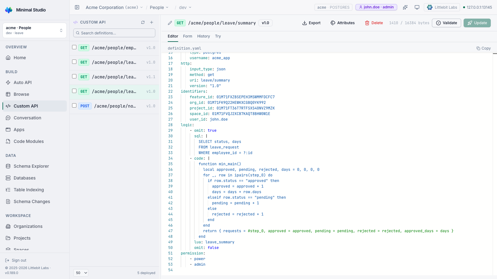

2. Open **Try**, type `7` and select **Try it**. The answer is **RESPONSE 200**, a plain map, since the SQL step is omitted: 21 requests, 15 approved, 3 pending, 3 rejected, 78 approved days. A query on the Postgres server gives the same numbers.

   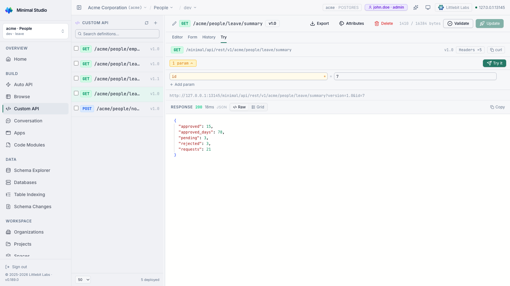

3. In **Editor**, replace the whole `logic` block with the one below. It keeps the SQL step and puts a Starlark step in place of the `lua` step. Select **Validate**, then **Update**.

   ```yaml
   logic:
     - sql: |
         SELECT status, days
         FROM leave_request
         WHERE employee_id = ?:id
       omit: true
     - lark: leave_summary
       code: |
         def min_main():
             approved = 0
             pending = 0
             rejected = 0
             days = 0
             for row in step_0:
                 if row["status"] == "approved":
                     approved += 1
                     days += row["days"]
                 elif row["status"] == "pending":
                     pending += 1
                 else:
                     rejected += 1
             return {"requests": len(step_0), "approved": approved, "pending": pending, "rejected": rejected, "approved_days": days}
       omit: false
   ```

   Select another definition and then this one again: the Core's copy shows `lark: leave_summary`.

   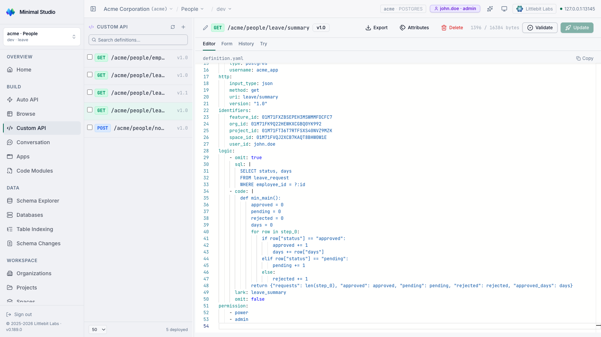

4. Run employee `7` again. The answer is the same, key for key.

   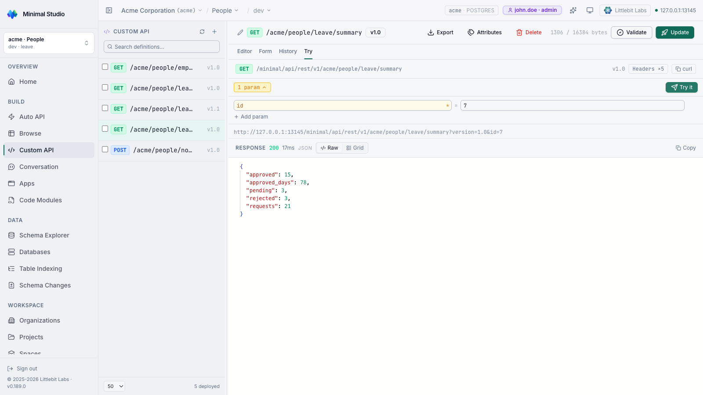

The two sources differ in small things a reader trips on:

| | Lua | Starlark |
|---|---|---|
| Key in the YAML | `lua` | `lark` |
| First row of a step | `step_0[1]`, counted from 1 | `step_0[0]`, counted from 0 |
| A field of a row | `row.status` | `row["status"]` |
| Length of a list | `#step_0` | `len(step_0)` |
| A loop | `for _, row in ipairs(step_0) do … end` | `for row in step_0:` |
| A map | `{ a = 1 }` | `{"a": 1}` |
| A value the caller sent | `input.id` | `input["id"]` |
| A SQL integer, such as a `days` of 8 | a number: `tostring(row.days)` is `"8"` | a float: `str(row["days"])` is `"8.0"`, and `int(row["days"])` is 8 |
| A SQL NULL | not `nil`: a value of its own kind (see below) | `None` |

## Reshape and protect

A script can send part of a value and keep the rest on the server, if the step that read the value is marked `omit`. The definition `directory/masked` reads four employees with their emails in a SQL step marked `omit`, and a Lua step answers with each email cut to its first letter and its domain.

```yaml
http:
  uri: directory/masked
  method: get
  version: "1.0"
  input_type: json

logic:
  - sql: |
      SELECT id, full_name, email
      FROM employee
      ORDER BY id
      LIMIT 4
    omit: true
  - lua: mask_email
    code: |
      function min_main()
        local people = {}
        for i, row in ipairs(step_0) do
          local at = string.find(row.email, "@", 1, true)
          people[i] = {
            id = row.id,
            full_name = row.full_name,
            email = string.sub(row.email, 1, 1) .. "***" .. string.sub(row.email, at),
          }
        end
        return { people = people }
      end
    omit: false
```

1. Make the definition and select **Deploy**. Open its **Editor** tab for the Core's copy.

   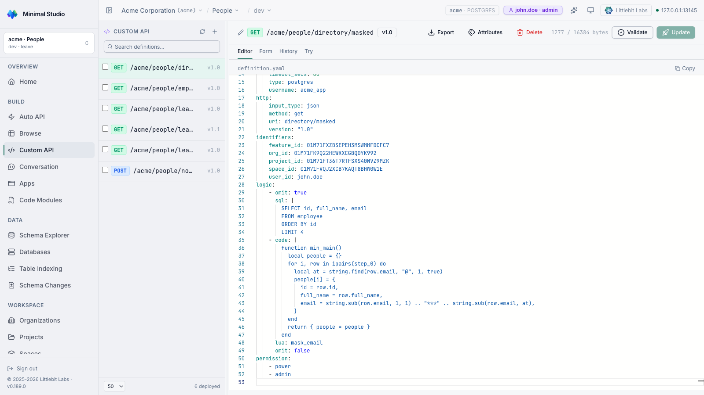

2. Open **Try** and select **Try it**. No parameter is asked for. The answer holds `people`, four entries, each with an email such as `r***@acme.example`.

   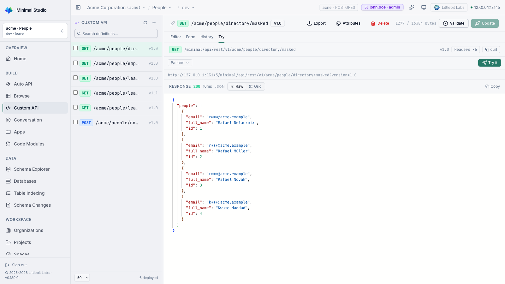

3. In **Editor**, change `omit: true` of the SQL step to `omit: false`, then select **Validate** and **Update**. Run it again. The answer now holds two keys: `step_0`, the four rows with their whole emails, and `step_1`, the masked list. What keeps the addresses out of the answer is the `omit` of Step 0, not the script.

   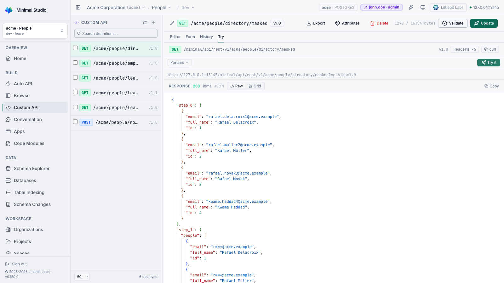

   Put `omit: true` back, then select **Validate** and **Update**.

### A NULL is not nil

Add the phone number, and show only its last four digits. Fourteen of the 120 employees have no phone, and employee 1 is one of them. In **Editor**, add `, phone` to the `SELECT` of the SQL step, add `phone = phone,` to each entry, and put the lines below after `local at = …`. This is how one would first write them:

```lua
local phone = nil
if row.phone ~= nil then
  phone = "***" .. string.sub(row.phone, -4)
end
```

Select **Validate**, then **Update**, and run it. The answer is **RESPONSE 424**, and `details` begins `lua step "mask_email": run failed (runtime): mask_email.lua:7: bad argument #1 to sub (string expected, got userdata)`, followed by a stack traceback. A SQL NULL arrives in a Lua step as a value that is not `nil`, and the test lets it through.

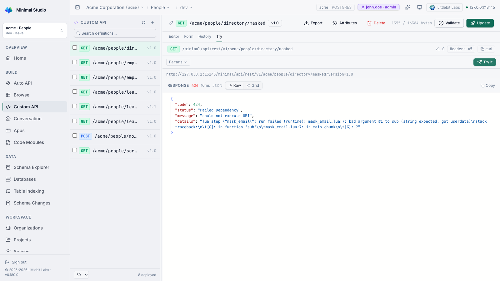

Test for the kind of value you want instead: `if type(row.phone) == "string" then`. With that line the answer is 200, and employee 1 has no `phone` key, while employee 2 has `"***8653"`.

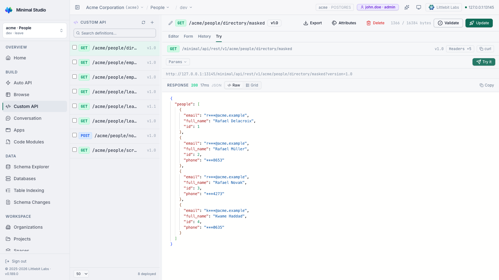

## Expr

An Expr step is one expression instead of a function. Studio's card says what the expression can read and use.

1. Make the definition `employee/flag` from the text below (**+**, **Editor**, replace the `http` and `logic` blocks) and open the **Form** tab. Step 1 is an **Expr** card: the kind buttons, the name `flag` in the `fn:` field, one box that holds only the expression, and the line "Single-line expression. Reference input.field, step_0, step_1… Supports comparisons, arithmetic, ternary." To add such a card by hand, select **Add Step** and choose **Expr**.

   ```yaml
   http:
     uri: employee/flag
     method: get
     version: "1.0"
     input_type: json

   logic:
     - sql: |
         SELECT COUNT(*) AS pending
         FROM leave_request
         WHERE employee_id = ?:id
           AND status = 'pending'
       omit: true
     - expr: flag
       code: |
         {"id": input.id, "pending": step_0[0].pending, "has_pending": step_0[0].pending > 0}
       omit: false
   ```

   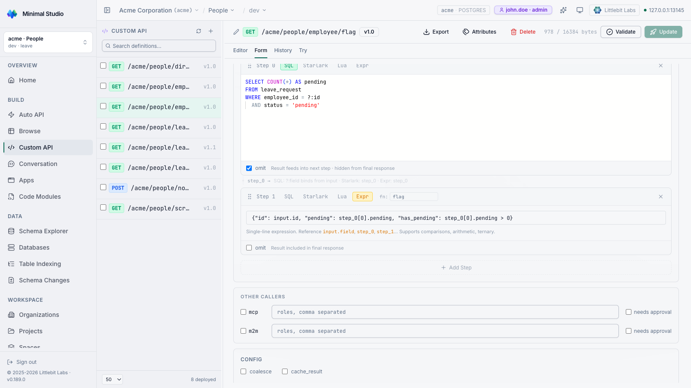

2. Select **Deploy**, open **Try** and run employee `7`. The answer is `{"has_pending": true, "id": "7", "pending": 3}`: a map literal, a field of a row (Expr counts from 0, as Starlark does), a comparison, and `input.id`, which is text.

   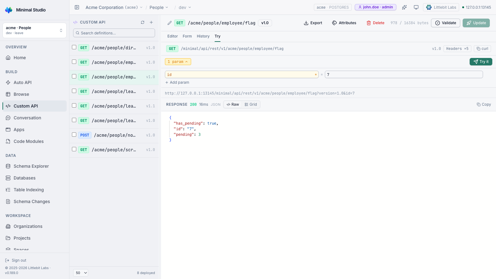

3. An Expr must give a map. Replace the expression with `step_0[0].pending > 0 ? "has pending" : "none"`, a ternary (`test ? this : that`) that gives text, then select **Validate** and **Update**. The Core takes it, and the call answers 200 with `{}`: a text, like a number, is dropped, and nothing says so.

   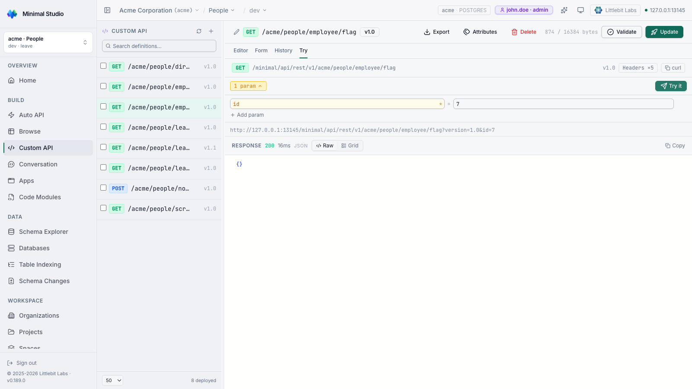

4. Replace it with `{"x": 1 +}`. **Validate** says all is valid and **Update** takes it. The call answers 424, and `details` shows `unexpected token Bracket("}") (1:10)`, the expression, and a caret under the place. A Lua or Starlark source that does not compile is refused at **Deploy** or **Update** with a 400 (Chapter 25 shows it for Lua); an Expr is read when the call arrives.

   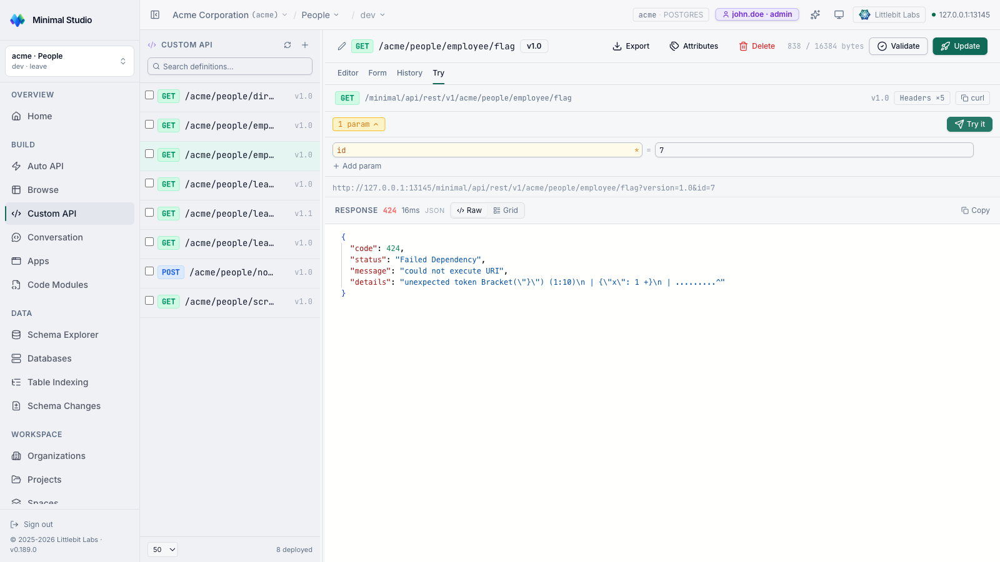

An index outside the list fails at the call as well: `{"x": step_0[5].pending}` answers 424, `index out of range: 5 (array length is 1)` (the book ran this and did not picture it).

## When a script fails

The probes below use a throwaway definition, `scratch/probe`: a SQL step, `SELECT full_name FROM employee WHERE id = ?:id`, with `omit: true`, and one script step named `probe`. Make it with the first probe and select **Deploy**; for each later probe, replace the whole `logic` block, keeping the SQL step, then select **Validate** and **Update**. A Starlark probe writes `lark: probe` where a Lua one writes `lua: probe`. Each time, run employee `7` unless it says otherwise.

1. **The function returns text.** `function min_main() return "hello" end` deploys. The call answers 424: `script step's min_main must return a map; an empty map is valid`.

   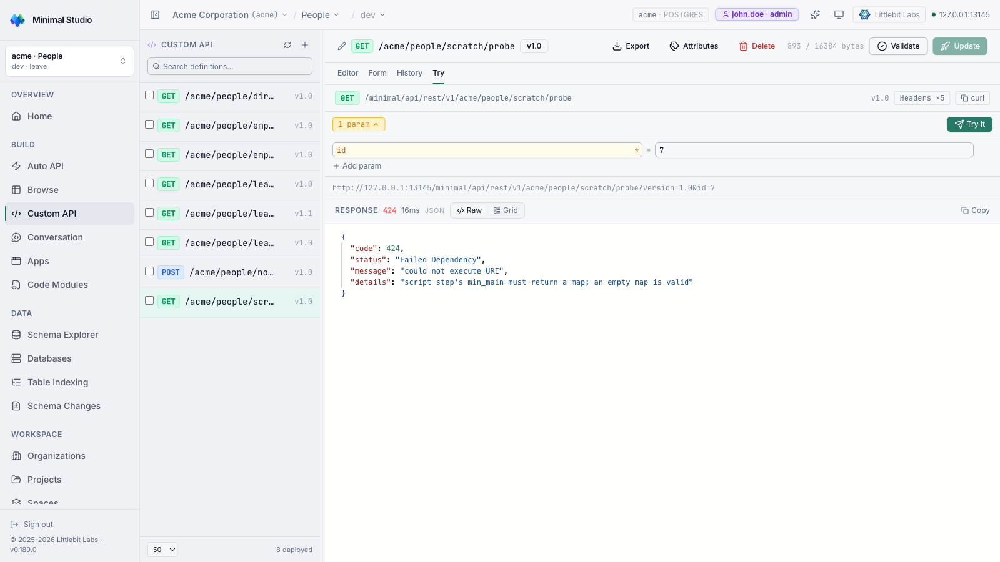

2. **A row that is not there.** This step deploys:

   ```lua
   function min_main()
     local row = step_0[1]
     return { name = row.full_name }
   end
   ```

   For employee `99999` the SQL step returns no row, and the call answers 424. `details` begins `lua step "probe": run failed (runtime): probe.lua:3: attempt to index a non-table object(nil) with key 'full_name'`, followed by a stack traceback.

   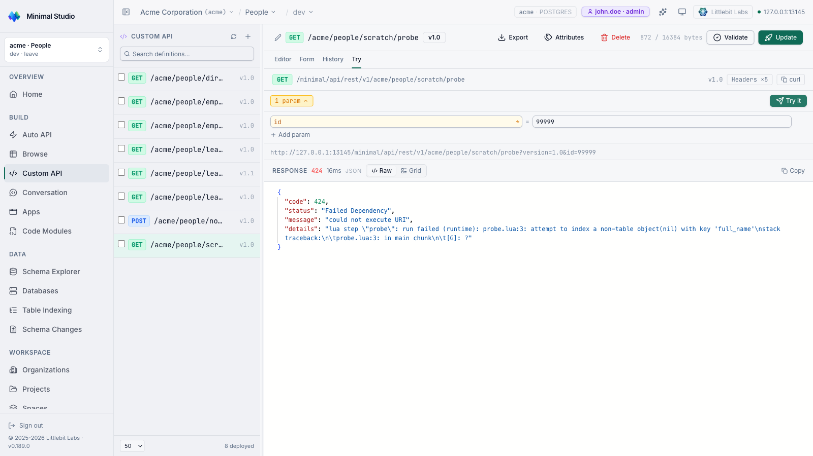

   Test the row first: add `if row == nil then return {} end` after `local row = step_0[1]`. Employee `99999` now answers `{}`, and employee `7` answers `{"name": "Margaret O'Brien"}` (the book did not picture these two).

3. **A Starlark step with no `min_main`.** Between the second and third card of a longer definition (Chapter 25's `leave/headroom`) Studio's grey line says, for Starlark, "result pre-seeded with this output". On this Core a step of `result = {"a": 1}` deploys, and the call answers 424: `script step defines no min_main function`. Define `min_main` and return the map.

   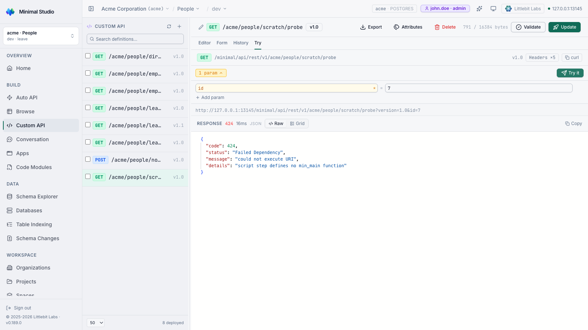

4. **A name Starlark does not have.** This step deploys:

   ```python
   def min_main():
       return {"total": sum([1, 2, 3])}
   ```

   The call answers 424, `probe.star:2:22: undefined: sum`; `round` is undefined as well. `len` and `str` exist. Count in a loop, as the summary does.

   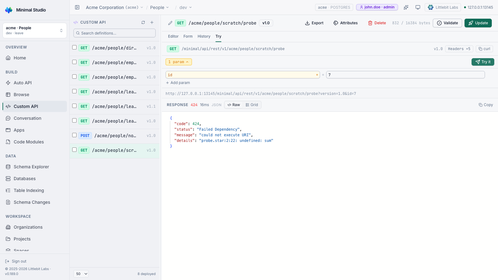

Each of these passes **Validate**. What is refused, and when:

| What is wrong | **Deploy** or **Update** | The call |
|---|---|---|
| A Lua or Starlark source that does not compile | 400 | |
| An Expr that does not parse | takes it | 424 |
| A function that returns text | takes it | 424 |
| A Starlark step with no `min_main` | takes it | 424 |
| A row, a name or an index that is not there | takes it | 424 |

## Exercises

1. Add `rejected_days` to `leave/summary`, in Lua and in Starlark. Check that both answer 27 for employee `7`, and that the SQL `SELECT SUM(days) FROM leave_request WHERE employee_id = 7 AND status = 'rejected'` on the Postgres server says the same.
2. Write the masked directory with the phone in Starlark, in `scratch/probe`. Check that employee `1`, who has no phone, comes out without a `phone` key, and employee `2` with `"***8653"`. A NULL is `None` in Starlark.
3. Write an Expr step over `SELECT full_name FROM employee WHERE id = ?:id` that answers the row, or `{}` for an unknown employee (the empty box of an Expr card shows an example). Check employee `7` and employee `99999`.

## Put it back

Select each of `leave/summary`, `directory/masked`, `employee/flag` and `scratch/probe` in turn, select **Delete** and then **Yes, Delete**: "Definition deleted". The list reads "1 deployed", as before the chapter.
