# 27. Code Modules in practice

Chapter 11 saved a module that no definition used. This chapter uses modules: written once, loaded by a definition, changed in one place, and broken on purpose to see what Studio and the Core say. The Core's own account of modules is in volume 2, chapter 2 of the Book of Minimal.

> **Setup.** The workspace of Chapter 5, space **dev**: Studio signed in as `john.doe` in **acme · People**. The chapter makes modules on the **Code Modules** page and two definitions on the **Custom API** page, and deletes them at the end. It writes nothing to the database. The Code Modules lists of `dev` and `staging` are empty in the pictures: Chapter 11's `acme_math` was made in `prod`. If yours is in one of them, it shows in that list; leave it there. The book left the definitions of Chapters 25 and 26 in place while it ran this chapter, so the lists of definitions in its pictures are longer than yours.

## A module, and a definition that loads it

A leave request lasts from one day to ten. The module `leave_bands` says whether a length is short, medium or long, and the definition `leave/bands` asks it.

1. Select **Code Modules**, the **Lua** tab and **New module**. Type `leave_bands` as the **Module name** and this source in the box:

   ```lua
   -- How long a leave request is: short, medium or long.
   local M = {}

   function M.classify(days)
     if days < 4 then return "short" end
     if days < 8 then return "medium" end
     return "long"
   end

   return M
   ```

   The convention, in Lua, is a table of functions that the file returns.

   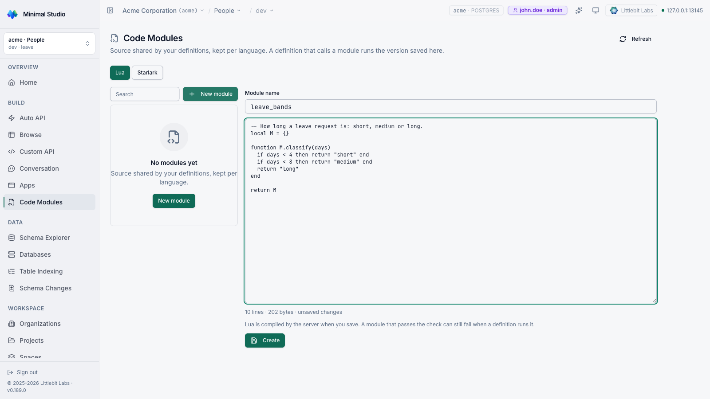

2. Select **Create**. "Created “leave_bands”" appears, and the header reads "active · by john.doe · updated …Z · commit …", the commit being the 8 characters that name this version.

   

3. In **Custom API**, make the definition below as in Chapter 25 and select **Deploy**. Its Lua step loads the module with `require("leave_bands")`. In this step `require` is not Lua's own: it reads the module store of the same space. Select the definition in the list and open **Editor**: the Core's copy holds the step with its `require` line.

   ```yaml
   http:
     uri: leave/bands
     method: get
     version: "1.0"
     input_type: json

   logic:
     - sql: |
         SELECT id, days
         FROM leave_request
         WHERE employee_id = ?:id
           AND status = 'pending'
         ORDER BY start_on
       omit: true
     - lua: bands_step
       code: |
         local bands = require("leave_bands")

         function min_main()
           local out = {}
           for i, row in ipairs(step_0) do
             out[i] = { id = row.id, days = row.days, band = bands.classify(row.days) }
           end
           return { requests = out }
         end
       omit: false
   ```

   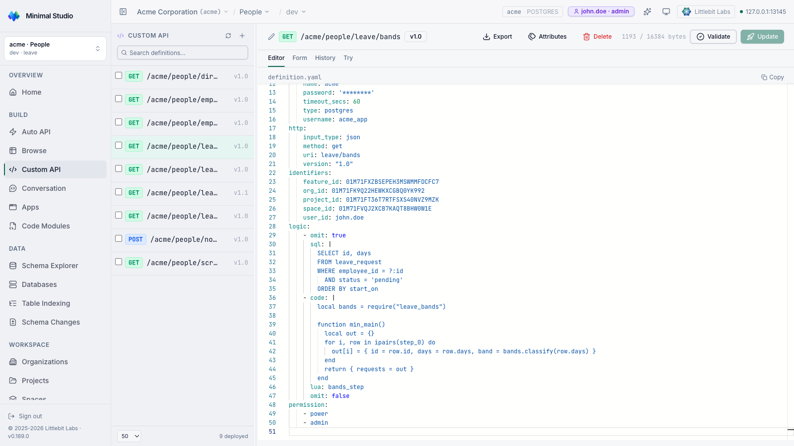

4. Open **Try**, type `7` and select **Try it**. Employee 7 has three pending requests (Appendix A), in order of start date: the one of 1 day is `short`, the one of 8 days `long`, the one of 7 days `medium`.

   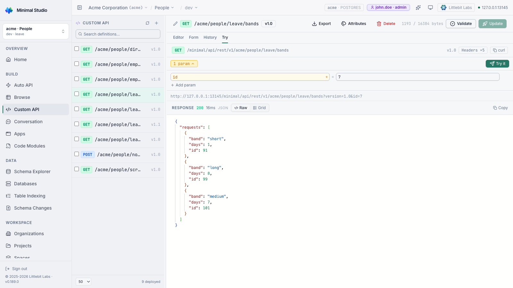

## Change the module, not the definition

1. On **Code Modules**, select `leave_bands`, and change `if days < 8 then` to `if days < 10 then`. The counter under the box reads "10 lines · 203 bytes · unsaved changes", and **Save** is lit. Selecting another module, or **Reload**, now asks "Discard unsaved changes?".

   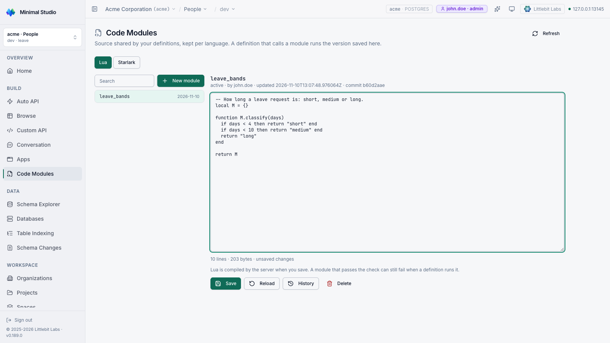

2. Select **Save**. "Saved “leave_bands”" appears, and the header shows a new time and a new commit.

   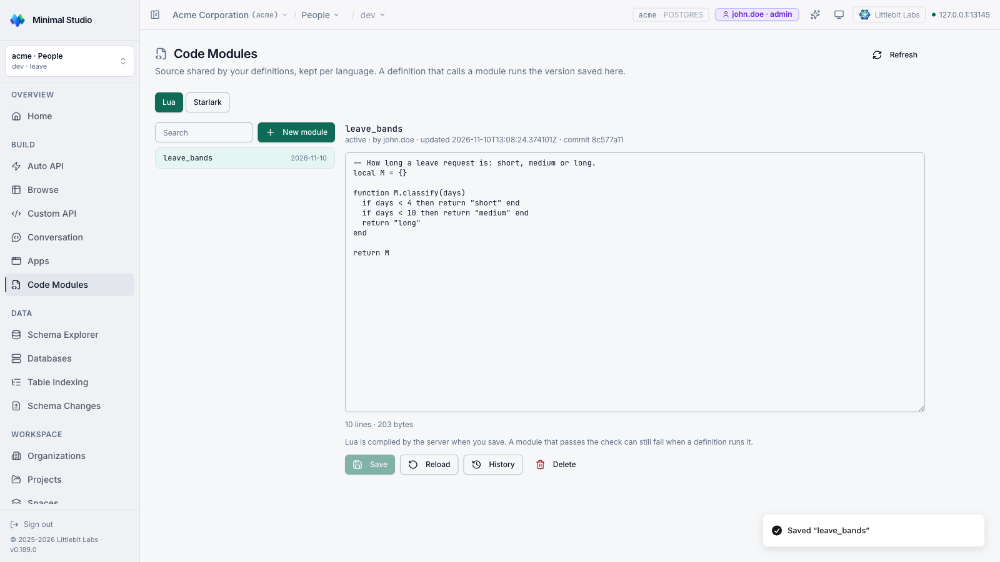

3. Return to **Custom API**, select `leave/bands`, and run employee `7` again. The definition was not touched, and nothing was deployed. The eight-day request is now `medium`. A definition runs the version of the module that is saved when it is called.

   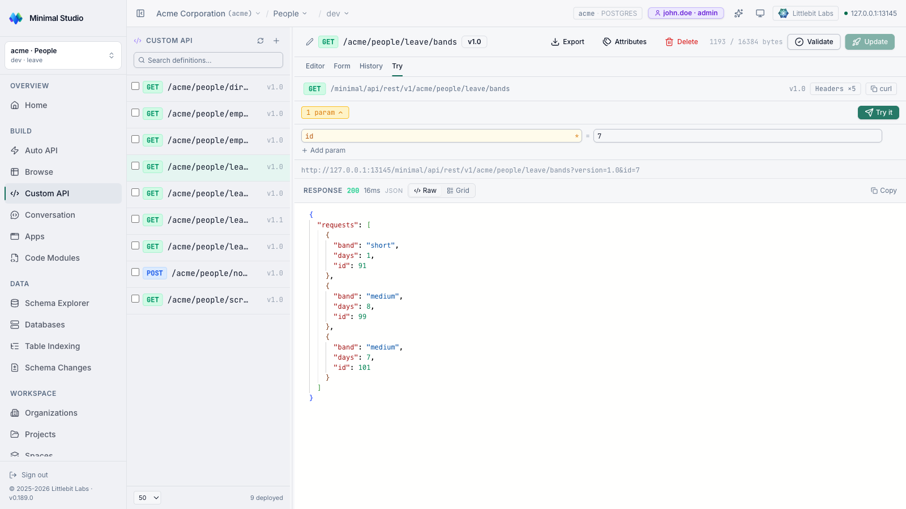

4. On **Code Modules**, select **History**. The list, "Each create, update and delete, with the source as it was", has two entries, newest first: UPDATE and INSERT, each with its time, its author and its commit. Open **Source** under each to read the text as it stood after that operation.

   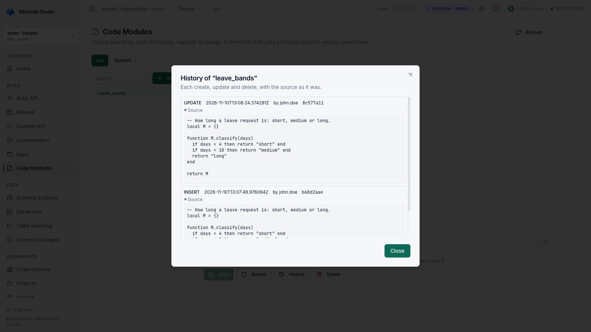

## The same in Starlark

Lua and Starlark keep separate stores. A module of each kind can have the same name, and which store a step reads is decided by the step's own kind, `lua` or `lark`.

1. On **Code Modules**, select the **Starlark** tab and **New module**. The line under the box reads "Starlark is Python-like and is parsed when you save." Type `leave_bands` again as the name, this source, and select **Create**. The Lua module of the same name is not in this list.

   ```python
   # How long a leave request is: short, medium or long.
   def classify(days):
       if days < 4:
           return "short"
       if days < 10:
           return "medium"
       return "long"
   ```

   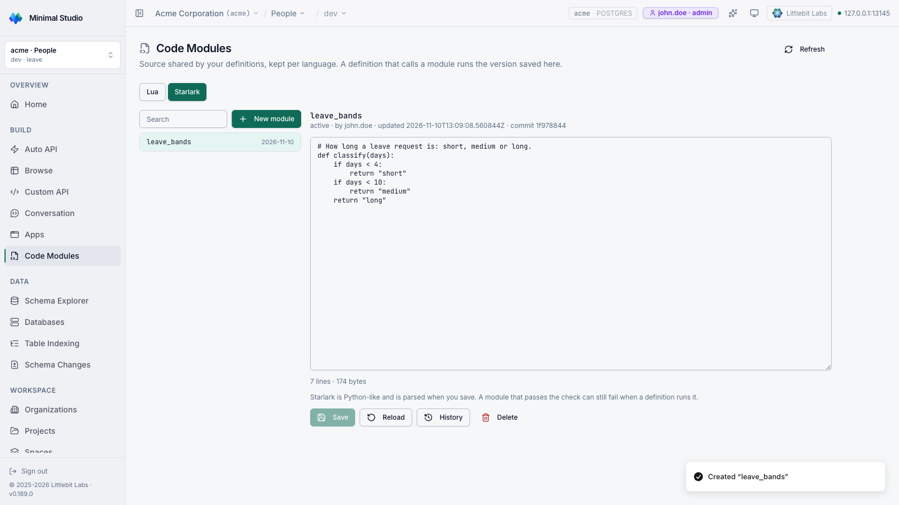

2. Make the definition `leave/bands-lark` and select **Deploy**. It differs from `leave/bands` in its `uri`, `leave/bands-lark`, and in the step below: a Starlark step names what it loads and the names it takes from it. Select it in the list and open **Editor**: the Core's copy holds this step.

   ```yaml
   http:
     uri: leave/bands-lark
     method: get
     version: "1.0"
     input_type: json

   logic:
     - sql: |
         SELECT id, days
         FROM leave_request
         WHERE employee_id = ?:id
           AND status = 'pending'
         ORDER BY start_on
       omit: true
     - lark: bands_step
       code: |
         load("leave_bands", "classify")

         def min_main():
             out = []
             for row in step_0:
                 out.append({"id": row["id"], "days": row["days"], "band": classify(row["days"])})
             return {"requests": out}
       omit: false
   ```

   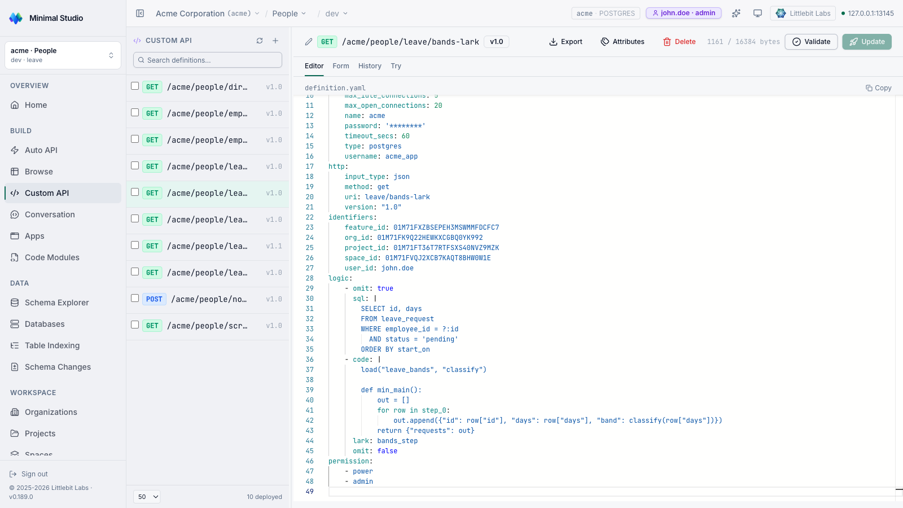

3. Run employee `7`. The answer is the Lua one: `short`, `medium`, `medium`.

   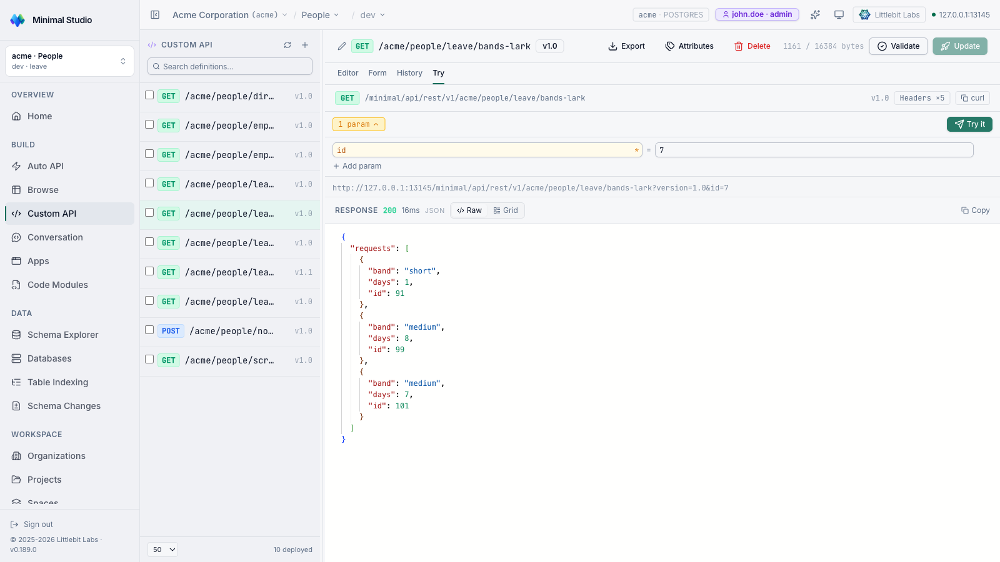

4. The Book of Minimal writes the load with the suffix, as `load("acme_bands.star", "classify")` for its own module. In `leave/bands-lark`, change the first line of the step to `load("leave_bands.star", "classify")`, select **Validate**, then **Update**, and run employee `7`. **Update** takes it and the call is refused: 424, `cannot load leave_bands.star: lark module code not found`. Change the line back to the bare name, select **Validate**, then **Update**, and run employee `7`: the answer of step 3 returns.

   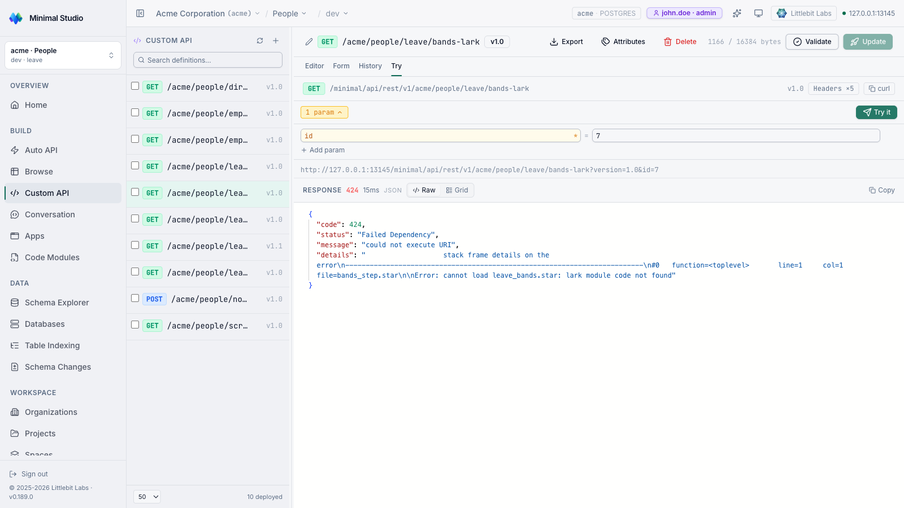

## A module that loads a module

A module can require another. `leave_report` writes one line for a request, and it asks `leave_bands` for the band.

```lua
-- One line for a leave request: its band, then its days.
local bands = require("leave_bands")
local M = {}

function M.describe(days)
  return bands.classify(days) .. " (" .. days .. ")"
end

return M
```

1. On **Code Modules**, select the **Lua** tab and **New module**, type `leave_report` as the name and the source above, and select **Create**.

   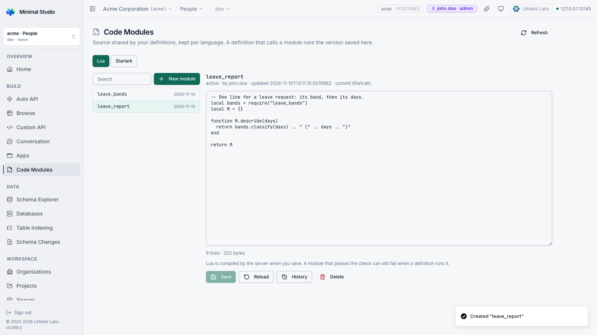

2. In **Custom API**, open `leave/bands` and its **Editor** tab. Replace the whole `logic` block with the one below, which names only `leave_report`. Select **Validate**, then **Update**.

   ```yaml
   logic:
     - sql: |
         SELECT id, days
         FROM leave_request
         WHERE employee_id = ?:id
           AND status = 'pending'
         ORDER BY start_on
       omit: true
     - lua: bands_step
       code: |
         local report = require("leave_report")

         function min_main()
           local out = {}
           for i, row in ipairs(step_0) do
             out[i] = { id = row.id, label = report.describe(row.days) }
           end
           return { requests = out }
         end
       omit: false
   ```

3. Run employee `7`. Each request has a `label`: `short (1)`, `medium (8)`, `medium (7)`. The definition never mentions `leave_bands`; the module does.

   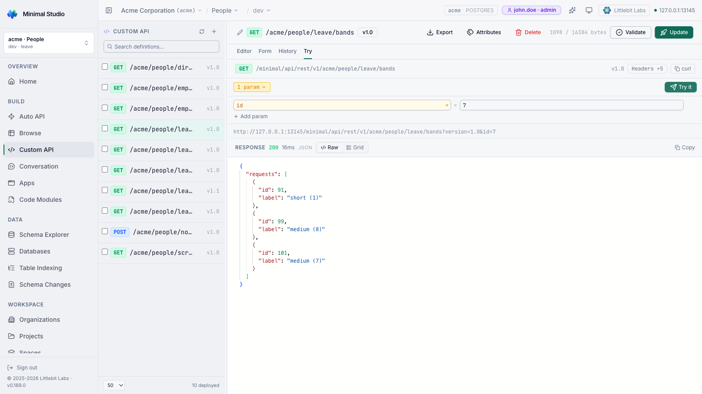

A Starlark module loads another in the same way, at the top, with `load("leave_bands", "classify")`. If it builds a label with `str(days)`, note that a number from SQL is a float in Starlark (Chapter 26): `str(days)` writes `"1.0"`, and `str(int(days))` writes `"1"` (Exercise 3).

## When a module fails

1. **A source that does not compile.** On the **Lua** tab, select **New module**, type `leave_broken` and this source, which lacks a closing parenthesis on line 3:

   ```lua
   local M = {}

   function M.classify(days
     return "short"
   end

   return M
   ```

   Select **Create**. The module is not made. A red line reads "The server refused this source", with the compiler's words, `leave_broken.lua line:4(column:8) near 'return':   syntax error`, and under it: "The module name is not valid, or the source does not compile. The server's message says which." **Save** of an edit is refused in the same way, with `code failed to compile`. A Starlark source that does not parse is refused with the same box, but its message names `test.star` whatever the module is called, for example `test.star:1:19: got ':', want ')'`: read the line and the column, not the file name. **Create** under a name that is taken answers "That name is already in use" with the server's `module already exists`.

   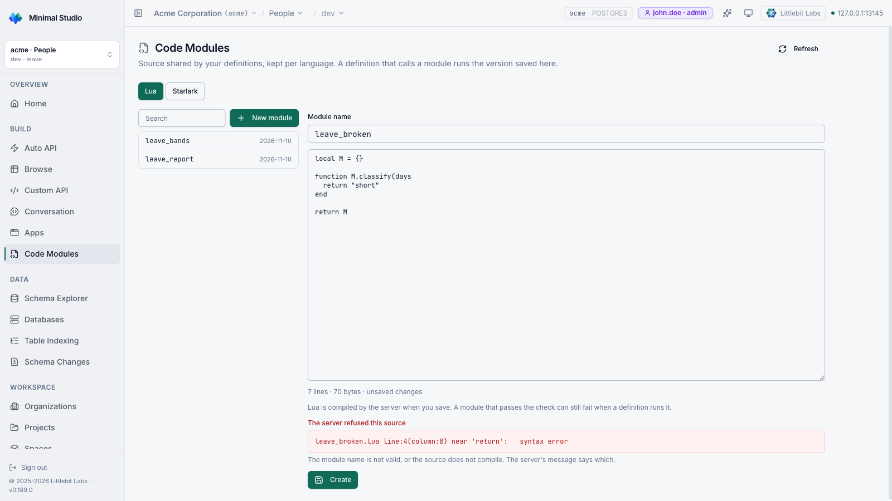

2. **A source that compiles and fails when it runs.** In `leave_bands`, change `if days < 4 then` to `if days.value < 4 then` and select **Save**. The Core accepts it: "Saved “leave_bands”". Run employee `7` in `leave/bands`. The answer is 424, and `details` follows the call down through three files: `leave_bands.lua:5: attempt to index a non-table object(number) with key 'value'`, in `classify`, called from `leave_report.lua:6`, in `describe`, called from `bands_step.lua:6`. A change to a module reaches every definition that loads it, a broken change too. Put the text back and select **Save**.

   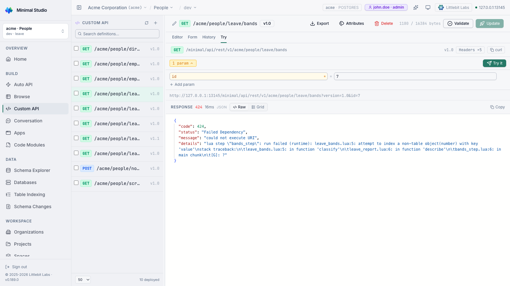

3. **A module that a definition still loads.** Select `leave_bands` on **Code Modules** and select **Delete**. The dialog reads "Delete “leave_bands”?" and "Deleting is permanent: there is no way back. Definitions that call this module fail as soon as it is gone; nothing checks for that."

   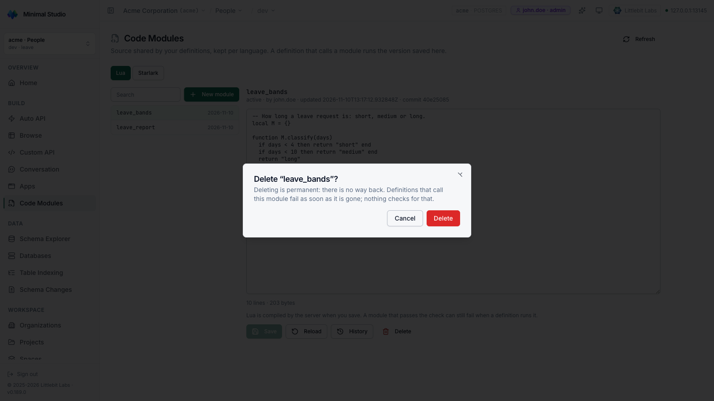

   Select **Delete**. "Deleted “leave_bands”" appears. Run `leave/bands` again. The answer is 424: `load failed (runtime): bands_step.lua:1: require leave_report: leave_report.lua:2: require leave_bands: lua module code not found`. The first module named in it, `leave_report`, is still there; the one it needs is gone.

   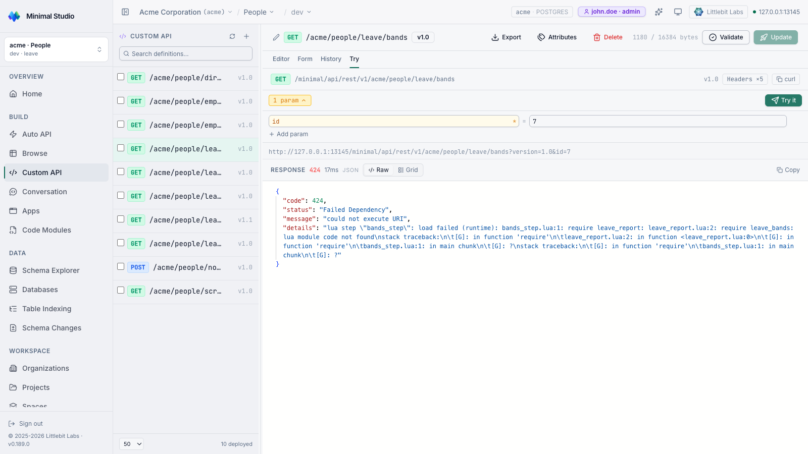

   Create `leave_bands` again with the same source, and the definition runs again (the book did not picture it). Select **History**: the list holds every operation under the one name, newest first: the new INSERT; the DELETE, with an UPDATE of the same commit just under it; the three UPDATEs made above, the broken one among them; and, at the foot, the first INSERT. Open **Source** under the UPDATEs: one holds `days.value`. The Book of Minimal says that the history of a deleted module cannot be read; the book could not try that, because **History** needs the module to be selected (Appendix C).

   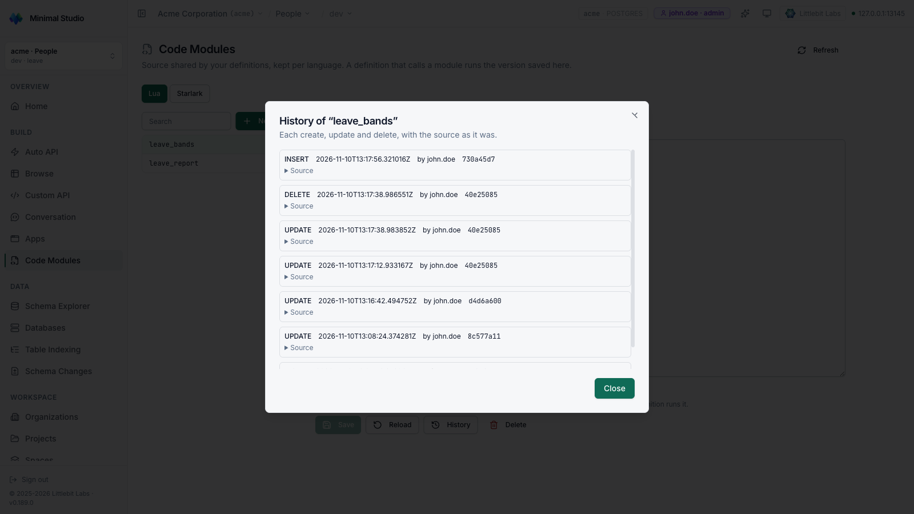

4. **A module belongs to a space.** Open the space menu in the top bar and choose **staging**, then open **Code Modules**. The list reads "No modules yet": the modules of `dev` are not there. A definition belongs to a space in the same way, and the Book of Minimal adds that promoting a definition (Chapter 10) does not bring the modules it loads. The book did not make a call in staging (Appendix C). Choose **dev** again.

   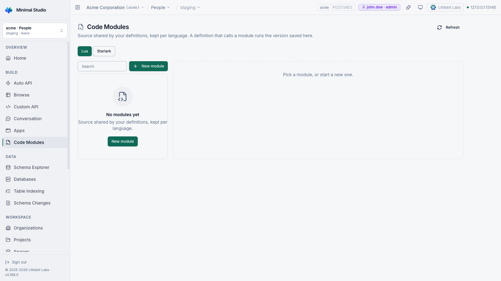

## Exercises

1. Make `leave_bands` four bands: `short` under 4 days, `medium` under 9, `long` under 10, and `extended` from 10. Save it, and run employee `11` in `leave/bands`. Check that the 8-day request is `medium (8)` and the 10-day request `extended (10)`, with no change to the definition.
2. Move the masking of `directory/masked` (Chapter 26; make the definition again if you deleted it) into a Lua module `acme_mask`, with a function `email(address)`, and call it from the step. Check that the answer is the same. Then show two letters instead of one in the module, and check that the first three emails read `ra***@acme.example` and the fourth `kw***@acme.example`, and that the definition was not updated.
3. Write the Starlark `leave_report` for `leave/bands-lark`, loading `leave_bands`, so that the labels read `short (1)`, `medium (8)`, `medium (7)`. Check what the label is when you write `str(days)` and when you write `str(int(days))`.

## Put it back

1. In **Custom API**, select `leave/bands` and `leave/bands-lark` in turn, select **Delete** and then **Yes, Delete**.
2. On **Code Modules**, delete `leave_bands` and `leave_report` on the **Lua** tab, and `leave_bands` on the **Starlark** tab: select each, select **Delete**, then **Delete** in the dialog. Delete `acme_mask` (Lua) and `leave_report` (Starlark) too, if you made them for Exercises 2 and 3. No module of this chapter is left in the lists.
