# 28. Auto API filters and operators

Chapter 8 read a table with **fc** and **oy**. A filter narrows the rows. The Auto API has nineteen operators for it, a group of alternatives joined by OR, and rules that the pane checks before it sends. This chapter runs them, family by family, on the table `employee`. Every request in it is a **GET**, so nothing is written.

> **Setup.** The workspace of Chapter 5, space **dev**: Studio signed in as `john.doe` in **acme · People**, with the tables of Chapter 18 as that chapter leaves them. `employee` follows the template `hr-read`, and `salary` is hidden, so the list reads 28 endpoints, not the 32 of Chapter 8. The shots are of Studio's web page, which is the same application as the desktop one (Appendix C). Appendix A has the data: 120 employees.

## One filter

All the steps of this chapter happen in the Studio window, on the **Auto API** page.

1. Select **Auto API**, open `employee` and select its **GET**. The line under the path reads `template "hr-read" allows: admin — your roles pass.` Type `3` into **ps**.

2. Select **Filters**, then **Add filter**. A row appears: a box for the column, a list of operators that reads **= eq**, and a box for the value. Type `department_id` and `7`. The chip reads "1 filter", and the URL gains `department_id=eq.7`. A filter is written `column=operator.value`.

3. Select **Send**. Three rows come back, all of department 7: "3 rows · 10 columns".

   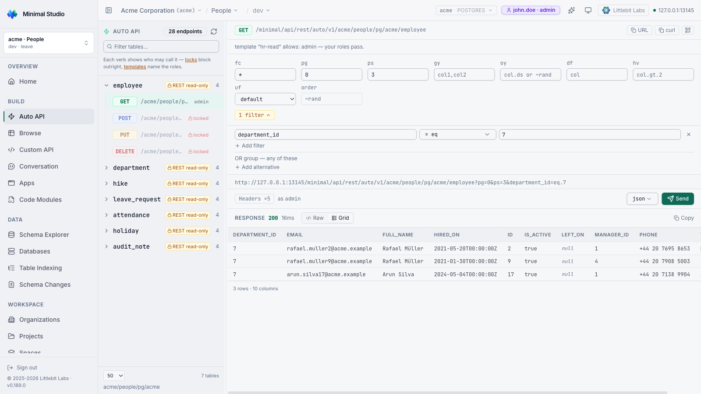

4. Open the list of operators. It holds nineteen and shows thirteen at a time; scroll it for the rest.

   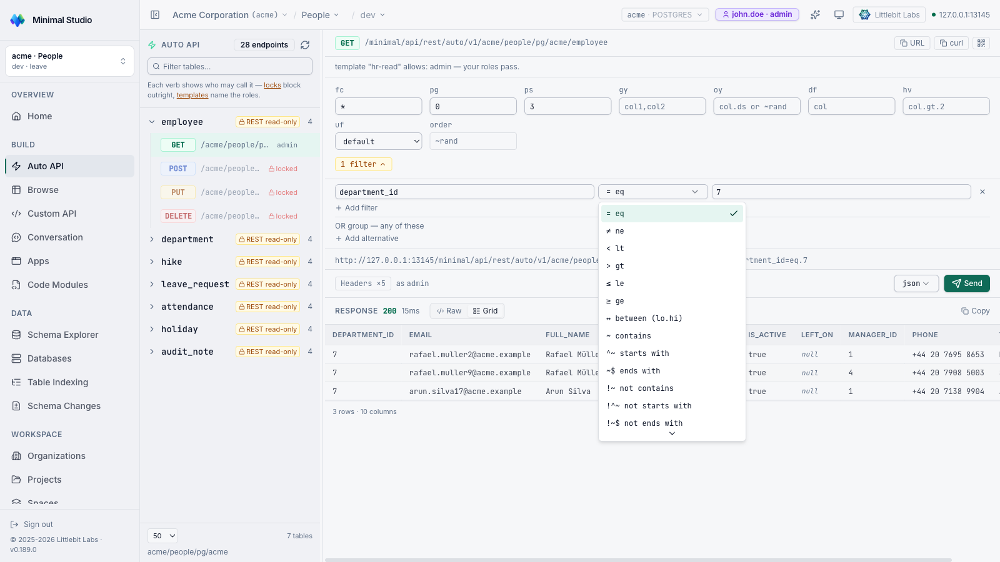

   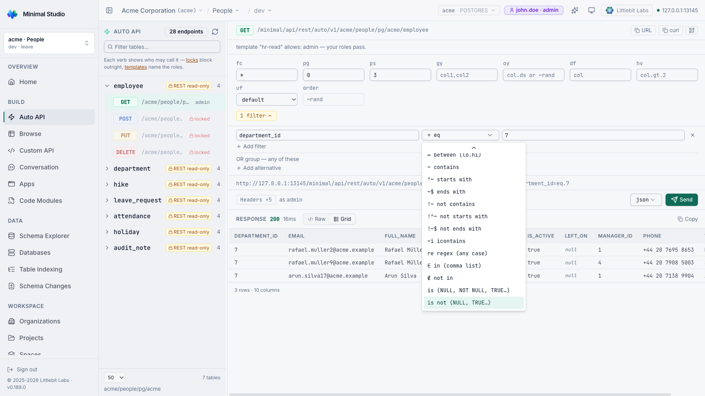

## The nineteen operators

The list names each operator by a symbol and by its code. The code is what the URL carries.

| On the list | Code | Keeps the rows where the column… |
|---|---|---|
| **= eq** | `eq` | equals the value |
| **≠ ne** | `ne` | does not equal it |
| **< lt** | `lt` | is less than it |
| **> gt** | `gt` | is greater than it |
| **≤ le** | `le` | is at most it |
| **≥ ge** | `ge` | is at least it |
| **↔ between (lo.hi)** | `bw` | lies from `lo` to `hi`, both ends included |
| **~ contains** | `li` | contains the text |
| **^~ starts with** | `rli` | starts with it |
| **~$ ends with** | `lli` | ends with it |
| **!~ not contains** | `nli` | does not contain it |
| **!^~ not starts with** | `nrli` | does not start with it |
| **!~$ not ends with** | `nlli` | does not end with it |
| **~i icontains** | `il` | contains the text, whatever the case |
| **re regex (any case)** | `mt` | matches the regular expression, whatever the case |
| **∈ in (comma list)** | `in` | equals one of the values of a comma list |
| **∉ not in** | `nin` | equals none of them |
| **is (NULL, NOT NULL, TRUE…)** | `is` | is the keyword you type, such as `NULL` or `TRUE` |
| **is not (NULL, TRUE…)** | `nis` | is not that keyword |

Several filters are joined by AND: a row has to pass all of them. A column takes one filter: a second filter on the same column replaces the first, and the pane says so (Chapter 29). The rest of this chapter runs the operators section by section. Between sections, select **GET** under `employee` again: it puts every field back to its default, **ps** included, so each section says which **ps** it needs.

## Compare

1. Type `3` into **ps** and fill three rows: `id` **≤ le** `60`, `department_id` **≠ ne** `1` and `manager_id` **> gt** `1`. The URL carries them as `id=le.60&department_id=ne.1&manager_id=gt.1`.

2. Select **Send**. With **ps** at 3 the grid holds the first three matches: employees 4, 5 and 7.

   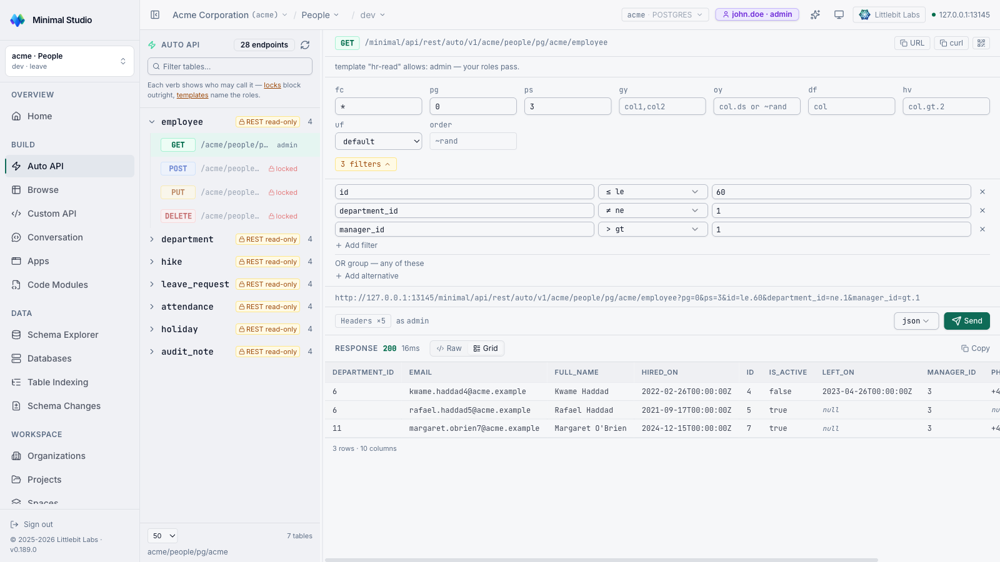

## A range

1. Type `5` into **ps**. Fill two rows with **↔ between (lo.hi)**: `hired_on` with `2023-01-01.2023-12-31` and `id` with `100.140`. The value is the low end, a dot and the high end. The URL reads `hired_on=bw.2023-01-01.2023-12-31&id=bw.100.140`.

2. Select **Send**. Four rows come back, employees 101, 110, 114 and 119, all hired in 2023. Both ends count: `id=bw.100.102` returns 100, 101 and 102.

   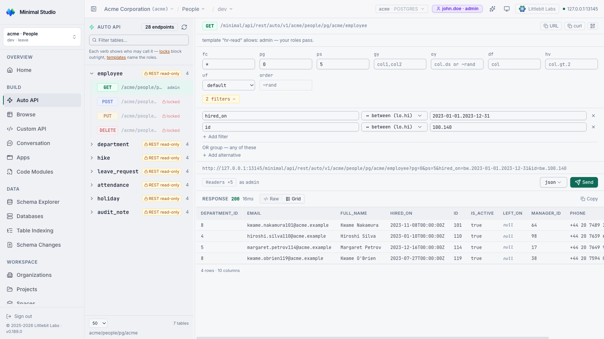

## Text

1. Type `4` into **ps**. Fill three rows: `full_name` **^~ starts with** `Rafael`, `title` **!~ not contains** `Analyst` and `email` **~$ ends with** `acme.example`.

2. Select **Send**. Four employees come back, all named Rafael: Delacroix, Müller, Novak and Haddad.

   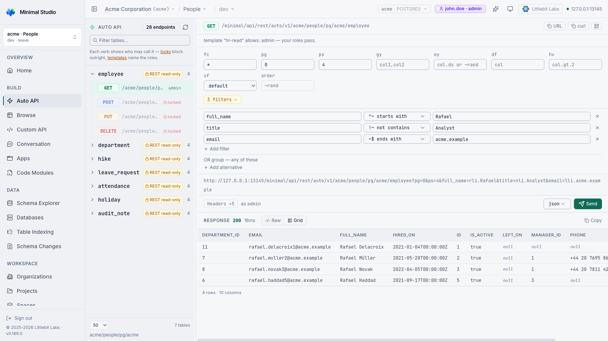

3. **~ contains** keeps the case on PostgreSQL. Select **GET** again, type `3` into **ps** and fill one row, `full_name` **~ contains** `HADDAD`, then select **Send**. The answer is 200, and the grid reads "No rows: the answer is an empty list." Type `Haddad` instead and the Haddads come back.

   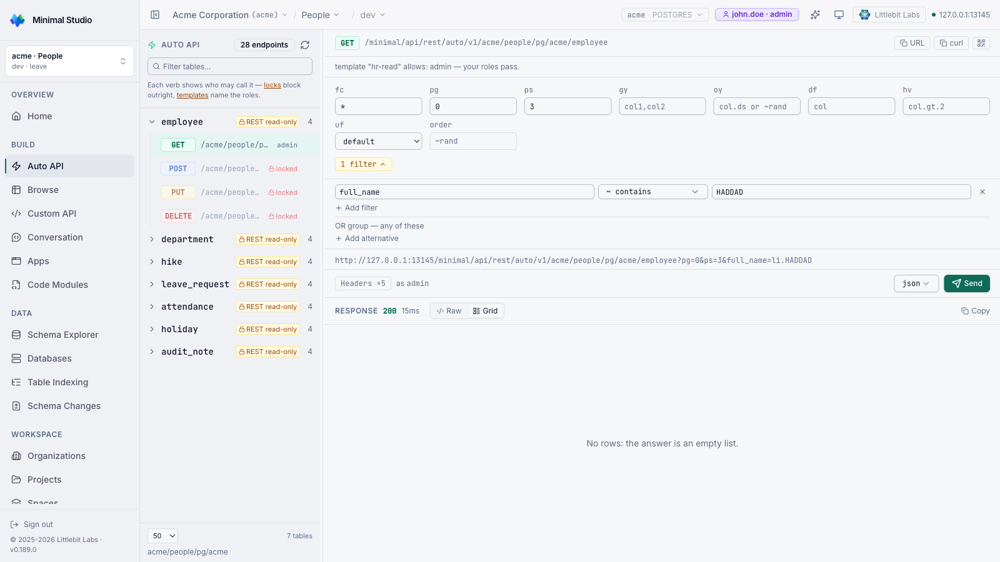

4. Select **GET** again, type `3` into **ps** and fill two rows: `email` **re regex (any case)** with `^raf.*example$` and `full_name` **~i icontains** with `HADDAD`. Select **Send**: one row, Rafael Haddad. The URL writes the regular expression with percent signs, `email=mt.%5Eraf.*example%24`, and the Core reads it back. On its own, `^RAF.*EXAMPLE$` in capitals still finds seven emails: the regular expression ignores the case.

   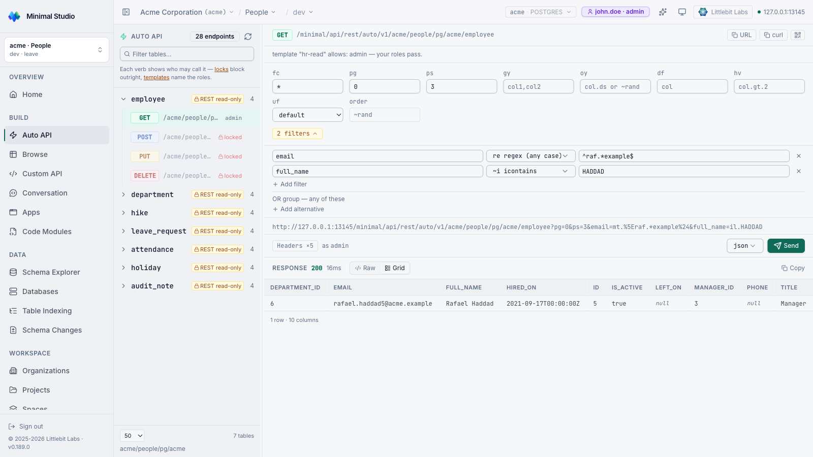

## Lists

1. Type `3` into **ps**. Fill `department_id` **∈ in (comma list)** with `7,8,11` and `id` **∉ not in** with `1,2,3`. Type the list with commas and nothing around it. The URL box writes each comma as `%2C`: `department_id=in.7%2C8%2C11&id=nin.1%2C2%2C3`.

2. Select **Send**. Employees 7, 9 and 10 come back, in departments 11, 7 and 8.

   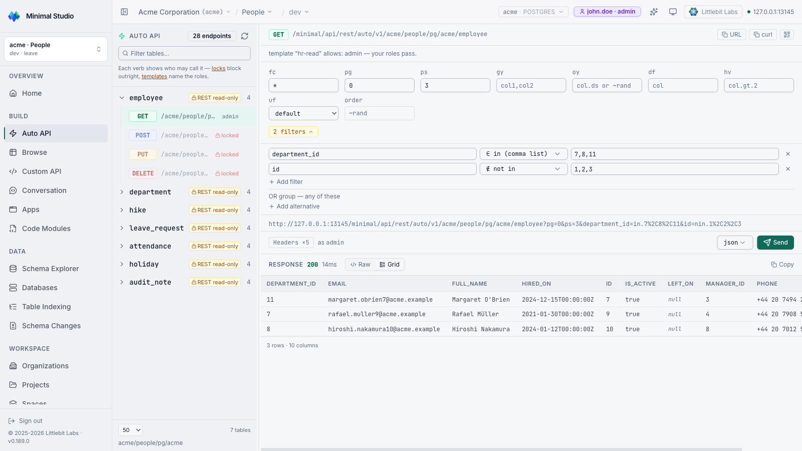

## NULL and TRUE

1. Type `3` into **ps**. Fill `left_on` **is (NULL, NOT NULL, TRUE…)** with `NULL`, `phone` **is not (NULL, TRUE…)** with `NULL` and `is_active` **is (NULL, NOT NULL, TRUE…)** with `TRUE`. The box shows only the start of those labels; from here on the chapter calls them **is** and **is not**. The URL reads `left_on=is.NULL&phone=nis.NULL&is_active=is.TRUE`.

2. Select **Send**. Employees 2, 3 and 6 come back: still at Acme, with a phone.

   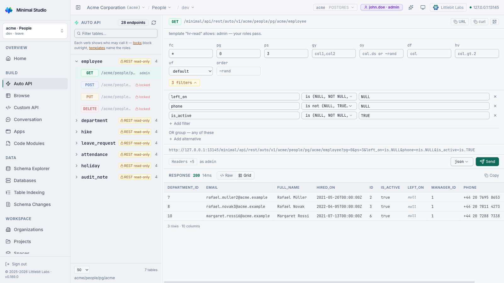

## An OR group

The filters of the first block are joined by AND. Under them, **OR group — any of these** holds alternatives: a row passes the group if it meets any one of them, and it still has to pass the filters above.

1. Type `4` into **ps**. Add one filter, `is_active` **is** `TRUE`. Under **OR group — any of these** select **Add alternative** twice and fill `department_id` **= eq** `7` and `title` **~ contains** `Chief`. The chip reads "3 filters": it counts the alternatives too.

2. Select **Send**. Four active employees come back: employee 1, Rafael Delacroix, whose title is Chief Executive, and employees 2, 9 and 17 of department 7. The request carries the group in one parameter: `or=(department_id.eq.7,title.li.Chief)`, each alternative written `column.operator.value`. The URL box writes the brackets and the comma with percent signs.

   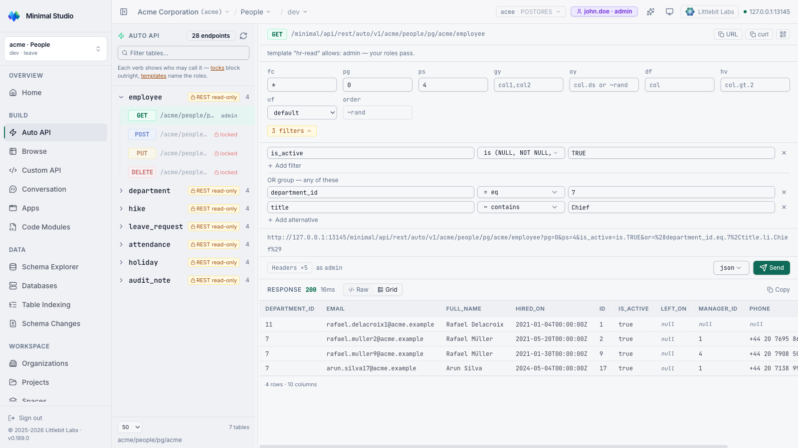

## What the group refuses

1. Keep the filter `is_active` **is** `TRUE`, and change the group to `department_id` **∈ in (comma list)** `7,8` and `title` **= eq** `Manager`. Before anything is sent, a red line under the panel reads "in and nin cannot be used inside the OR group."

2. Select **Send**. Nothing is sent: for a moment a message at the bottom right repeats the line, and the answer area still reads "Send a request to see the response". Write one **= eq** alternative for each value instead.

   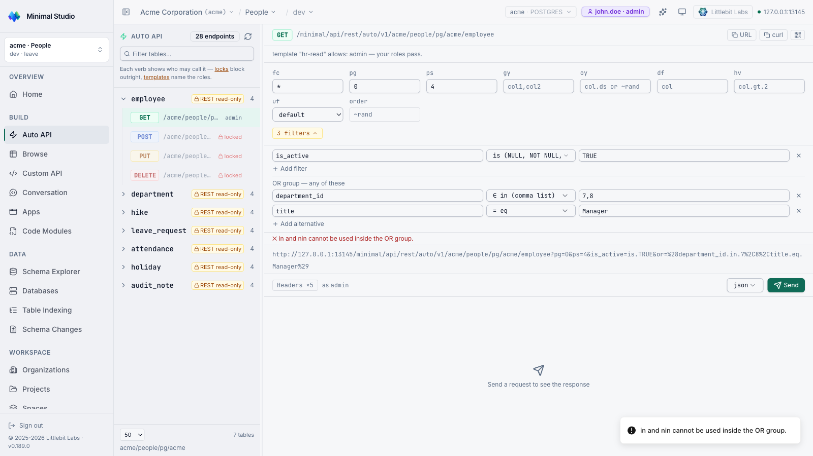

## Exercises

1. Select **GET** under `employee` again. Set **ps** to `50` and **fc** to `id`, and filter `phone` **is** `NULL`. Check that the grid reads "14 rows · 1 column", the fourteen employees without a phone in Appendix A.
2. Replace the filter with `is_active` **is** `FALSE`. Check that the grid reads "11 rows · 1 column", the eleven employees who have left.
3. Select **GET** again and add `hired_on` **≥ ge** `2023-01-01` and `hired_on` **≤ le** `2023-12-31`. Read the orange line under the panel. How many conditions on `hired_on` are sent, and which operator writes a range on one column?
