# 29. Auto API keywords, formats and limits

Chapter 28 chose rows. This chapter shapes what comes back: distinct values, groups, a random order and five formats. It then reads what the pane refuses before it sends, what the Core refuses after, what the **PUT** and **DELETE** panes ask for, and the chips that carry a request away. The table is `employee` again, and nothing is written.

> **Setup.** The same as Chapter 28: **acme · People**, space **dev**, `john.doe`, the tables of Chapter 18 as that chapter leaves them, and the shots taken in Studio's web page (Appendix C). The tables of Acme are locked against writes, so the **PUT** and **DELETE** panes are filled in and not sent.

## Distinct values: df

1. Select **Auto API**, open `employee` and select its **GET**. Type `title` into **df** and `title.as` into **oy**; **ps** stays at its 10. The URL reads `…/employee?pg=0&ps=10&df=title&oy=title.as`. **df** collapses duplicate rows over the columns it names, a comma list, and the Book of Minimal says an order must then name a column that **df** selects: here `title`.

2. Select **Send**. The grid has one column, TITLE, and ten rows, from Analyst to Specialist: "10 rows · 1 column". Acme has eleven titles; the eleventh, Staff Engineer, sorts after Specialist, and a **ps** of `20` shows all eleven.

   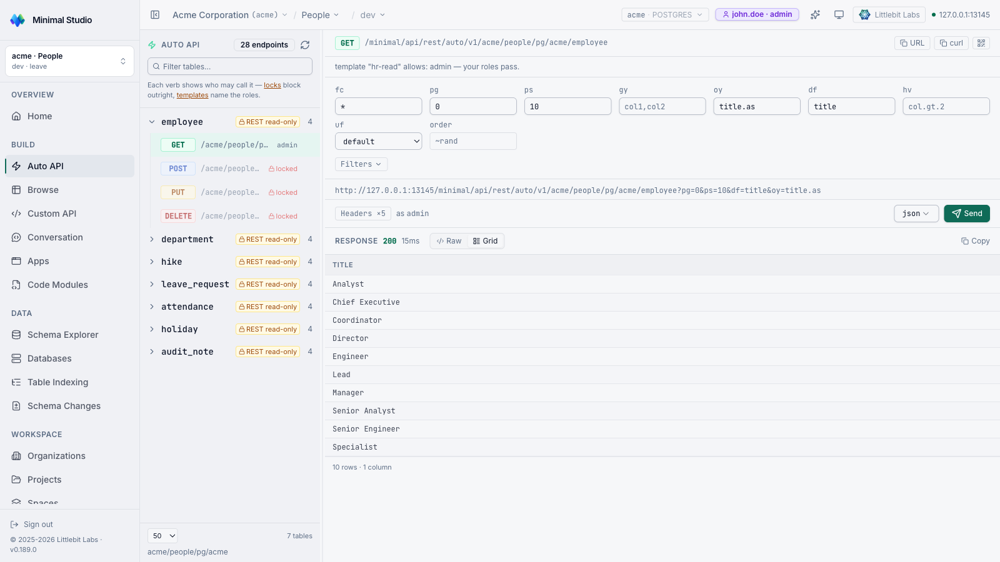

3. **df** does not go with **fc**. Select **GET** again and type `full_name` into **fc**, `title` into **df** and `5` into **ps**. An orange line reads "df and fc exclude each other: only df is sent." Select **Send**. The URL has no **fc**, and five titles come back, with no order asked for. The Book of Minimal says the Core refuses the pair with 417; Studio drops **fc** before it sends.

   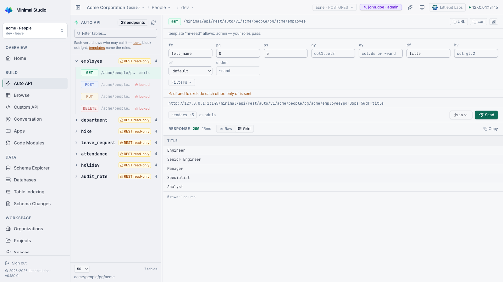

## Groups: gy and hv

1. Select **GET** again. Type `department_id` into **fc** and into **gy**, `department_id.gt.8` into **hv** and `department_id.as` into **oy**. **gy** groups the rows by the column. **hv** filters the groups, written like a filter, `column.operator.value`. The URL reads `…&fc=department_id&gy=department_id&hv=department_id.gt.8&oy=department_id.as`.

2. Select **Send**. Three rows come back, 9, 10 and 11: the department IDs above 8 that an employee belongs to.

   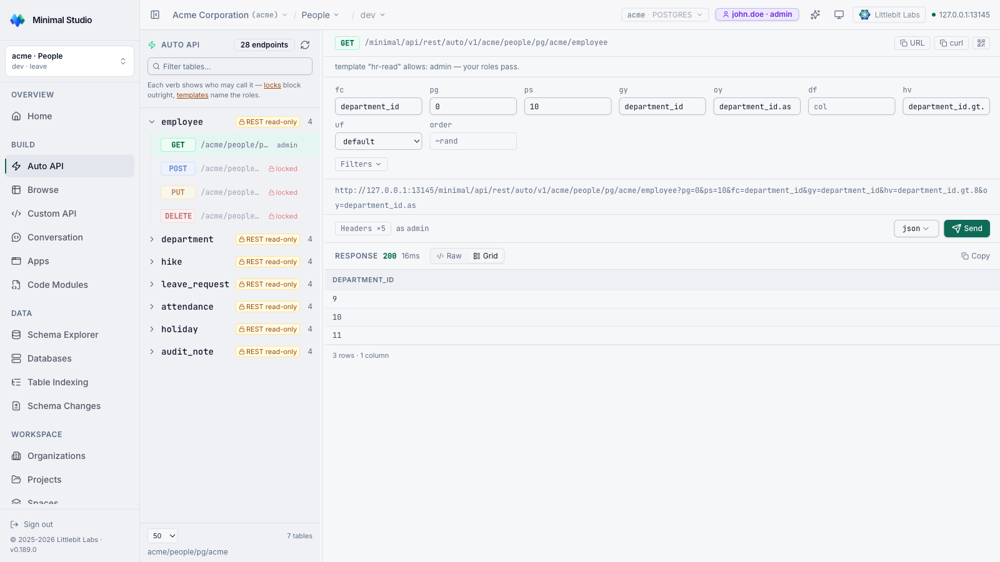

## Random order: ~rand

1. Select **GET** again. Type `id,full_name,title` into **fc** and `4` into **ps**. Under **order**, select **~rand**. The box turns amber, and **oy** reads `~rand`. The URL carries `oy=%7Erand`.

2. Select **Send**. Four employees come back in no order you chose, and **Send** again brings others. The grid lists FULL_NAME, ID and TITLE: its columns are in alphabetical order, not in the order of **fc**.

   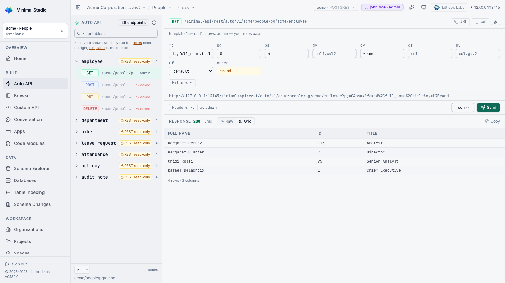

**~rand** does not go with **df**: a random order over collapsed rows means nothing, and the pane refuses the pair (below).

## The keyword for ClickHouse

The parameter grid has one more keyword, **uf**, a list of **default**, **true** and **false**. It is for ClickHouse tables, and Chapter 23 sends it to one.

## Formats

The list beside **Send** reads **json**. It also offers **xml**, **csv**, **bson** and **yaml**, and the URL gains `format=…`. Select **GET** again and type `3` into **ps**. Then, for each format:

1. Choose **xml**, select **Send**, then **Raw**. The answer is `<rows>` with one `<row>` for each employee and one element for each column. A NULL prints as `&lt;nil&gt;`, which is `<nil>` escaped. The elements of a row do not come in a fixed order: read an XML by the element's name.

   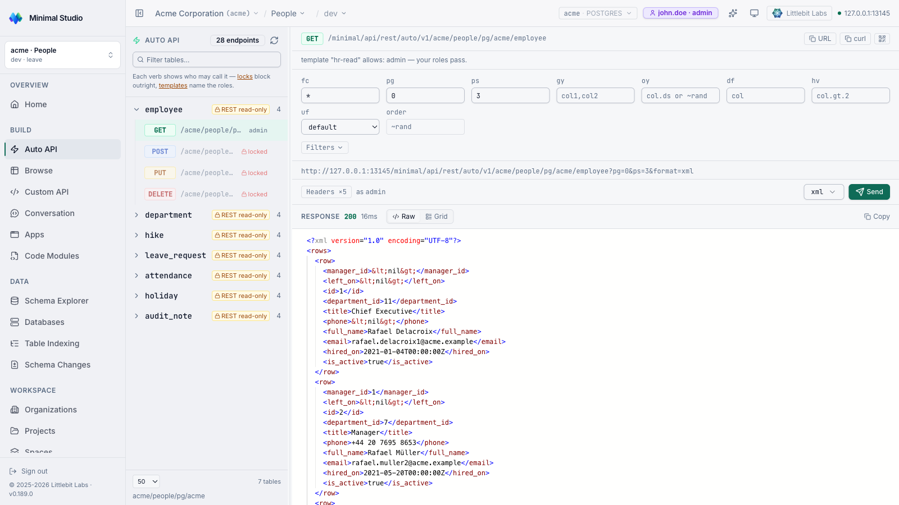

2. Choose **csv** and select **Send**. The answer is a header line and a line for each row. A NULL prints as `<nil>`. With **fc** left at `*`, the order of the columns changed with every **Send** in the book's runs: read a CSV by its header, never by position.

   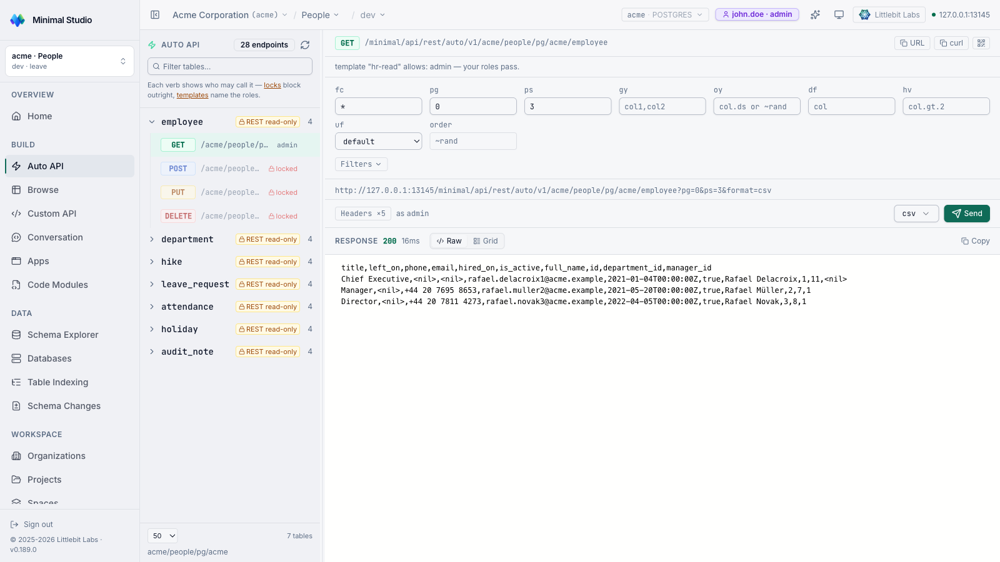

3. Choose **yaml** and select **Send**. The answer is a list of mappings, `- department_id: 11` and under it the other columns in alphabetical order. A NULL prints as `null`, as in JSON.

   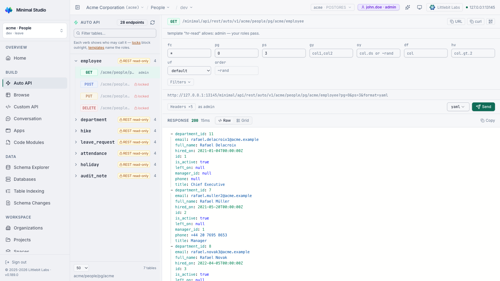

4. Choose **bson** and select **Send**. The answer is binary data, which the page shows as base64 text. **Grid** is disabled for it.

   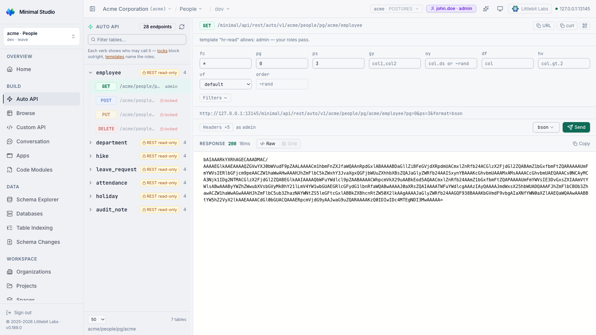

5. Choose **json** again before you go on. Selecting **GET** again does not put the format back.

## What the pane checks before it sends

Before **Send**, the pane reads the request and writes what it finds under the panels. A red **✕** line is an error: **Send** then sends nothing, a message repeats the first error, and the **Filters** panel opens. An orange **⚠** line is a warning: the request is still sent, as the URL under the panels shows it.

1. Select **GET** again. Type `title` into **df** and `id.gt.2` into **hv**, and select **~rand**.

2. Open **Filters** if it is closed. Filter `id` **> gt** `5` and `id` **< lt** `9`, and add `department_id` **∈ in (comma list)** `7,8` to the OR group. The pane writes two errors and two warnings:

   - ✕ "df (distinct) cannot be combined with ~rand."
   - ✕ "in and nin cannot be used inside the OR group."
   - ⚠ "hv is ignored without gy."
   - ⚠ "Only one condition per column can be sent: the last one on "id" wins. Use the OR group for alternatives."

   The URL under them shows what would be sent: of the two filters on `id`, only `id=lt.9`.

   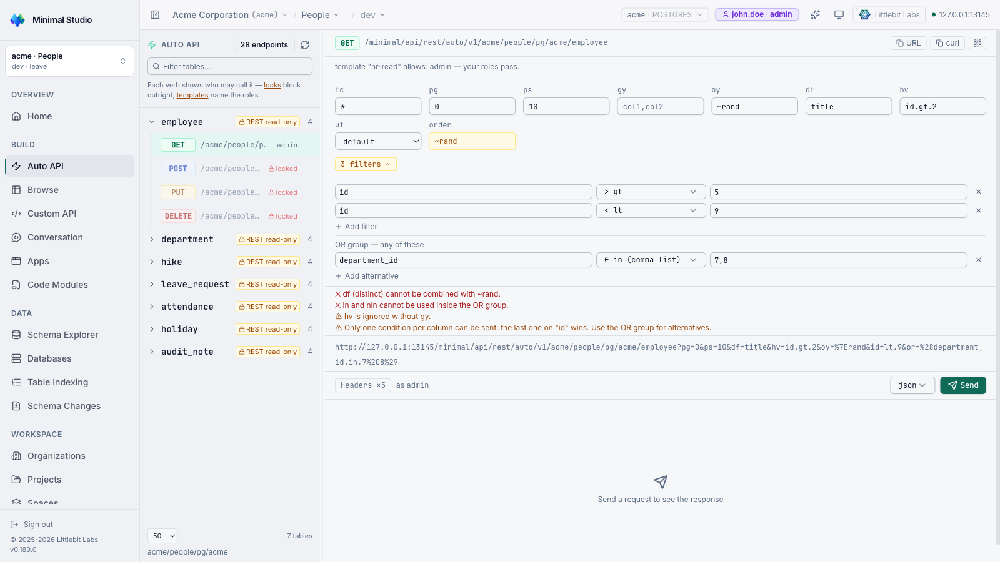

## What the Core refuses

The pane cannot know every rule. The Core checks each call, and its refusals reach the page with their status.

1. Select **GET** again. Type `count(*)` into **fc** and `5` into **ps**. Before anything is sent, an orange line reads "Aggregate functions such as count(*) are not supported here (the server answers 417). Group plain columns with gy, or use a Custom API for totals." It is a warning, so **Send** goes ahead.

2. Select **Send**, then **Raw**. The answer is **RESPONSE 417**, with "Query refused", and the body reads:

   ```json
   {
     "code": 417,
     "status": "Expectation Failed",
     "message": "unable to perform select",
     "details": "a valid SQL statement could not be formed reason: unknown column \"count(*)\""
   }
   ```

   Under the status Studio adds an orange line: "The server could not build that query. Aggregate functions such as count(*) are not supported: use plain columns, or a Custom API." The Core took `count(*)` for the name of a column. Counting is for a Custom API (Chapter 9). The Book of Minimal says that a statement that cannot be built, with an unknown column or operator or a malformed filter, answers 417 on a read, with a `details` that starts the same way. Studio adds its orange line whenever `details` starts that way, so read `details` for the column it names.

   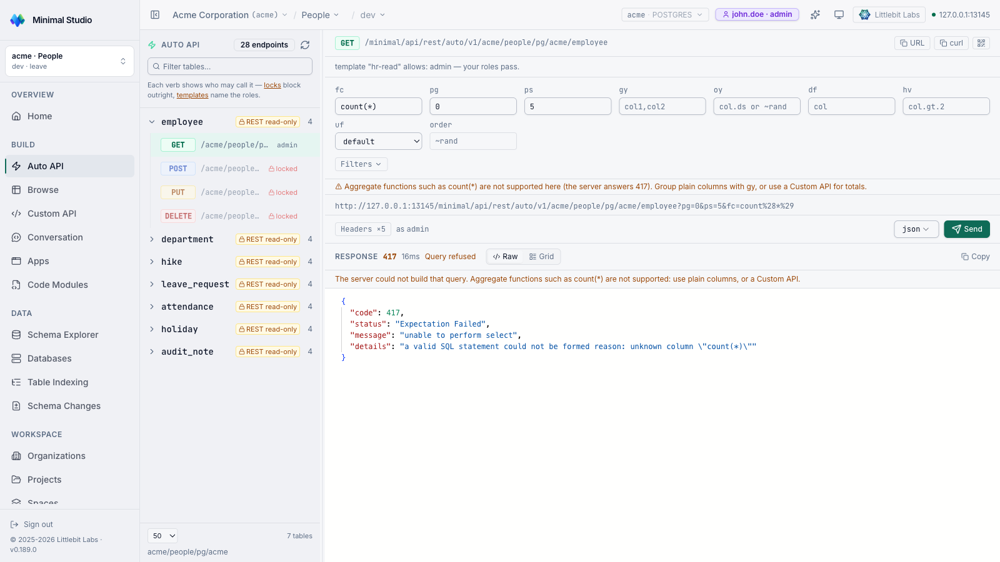

3. Select **GET** again, type `100001` into **pg** and `100` into **ps**, select **Send**, then **Raw**. The answer is **RESPONSE 406**, with "Not acceptable":

   ```json
   {
     "code": 406,
     "status": "Not Acceptable",
     "message": "page number is too large",
     "details": "pg=100001 with a page size of 100 starts past row 10000000, the most a read may skip; to walk a large table, filter on the last key seen and order by it (for example id=gt.<last>&oy=id.as&ps=100&pg=0)"
   }
   ```

   A read cannot skip past row 10,000,000, unless the deployment says otherwise. To read a table that large, filter on the last key you have seen, as the details say. The page size has a cap too, 100 unless the deployment says otherwise, but the Core does not refuse a larger one: it reduces it. A **ps** of `500` answers 200 with 100 rows.

   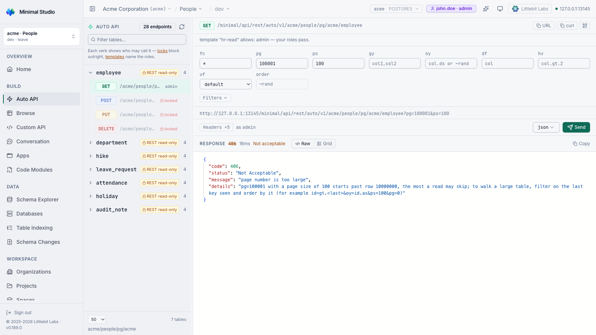

## Writes: PUT and DELETE

The **PUT** pane asks for two things that a **GET** does not: what to set, and which rows. Nothing here is sent.

1. Select **PUT** under `employee`. The orange line above the panels predicts the answer, as the **POST** of Chapter 8 did: "Expect 403: table·update — closed for every caller. Table Governance changes it — the Core decides each call, Send verifies."

2. Select **Set (required)**, then **Add set** twice. Each row is a column and a value: fill `is_active` with `false` and `left_on` with `~NOW()`. The chip reads "2 sets". A value that starts with `~` is an expression and not text: the Book of Minimal accepts `NULL`, `''` and a function with no arguments such as `NOW()` after it.

3. Open **Filters** if it is closed, select **Add filter** and fill `id` **= eq** `7`. The URL carries the filter and a `set` for each pair: `…/employee?id=eq.7&set=is_active.false&set=left_on.%7ENOW%28%29`. The Book of Minimal writes `set` as one comma-separated list of pairs; this book could not send either form, because the table is locked. Beside the chips, "⚠ filter required" stands on every **PUT** and **DELETE**, whether or not a filter is set.

   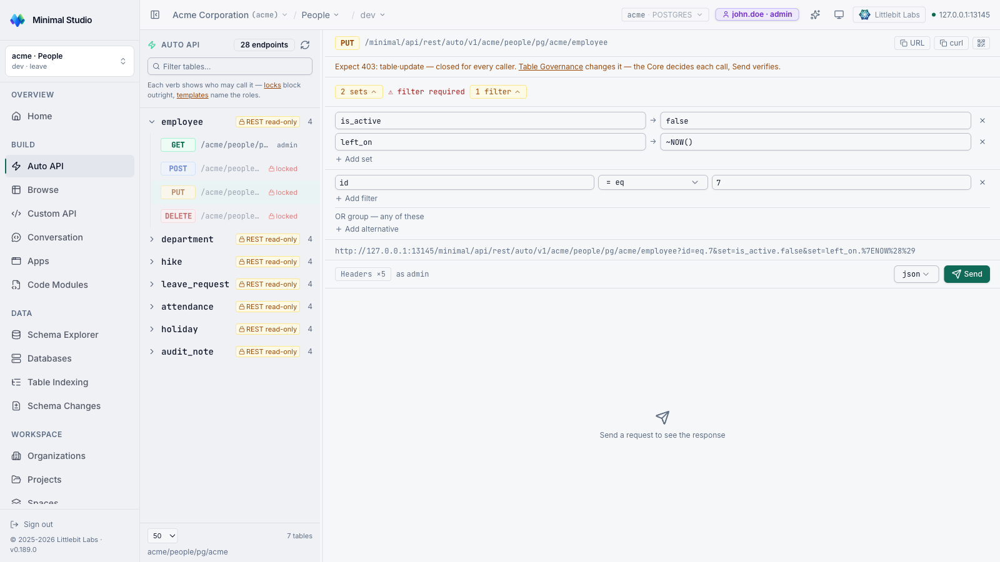

4. Select **PUT** again. The fields empty, and the **Set** and **Filters** panels stay open. Select **Add set** once and fill `is_active` with `false`. **Filters** reads "No filters — an update needs at least one", and a red line under the panels reads "Update needs at least one filter: an unfiltered update is refused." **Send** would send nothing. The Book of Minimal gives the Core's own answer to an update with no filter, 424 with "blanket updated detected, rejecting request"; this book did not send one.

   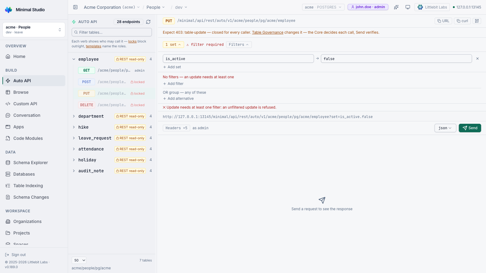

5. Select **DELETE** under `employee`. The line above the panels reads "Expect 403: table·delete — closed for every caller." Open **Filters** if it is closed: it reads "Carpet delete is not allowed", and a red line under the panels reads "Delete needs at least one filter: an unfiltered delete is refused."

   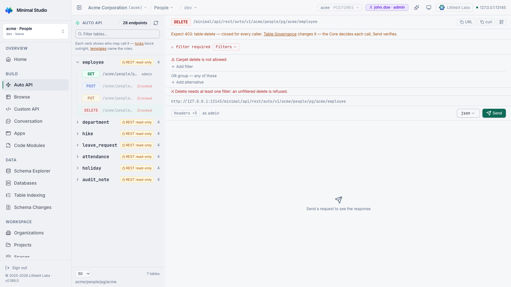

## Take the request with you

Three chips at the right end of the path line carry a request away. **URL** copies the address, **curl** copies the command, and the chip with the QR symbol shows the address as a QR code: "Scan to open this request in a browser." The URL never holds a credential, and the chips say so; a request that needs the key is the **curl** one. A scan opens the same address, so it works only from a device that can reach the Core.

1. Select the **GET** of `employee` again, type `5` into **ps**, filter `id` **↔ between (lo.hi)** `100.140`, and select **Send**. Select the QR chip: the pop-up shows the code.

   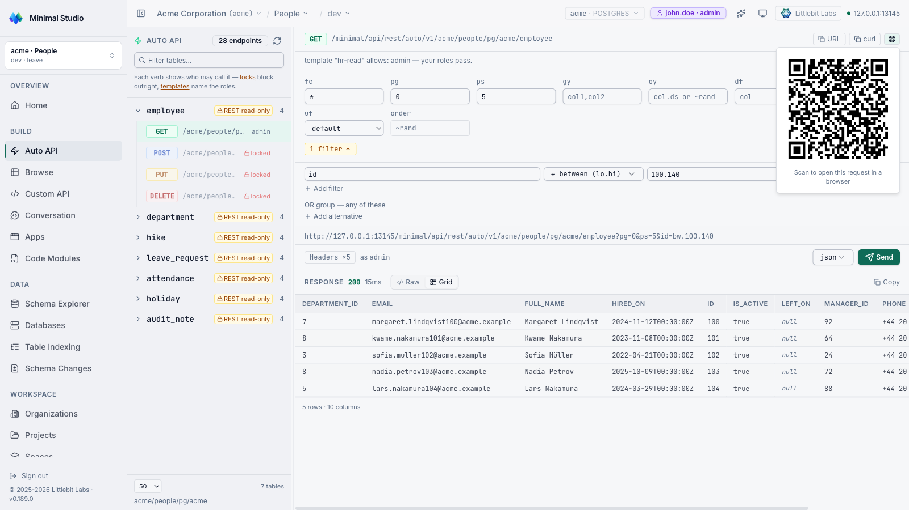

## Exercises

1. On `employee`, select **GET** again, type `title` into **df** and `20` into **ps**, and select **Send**, then **Grid**. Check that the grid reads "11 rows · 1 column", the eleven titles of Acme.
2. Select **GET** again, type `department_id.gt.8` into **hv** and leave **gy** empty. Which line does the pane write?
3. Select **GET** again, type `100001` into **pg** and `100` into **ps**, and select **Send**. Which status comes back, and what does the Core tell you to filter on in order to read that far into a table?
