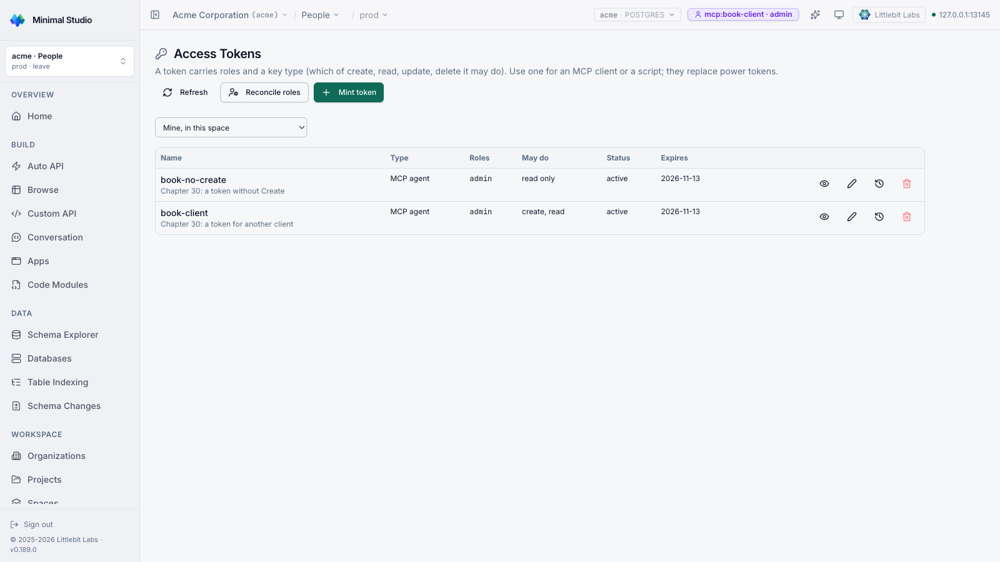
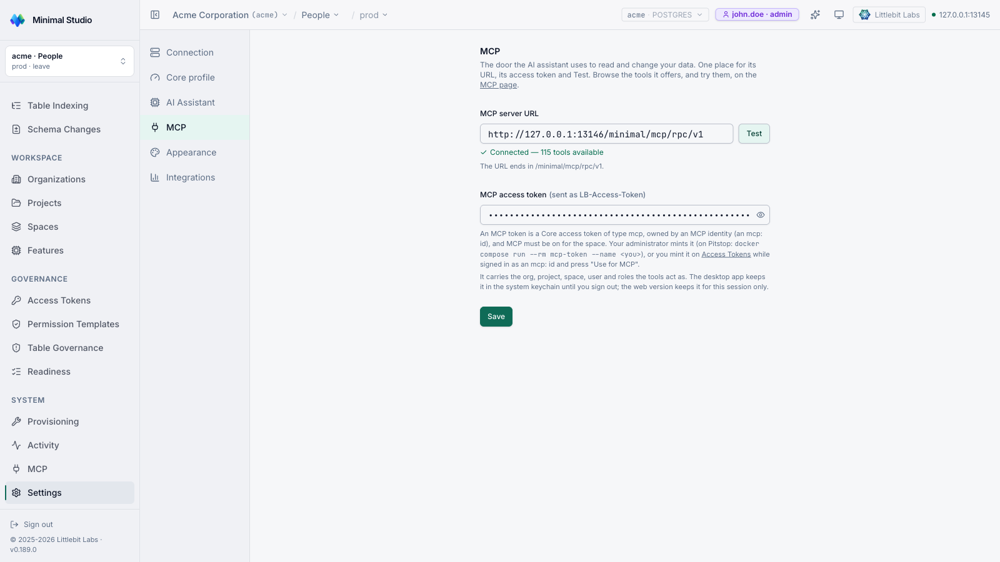
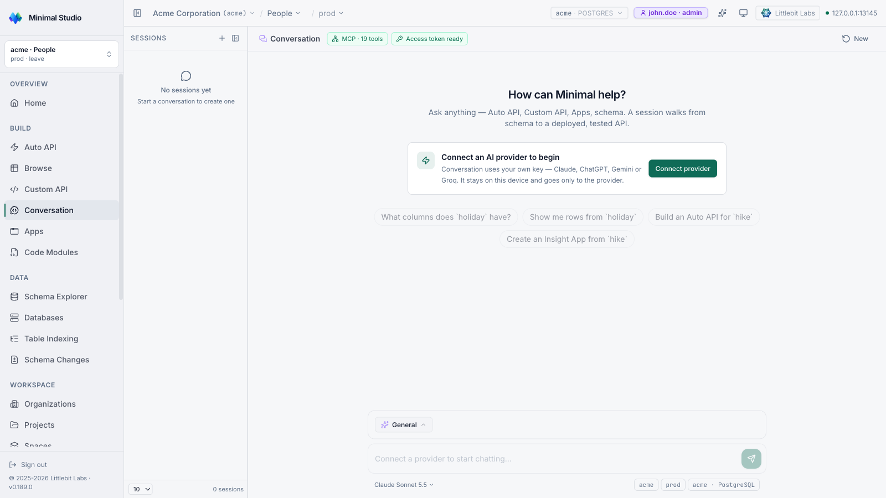
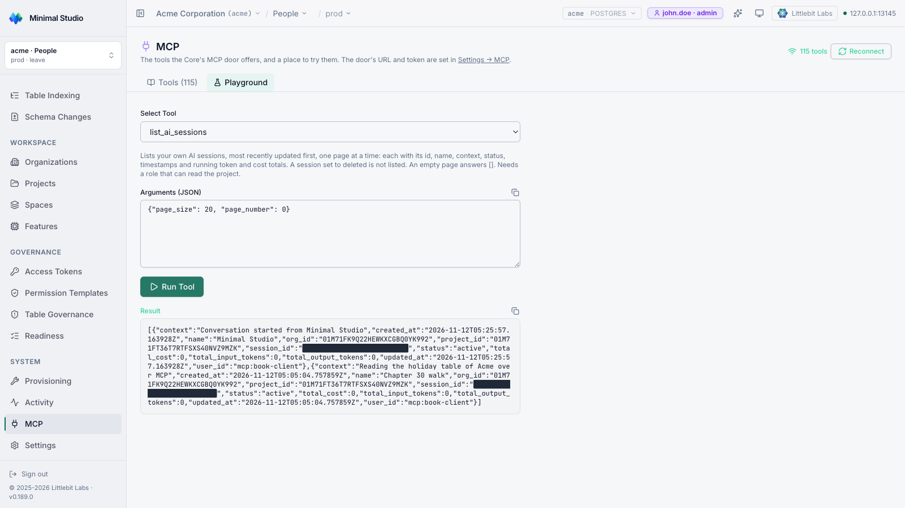
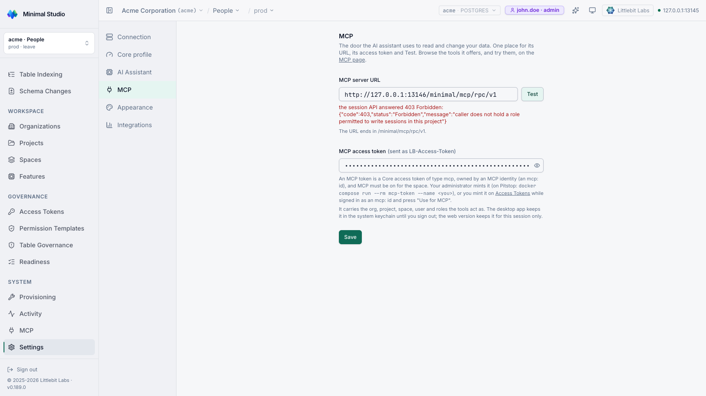

# 30. The MCP door beyond Studio

Chapter 17 ended with a token that Studio itself holds. A token is only a string, so the same one can sit in a terminal, in another AI client or in another person's Studio, and each of them reaches the same door. This chapter hands one token to all three, reads what the door answers when something is missing, and says who may open a session. A session is the record the door keeps of one caller's calls: one call opens it, and the id it returns is named in a header on every other call. The operator's way of making a token on a gateway is described, not run.

> **Setup.** The book's Core with the MCP door open for `prod` (Chapter 17), and the workspace of Chapter 5 entered as **acme · People · prod · leave**. The Studio parts were run in the web page, signed in twice: as `mcp:book-client` to mint, and as `john.doe` to use (Appendix C). The terminal parts run on the same Mac against `http://127.0.0.1:13146`. Every token of this chapter lasts one day and is deleted at the end.

## A token for someone else

1. Sign in as Chapter 17 did for `mcp:agent`: select **Direct to Core**, type the Core's address, and under **Identity options** type `mcp:book-client` as the **User ID** and keep the role `admin`. Paste the server key and select **Continue**. On **Pick your workspace**, paste your organization's ID as in Chapter 5, choose `prod` as the space and `leave` as the feature, and select **Open Studio**.

2. Select **Access Tokens** in the sidebar, then **Mint token**. Type `book-client` as the **Name** and `Chapter 30: a token for another client` as the **Description**. Leave **Type** on **MCP agent**, **Roles** on `admin` and **May do** on create and read, and type `1` in **Expires in (days)**. Select **Mint token** and copy the token that the dialog shows. Before you select **Done**, put it in a file that only you can read, so that it never sits on a command line. On a Mac:

   ```bash
   ( umask 077; printf 'LB-Access-Token: %s\n' "$(pbpaste)" > book-token.header )
   ```

3. Mint a second token, `book-no-create`, in the same way with **Create** unticked: the line **May do** then reads "read only". Save it as `book-no-create.header`. The terminal section below uses it to meet a refusal.

   

The top bar names the identity that minted both, `mcp:book-client · admin`, and that is why the door will take them (Chapter 17). (This edition saved the tokens from the dialog to such files with a script, not by hand: Appendix C.)

## The door from a terminal

Studio hides what the door asks for; a terminal shows it. Every call of a tool is one JSON-RPC `POST` to `/minimal/mcp/rpc/v1` with the token in `LB-Access-Token`. Volume 1, chapter 7 of the Book of Minimal explains the protocol.

1. Ask whether the door is up. This needs no credential:

   ```bash
   curl -s http://127.0.0.1:13146/minimal/mcp/ops/v1/health
   ```

   ```text
   {"listener":"mcp","status":"ok"}
   ```

2. The calls below differ only in the tool, its arguments and the odd extra option, so paste this function once. It sends the headers the door expects, reads the token from `book-token.header`, and prints the HTTP status after each answer. Its first argument is the tool, its second the tool's arguments as JSON, and anything after them goes to `curl`. Putting `H=other-file` before a call reads another header file.

   ```bash
   U=http://127.0.0.1:13146
   META='"_meta":{
     "io.modelcontextprotocol/protocolVersion":"2026-07-28",
     "io.modelcontextprotocol/clientInfo":{"name":"terminal","version":"1"},
     "io.modelcontextprotocol/clientCapabilities":{}}'
   mcp() {
     curl -s -w '\n[HTTP %{http_code}]\n' -X POST $U/minimal/mcp/rpc/v1 \
       -H 'Content-Type: application/json' -H 'Accept: application/json, text/event-stream' \
       -H 'MCP-Protocol-Version: 2026-07-28' -H 'Mcp-Method: tools/call' -H "Mcp-Name: $1" \
       -H @${H:-book-token.header} "${@:3}" \
       -d "{\"jsonrpc\":\"2.0\",\"id\":1,\"method\":\"tools/call\",\"params\":{$META,\"name\":\"$1\",\"arguments\":$2}}"
   }
   ```

3. Open a session. Almost every tool needs one, and this is the call that makes it:

   ```bash
   mcp start_ai_session '{"name":"Chapter 30 walk","context":"Reading the holiday table of Acme over MCP"}'
   ```

   The answer is one line, a JSON-RPC envelope that ends with `[HTTP 200]`. The tool's own answer is the text inside it, here on several lines:

   ```text
   {
     "name": "Chapter 30 walk",
     "org_id": "01M71FK9Q22HEWKXCGBQ0YK992",
     "project_id": "01M71FT36T7RTFSXS40NVZ9MZK",
     "session_id": "<session-id>",
     "user_id": "mcp:book-client"
   }
   ```

   The organization and the project come from the token, not from the request, and `user_id` is the token's owner. Find `session_id` in your answer and copy the 26 letters and digits after it into a variable: `SID=<session-id>`.

4. Under the session, `ping` answers `pong`, and `meta_describe_table` reads the columns of `holiday`, the tool that Chapter 12's Conversation chose:

   ```bash
   mcp ping '{}' -H "X-Session-Id: $SID"
   mcp meta_describe_table '{"type":"pg","schema":"acme","table":"holiday"}' -H "X-Session-Id: $SID"
   ```

   The first answers the text `pong`. The text of the second is a JSON list of four columns: `id`, an integer with the default `nextval('holiday_id_seq'::regclass)`; `name`, `character varying` of length 60; `region`, `character varying` of length 4; and `observed`, a `date`. None may be null. They are the columns of Appendix A. The arguments are the engine's two-letter code (`pg`), the name under which the project registered the database (`acme`) and the table. The tools that give these names are the ones on Studio's **MCP** page, which counts 115.

5. Now take pieces away. Each of these four calls is refused in its own way:

   ```bash
   H=/dev/null mcp ping '{}'
   H=book-no-create.header mcp start_ai_session '{"name":"Chapter 30 read-only","context":"A token without Create"}'
   mcp ping '{}'
   mcp ping '{}' -H 'X-Session-Id: 01M00000000000000000000000'
   ```

   | The call | Status | The door says |
   |---|---|---|
   | No token | 401 | `this endpoint requires an access token: send LB-Access-Token` |
   | A token that may not create | 401 | `access token is not valid for this request`, with the reason in `data`: `this token's key_type does not permit this HTTP method` |
   | No `X-Session-Id` | 200, `isError: true` | `this call carries no X-Session-Id header. Initiate a session first -- call the start_ai_session tool with a name and a context, then send the session_id it returns as X-Session-Id on every call` |
   | A session that does not exist | 200, `isError: true` | `recording this call failed and nothing was executed: the conversation API answered 404: ... "session not found"` |
   | A role that may not write sessions (the section below) | 200, `isError: true` | `the session API answered 403 Forbidden: ... caller does not hold a role permitted to write sessions in this project` |
   | A token owned by a person (Chapter 17) | 403 | `this access token's owner is not an MCP identity: mint the token for an MCP user/persona/profile whose id carries the deployment's MCP prefix` |
   | A deleted token (the last section) | 401 | `access token is not valid for this request`, with the reason in `data`: `access token does not resolve to an active, unexpired grant` |

   The pattern is worth keeping. A problem with the token is an HTTP error. A problem with the session is an HTTP 200 whose result says `isError`, because the tool did not run: a call that cannot be recorded in its session is not executed.

## Another client: Claude Code

Any MCP client that can send two headers can use the same token. This edition ran one, Claude Code, version 2.1.59, against the door.

1. A general-purpose client does not know that Minimal wants a session, so the session of step 3 of the terminal section is opened first and its id travels in a header beside the token. Claude Code reads its servers from a JSON file. Save this as `book-mcp.json`, put the token and the session id in place of the two placeholders, and make the file private with `chmod 600 book-mcp.json`:

   ```json
   {
     "mcpServers": {
       "minimal-book": {
         "type": "http",
         "url": "http://127.0.0.1:13146/minimal/mcp/rpc/v1",
         "headers": {
           "LB-Access-Token": "<your-access-token>",
           "X-Session-Id": "<session-id>"
         }
       }
     }
   }
   ```

   The file serves these runs and is then deleted. This edition did not use `claude mcp add`: it would write the same headers, in plain text, into Claude Code's own settings, which are not the book's to change (Appendix C).

2. Ask the question of Chapter 12:

   ```bash
   claude -p "What columns does the holiday table have? Use the minimal-book tool meta_describe_table with type pg and schema acme." \
     --model sonnet --mcp-config book-mcp.json --strict-mcp-config \
     --allowedTools "mcp__minimal-book__meta_describe_table" \
     --max-budget-usd 0.5 --no-session-persistence \
     --output-format stream-json --verbose
   ```

   `-p` prints the answer and exits. `--mcp-config` loads the file, and `--strict-mcp-config` ignores every other server you have set up. `--allowedTools` names the one tool Claude Code may call, because in this mode nobody is there to be asked. `--max-budget-usd` caps the spend. The last two flags make it print one JSON event per line: the connection, each tool call and the answer.

   The first event says that `minimal-book` is `connected`, with the 115 tools of the door. The model does not know that a session is open behind the header: the tools' descriptions say a session is needed, so it asks for `start_ai_session`, which is not on the allowed list, and the run ends with "I need permission to call the `start_ai_session` tool. Please approve it so I can proceed — it's required before any other minimal-book tool call." That run took two minutes and cost US$0.14.

3. Tell it. Start the prompt with "A session is already open for this connection (its id is sent as the X-Session-Id header), so do not call start_ai_session." and keep the rest. This time the run calls `meta_describe_table` with `{"type":"pg","schema":"acme","table":"holiday"}` and answers with a reply such as:

   | Column | Type | Nullable | Notes |
   |---|---|---|---|
   | `id` | `integer` | NO | Auto-increment (`nextval`) |
   | `name` | `varchar(60)` | NO | — |
   | `region` | `varchar(4)` | NO | — |
   | `observed` | `date` | NO | — |

   It took about 18 seconds and cost US$0.06. As in Chapter 12, the wording changes from run to run; what the chapter asserts is the tool and the four columns, which are those of the terminal call. Both runs used the Claude Code login of the Mac, not the AI key of Studio.

Claude Code refuses to start inside another Claude Code session ("cannot be launched inside another Claude Code session"), so run it in a terminal of its own.

Claude Desktop is named, not run (Appendix C).

## The same token in another person's Studio

The token carries the identity. The person who holds it need not be its owner.

1. Select **Sign out**, and sign in again as `john.doe` with the role `admin`, in the same workspace.

2. Open **Settings**, tab **MCP**. Type `http://127.0.0.1:13146/minimal/mcp/rpc/v1` as the **MCP server URL**, paste the token of `book-client` into **MCP access token**, and select **Test**. The line "Connected — 115 tools available" appears. Select **Save**.

   

3. Select **Conversation**. The two badges read **MCP · 19 tools** and **Access token ready**, as they did in Chapter 12, and the page counts 19 tools where the **MCP** page counts 115, as there.

   

   This web session holds no AI key, so the page asks to connect a provider and its composer waits. The model line at the foot reads Claude Sonnet 5.5: the model of Chapter 20 was chosen in the desktop application, not in this web session. With the key and the model of Chapter 20 the page answers as Chapter 12 shows. That exchange was not run as `john.doe` (Appendix C).

4. Select **MCP** in the sidebar and open the tab **Playground**. Choose `list_ai_sessions`, type `{"page_size": 20, "page_number": 0}` into **Arguments (JSON)**, and select **Run Tool**. The result lists the sessions of this token's owner: the one of the terminal section, "Chapter 30 walk", and the one that Studio opened when it connected, "Minimal Studio", whose context reads "Conversation started from Minimal Studio".

   

Every session reads `"user_id":"mcp:book-client"`. John asked, and the door answered as the token's owner: it records the owner of the token, not the person at the keyboard, and the tools run with the token's roles and under the locks of Chapter 18.

## Who may open a session

Studio opens a session when it connects, the terminal opened one with `start_ai_session`, and the Core does not let every role do it: the project decides which roles may write sessions. On the book's Core `admin` may, and `viewer` may not.

This edition made the token of this section by calling the Core's token route with the book Core's server key, under the identity `mcp:book-viewer` and the role `viewer`, with the key type create and read. That is the call that the Mint dialog makes, but it was not made through the dialog, which offers only the roles of whoever is signed in: whether Studio's own screens let a `viewer` sign-in reach the dialog was not tried (Appendix C).

1. Paste that token into **Settings → MCP** as above, and select **Test**.

   

   The line under the URL is red: "the session API answered 403 Forbidden: {"code":403,"status":"Forbidden","message":"caller does not hold a role permitted to write sessions in this project"}".

2. From the terminal, the same call, `start_ai_session` with the viewer token, answers HTTP 200 with `isError: true` and the same text, like the other refusals that concern a session. The token still works for what needs no session: `help` answers. Every other tool needs a session, so a viewer token can ask what the tools are and run none of them.

## On a gateway the operator makes it

A gateway's Core is not reached with a server key, so a person cannot sign in as an `mcp:` user and mint a token the way the first section did. On the book's Pitstop gateway (Chapter 4) the operator makes it, on the gateway's server, with Pitstop's own helper. The line of help under **MCP access token** names it (it can be read in the shots of **Settings → MCP** above):

```text
docker compose run --rm mcp-token --name <you>
```

This section is described, not run. The book's gateway no longer exists, so the helper had nothing to run against, and the helper belongs to Pitstop, not to Studio. A Studio user needs three facts from it. The token's owner is an `mcp:` identity, so the door takes it (Chapter 17). The helper prints the token once, with the door's address, and the operator chooses how long it lasts and can revoke it. The person then pastes the address and the token into **Settings → MCP**, as in the previous sections, and only a role that may open a session gets further.

## Clean up

1. On **Access Tokens**, switch the list from **Mine, in this space** to **Whole project (organization admins)**. It lists the tokens of every owner. Select the bin of each token of this chapter and select **Delete** in the dialog: "Whatever uses this token stops working at once. This cannot be undone." A deleted token answers 401 on the door, with the reason of the last row of the table above.

2. Delete `book-token.header`, `book-no-create.header` and `book-mcp.json`.

3. The sessions stay: a session is a record. The tool `delete_ai_session` is made for removing one of your own, and its description warns against deleting the session that your own calls are recorded under. This edition left its sessions in place. **Sign out** clears the token that Studio holds (Chapter 21).

Volume 1, chapter 7 of the Book of Minimal sets out the door, its sessions and the `_meta` block.

## Exercises

1. Run the health call and read the answer. Which credentials did it need?
2. Paste the function, and send `ping` with no token: `H=/dev/null mcp ping '{}'`. Read the status and the sentence.
3. In the **Mint token** dialog, untick **Create** and read what **May do** says. Select **Cancel**.
